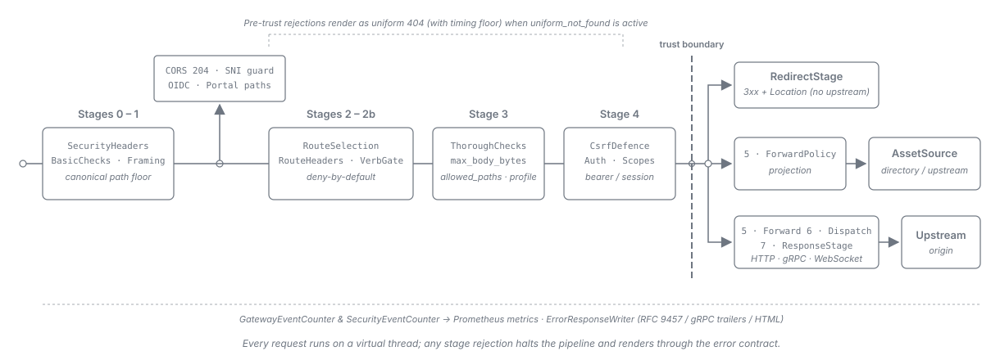
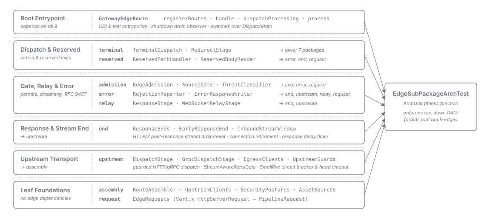
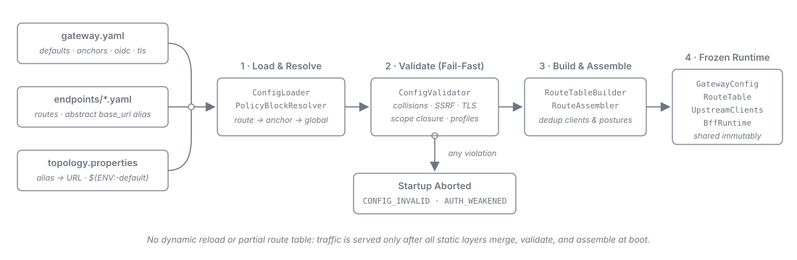

= API Sheriff -- Architecture
:toc: left
:toclevels: 3
:toc-title: Table of Contents
:sectnums:
:source-highlighter: highlight.js

== Overview

API Sheriff is a single Quarkus process that terminates (or passes through) inbound connections,
applies security filtering, optionally establishes and mediates an OIDC session, and forwards
permitted requests to a statically configured upstream. It holds no mandatory external dependency:
configuration is a set of immutable files read at startup, and the only optional state (a
server-side session store) exists solely in the
link:../variants/02-bff-session.adoc[session-based BFF variant].

The runtime is the same binary for all three link:../README.adoc#_deployment_variants[variants];
the active mode is a function of configuration.

== Component Model

An admitted request flows left to right through a fixed pipeline on a virtual thread. *Route matching
is the deny-by-default gate*: a request matching no route reaches no upstream, and the forward
policy filters headers and query parameters only *within* a route the request is already authorised
for. The event system and metrics record request outcomes and events across the pipeline.

*Inbound validation is split across route selection*
(link:../development/README.adoc#_inbound_validation_where_the_code_lives_and_why[Contributor Guide -- Inbound Validation]):

. *Pre-route floor (Stage 1, non-skippable).* Runs under the gateway-wide baseline policy: validates
  the raw path and every header name/value, enforces the parameter- and header-*count* caps, runs
  the anti-smuggling framing gate, and produces the *single canonical path* required by route
  selection.

. *Route selection (Stage 2).* Resolves one route and its effective per-route policy.
. *Post-route per-route stage (Stage 3).* Unconditionally enforces `max_body_bytes` and
  `allowed_paths`; its *validation half* (URL-parameter name/value validation and divergent
  path/header re-runs) is gated by the route's inbound-filter `profile`.

*What `profile: minimal` disables.* `minimal` is a *partial* disable
(link:../adr/0024-Inbound_filter_modes_minimal_is_a_partial_disable_retaining_the_body_cap_and_path_allowlist_and_is_refused_on_authenticated_and_BFF_routes.adoc[ADR-0024]):
it switches off only URL-parameter name/value validation and the per-route pipeline re-run. The
pre-route floor, `max_body_bytes`, `allowed_paths`, authentication, the verb gate, and the response
envelope remain active. `minimal` is *refused at boot* on any route that is effectively
authenticated or sits under a `type: bff` anchor.

[[_request_pipeline_stages]]
=== Request Pipeline Stages

A rejection at any stage halts the pipeline and renders an RFC 9457 `application/problem+json`
response (or trailers-only on a post-trust gRPC route), subject to the HTTP/2 open-body drain/reset
rule and the uniform-`404` response-timing floor. Rejections raised between stage 2 and the trust
boundary in stage 4 render to an untrusted caller as the unrouted `404`
(link:observability-and-errors.adoc#_trust_boundary_rejections[Rejections before the trust boundary]):

[cols="1,2,4", options="header"]
|===
| Stage | Responsibility | What it does

| 0
| Global security headers & CORS
| Seeds the *global* `security_headers` block and applies global CORS; marks an allow-listed CORS
  preflight for a `204` short-circuit immediately after stage 1
  (link:../configuration.adoc#_security_headers[Configuration -- `security_headers`]).

| 1
| Pre-route floor & framing gate
| Non-skippable pre-route floor (canonical path), canonical-path guard, and anti-smuggling framing
  gate (link:tls-and-inbound-security.adoc#_inbound_security_filter[Inbound Security Filter]).

| 1 → 2
| Pre-route exits
| CORS preflight `204`; Host-vs-SNI smuggle guard
  (link:tls-and-inbound-security.adoc#_tls_edge_accept_time_sni_split[TLS Edge]); exact-matched
  reserved OIDC endpoints (browser paths on the OIDC host only, back-channel logout and client JWKS
  on every host; see link:authentication-and-bff.adoc#_bff_session_runtime[BFF Runtime]); and
  `portal.path` on every host (<<_application_portal>>). All answer before stage 2a under the global
  security-header block.

| 2
| Route selection
| Deny-by-default selection over the exact-first, longest-prefix-first route table; no match is
  `404` (link:routing-and-forwarding.adoc#_routing_matching[Routing / Matching]).

| 2a
| Route security headers
| Wholesale replacement of gateway-owned security headers with the route's boot-resolved block
  (anchor, else global; see link:routing-and-forwarding.adoc#_response_security_headers[Response
  Security Headers]).

| 2b
| Verb gate
| Enforces effective `allowed_methods`; a disallowed verb raises `405` with `Allow` (uniform `404`
  without `Allow` while `security_defaults.uniform_not_found` is on).

| 3
| Post-route checks
| Per-route `max_body_bytes` cap, `allowed_paths`, and profile-gated parameter/header validation.

| 4
| Authentication & CSRF
| Resolves the authentication branch (`none`, `bearer`, `session`, or header-selected
  `session_fallback` per
  link:../adr/0055-A_session_fallback_route_carries_two_authentication_branches_selected_by_Authorization_header_presence.adoc[ADR-0055]);
  runs the session CSRF gate, the cookie-forwarding same-origin check
  (link:routing-and-forwarding.adoc#_cookie_origin_check[Same-origin check]), authentication
  (link:../variants/01-base-gateway.adoc[Variant 1], link:../variants/02-bff-session.adoc[Variant 2],
  or link:../variants/03-bff-cookie.adoc[Variant 3]), and scope enforcement
  (link:authentication-and-bff.adoc#_scope_enforcement[Scope Enforcement]).

| 5 -- 7
| Terminal action
| *Redirect*: answered immediately after stage 4 with no forward policy or upstream contact.
  *Asset*: forward policy (stage 5) then buffered, governed asset response.
  *Proxy*: forward policy and `Cookie` rebuild (stage 5; see
  link:routing-and-forwarding.adoc#_forward_policy[Forward Policy]), streamed dispatch (stage 6),
  and streamed relay (stage 7: `Location` rewrite, set/default header precedence, upstream-header
  predicate; see link:terminal-actions-and-protocols.adoc[Terminal Actions & Protocols]).
|===

[[_application_portal]]
==== Application portal (reserved path and HTML error pages)

The application portal (link:../user/portal.adoc[operator guide],
link:../adr/0053-Portal_templates_render_on_a_standalone_Qute_engine_and_escape-bypass_constructs_are_refused_at_boot.adoc[ADR-0053])
serves `portal.path` on every host from a boot-resolved catalog of enabled endpoints and negotiates
HTML error pages for browser navigations when `portal.error_pages: true`
(link:observability-and-errors.adoc#_html_error_pages[Negotiated HTML Error Pages]). Templates render
on a standalone, reflection-free Qute engine that auto-escapes every value, refuses escape-bypass
constructs at boot, and emits responses under a fixed `Content-Security-Policy` and `nosniff`
envelope.

[[_edge_package_structure]]
=== Edge Package Structure

The framework-bound edge layer (`de.cuioss.sheriff.gateway.edge`) is split into a thin root
(`GatewayEdgeRoute`) and nine acyclic sub-packages
(link:../adr/0068-The_edge_is_split_into_acyclic_sub-packages_beneath_a_thin_GatewayEdgeRoute.adoc[ADR-0068]).
An ArchUnit fitness function enforces the top-down dependency DAG and forbids any sub-package from
depending on the root
(link:../development/test-corpus-integrity.adoc#fitness-function-shape[Comment-Only Invariants Become Fitness Functions]).

[cols="1,4", options="header"]
|===
| Sub-package | Job

| `assembly`
| Boot-only route completion: attaches deduplicated upstream clients, resilience guards, security
  postures, and asset sources to each route.

| `upstream`
| Guarded upstream dispatch, stream-aware retry gating, failure mapping, egress clients, and circuit
  breakers.

| `end`
| Response-end rules, early-answer HTTP/2 stream drain/reset
  (link:tls-and-inbound-security.adoc#_http2_post_response_reset[HTTP/2 post-response reset]),
  connection retirement, and the Vert.x timer delay primitive.

| `relay`
| Streaming upstream HTTP, gRPC, and WebSocket responses back to the client.

| `admission`
| Transport bounds, shutdown drain, and the three permit pools (general admission cap, WebSocket
  relay sub-budget, and held-answer sub-budget for uniform `404` floor and `delay` answers), plus
  source-key resolution, per-source enumeration gating (`429` before admission;
  link:tls-and-inbound-security.adoc#_per_source_detection[Per-Source Detection]), and per-source
  threat classification
  (link:tls-and-inbound-security.adoc#_threat_classification[Per-Source Threat Classification]).

| `request`
| Converting the Vert.x request into the pipeline request model.

| `error`
| Rejection metering, logging, RFC 9457 / HTML / gRPC rendering, and the uniform-`404` trust-boundary
  branch (link:observability-and-errors.adoc#_trust_boundary_rejections[Rejections before the trust
  boundary]).

| `reserved`
| Reserved OIDC paths, application portal dispatch, and bounded reserved-body reads.

| `terminal`
| Terminal action dispatch: proxy, gRPC, WebSocket, asset, redirect, and short-circuit.
|===

=== Configuration Subsystem

Configuration is loaded once at startup from three static layers (see
link:../configuration.adoc[Configuration Model]; only *Static mode* is supported per
link:../features-analysis.adoc#_initial_scope[Feature Analysis -- Initial Scope]), validated fail-fast,
and frozen into immutable value objects (link:../adr/0004-topology-indirection.adoc[ADR-0004],
link:../adr/0007-anchor-scoped-policy.adoc[ADR-0007]):

== Architecture Topics

* *link:tls-and-inbound-security.adoc[TLS Edge & Inbound Security]* -- Accept-time SNI split,
  server-TLS policy binding, pre-route and post-route inbound security filters, framing gate, HTTP/2
  post-response resets, connection windows and transport bounds, request-body framing and timeouts,
  per-source enumeration detection, and per-source threat classification.

* *link:routing-and-forwarding.adoc[Routing, Forwarding & Header Policies]* -- Route matching,
  policy-block resolution, forward header/query modes, gateway-owned header sets, cookie policy and
  same-origin checks, and response security headers and `Location` rewriting.

* *link:authentication-and-bff.adoc[Authentication & BFF Runtime]* -- Variant authentication
  strategies, boot-time scope enforcement, BFF runtime and `SessionBinding` seam, session store and
  lifetimes, client authentication, PAR, DPoP, and `response_mode=query`.

* *link:terminal-actions-and-protocols.adoc[Terminal Actions, Downstream Client & Protocols]* --
  Data-plane vs control-plane clients, SmallRye Fault Tolerance guards, asset and redirect terminal
  actions, and HTTP/1.1, HTTP/2, WebSocket, gRPC and GraphQL protocol support.

* *link:observability-and-errors.adoc[Event System, Error Contract & Metrics]* -- Lock-free event
  counters, RFC 9457 error contract, uniform `404` before the trust boundary, HTML error pages, gRPC
  trailers-only rejections, Prometheus metrics and SmallRye Health readiness.

* *link:runtime-and-dependencies.adoc[Threading, Object Reuse & Dependencies]* -- Virtual-thread vs
  event-loop rules, boot-time assembly and immutable object reuse, library dependencies and
  implementation deviations.
