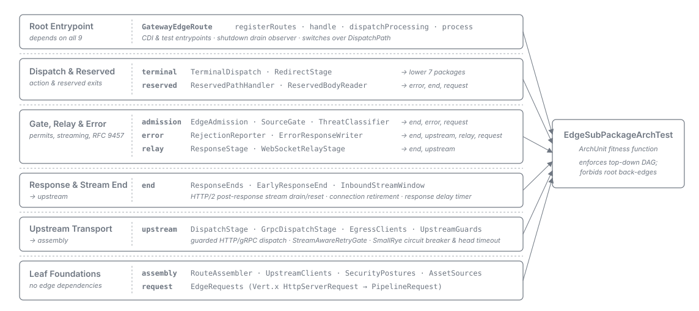
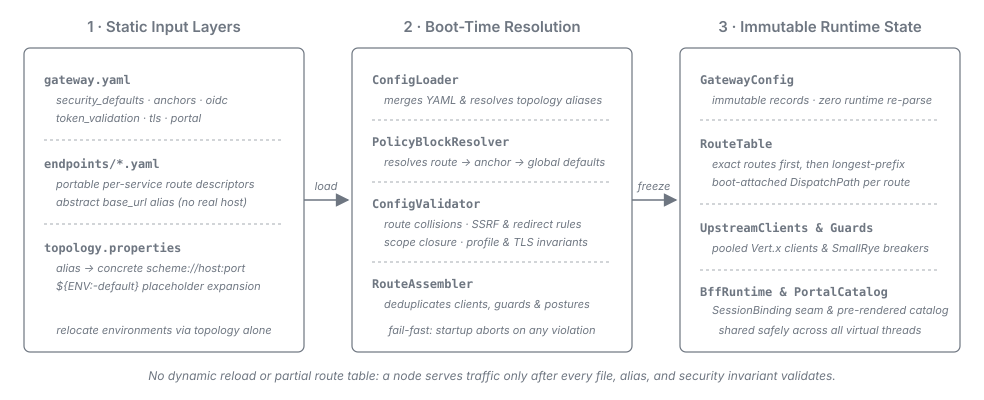

= API Sheriff -- Architecture
:toc: left
:toclevels: 3
:toc-title: Table of Contents
:sectnums:
:source-highlighter: highlight.js

== Overview

API Sheriff is a single Quarkus process that terminates (or passes through) inbound connections,
applies security filtering, optionally establishes and mediates an OIDC session, and forwards
permitted requests to a statically configured upstream. It holds no mandatory external dependency:
configuration is a set of immutable files read at startup, and the only optional state (a
server-side session store) exists solely in the
link:../variants/02-bff-session.adoc[session-based BFF variant].

The runtime is the same binary for all three link:../README.adoc#_deployment_variants[variants];
the active mode is a function of configuration.

== Component Model

An admitted request flows left to right through a fixed pipeline on a virtual thread. *Route matching
is the deny-by-default gate*: a request matching no route reaches no upstream, and the forward
policy filters headers and query parameters only *within* a route the request is already authorised
for. The event system and metrics record request outcomes and events across the pipeline.

image::../resources/diagrams/request-pipeline.svg[API Sheriff inbound request pipeline across stages 0 through 7 and terminal action branches, align=center]

*Inbound validation is split across route selection:*

. *Pre-route floor (Stage 1, non-skippable).* Runs under the gateway-wide baseline policy: validates
  the raw path and every header name/value, enforces the parameter- and header-*count* caps, runs
  the anti-smuggling `FramingGate`, and produces the *single canonical path* required by route
  selection.

. *Route selection (Stage 2).* Resolves one route and its effective per-route policy.
. *Post-route per-route stage (Stage 3).* Unconditionally enforces `max_body_bytes` and
  `allowed_paths`; its *validation half* (URL-parameter name/value validation and divergent
  path/header re-runs) is gated by the route's inbound-filter `profile`.

*What `profile: minimal` disables.* `minimal` is a *partial* disable
(link:../adr/0024-Inbound_filter_modes_minimal_is_a_partial_disable_retaining_the_body_cap_and_path_allowlist_and_is_refused_on_authenticated_and_BFF_routes.adoc[ADR-0024]):
it switches off only URL-parameter name/value validation and the per-route pipeline re-run. The
pre-route floor, `max_body_bytes`, `allowed_paths`, authentication, the verb gate, and the response
envelope remain active. `minimal` is *refused at boot* on any route that is effectively
authenticated or sits under a `type: bff` anchor.

[[_request_pipeline_stages]]
=== Request Pipeline Stages

A rejection at any stage halts the pipeline and renders an RFC 9457 `application/problem+json`
response (or trailers-only on a post-trust gRPC route), subject to the HTTP/2 open-body drain/reset
rule and the uniform-`404` response-timing floor. Rejections raised between stage 2 and the trust
boundary in stage 4 render to an untrusted caller as the unrouted `404`
(link:observability-and-errors.adoc#_trust_boundary_rejections[Rejections before the trust boundary]):

[cols="1,2,4", options="header"]
|===
| Stage | Component | What it does

| 0
| `SecurityHeadersStage.process`
| Seeds the *global* `security_headers` block and applies global CORS; marks an allow-listed CORS
  preflight for a `204` short-circuit immediately after stage 1
  (link:../configuration.adoc#_security_headers[Configuration -- `security_headers`]).

| 1
| `BasicChecksStage`, `CanonicalPathGuard`, `FramingGate`
| Non-skippable pre-route floor (canonical path), canonical-path guard, and anti-smuggling framing
  gate.

| 1 → 2
| Pre-route exits
| CORS preflight `204`; Host-vs-SNI smuggle guard
  (link:tls-and-inbound-security.adoc#_tls_edge_accept_time_sni_split[TLS Edge]); exact-matched
  reserved OIDC endpoints (`ReservedPathRegistry.ReservedEndpoint`, browser paths on the OIDC host
  only, `BACKCHANNEL_LOGOUT` and `CLIENT_JWKS` / `MATCHED_ON_EVERY_HOST` on every host; see
  link:authentication-and-bff.adoc#_bff_session_runtime[BFF runtime]); and `portal.path` on every
  host (<<_application_portal>>). All answer before stage 2a under the global security-header block.

| 2
| `RouteSelectionStage`
| Deny-by-default selection over the exact-first, longest-prefix-first route table; no match is
  `404`.

| 2a
| `SecurityHeadersStage.applyRouteHeaders`
| Wholesale replacement of gateway-owned security headers with the route's boot-resolved block
  (anchor, else global). See link:routing-and-forwarding.adoc#_response_security_headers[Response
  Security Headers].

| 2b
| `VerbGateStage`
| Enforces effective `allowed_methods`; a disallowed verb raises `405` with `Allow` (uniform `404`
  without `Allow` while `security_defaults.uniform_not_found` is on).

| 3
| `ThoroughChecksStage`
| Post-route per-route stage: `max_body_bytes` cap, `allowed_paths`, and profile-gated validation.

| 4
| `AuthBranch`, `CsrfDefence`, `AuthenticationStage`
| `AuthBranch.resolve` maps `none`, `bearer` and `session` to themselves, and a `session_fallback:
  true` route to `BEARER` when `Authorization` is present and `SESSION` otherwise
  (link:../adr/0055-A_session_fallback_route_carries_two_authentication_branches_selected_by_Authorization_header_presence.adoc[ADR-0055]).
  Runs the session CSRF gate, the cookie-forwarding same-origin check
  (link:routing-and-forwarding.adoc#_cookie_origin_check[Same-origin check]), authentication
  (link:../variants/01-base-gateway.adoc[Variant 1], link:../variants/02-bff-session.adoc[Variant 2],
  or link:../variants/03-bff-cookie.adoc[Variant 3]), and `neededScopes`
  (link:authentication-and-bff.adoc#_scope_enforcement[Scope Enforcement]).

| 5 -- 7
| Terminal action
| *Redirect*: `RedirectStage` immediately after stage 4 (no forward policy or upstream contact).
  *Asset*: `ForwardPolicyStage` then buffered, governed asset response.
  *Proxy*: `ForwardPolicyStage` (stage 5, including `Cookie` rebuild; see
  link:routing-and-forwarding.adoc#_cookie_policy[Cookie Policy]), streamed dispatch (stage 6), and
  streamed relay (stage 7: `Location` rewrite, set/default header precedence, upstream-header
  predicate).
|===

[[_application_portal]]
==== Application portal (reserved path and HTML error pages)

The portal (link:../user/portal.adoc[operator guide],
link:../adr/0053-Portal_templates_render_on_a_standalone_Qute_engine_and_escape-bypass_constructs_are_refused_at_boot.adoc[ADR-0053])
lives in `de.cuioss.sheriff.gateway.portal` (`PortalEndpoint`, `PortalRenderer`, `PortalPageModel`,
`PortalNotice`, `PortalCatalog`, `PortalResponseEnvelope`, `ErrorPageClassifier`) and is wired by
`quarkus.PortalProducer` and `quarkus.ConfigProducer`
(link:../adr/0062-Platform_mechanisms_are_preferred_over_hand-rolled_equivalents_and_the_framework-agnostic_core_rule_is_retired.adoc[ADR-0062]):

* `PortalEndpoint` reserves `portal.path` on every host outside `ReservedPathRegistry` (which gates
  browser paths to the OIDC host); without a `portal` block, an inert endpoint is supplied.

* `PortalRenderer` uses a standalone Qute engine that escapes every value, exposes no reflection or
  namespace resolver, and refuses escape-bypass constructs at boot.

* `PortalCatalog` is resolved at boot from enabled endpoints; `PortalResponseEnvelope` sets content
  type, `nosniff`, per-class cache headers, and its own fixed `Content-Security-Policy`.

* The page renders on the virtual thread (`BffRuntime.sessionIdentity` may read the session store)
  and writes on the event loop. Gateway-originated error writers negotiate HTML error pages via
  `ErrorPageClassifier` (link:observability-and-errors.adoc#_html_error_pages[Negotiated HTML error
  pages]).

[[_edge_package_structure]]
=== Edge Package Structure

The framework-bound edge layer (`de.cuioss.sheriff.gateway.edge`) is split into a thin root
(`GatewayEdgeRoute`) and nine acyclic sub-packages
(link:../adr/0068-The_edge_is_split_into_acyclic_sub-packages_beneath_a_thin_GatewayEdgeRoute.adoc[ADR-0068]).
`arch.EdgeSubPackageArchTest` enforces the top-down dependency DAG and forbids any sub-package from
depending on the root
(link:../adr/0030-Comment-only_invariants_become_positively-phrased_fitness_functions_shipped_with_a_four-leg_control_set.adoc[ADR-0030]).
Each class logs under its own class name (see link:../LogMessages.adoc[Log Messages]).

[cols="1,3,3", options="header"]
|===
| Sub-package | Job | Types

| `assembly`
| Boot-only route completion: attaches deduplicated upstream clients, resilience guards, security
  postures, and asset sources to each `routing.Route`.
| `RouteAssembler` (`AssembledRoutes`), `UpstreamClients`, `UpstreamTarget`, `ResilienceShape`,
  `DispatchPath`, `SecurityPosture`, `SecurityPostures`, `AssetSources`,
  `SecurityConfigurationFactory`, `UpstreamClientFactory`, `ResilienceGuardFactory`,
  `AssetSourceFactory`

| `upstream`
| Guarded upstream dispatch, retry gating, failure mapping, egress clients, and circuit breakers.
| `DispatchStage`, `GrpcDispatchStage`, `StreamAwareRetryGate`, `UpstreamFailureMapper`,
  `EgressClients`, `UpstreamGuards`

| `end`
| Response-end rules, early-answer HTTP/2 stream drain/reset
  (link:tls-and-inbound-security.adoc#_http2_post_response_reset[HTTP/2 post-response reset]),
  connection retirement, and the Vert.x timer delay primitive.
| `ResponseEnds`, `ResponseEnd`, `EarlyResponseEnd`, `InboundStreamWindow`, `ConnectionRetirement`,
  `ResponseDelay`

| `relay`
| Streaming upstream HTTP, gRPC, and WebSocket responses back to the client.
| `ResponseStage`, `UpstreamSetCookieFilter`, `GrpcStatusMapper`, `WebSocketRelayStage`

| `admission`
| Transport bounds, shutdown drain, and three permit pools: general (`edge_hardening.admission_cap`),
  WebSocket relay sub-budget, and held-answer sub-budget (1/4 of admission cap, min 1, for uniform
  `404` floor and `delay` answers; per-source `delay` share is 1/8 of the sub-budget, min 1). Also
  runs `SourceKeys`, `SourceGate` (`429` before admission;
  link:tls-and-inbound-security.adoc#_per_source_detection[Per-Source Detection]), and
  `ThreatClassifier`
  (link:tls-and-inbound-security.adoc#_threat_classification[Per-Source Threat Classification]).
| `EdgeHardeningOptions`, `EdgeAdmission`, `SourceKeys`, `SourceGate`, `ThreatClassifier`,
  `ThreatWeights`, `ThreatAlerts`, `ThreatAlertDocument`

| `request`
| Converting the Vert.x request into the pipeline request.
| `EdgeRequests`

| `error`
| Rejection metering, logging, RFC 9457 / HTML / gRPC rendering, and the uniform-`404` trust-boundary
  branch (link:observability-and-errors.adoc#_trust_boundary_rejections[Rejections before the trust
  boundary]).
| `RejectionReporter`, `ErrorResponseWriter`, `UniformNotFound`

| `reserved`
| Reserved OIDC paths, application portal dispatch, and bounded reserved-body reads.
| `ReservedPathHandler`, `ReservedBodyReader`

| `terminal`
| Terminal action dispatch: proxy, gRPC, WebSocket, asset, redirect, and short-circuit.
| `TerminalDispatch`, `RedirectStage`
|===

=== Configuration Subsystem

Configuration is loaded once at startup from three static layers (see
link:../configuration.adoc[Configuration Model]; only *Static mode* is supported per
link:../features-analysis.adoc#_initial_scope[Feature Analysis -- Initial Scope]), validated fail-fast,
and frozen into immutable value objects (link:../adr/0004-topology-indirection.adoc[ADR-0004],
link:../adr/0007-anchor-scoped-policy.adoc[ADR-0007]):

== Architecture Topics

* *link:tls-and-inbound-security.adoc[TLS Edge & Inbound Security]* -- Accept-time SNI split,
  server-TLS policy binding, pre-route and post-route inbound security filters, framing gate, HTTP/2
  post-response resets, connection windows and transport bounds, request-body framing and timeouts,
  per-source enumeration detection, and per-source threat classification.

* *link:routing-and-forwarding.adoc[Routing, Forwarding & Header Policies]* -- Route matching,
  policy-block resolution, forward header/query modes, gateway-owned header sets, cookie policy and
  same-origin checks, and response security headers and `Location` rewriting.

* *link:authentication-and-bff.adoc[Authentication & BFF Runtime]* -- Variant authentication
  strategies, boot-time scope enforcement, BFF runtime and `SessionBinding` seam, session store and
  lifetimes, client authentication, PAR, DPoP, and `response_mode=query`.

* *link:terminal-actions-and-protocols.adoc[Terminal Actions, Downstream Client & Protocols]* --
  Data-plane vs control-plane clients, SmallRye Fault Tolerance guards, asset and redirect terminal
  actions, and HTTP/1.1, HTTP/2, WebSocket, gRPC and GraphQL protocol support.

* *link:observability-and-errors.adoc[Event System, Error Contract & Metrics]* -- Lock-free event
  counters, RFC 9457 error contract, uniform `404` before the trust boundary, HTML error pages, gRPC
  trailers-only rejections, Prometheus metrics and SmallRye Health readiness.

* *link:runtime-and-dependencies.adoc[Threading, Object Reuse & Dependencies]* -- Virtual-thread vs
  event-loop rules, boot-time assembly and immutable object reuse, library dependencies and
  implementation deviations.
