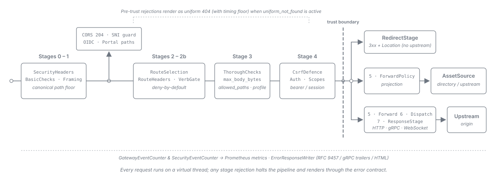

= API Sheriff -- Architecture
:toc: left
:toclevels: 3
:toc-title: Table of Contents
:sectnums:
:source-highlighter: highlight.js

== Overview

API Sheriff is a single Quarkus process that terminates (or passes through) inbound connections,
applies security filtering, optionally establishes and mediates an OIDC session, and forwards
permitted requests to a statically configured upstream. It holds no mandatory external dependency:
configuration is a set of immutable files read at startup, and the only optional state (a
server-side session store) exists solely in the
link:../variants/02-bff-session.adoc[session-based BFF variant].

The runtime is the same binary for all three link:../README.adoc#_deployment_variants[variants];
the active mode is a function of configuration.

== Component Model

An inbound request flows left to right through a fixed pipeline. The TLS edge terminates (or passes
through) the connection; a *security-headers/CORS stage* seeds the *global* response security
headers -- the block every response starts from, and the one a response answered before a route is
selected keeps, rejections included -- and answers CORS preflight `OPTIONS` requests after stage 1
and before route selection and authentication (preflights carry no credentials by spec; see
link:../configuration.adoc#_security_headers[Configuration -- `security_headers`]); then inbound
validation and the route matcher act, the selected route's resolved security headers replace the
global ones (see link:routing-and-forwarding.adoc#_response_security_headers[Response Security
Headers]), and the verb gate, the thorough checks, the authentication layer and the route's terminal
action -- the forward policy and upstream dispatch, an asset, or a redirect -- follow; a request
that fails any stage is rejected before it reaches the upstream. *Route matching is the
deny-by-default stage*: a request matching no route reaches no upstream at all, and the forward
policy that follows filters headers and query parameters *within* a route the request is already
authorised for. The event system and metrics observe every stage.

*Inbound validation is split across route selection.* The two halves differ in what they can see and
in what configuration can switch off:

. A *non-skippable pre-route floor* runs first, under the gateway-wide baseline policy. It validates
  the raw path and every header name and value, enforces the parameter- and header-*count* caps, and
  produces the *single canonical path* every later stage consumes. Route selection requires that
  canonical path, so this half cannot be skipped or moved behind routing.

. *Route selection* resolves one route and its effective per-route policy.
. A *post-route per-route stage* runs next for every route and every profile: it unconditionally
  enforces the route's `max_body_bytes` cap and its `allowed_paths` allowlist, while its *validation
  half* -- URL-parameter name and value validation, plus the divergent path/header pipeline re-run
  -- is gated by the route's inbound-filter `profile`.

*What `profile: minimal` disables.* `minimal` is a *partial* disable
(link:../adr/0024-Inbound_filter_modes_minimal_is_a_partial_disable_retaining_the_body_cap_and_path_allowlist_and_is_refused_on_authenticated_and_BFF_routes.adoc[ADR-0024]).
Its blast radius consists of two items: URL-parameter name and value validation, and the per-route
pipeline re-run. Everything else still runs -- the pre-route floor (encoded path separators,
over-cap parameter counts, oversized header values), the `max_body_bytes` cap, the `allowed_paths`
allowlist, authentication, the verb gate, the terminal-action rules and the response envelope. A
body cap is a resource guard and a path allowlist is a surface restriction; neither rides the
profile switch. A route whose effective profile resolves to `minimal` is *refused at boot* when it
is effectively authenticated or sits under a `type: bff` anchor.

[NOTE]
====
The diagram renders inbound validation as a single "security filter" box ahead of route matching.
Read the three-step list above and the stage table in <<_request_pipeline_stages>> as authoritative
for the pre-route/post-route split, the route-scoped header replacement, and the asset and redirect
terminal actions.
====

[[_request_pipeline_stages]]
=== Request Pipeline Stages

The fixed per-request order the edge (`GatewayEdgeRoute`) runs on a virtual thread. A rejection at
any stage halts the pipeline (nothing after it runs) and renders an RFC 9457
`application/problem+json` response (or trailers-only on a post-trust gRPC route), subject to the
HTTP/2 open-body drain/reset rule and the uniform-`404` response-timing floor. A rejection raised
between stage 2 and the trust boundary in stage 4 is rendered to an untrusted caller as the unrouted
`404` instead
(link:observability-and-errors.adoc#_trust_boundary_rejections[Rejections before the trust boundary]):

[cols="1,2,4", options="header"]
|===
| Stage | Component | What it does

| 0
| `SecurityHeadersStage.process`
| Seeds the *global* `security_headers` block onto the response and applies the global CORS policy;
  marks an allow-listed CORS preflight for a `204` short-circuit (written immediately after stage 1,
  before route selection and authentication).

| 1
| `BasicChecksStage`, `CanonicalPathGuard`, `FramingGate`
| The non-skippable pre-route floor (produces the canonical path), the canonical-path guard, and the
  anti-smuggling framing gate.

| 2
| `RouteSelectionStage`
| Deny-by-default route selection over the exact-first, then longest-prefix-first route table; no
  match is a `404`.

| 2a
| `SecurityHeadersStage.applyRouteHeaders`
| Replaces the gateway-owned security headers with the selected route's resolved block (anchor block,
  else global, resolved at boot by the policy-block resolver) -- wholesale, never merged. See
  link:routing-and-forwarding.adoc#_response_security_headers[Response Security Headers].

| 2b
| `VerbGateStage`
| Enforces the route's effective `allowed_methods`; a verb outside it is a `405` with `Allow`,
  rendered as the unrouted `404` while `security_defaults.uniform_not_found` is on
  (link:observability-and-errors.adoc#_trust_boundary_rejections[Rejections before the trust boundary]).

| 3
| `ThoroughChecksStage`
| The post-route per-route stage: body cap, `allowed_paths`, and the profile-gated validation half.

| 4
| `AuthBranch`, `CsrfDefence`, `AuthenticationStage`
| Bearer validation or session resolution for the route's effective auth. `AuthBranch.resolve` maps
  `none`, `bearer` and `session` postures to themselves, and a `require: bearer` route with
  `session_fallback: true` to `BEARER` when the request carries an `Authorization` header (any
  scheme or value) and `SESSION` otherwise. Both the edge CSRF gate and `AuthenticationStage` call
  that pure resolver, so the two cannot disagree
  (link:../adr/0055-A_session_fallback_route_carries_two_authentication_branches_selected_by_Authorization_header_presence.adoc[ADR-0055]).
  Between the session CSRF gate and authentication, a cookie-forwarding route runs its own
  same-origin check -- a second `CsrfDefence` instance built for the route by `RouteTableBuilder` --
  on an unsafe request carrying a forwardable cookie
  (link:routing-and-forwarding.adoc#_cookie_origin_check[Same-origin check]). Both branches enforce
  `neededScopes` (link:authentication-and-bff.adoc#_scope_enforcement[Scope Enforcement]).

| 5 -- 7
| terminal action
| *Redirect*: answered immediately after stage 4 by `RedirectStage` -- no forward policy, no
  upstream contact.
  *Proxy*: the forward policy (stage 5, including the `Cookie` rebuilt from the route's `cookies`
  policy), the streamed upstream dispatch (stage 6) and the streamed response relay (stage 7), which
  applies the optional `Location` rewrite, set/default header precedence and the upstream-header
  predicate (see link:routing-and-forwarding.adoc#_cookie_policy[Cookie Policy]).
  *Asset*: runs `ForwardPolicyStage` then serves the buffered, governed asset response.
|===

Three checks sit between stage 1 and route selection (stage 2). After the stage-1 short-circuit
check, the Host-vs-SNI smuggle guard rejects before route selection
(link:tls-and-inbound-security.adoc#_tls_edge_accept_time_sni_split[TLS Edge]). Then the gateway's
reserved paths are answered: first the reserved OIDC paths (`ReservedPathRegistry.ReservedEndpoint`),
matched exactly (link:authentication-and-bff.adoc#_bff_session_runtime[BFF runtime]), and then the
application portal's `portal.path`, matched exactly on *any* host (<<_application_portal>>).
Browser-facing reserved OIDC paths are matched on the OIDC host only; the back-channel logout path
and the client JWKS path (`MATCHED_ON_EVERY_HOST`) are matched on every host, because the identity
provider dials them server-to-server. A prefix route covering `portal.path` or either all-host OIDC
path never sees a request for it on any host; a prefix route covering one of the host-gated OIDC
paths never sees a request for it on the OIDC host, while the same path on another host reaches
route selection. All three answer before stage 2a, so they carry the global security-header block.
The portal additionally replaces `Content-Security-Policy` and `X-Content-Type-Options` with its own
fixed values.

The authentication stage is where the three variants differ: offline bearer validation
(link:../variants/01-base-gateway.adoc[Variant 1]), OIDC session mediation
(link:../variants/02-bff-session.adoc[Variant 2]), or OIDC encrypted-cookie mediation
(link:../variants/03-bff-cookie.adoc[Variant 3]). Everything else in the pipeline is shared.

[[_application_portal]]
==== Application portal (reserved path and HTML error pages)

The portal (link:../user/portal.adoc[operator guide],
link:../adr/0053-Portal_templates_render_on_a_standalone_Qute_engine_and_escape-bypass_constructs_are_refused_at_boot.adoc[ADR-0053])
lives in `de.cuioss.sheriff.gateway.portal` (seven classes: `PortalEndpoint`, `PortalRenderer`,
`PortalPageModel`, `PortalNotice`, `PortalCatalog`, `PortalResponseEnvelope`, and
`ErrorPageClassifier`) and is wired by `quarkus.PortalProducer` (`PortalRenderer` and
`PortalEndpoint`) and `quarkus.ConfigProducer` (`PortalCatalog`), following
link:../adr/0062-Platform_mechanisms_are_preferred_over_hand-rolled_equivalents_and_the_framework-agnostic_core_rule_is_retired.adoc[ADR-0062]:

* `PortalEndpoint` is the portal's own reservation seam outside `ReservedPathRegistry`, because that
  registry matches browser paths only on the OIDC host while the portal answers on every host.
  Without a `portal` block the producer supplies an inert endpoint that never matches.

* `PortalRenderer` renders through a standalone Qute engine that escapes every value, has no
  namespace or reflection resolver, and refuses escape-bypass or namespaced templates at boot.

* `PortalPageModel` is the fixed Map-only template data model. `PortalCatalog` is resolved once at
  boot from the enabled endpoints, and `PortalResponseEnvelope` owns the content type, `nosniff` and
  per-class cache headers.

* The page is rendered on the request's virtual thread (because `BffRuntime.sessionIdentity` may
  reach the session store) and written on the event loop.

The edge's three gateway-originated error writers (the problem renderer, a failed OIDC callback and
a `source: directory` asset miss) negotiate an HTML error page guided by `ErrorPageClassifier`; see
link:observability-and-errors.adoc#_html_error_pages[Negotiated HTML error pages].

[[_edge_package_structure]]
=== Edge Package Structure

The edge is the framework-bound layer that runs the pipeline above: `de.cuioss.sheriff.gateway.edge`
and nine sub-packages beneath it
(link:../adr/0068-The_edge_is_split_into_acyclic_sub-packages_beneath_a_thin_GatewayEdgeRoute.adoc[ADR-0068]).
The root holds only `GatewayEdgeRoute` -- the CDI and test constructors, `registerRoutes`, the
shutdown observer (which delegates drain to `EdgeAdmission`), `handle`, `dispatchProcessing` and
`process` (which executes <<_request_pipeline_stages>> and switches over `assembly.DispatchPath`).
Every delegated responsibility lives in a sub-package:

[cols="1,3,3", options="header"]
|===
| Sub-package | Job | Types

| `assembly`
| Boot-only route completion: completes every `routing.Route` with its boot-attached components, and
  holds the deduplicated upstream clients and resilience guards (`UpstreamClients`), the security
  postures and the asset sources.
| `RouteAssembler` (with nested `AssembledRoutes`), `UpstreamClients`, `UpstreamTarget`,
  `ResilienceShape`, `DispatchPath`, `SecurityPosture`, `SecurityPostures`, `AssetSources`,
  `SecurityConfigurationFactory`, `UpstreamClientFactory`, `ResilienceGuardFactory`,
  `AssetSourceFactory`

| `upstream`
| Guarded upstream dispatch and failure mapping, egress clients and upstream guards.
| `DispatchStage`, `GrpcDispatchStage`, `StreamAwareRetryGate`, `UpstreamFailureMapper`,
  `EgressClients`, `UpstreamGuards`

| `end`
| The response-end rule, the early-answer HTTP/2 reset path
  (link:tls-and-inbound-security.adoc#_http2_post_response_reset[HTTP/2 post-response reset]),
  connection retirement and the Vert.x timer delay primitive.
| `ResponseEnds`, `ResponseEnd`, `EarlyResponseEnd`, `InboundStreamWindow`, `ConnectionRetirement`,
  `ResponseDelay`

| `relay`
| Streaming an upstream answer back to the client.
| `ResponseStage`, `UpstreamSetCookieFilter`, `GrpcStatusMapper`, `WebSocketRelayStage`

| `admission`
| Transport and admission bounds, admission permits and shutdown drain. Admission keeps three permit
  pools: the general pool every request is admitted under (`edge_hardening.admission_cap`), the
  WebSocket relay sub-budget an upgrade takes in addition to its general permit for the relay's
  lifetime, and the held-answer sub-budget an answer waiting on a timer -- the uniform `404`'s floor,
  the `delay` action -- takes instead of its general permit, a quarter of the admission cap (at least
  one permit) with no key of its own. A held answer refused a permit is a `503`, written no earlier
  than the floor's release time (at once while `security_defaults.uniform_not_found` is off) under the
  general permit it was admitted with; one source tripped under `delay` holds at most its share of
  the sub-budget -- an eighth of it, and at least one permit -- and the gate answers it `429` before
  admission while its share is used up. The request stays counted in flight while its answer is held,
  so the drain waits for it. The per-source gate answers a blocked source `429` before admission
  (link:tls-and-inbound-security.adoc#_per_source_detection[Per-Source Detection]).
| `EdgeHardeningOptions`, `EdgeAdmission`, `SourceGate`

| `request`
| Converting the Vert.x request into the pipeline request.
| `EdgeRequests`

| `error`
| Rejection metering, logging and rendering, and the trust-boundary branch
  (link:observability-and-errors.adoc#_trust_boundary_rejections[Rejections before the trust boundary]).
| `RejectionReporter`, `ErrorResponseWriter`, `UniformNotFound`

| `reserved`
| Reserved OIDC paths, the portal and the reserved-body read.
| `ReservedPathHandler`, `ReservedBodyReader`

| `terminal`
| Serving a route's terminal action: proxy, gRPC, WebSocket, asset, redirect and short-circuit.
| `TerminalDispatch`, `RedirectStage`
|===

*The dependency rule.* The sub-packages form an acyclic bytecode dependency graph, and none depends
on the root:

[cols="1,3", options="header"]
|===
| Package | Depends on (within the edge)

| `assembly`, `request` | no edge package
| `upstream` | `assembly`
| `end` | `upstream`
| `admission` | `end`
| `relay` | `end`, `upstream`
| `error` | `end`, `upstream`, `relay`, `request`
| `reserved` | `error`, `end`, `request`
| `terminal` | `relay`, `upstream`, `error`, `end`, `admission`, `request`, `assembly`
| the root, `GatewayEdgeRoute` | all nine
|===

`arch.EdgeSubPackageArchTest` enforces acyclicity and forbids any sub-package from depending on the
root package, carrying the four control legs of
link:../adr/0030-Comment-only_invariants_become_positively-phrased_fitness_functions_shipped_with_a_four-leg_control_set.adoc[ADR-0030].
Each class logs under its own class name; the `ApiSheriff-NNN` identifiers are listed in
link:../LogMessages.adoc[Log Messages].

=== Configuration Subsystem

Configuration is loaded once at startup from static files (see link:../configuration.adoc[Configuration
Model]), validated in full, and frozen into immutable value objects. The gateway *refuses to start*
on invalid configuration -- it never serves traffic against a partially valid route table. Only
*Static mode* is supported initially (link:../features-analysis.adoc#_initial_scope[Feature Analysis
-- Initial Scope]).

Configuration is layered: a global `gateway.yaml` (including the namespace-scoped `anchors` policy,
link:../adr/0007-anchor-scoped-policy.adoc[ADR-0007]), one portable `endpoints/*.yaml` file per
service that references an abstract `base_url` alias, and a `topology.properties` that binds each
alias to a concrete location with `${VAR:-default}` placeholders
(link:../adr/0004-topology-indirection.adoc[ADR-0004] + Amendment A1). Endpoint files carry no real
host, so a deployment is relocated by changing only the topology. Immutability ensures a running
node's behaviour is fully determined by an auditable startup artifact; changes roll out by
restarting nodes.

== Architecture Topics

* *link:tls-and-inbound-security.adoc[TLS Edge & Inbound Security]* -- Accept-time SNI split,
  server-TLS policy binding, pre-route and post-route inbound security filters, framing gate, HTTP/2
  post-response resets, connection windows and transport bounds, request-body framing and timeouts,
  and per-source enumeration detection.

* *link:routing-and-forwarding.adoc[Routing, Forwarding & Header Policies]* -- Route matching,
  policy-block resolution, forward header/query modes, gateway-owned header sets, cookie policy and
  same-origin checks, and response security headers and `Location` rewriting.

* *link:authentication-and-bff.adoc[Authentication & BFF Runtime]* -- Variant authentication
  strategies, boot-time scope enforcement, BFF runtime and `SessionBinding` seam, session store and
  lifetimes, client authentication, PAR, DPoP, and `response_mode=query`.

* *link:terminal-actions-and-protocols.adoc[Terminal Actions, Downstream Client & Protocols]* --
  Data-plane vs control-plane clients, SmallRye Fault Tolerance guards, asset and redirect terminal
  actions, and HTTP/1.1, HTTP/2, WebSocket, gRPC and GraphQL protocol support.

* *link:observability-and-errors.adoc[Event System, Error Contract & Metrics]* -- Lock-free event
  counters, RFC 9457 error contract, uniform `404` before the trust boundary, HTML error pages, gRPC
  trailers-only rejections, Prometheus metrics and SmallRye Health readiness.

* *link:runtime-and-dependencies.adoc[Threading, Object Reuse & Dependencies]* -- Virtual-thread vs
  event-loop rules, boot-time assembly and immutable object reuse, library dependencies and
  implementation deviations.
