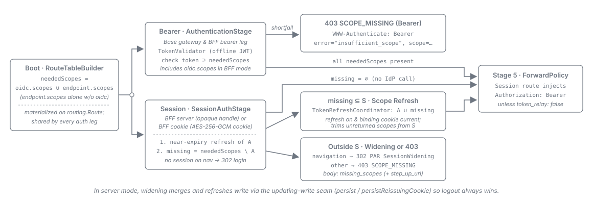
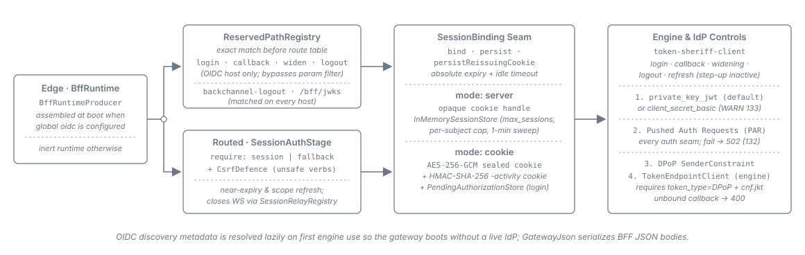
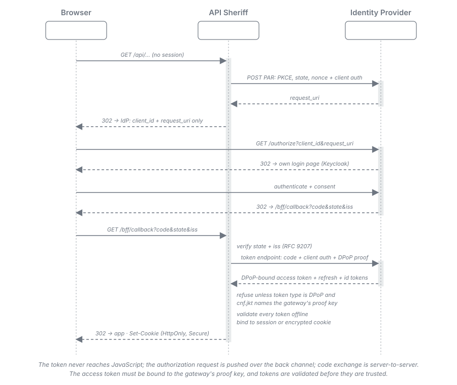
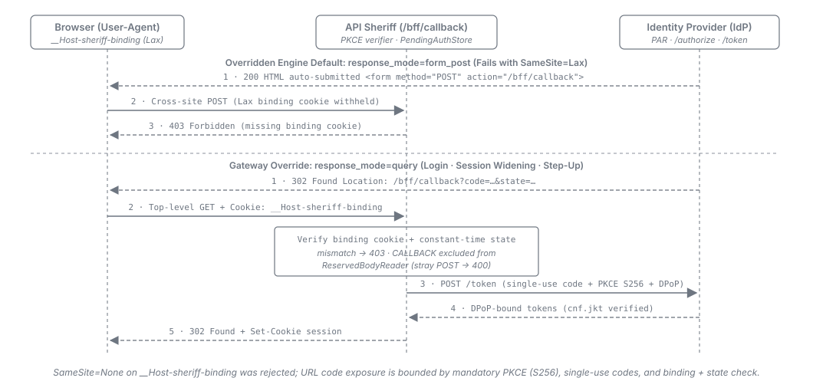

= Authentication & BFF Runtime
:toc: left
:toclevels: 3
:toc-title: Table of Contents
:sectnums:
:source-highlighter: highlight.js

link:README.adoc[← Back to Architecture Index]

[[_authentication_layer]]
== Authentication Layer

The active strategy depends on the deployment variant: the
link:../variants/01-base-gateway.adoc[base gateway] validates the client's own
`Authorization: Bearer` offline via `token-sheriff-validation`; the
link:../variants/02-bff-session.adoc[BFF session] and link:../variants/03-bff-cookie.adoc[BFF cookie]
variants make the gateway the OIDC confidential client, holding the tokens server-side or in an
AES-256-GCM-encrypted `HttpOnly` cookie (carrying access, refresh and ID tokens plus session
metadata and the active/granted scope sets). A session route injects the access token upstream
unless the route resolves `auth.token_relay: false`.

[[_scope_enforcement]]
=== Scope Enforcement

*Scope enforcement is one boot-time derivation, checked on bearer and session routes alike.* Each
route's `neededScopes = oidc.scopes ∪ endpoint.scopes` is materialized once at boot (`endpoint.scopes`
alone without an `oidc` block) so requesting and checking never drift apart
(link:../adr/0057-Session_routes_obtain_their_declared_scopes_by_refreshing_inside_the_grant_and_widening_the_live_session_outside_it.adoc[ADR-0057],
link:../adr/0048-Per-request_OIDC_scope_rides_a_per-scope-set_client_configuration_on_the_unchanged_engine.adoc[ADR-0048]):

* *Bearer check.* Compares the validated token against `neededScopes`; a shortfall is `403
  SCOPE_MISSING` with `WWW-Authenticate: Bearer error="insufficient_scope", scope="<missing>"` (RFC
  6750), drawing scope names from boot configuration rather than the token.

* *Session check.* Compares the session's active scope set `A` against `neededScopes` on every
  request after near-expiry refresh, regardless of `auth.token_relay`:
  ** When `missing ⊆ S` (the session's granted scope set) and transparent refresh is enabled, the
     gateway runs a scope-driven refresh requesting `A ∪ missing` and re-checks the returned session
     (dropping any scope the IdP did not return from `S`).
  ** Otherwise, a browser navigation redirects `302` into a live-session widening (`prompt=none`
     first, then at most one interactive attempt via PAR), while a non-navigation request is
     rejected `403 SCOPE_MISSING` with `missing_scopes` and optional `step_up_url`.

* *Session login and return-target resolution.* Navigating to an unauthenticated `require: session`
  route or `/bff/login?returnUrl=` resolves the target route's `neededScopes` (or `oidc.scopes`
  fallback) so the initial authorization request asks for the target's full scope set up front.

* *Termination wins over concurrent updates.* In server mode, refresh and widening writes replace an
  existing stored session and never recreate one destroyed by a concurrent logout
  (link:../adr/0018-BFF_session_mode_is_one_SessionBinding_seam_behind_a_fixed_reserved-path_and_CSRF_model.adoc#updating-write[ADR-0018]).

[IMPORTANT]
====
For everything BFF-related, the authoritative specification is `TokenSheriff/doc/client` (the
`CLIENT-1..22` contract). *It is the sole authority for that surface: these documents describe how
API Sheriff realizes it and never override it.*

The confidential-client *engine* (`token-sheriff-client`) owns retrieval and flow (auth-code + PKCE,
`state` / `nonce` / exact `redirect_uri`, mix-up `iss` defence, PAR, sender-constraint requests,
step-up, RP-initiated logout) and the server-side token lifecycle (validate -> hold -> refresh with
rotation -> revoke), keeping both token-binding shapes viable (`CLIENT-19`). The *BFF* -- API
Sheriff's job -- owns the browser-facing layer: session/cookie handling, symmetric-key management in
cookie mode, CSRF, proxying, logout receivers, client signing keys and the client JWKS endpoint, the
token-binding check of <<_bff_client_controls>>, and RFC 9457 rendering for gateway-raised errors.
====

[[_bff_session_runtime]]
== BFF Runtime (Edge Wiring)

The BFF realizes its side of the engine boundary through four architectural seams (recorded in
link:../adr/0018-BFF_session_mode_is_one_SessionBinding_seam_behind_a_fixed_reserved-path_and_CSRF_model.adoc[ADR-0018]
and
link:../adr/0019-Reserved_BFF_paths_bypass_the_url-parameter_value_pipeline_and_the_cookie-header_length_relaxation_is_gateway-wide.adoc[ADR-0019];
for package and class details see the link:../development/bff-session.adoc[server-mode contributor
guide] and link:../development/bff-cookie.adoc[cookie-mode contributor guide]):

* *Session-resolution seam (`SessionBinding`).* Every reserved endpoint, CSRF check, refresh/step-up
  coordinator, and stage-4 session check binds to one mode-neutral `SessionBinding` interface.
  `oidc.session.mode` selects the implementation at boot: *server* mode maps an opaque cookie handle
  to a bounded in-memory session store (<<_bff_session_store>>), while *cookie* mode unseals the
  AES-256-GCM session cookie per request with no server-side session store. Both modes use the
  bounded in-memory pending-authorization store during the login handshake
  (link:../variants/03-bff-cookie.adoc#_stateless_after_login_not_during_it[stateless after login,
  not during it]).

* *Reserved-path registry and edge dispatch.* Gateway-owned OIDC paths are matched by *exact* path
  before the proxy route table is consulted. Browser-facing endpoints require the request host to
  match the OIDC host; back-channel logout and the client JWKS endpoint (`/bff/jwks`) match on every
  host because the IdP dials them server-to-server. Matched reserved paths terminate at the gateway
  and validate their own parameter grammar (ADR-0019).

* *Engine boundary.* Login initiation, callback code exchange, session widening, RP-initiated and
  back-channel logout, and transparent refresh drive `token-sheriff-client` and add only
  browser-facing concerns. Token material never lives outside the active `SessionBinding`.

* *Lazy IdP discovery.* When a global `oidc` block with `redirect_uri` and `session.mode` is
  configured, the BFF runtime is assembled at boot and resolves IdP metadata lazily on first engine
  use so the gateway starts without requiring a live IdP.

[[_bff_session_store]]
=== Session Store, Writes and Lifetime

The `SessionBinding` contract separates session creation from updates
(link:../adr/0018-BFF_session_mode_is_one_SessionBinding_seam_behind_a_fixed_reserved-path_and_CSRF_model.adoc[ADR-0018]):

[cols="1,2,3", options="header"]
|===
| Seam operation | Caller | What it does

| `bind`
| Login callback
| Creates the session; refused at the store's capacity bound.

| `persist`
| Token refresh (near-expiry or scope-driven)
| Replaces the record of an existing session and never creates one; reports a missing session.
  Server mode keeps the browser's cookie handle; cookie mode re-seals.

| `persistReissuingCookie`
| Widening merge
| As `persist`, and re-issues the cookie value the browser holds.
|===

* *Cookie handle vs session identity (server mode).* The session cookie holds a random handle, never
  the internal session identity. Re-issuing on privilege widening swaps the handle atomically while
  preserving the session identity, `sid`/`sub` index entries, expiry deadlines, and refresh
  single-flight key.

* *Two deadlines and bounds.* Every session expires at the earlier of its absolute lifetime or
  `oidc.session.idle_timeout_seconds` since the last admitted request. In server mode, a periodic
  1-minute sweep and lazy eviction on lookup enforce expiry, `oidc.session.max_sessions` bounds
  total capacity, `oidc.session.max_sessions_per_subject` evicts a subject's oldest session on
  overflow, and any ended session closes WebSocket relays opened under it.

* *Activity cookie (cookie mode).* Idle timeout in cookie mode is tracked via a companion
  `<cookie_name>-activity` cookie authenticated with HMAC-SHA-256 under a dedicated key and bound to
  the derived session identity (unencrypted, consuming no AES-GCM nonce budget), re-issued at most
  once per 60 s (or half the idle timeout; see link:../development/bff-cookie.adoc#activity-cookie[the
  cookie-mode contributor guide]).

[[_bff_client_controls]]
=== Client Authentication, Pushed Requests and Sender Constraint

Three IdP-facing FAPI 2.0 controls are assembled once at boot
(link:../adr/0058-The_BFF_pushes_every_authorization_request_and_binds_its_tokens_with_DPoP_and_authenticates_with_private_key_jwt_unless_a_client_secret_is_configured.adoc[ADR-0058];
see link:../development/bff-session.adoc#_the_engine_seams_the_producer_wires[the server-mode
contributor guide] for implementation seams):

* *Client authentication (`private_key_jwt` by default).* Without `oidc.client_secret` (*key mode*),
  the gateway loads `oidc.client_authentication.key_file` (or generates an ephemeral key at startup),
  authenticates to the IdP with `private_key_jwt`, and publishes the public JWK at `/bff/jwks`. With
  `oidc.client_secret` (*client-secret mode*), it uses `client_secret_basic` and answers `404` on
  `/bff/jwks`; declaring both is refused at boot.

* *Pushed Authorization Requests (PAR).* Every authorization request (login, silent/interactive
  widening, step-up) is pushed back-channel to the IdP PAR endpoint, returning a `302` redirect URL
  carrying only `client_id` and `request_uri` (`502` on PAR failure before any state or cookie is
  stored).

* *DPoP sender constraint and token-binding verification.* A dedicated proof key
  (`oidc.sender_constraint.key_file` or generated at startup) signs DPoP proofs on every code
  exchange and refresh grant, and the gateway accepts a token response only when `token_type` is
  `DPoP` and the access token's `cnf.jkt` matches the proof key's thumbprint (`400` on callback or
  session termination on refresh otherwise).

[[_oidc_callback_response_mode]]
=== OIDC Callback Response Mode: `query`

Every authorization request specifies `response_mode=query` so the IdP returns `code` and `state`
via a top-level `302 GET` navigation rather than a cross-site `form_post`
(link:../adr/0018-BFF_session_mode_is_one_SessionBinding_seam_behind_a_fixed_reserved-path_and_CSRF_model.adoc[ADR-0018]):

The short-lived browser-binding cookie (`__Host-sheriff-binding`) is `SameSite=Lax`, which browsers
withhold on cross-site `POST` requests (`form_post`) but send on top-level `GET` navigations
(`query`). Keeping `SameSite=Lax` preserves cross-site request forgery protection on the binding
cookie, while mandatory PKCE (`S256`), single-use short-lived authorization codes, and the
constant-time `state` + binding-cookie check bound the exposure of `code` in the callback URL. Because
the callback is a `GET`, only the back-channel logout receiver remains in the pre-pipeline reserved
`POST` body-read allowlist (bounded by `reserved_body_max_bytes`; see
link:runtime-and-dependencies.adoc#_threading_model[Threading Model]).
