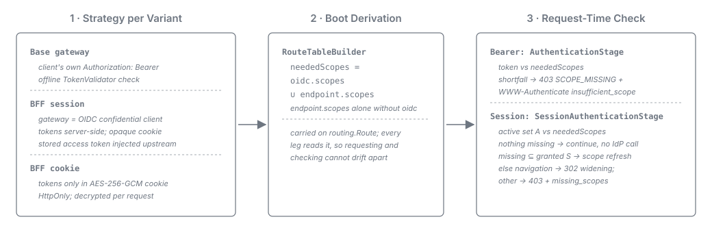
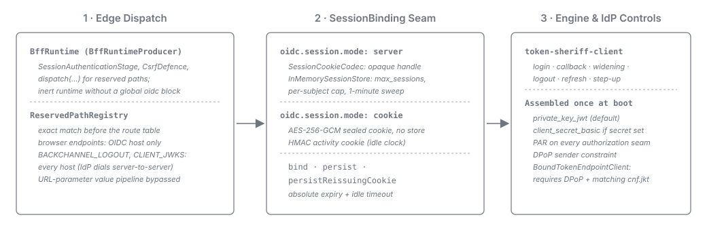
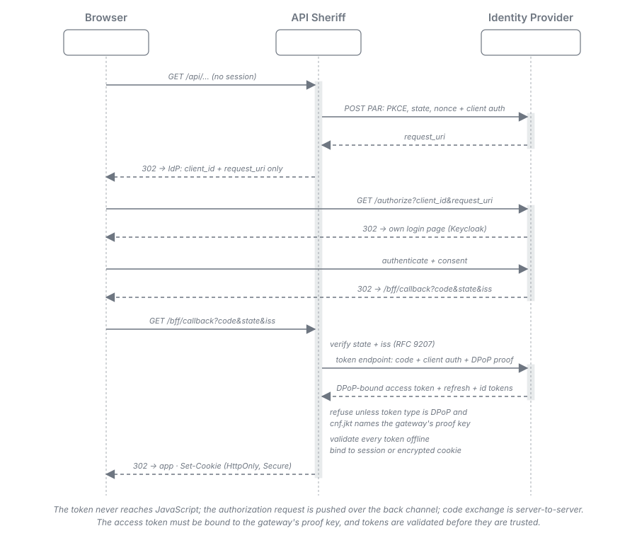
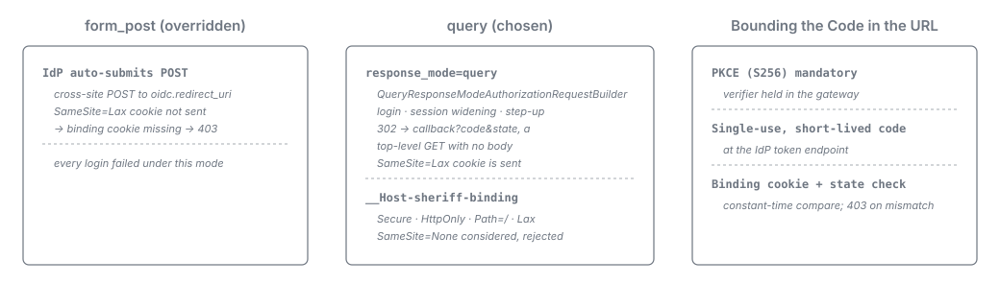

= Authentication & BFF Runtime
:toc: left
:toclevels: 3
:toc-title: Table of Contents
:sectnums:
:source-highlighter: highlight.js

link:README.adoc[← Back to Architecture Index]

[[_authentication_layer]]
== Authentication Layer

The active strategy depends on the deployment variant: the
link:../variants/01-base-gateway.adoc[base gateway] validates the client's own
`Authorization: Bearer` offline via `token-sheriff-validation`'s `TokenValidator`; the
link:../variants/02-bff-session.adoc[BFF session] and link:../variants/03-bff-cookie.adoc[BFF cookie]
variants make the gateway the OIDC confidential client, holding the tokens server-side or in an
AES-256-GCM-encrypted `HttpOnly` cookie (the cookie carries access, refresh and ID token plus minimal
metadata, including the session's active and granted scope sets). A session route injects the access
token upstream unless the route resolves `auth.token_relay: false`.

[[_scope_enforcement]]
=== Scope Enforcement

*Scope enforcement is one boot-time derivation, checked on bearer and session routes alike.*
`RouteTableBuilder` materializes each route's `neededScopes = oidc.scopes ∪ endpoint.scopes` once at
boot (`endpoint.scopes` alone without an `oidc` block) and carries it on `routing.Route`. Every leg
reads that field, so requesting and checking cannot drift apart:

* *Bearer check.* `AuthenticationStage` compares the validated token against `neededScopes`; a
  shortfall is `403 SCOPE_MISSING` with the RFC 6750 challenge
  `WWW-Authenticate: Bearer error="insufficient_scope", scope="<missing>"`, drawing scope names from
  boot configuration rather than the token. Because `oidc.scopes` is part of the set, a BFF-mode
  gateway rejects a bearer token that lacks it.

* *Session check.* `SessionAuthenticationStage` compares the session's active scope set `A` against
  `neededScopes` on every request, after near-expiry refresh and before any bearer is recorded,
  regardless of `auth.token_relay`. When nothing is missing, the request continues with no IdP call.
  When all missing scopes lie inside the session's granted scope set `S`, transparent refresh is
  enabled, and the request still carries the current binding cookie, `TokenRefreshCoordinator` runs a
  scope-driven refresh requesting `A ∪ missing` and re-checks the returned session. Otherwise a
  navigation is redirected `302` into a widening of the live session, and any other request is
  rejected `403 SCOPE_MISSING` whose problem body carries `missing_scopes` and, when
  `oidc.step_up.path` is configured, `step_up_url` (no `WWW-Authenticate` challenge). The `SESSION`
  branch of a `session_fallback` route runs this same stage.

* *Session login.* A navigation to a `require: session` route without a session starts a login whose
  authorization request carries that route's `neededScopes`.

* *Return-target resolution.* `ReturnTargetScopes` matches a same-origin target path as a `GET`
  against the route table (ignoring header matchers) and yields the matched authenticated route's
  `neededScopes`, or `oidc.scopes` otherwise. `/bff/login?returnUrl=` uses it to decide what a login
  requests, and the reserved step-up path to decide whether a widening is owed.

* *Widening.* `SessionWidening` requests `S ∪ neededScopes` from the identity provider (`prompt=none`
  first, then at most one interactive attempt) via pushed authorization requests
  (<<_bff_client_controls>>), and `CallbackEndpoint` merges the grant into the live session after
  re-checking `sub`. The merge sets both `A` and `S` to the granted scope and updates `sid` when the
  ID token carries one. An IdP refusal on the callback is a terminal `403` leaving the session
  unchanged; a failed PAR push is a `502` before any redirect.

* *Refresh.* Every near-expiry refresh requests the session's active scope set `A` (never the static
  `oidc.scopes`).

* *The granted set is kept truthful.* `S` equals `A` at login and after a widening (which replaces
  `S`). A scope-driven refresh removes from `S` any requested scope the provider's response did not
  return, so a revoked scope leaves `S` on first use and a later widening that still lacks it ends in
  a terminal `403`.

* *Termination wins over both writers in server mode.* Widening merges and refreshes write through the
  updating-write seam, which replaces an existing stored session and never creates one. If logout or
  back-channel logout destroyed the session while either was in flight, the widening callback answers
  `403` (`ApiSheriff-131`, reason `session-terminated`) and the refresh fails (`ApiSheriff-111`, reason
  `session-terminated`, revoking the rotated refresh token best-effort). In cookie mode there is no
  server store, so the update re-seals the cookie
  (link:../adr/0018-BFF_session_mode_is_one_SessionBinding_seam_behind_a_fixed_reserved-path_and_CSRF_model.adoc#updating-write[ADR-0018]).

See
link:../adr/0057-Session_routes_obtain_their_declared_scopes_by_refreshing_inside_the_grant_and_widening_the_live_session_outside_it.adoc[ADR-0057]
(which supersedes the session half of
link:../adr/0049-Route_scope_policy_bearer_routes_enforce_oidcscopes_union_endpointscopes_session_routes_only_request_them.adoc[ADR-0049])
and
link:../adr/0048-Per-request_OIDC_scope_rides_a_per-scope-set_client_configuration_on_the_unchanged_engine.adoc[ADR-0048].

[IMPORTANT]
====
For everything BFF-related, the authoritative specification is `TokenSheriff/doc/client` (the
`CLIENT-1..22` contract). *It is the sole authority for that surface: these documents describe how
API Sheriff realizes it and never override it.*

The confidential-client *engine* (`token-sheriff-client`) owns retrieval and flow (auth-code + PKCE,
`state` / `nonce` / exact `redirect_uri`, mix-up `iss` defence, PAR, sender-constraint requests,
step-up, RP-initiated logout) and the server-side token lifecycle (validate -> hold -> refresh with
rotation -> revoke), keeping both token-binding shapes viable (`CLIENT-19`). The *BFF* -- API
Sheriff's job -- owns the browser-facing layer: session/cookie handling, symmetric-key management in
cookie mode, CSRF, proxying, logout receivers, client signing keys and the client JWKS endpoint, the
token-binding check of <<_bff_client_controls>>, and RFC 9457 rendering for gateway-raised errors
(`token-sheriff-client-quarkus` maps engine-raised failures to the same RFC 9457 contract).
`token-sheriff-validation` validates every retrieved token (`CLIENT-15` / `CLIENT-16`) before it is
trusted or stored.
====

[[_bff_session_runtime]]
== BFF Runtime (Edge Wiring)

The BFF realizes its side of the seam as four pieces, one of them CDI-bound (recorded in
link:../adr/0018-BFF_session_mode_is_one_SessionBinding_seam_behind_a_fixed_reserved-path_and_CSRF_model.adoc[ADR-0018]
and
link:../adr/0019-Reserved_BFF_paths_bypass_the_url-parameter_value_pipeline_and_the_cookie-header_length_relaxation_is_gateway-wide.adoc[ADR-0019]):

* *Session-resolution seam.* Every collaborator binds to `SessionBinding`, never to a store;
  `oidc.session.mode` selects the implementation. In *server* mode, `SessionCookieCodec` reads an
  opaque handle from `Cookie` and `InMemorySessionStore` (bounded by `oidc.session.max_sessions`)
  resolves it to the server-held `SessionRecord` (<<_bff_session_store>>). In *cookie* mode, the
  sealed cookie carries that state and is unsealed per request with no session store; the in-memory
  `PendingAuthorizationStore` holding the login leg between redirect and callback is assembled in
  both modes
  (link:../variants/03-bff-cookie.adoc#_stateless_after_login_not_during_it[stateless after login,
  not during it]). A `require: session` route is mediated by `SessionAuthenticationStage`.

* *Reserved-path registry + live-edge dispatch.* `ReservedPathRegistry` matches the gateway-owned OIDC
  endpoints defined in `ReservedPathRegistry.ReservedEndpoint` (`pathsOf(...)`) by *exact* path match
  before the proxy route table is consulted. Browser-facing endpoints require the request host to
  match the OIDC host; `BACKCHANNEL_LOGOUT` and `CLIENT_JWKS` (`MATCHED_ON_EVERY_HOST`) match on every
  host because the identity provider dials them server-to-server
  (link:../adr/0018-BFF_session_mode_is_one_SessionBinding_seam_behind_a_fixed_reserved-path_and_CSRF_model.adoc#backchannel-host[ADR-0018],
  link:../adr/0058-The_BFF_pushes_every_authorization_request_and_binds_its_tokens_with_DPoP_and_authenticates_with_private_key_jwt_unless_a_client_secret_is_configured.adoc[ADR-0058]).
  An `oidc` block with a `redirect_uri` reserves `/bff/jwks` by default when undeclared: in key mode
  it serves the client-authentication public key to `GET`; in client-secret mode it answers `404` to
  every method and stays reserved so no upstream can claim it. Matched reserved paths terminate at the
  gateway, so the inbound URL-parameter *value* pipeline is bypassed for them and each handler
  validates its own parameter grammar (ADR-0019).

* *Engine boundary.* Login initiation, callback code exchange, session widening, RP-initiated and
  back-channel logout and transparent refresh drive `token-sheriff-client` and add only
  browser-facing concerns. RFC 9470 step-up is assembled but is not currently driven by the live edge.
  Token material never lives outside the active `SessionBinding`.

* *`BffRuntime` / `BffRuntimeProducer` CDI wiring.* `BffRuntime` is the single collaborator the edge
  consults, holding `SessionAuthenticationStage`, `CsrfDefence` and `dispatch(...)` for reserved
  paths. `BffRuntimeProducer` builds it at boot when a global `oidc` block with `redirect_uri` and
  `session.mode` (`server` or `cookie`) is configured, or supplies an inert runtime otherwise.
  Provider-metadata discovery is resolved lazily on first engine use so the gateway boots without a
  live IdP.

*Gateway-authored JSON bodies.* User-info responses, step-up `401` problems, the client JWKS document
and edge RFC 9457 problem bodies are serialized by `GatewayJson` over a private copy of the
Quarkus-managed Jackson `ObjectMapper`
(link:../adr/0062-Platform_mechanisms_are_preferred_over_hand-rolled_equivalents_and_the_framework-agnostic_core_rule_is_retired.adoc[ADR-0062]).

[[_bff_session_store]]
=== Session Store, Writes and Lifetime

The session contract is `SessionBinding`
(link:../adr/0018-BFF_session_mode_is_one_SessionBinding_seam_behind_a_fixed_reserved-path_and_CSRF_model.adoc[ADR-0018],
link:../adr/0062-Platform_mechanisms_are_preferred_over_hand-rolled_equivalents_and_the_framework-agnostic_core_rule_is_retired.adoc[ADR-0062]):

[cols="1,2,3", options="header"]
|===
| Seam operation | Caller | What it does

| `bind`
| Login callback
| Creates the session; refused at the store's capacity bound.

| `persist`
| Token refresh (near-expiry or scope-driven)
| Replaces the record of an existing session and never creates one; reports a missing session.
  Server mode keeps the browser's cookie handle; cookie mode re-seals.

| `persistReissuingCookie`
| Widening merge
| As `persist`, and re-issues the cookie value the browser holds.
|===

* *Cookie handle (server mode).* The session cookie holds a random handle, not the session identity.
  `InMemorySessionStore` resolves requests by handle; re-issuing mints a new handle and drops the old
  one atomically without changing the session identity, `sid`/`sub` index entries, authentication
  time, absolute expiry or refresh single-flight key. The session identity never leaves the gateway in
  either mode.

* *Two deadlines.* A session expires at its absolute expiry or when `oidc.session.idle_timeout_seconds`
  elapses since the last request admitted by `SessionAuthenticationStage`. `resolve` checks both
  without extending either; only `recordAccess` advances the idle deadline.

* *Periodic sweep and bounds (server mode).* `BffRuntimeProducer` schedules a 1-minute Vert.x timer
  that runs `SessionStore.sweepExpired` off the event loop (besides lazy removal in `resolve`).
  `oidc.session.max_sessions` bounds total sessions, and `oidc.session.max_sessions_per_subject` bounds
  live sessions per `sub` (evicting that subject's oldest session on overflow). Every ended session
  notifies `SessionRelayRegistry` to close any WebSocket relays opened under it.

* *Activity cookie (cookie mode).* Last access is tracked in `<session cookie name>-activity`,
  authenticated by `SessionActivityCookieCodec` with HMAC-SHA-256 under a dedicated key and bound to
  the derived session identity (unencrypted, so writes consume no AES-GCM key budget).
  `CookieSessionBinding.recordAccess` re-issues it once the recorded timestamp is at least 60 s old
  (or half the idle timeout if shorter) without rewriting the session cookie. A missing, invalid or
  mismatched activity cookie falls back to measuring idle time from login. See
  link:../development/bff-cookie.adoc[the cookie-mode guide] and
  link:../development/bff-session.adoc[the server-mode guide].

[[_bff_client_controls]]
=== Client Authentication, Pushed Requests and Sender Constraint

`BffRuntimeProducer` assembles three IdP-facing controls once at boot
(link:../adr/0058-The_BFF_pushes_every_authorization_request_and_binds_its_tokens_with_DPoP_and_authenticates_with_private_key_jwt_unless_a_client_secret_is_configured.adoc[ADR-0058]):

* *Client authentication (`private_key_jwt` by default).* `OidcConfig.usesClientSecret()` selects the
  mode. With no `oidc.client_secret` (*key mode*), `ClientSigningKey` loads
  `oidc.client_authentication.key_file` (or generates an ephemeral key at startup) and configures
  `PrivateKeyJwtAuth` with the issuer as audience. With `oidc.client_secret` (*client-secret mode*),
  the gateway uses `client_secret_basic`, resolves no client-authentication key and logs
  `WARN ApiSheriff-133` at boot; declaring both a secret and a key file is refused at boot. One
  instance serves PAR pushes, login and widening code exchanges, both refresh legs and RFC 7009
  revocation.

* *Client JWKS endpoint.* In key mode `ClientJwksEndpoint` publishes the public half of the
  client-authentication key; in client-secret mode its withheld form answers `404`.

* *Pushed Authorization Requests (PAR).* `PushedAuthorizationRequests` wraps the engine's `ParClient`
  on every authorization-request seam (login, silent and interactive session widening, RFC 9470
  step-up), pushing all parameters (including `prompt=none` and `response_mode=query`) and returning a
  redirect URL containing only `client_id` and `request_uri`, with no front-channel fallback.

* *DPoP sender constraint.* `ClientSigningKey` loads `oidc.sender_constraint.key_file` (or generates
  one) in both client-authentication modes and shares a single `SenderConstraint` across all code
  exchanges and refresh grants.

* *Token-binding enforcement.* `BoundTokenEndpointClient` accepts a token response only when
  `token_type` is `DPoP` and the access token's `cnf.jkt` matches the gateway proof key's thumbprint.
  An unbound response raises the engine's redeemed-response failure: on callback it answers `400`
  (`WARN ApiSheriff-134`) without creating or merging a session; on refresh it terminates the session
  and answers per `oidc.session.refresh.on_failure`.

*The login sequence.* The gateway lazily resolves IdP metadata and builds the authorization
parameters for the required scopes, then pushes them via PAR; if the IdP advertises no PAR endpoint or
the push fails, the gateway answers `502` (`WARN ApiSheriff-132`) before storing state or setting any
cookie. It then stores the pending authorization, sets the browser-binding cookie and redirects `302`
with `client_id` and `request_uri` only (<<_oidc_callback_response_mode>>).

[[_oidc_callback_response_mode]]
=== OIDC Callback Response Mode: `query`

The gateway overrides `token-sheriff-client`'s default `response_mode=form_post` with
`QueryResponseModeAuthorizationRequestBuilder` (`response_mode=query`) on every seam that builds an
authorization request (login, session widening, RFC 9470 step-up). Although the request parameters
travel to the IdP via PAR (<<_bff_client_controls>>), `response_mode=query` governs how the IdP
returns the response: it redirects `302` to `oidc.redirect_uri` with `code` and `state` in the query
string, making the callback a *top-level `GET` navigation* with no request body.

*Why `query` is load-bearing.* The short-lived browser-binding cookie (`__Host-sheriff-binding`) is
`SameSite=Lax`, and browsers do not send `SameSite=Lax` cookies on cross-site `POST` requests. Under
`form_post`, the IdP's auto-submitted cross-site `POST` dropped the binding cookie and every login
failed with `403`. With `response_mode=query` the callback is a top-level `GET` on which the cookie is
sent.

[IMPORTANT]
.`SameSite=None` was considered and rejected
====
Relaxing `__Host-sheriff-binding` to `SameSite=None` to keep `form_post` would permit cross-site sends
that weaken browser binding. The cookie retains its `__Host-` prefix, `Secure`, `HttpOnly`, `Path=/`
and `SameSite=Lax`.
====

[WARNING]
.Accepted tradeoff -- the authorization code travels in the URL
====
`response_mode=query` places `code` in the callback URL rather than a `POST` body. Three enforced
controls bound that exposure:

* *PKCE (`S256`)* is mandatory; a leaked code cannot be redeemed without the verifier held in the
  gateway.

* *Single-use, short-lived codes* at the IdP token endpoint.
* *Browser-binding cookie + constant-time `state` check* on the callback (`403` on mismatch).
====

*Consequence for the reserved-POST surface.* Because the callback consumes no body,
`ReservedEndpoint.CALLBACK` is excluded from `ReservedBodyReader`'s pre-pipeline body-read allowlist;
a stray `POST` to the callback path takes the paused-stream path and is rejected `400` for a missing
`state`. Only the back-channel logout receiver remains in the reserved-POST body-read allowlist,
bounded by `reserved_body_max_bytes` (see
link:runtime-and-dependencies.adoc#_threading_model[Threading Model]).
