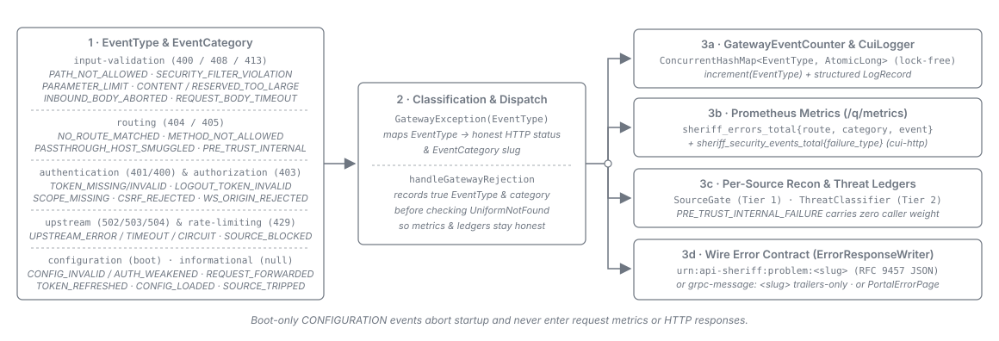
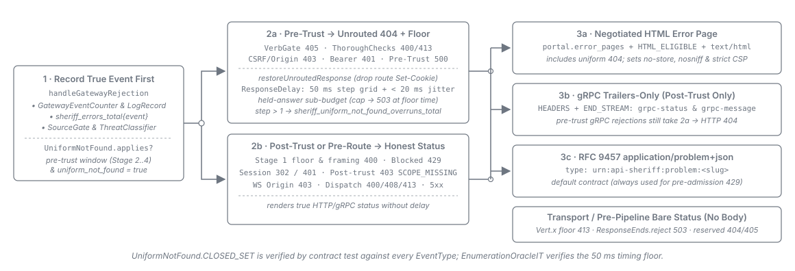
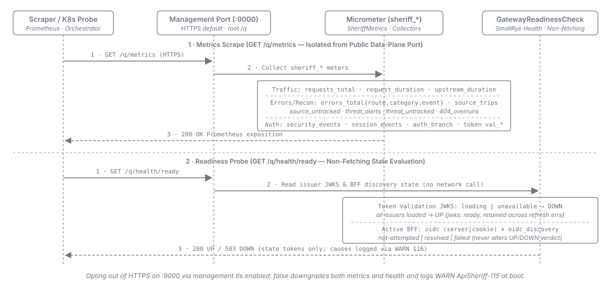

= Event System, Error Contract & Metrics
:toc: left
:toclevels: 3
:toc-title: Table of Contents
:sectnums:
:source-highlighter: highlight.js

link:README.adoc[← Back to Architecture Index]

[[_event_system]]
== Event System

API Sheriff tracks general and security-relevant events with a thread-safe, lock-free in-process
counter (`de.cuioss.sheriff.gateway.events`, modelled on `token-sheriff`'s `SecurityEventCounter`)
that feeds metrics and error mapping without an external broker:

* *Categories and slugs.* `EventCategory` groups failure events by impact and supplies the lowercase
  hyphenated slug (e.g. `input-validation` for `INPUT_VALIDATION`) used in the RFC 9457 problem type
  (`urn:api-sheriff:problem:<slug>`), the `category` label of `sheriff_errors_total`, and
  `grpc-message` on `protocol: grpc` routes. `CONFIGURATION` events occur at boot only and never
  surface as an HTTP response.

* *Informational and WebSocket-close events.* Success/informational events (`REQUEST_FORWARDED`,
  `TOKEN_REFRESHED`, `CONFIG_LOADED`, `SOURCE_TRIPPED`) carry no category and serve as metric
  counters only; `WEBSOCKET_IDLE_TIMEOUT` closes an idle relay with WebSocket code `1001`.

* *Typed gateway exceptions.* `GatewayException` carries its `EventType`, so the edge maps the event
  to its HTTP status and renders `application/problem+json` (RFC 9457) without leaking internal
  detail. The `cui-http` security filter contributes its own `SecurityEventCounter`, surfaced
  alongside in Prometheus metrics (<<_metrics>>).

[[_error_contract]]
== Error Contract

Every gateway-generated rejection is rendered as an `application/problem+json` (RFC 9457) response
naming the category without leaking internal detail, with three exceptions: rejections on a
`protocol: grpc` route after the trust boundary are trailers-only gRPC responses
(<<_grpc_error_contract>>), browser navigations receive a negotiated HTML error page when
`portal.error_pages: true` (<<_html_error_pages>>), and pre-pipeline / transport-level rejections
write a bare status with no body (the Vert.x body-floor `413`, edge admission / executor /
WebSocket relay-cap `503`s, and direct reserved-path `404`/`405` answers).

A rejection raised after route selection and before the trust boundary (except session-branch
authentication rejections, which keep their `302` / `401`) is rendered to the caller as the unrouted
`404` while `security_defaults.uniform_not_found` is on, the shipped default
(<<_trust_boundary_rejections>>):

[cols="1,2,2", options="header"]
|===
| Status | Cause | EventCategory

| `400`
| Security-filter violation (path/parameter/header pipeline, collection limits, framing gate, body
  on a bodyless method or beyond declared length -- see
  link:tls-and-inbound-security.adoc#_dispatch_body_framing[Dispatch body framing]); proxied request
  body failing after dispatch (`INBOUND_BODY_ABORTED`, see
  link:tls-and-inbound-security.adoc#_aborted_inbound_body[Aborted inbound body]); or a rejected
  back-channel logout token (`LOGOUT_TOKEN_INVALID`). Route-scoped `allowed_paths` and post-route
  security-filter `400`s render as the unrouted `404` before the trust boundary
  (<<_trust_boundary_rejections>>); pre-route floor, framing-gate and back-channel logout `400`s
  stay `400` (an unbound token response on the OIDC callback is a separate BFF callback `400`
  without an `EventType`).
| `INPUT_VALIDATION` (`AUTHENTICATION` for `LOGOUT_TOKEN_INVALID`)

| `401`
| Missing/invalid bearer token (`WWW-Authenticate: Bearer` per RFC 6750); invalid or expired session
  on a non-navigation request (unauthenticated `text/html` navigations on `session` routes redirect
  `302` to login; see link:../configuration/authentication-and-oidc.adoc#_auth[Configuration -- `auth`]). Bearer `401`s
  render as the unrouted `404` without `WWW-Authenticate` while `security_defaults.uniform_not_found`
  is on; the session branch keeps its `302` / `401` (<<_trust_boundary_rejections>>).
| `AUTHENTICATION`

| `403`
| Valid bearer token lacking a required scope (`WWW-Authenticate: Bearer error="insufficient_scope",
  scope="<missing>"`); live session lacking a scope on a non-navigation request when refresh cannot
  obtain it (problem body carries `missing_scopes` and optional `step_up_url`, while navigations
  redirect `302` to session widening -- see link:authentication-and-bff.adoc#_scope_enforcement[Scope
  Enforcement]); failed CSRF or cookie-forwarding same-origin check (see
  link:routing-and-forwarding.adoc#_cookie_origin_check[Same-origin check]); or a WebSocket upgrade
  whose `Origin` is absent or not in `allowed_origins` (`WEBSOCKET_ORIGIN_REJECTED`). CSRF `403`s
  render as the unrouted `404` while `security_defaults.uniform_not_found` is on; post-trust scope
  and WebSocket origin `403`s stay `403`.
| `AUTHORIZATION`

| `404`
| No route matched (deny-by-default routing); reserved-for-passthrough `Host` on a terminated
  connection; disabled endpoint; and, while `security_defaults.uniform_not_found` is on, every
  pre-trust rejection marked above, held to the response-timing floor (<<_trust_boundary_rejections>>).
| `ROUTING` (`urn:api-sheriff:problem:routing`;
  link:../adr/0059-Routing_rejections_report_under_their_own_ROUTING_problem_category.adoc[ADR-0059])

| `405`
| Request method outside the matched route's effective `allowed_methods` allowlist (carries `Allow`),
  or an unparseable HTTP method token. The route-level verb gate runs before authentication and
  renders as the unrouted `404` without `Allow` while `security_defaults.uniform_not_found` is on.
| `ROUTING`

| `408`
| Proxied request body making no progress for the 10 s request-body idle timeout or not ending within
  the 25 s request-body deadline before the response head (`REQUEST_BODY_TIMEOUT`; see
  link:tls-and-inbound-security.adoc#_request_body_idle_timeout[Request-body idle timeout] and
  link:tls-and-inbound-security.adoc#_request_body_deadline[Request-body deadline]).
| `INPUT_VALIDATION`

| `413`
| Request body exceeding the per-route `security_filter.max_body_bytes` cap (`CONTENT_TOO_LARGE`) or
  the `reserved_body_max_bytes` ceiling on a reserved BFF `POST` (`RESERVED_BODY_TOO_LARGE`).
  Pre-authentication declared-`Content-Length` `413`s on proxy routes render as the unrouted `404`
  while `security_defaults.uniform_not_found` is on; mid-transfer and reserved-path `413`s stay `413`.
| `INPUT_VALIDATION`

| `429`
| Request from a source blocked by `enumeration_detection` under `action: block`, or exceeding its
  held-answer sub-budget share under `action: delay` (`SOURCE_BLOCKED`, carrying `Retry-After`; see
  link:tls-and-inbound-security.adoc#_per_source_detection[Per-Source Detection]). The per-route
  `rate_limit` key is parsed and warned at boot but unenforced
  (link:../adr/0077-The_unenforced_rate_limit_key_is_kept_parsed_and_warned_at_boot.adoc[ADR-0077]).
| `RATE_LIMITING`

| `502`
| Upstream connection failure, invalid upstream response, or failed BFF PAR push (`UPSTREAM_ERROR`).
| `UPSTREAM`

| `503`
| Circuit breaker open (`UPSTREAM_CIRCUIT_OPEN`, carrying `Retry-After: 5`; see
  link:../adr/0064-The_upstream_guard_is_fixed_in_the_gateway_and_a_route_declares_no_circuit_breaker_settings.adoc[ADR-0064]).
  Edge admission cap, virtual-thread executor rejection, and WebSocket session-relay tracking-cap
  exhaustion write a bare `503` directly with no `EventType`.
| `UPSTREAM` (`--` for bare `503`)

| `504`
| Upstream dispatch timeout (the upstream guard's fixed 30 s head timeout, `UPSTREAM_TIMEOUT`).
| `UPSTREAM`
|===

[[_trust_boundary_rejections]]
=== Rejections Before the Trust Boundary (Uniform 404)

An honest status on a matched route tells an unauthenticated caller that the route exists. To close
that endpoint-existence oracle, the edge renders every rejection raised in the *pre-trust window*
(except session-branch authentication rejections, which keep their `302` / `401`) as the unrouted
`404` while `security_defaults.uniform_not_found` (default `true`) is enabled
(link:../adr/0073-Untrusted_callers_get_the_unrouted_404_for_every_rejection_raised_before_the_trust_boundary.adoc[ADR-0073];
contributor mechanics in
link:../development/README.adoc#_rejections_before_the_trust_boundary[Contributor Guide --
Rejections Before the Trust Boundary]):

* *The trust boundary.* A request passes the trust boundary when the bearer branch of stage 4
  validates a token, or when stage 4 completes on any branch (a live session or an anonymous route).
  The pre-trust window runs from route selection (stage 2) up to that point, covering the verb gate
  (2b), post-route checks (3), CSRF / cookie same-origin defence, and the bearer branch prior to
  token validation (session authentication failures are exempt and keep their `302` / `401`).

* *True-event metering and unrouted rendering.* The rejection is first recorded under its *true*
  event (event counter, log record, and `sheriff_errors_total{event}`), then pre-route response
  headers are restored, any route `Set-Cookie` is dropped, and the response is rendered as
  `NO_ROUTE_MATCHED` (`404` problem body or negotiated HTML error page). An unexpected internal
  failure inside the pre-trust window is likewise rendered as the floored `404` and metered under
  `PRE_TRUST_INTERNAL_FAILURE` (`ROUTING`, with zero per-source detection weight); post-trust
  unexpected failures remain `500`.

[cols="1,3", options="header"]
|===
| Rendered as the unrouted `404` | Kept honest

| `METHOD_NOT_ALLOWED`, `PATH_NOT_ALLOWED`, route-scoped `SECURITY_FILTER_VIOLATION`,
  `PARAMETER_LIMIT_EXCEEDED`, declared-`Content-Length` `CONTENT_TOO_LARGE`, `CSRF_REJECTED`,
  `TOKEN_MISSING` / `TOKEN_INVALID` on the bearer branch, and an unexpected internal failure
  (`PRE_TRUST_INTERNAL_FAILURE`)
| Session branch `302` / `401`; `SCOPE_MISSING`; every rejection after stage 4 completed (dispatch `400`
  / `408` / `413`, WebSocket origin `403`, upstream `5xx`); reserved paths; every stage-1 rejection
  (including framing gate); unparseable-method `405`
|===

* *Response-timing floor.* Every answer rendered as the unrouted `404` (including genuine
  `NO_ROUTE_MATCHED` and `PASSTHROUGH_HOST_SMUGGLED`) is held on a non-blocking Vert.x timer under
  the held-answer permit sub-budget to a 50 ms step grid from admission plus 0--20 ms random jitter
  (counting any answer that ran past the first step on
  `sheriff_uniform_not_found_overruns_total`). Setting `security_defaults.uniform_not_found: false`
  restores honest statuses and undelayed `404` responses (see
  link:../configuration/security-and-edge-hardening.adoc#_security_defaults[Configuration -- `security_defaults`]).

[[_html_error_pages]]
=== Negotiated HTML Error Pages

With `portal.error_pages: true` (see link:README.adoc#_application_portal[Application portal]), a
gateway-originated error renders the portal HTML error page instead of `application/problem+json`
when error pages are enabled on an active portal, the exit is classified as HTML-eligible, and the
request's `Accept` header explicitly lists `text/html` with quality > 0 (`+*/*+` and `+text/*+`
never qualify, so `fetch()`, XHR and REST clients keep the problem body):

* *`HTML_ELIGIBLE`.* Browser-facing authorization (`403` scope/CSRF), routing (`404` including
  pre-trust rejections rewritten to the unrouted `404`, and routed `405`), payload-size (`413` route
  body cap), and upstream (`502`/`503`/`504`) rejections, plus failed OIDC callbacks and `source:
  directory` asset misses (`404`).

* *`KEEP_SHAPE`.* Machine-facing input-validation (`400`), bearer/session token (`401`), reserved
  body-cap, WebSocket, and unparseable-method (`405`) rejections, origin-relayed responses, post-head
  relay failures, gRPC trailers-only rejections, bare admission `503`s, and internal failures.

Error pages preserve the HTTP status, render anonymously with a fixed per-status title (no problem
detail, exception message, or upstream address), and set `Cache-Control: no-store`,
`X-Content-Type-Options: nosniff`, and `Content-Security-Policy: default-src 'self'; base-uri
'none'; form-action 'self'; frame-ancestors 'none'`.

[[_grpc_error_contract]]
=== gRPC Rejections (Trailers-Only)

Because gRPC clients surface statuses from response trailers rather than `application/problem+json`
bodies, a gateway-generated rejection on a `protocol: grpc` route after the trust boundary is emitted
as a *trailers-only* HTTP/2 response (`grpc-status` and `grpc-message` carrying the category slug in
the `HEADERS` frame with `END_STREAM`, no `DATA` frame;
link:../adr/0016-grpc-trailers-only-rejection-mapping.adoc[ADR-0016]). Pre-trust rejections still
render as the unrouted HTTP `404` while `security_defaults.uniform_not_found` is on
(<<_trust_boundary_rejections>>), and pre-route `429` (`SOURCE_BLOCKED`) is always a problem
document:

[cols="1,1,3", options="header"]
|===
| gRPC status | Code | Gateway rejection (equivalent HTTP status)

| `INVALID_ARGUMENT`   | 3  | `400` -- security-filter violation; `INBOUND_BODY_ABORTED`
| `UNAUTHENTICATED`    | 16 | `401` -- missing/invalid bearer token; invalid/expired session
| `PERMISSION_DENIED`  | 7  | `403` -- missing scope (`SCOPE_MISSING`); failed CSRF or cookie same-origin check (`CSRF_REJECTED`)
| `NOT_FOUND`          | 5  | `404` -- `NO_ROUTE_MATCHED`, `PASSTHROUGH_HOST_SMUGGLED`, disabled endpoint
| `UNIMPLEMENTED`      | 12 | `405` -- `METHOD_NOT_ALLOWED`
| `RESOURCE_EXHAUSTED` | 8  | `413` -- `CONTENT_TOO_LARGE` (`max_body_bytes` cap)
| `UNAVAILABLE`        | 14 | `502` / `503` -- `UPSTREAM_ERROR`, `UPSTREAM_CIRCUIT_OPEN`, or upstream `h2` negotiation failure
| `DEADLINE_EXCEEDED`  | 4  | `504` -- `UPSTREAM_TIMEOUT` (the upstream guard's fixed 30 s head timeout)
|===

[[_metrics]]
== Metrics and Health

Metrics are exposed as Prometheus data via Quarkus Micrometer on the *management port*
(`quarkus.management.enabled=true`, default port `9000`), keeping the operational surface off the
public data-plane port.

The management port is served over *HTTPS* by default (`management.tls.enabled: false` in
`gateway.yaml` opts out behind a trusted boundary; see
link:../configuration/tls-and-egress.adoc#_management[Configuration -- `management`]).

[cols="1,2", options="header"]
|===
| Metric | Meaning

| `sheriff_requests_total{route,method,status_family}`
| Counter of requests per route (`"<no-route>"` when unmatched), bounded method (`GET`..`OPTIONS`,
  or `OTHER` for unparseable tokens), and bounded status family (`1xx`..`5xx`, or `other`).

| `sheriff_request_duration_seconds{route}`
| Request latency timer and histogram per route.

| `sheriff_errors_total{route,category,event}`
| Counter of rejected/failed requests sourced from the event system (`category` is the
  `EventCategory` slug excluding boot-only `configuration`; `event` is the *true* `EventType` name,
  even when rendered to the caller as the uniform `404`; `"<no-route>"` for pre-route rejections such
  as `SOURCE_BLOCKED`; see
  link:../adr/0059-Routing_rejections_report_under_their_own_ROUTING_problem_category.adoc[ADR-0059]).

| `sheriff_source_trips_total{action}`
| Counter of per-source enumeration-detection trips (one per source and `CLEAR` period) labelled by
  configured `action` (`observe`, `delay`, `block`; see
  link:tls-and-inbound-security.adoc#_per_source_detection[Per-Source Detection]).

| `sheriff_source_untracked_total` (no labels)
| Counter of recon events whose source could not be tracked because the 65,536-source ledger was full.

| `sheriff_threat_alerts_total` (no labels)
| Counter of per-source threat-classification ALERTs (at most one per source and episode; see
  link:tls-and-inbound-security.adoc#_threat_classification[Per-Source Threat Classification] and
  <<_threat_alert_document>>).

| `sheriff_threat_untracked_total` (no labels)
| Counter of rejections threat classification could not score because the 65,536-source ledger was full.

| `sheriff_uniform_not_found_overruns_total` (no labels)
| Counter of uniform `404` answers whose processing ran past the first step of the response-timing
  floor (<<_trust_boundary_rejections>>).

| `sheriff_security_events_total{failure_type}`
| `cui-http` `SecurityEventCounter` counts per `UrlSecurityFailureType`.

| `sheriff_upstream_duration_seconds{route}`
| Downstream call duration per route, separating gateway overhead from upstream latency.

| `sheriff_session_events_total{event}`
| BFF session lifecycle events (create, destroy, refresh, CSRF, logout) keyed by `EventType`.

| `sheriff_auth_branch_total{route,branch}`
| Authentication branch (`bearer` or `session`) selected on a
  link:../configuration/authentication-and-oidc.adoc#_auth_session_fallback[`session_fallback`] route.

| `sheriff_token_validation_errors_total{event_type,result,category}`
| Bearer token-validation failure counter published by the token-validation extension's metrics
  collector observing `@GatewayValidator` (`result="failure"`, `category` in `INVALID_STRUCTURE`,
  `INVALID_SIGNATURE`, `SEMANTIC_ISSUES`; see
  link:../adr/0074-The_token-validation_extensions_metrics_collector_observes_the_gateway_validator_and_its_health_probes_stay_excluded.adoc[ADR-0074]).

| `sheriff_token_validation_success_operations_total{event_type,result}`
| Success counter from the same collector (`result="success"`, meter
  `sheriff.token.validation.success` with base unit `operations`).
|===

*Health.* SmallRye Health serves `/health`, `/health/live` and `/health/ready` beneath
`quarkus.management.root-path` (default `/q`; see link:../user/context-path.adoc[The Context Path]) on
the management port. Readiness reflects the validated configuration and -- where a `token_validation`
block is configured -- whether *every configured issuer has a loaded key set*
(link:../adr/0027-The_token-validation_extensions_unqualified_beans_are_excluded_not_accommodated.adoc#_live_key_set_readiness[ADR-0027]):
`DOWN` with `jwks: loading` or `jwks: unavailable` until every issuer has loaded keys, then `UP`
with `jwks: ready` (retaining `UP` across subsequent refresh failures; see
link:../configuration/authentication-and-oidc.adoc#_jwks_readiness[Key-set loading and readiness]).

A deployment with an active BFF runtime -- `mode: server` or `mode: cookie` -- adds two data, whether
or not it configures `token_validation` and whether the probe is `UP` or `DOWN`. `oidc` names the mode.
`oidc_discovery` reports what the BFF's lazy resolution of the identity provider's metadata
(`.well-known/openid-configuration`) last did: `not-attempted` until the first engine use asks for it,
`resolved` when the most recent attempt produced it, and `failed` when the most recent attempt threw.
The probe reads the datum from a *non-fetching* view, and `oidc_discovery` never changes the
`UP`/`DOWN` verdict
(link:../adr/0079-The_oidc_discovery_readiness_datum_reports_provider-metadata_resolution_and_never_changes_the_verdict.adoc[ADR-0079]).
Health payloads report *state tokens only, never cause* (never exposing issuer URLs, internal
hostnames, TLS paths, or exception messages).

[[_threat_alert_document]]
== The Threat ALERT Document

A source that crosses the `threat_classification` threshold logs one structured JSON ALERT per
episode (`WARN ApiSheriff-143`, counted on `sheriff_threat_alerts_total`; see
link:tls-and-inbound-security.adoc#_threat_classification[Per-Source Threat Classification] and
link:../adr/0078-Per-source_threat_classification_raises_one_ECS_alert_per_episode_from_its_own_ledger.adoc[ADR-0078]):

* *ECS 8.17.0 schema.* Field names follow Elastic Common Schema `8.17.0` (`@timestamp`, `event.*`,
  `source.address`, `source.ip` for IPv4 only, `url.domain` for declared hosts, `threat.*` mapped to
  MITRE ATT&CK `TA0043` / `T1595`) plus the gateway's `api_sheriff.threat.*` breakdown (`score`,
  `threshold`, `window_seconds`, `host`, `contributions`, `categories`). The full field table and
  OCSF (`class_uid` 2004 Detection Finding) mapping are in
  link:../development/source-detection-substrate.adoc#_threat_alert_schema[Per-Source Detection
  Substrate -- ECS 8.17.0 ALERT Document and OCSF Mapping] and the operator view in
  link:../user/edge-security.adoc#_threat_classification_operator_note[Endpoint Routes].

* *Zero request bytes, fallback marker, and bounded volume.* Every value in the document is
  gateway-derived (canonical source/host keys, enum names, ledger numbers, and fixed constants --
  never a raw path, `Host`, or header), eliminating log-injection vectors. Should JSON rendering
  ever fail, the warning log still fires with the fallback marker `<document unavailable>` and
  `sheriff_threat_alerts_total` is still incremented. The 65,536-source ledger caps volume to at
  most one ALERT per tracked source per episode.
