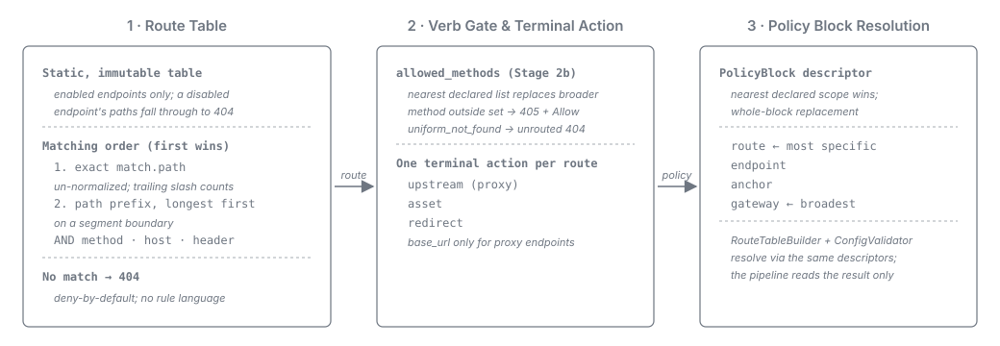
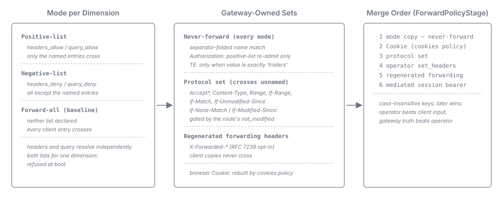
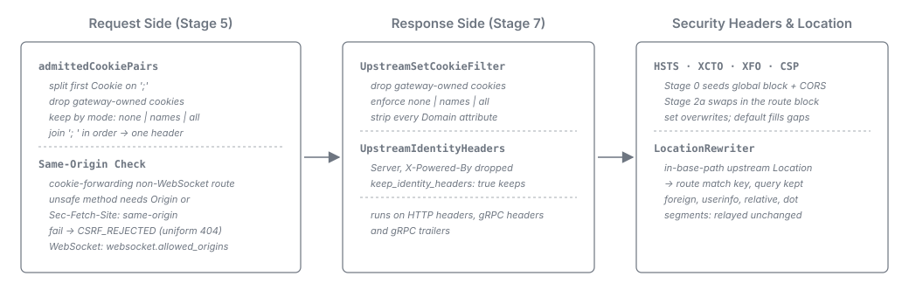

= Routing, Forwarding & Header Policies
:toc: left
:toclevels: 3
:toc-title: Table of Contents
:sectnums:
:source-highlighter: highlight.js

link:README.adoc[← Back to Architecture Index]

[[_routing_matching]]
== Routing / Matching

A static, immutable route table maps inbound requests to one route, and each route to one *terminal
action*: a proxied `upstream`, a served `asset` (see
link:terminal-actions-and-protocols.adoc#_asset_terminal_action[Asset Terminal Action]) or a
gateway-answered `redirect` (see
link:terminal-actions-and-protocols.adoc#_redirect_terminal_action[Redirect Terminal Action];
link:../adr/0014-asset-serving-terminal-action.adoc[ADR-0014] + Amendment A1).

Matchers are bounded and composable with AND semantics (exact path or path prefix, HTTP method,
host, header presence/value); routing carries no dynamic rule language. A route matches either one
exact address (`match.path`, compared un-normalized against the canonical path, so the trailing slash
is significant) or a path prefix on a segment boundary. The table is ordered *exact-first*: every
exact route precedes every prefix route, prefix routes longest first, and the first matching
candidate wins. A request matching no route is rejected with `404` (deny-by-default). See
link:../user/endpoint-routes.adoc#_route_ordering[Endpoint Routes -- Route ordering].

The endpoint `base_url` alias is resolved only for an endpoint carrying at least one proxy route.
`RouteTableBuilder` and `ConfigValidator` decide that through one shared predicate, so assembly and
validation cannot disagree about which endpoints owe a `base_url`.

Only routes of *enabled* endpoints enter the table: an endpoint switched off by its resolved
`enabled` value (file literal or `${ENDPOINT_<ID>_ENABLED:-...}` placeholder, ADR-0004 A1)
contributes nothing and its paths fall through to `404` (see
link:../configuration.adoc#_endpoint_identity[Configuration -- `endpoint`]).

Orthogonally, a coarse *positive verb allowlist* -- `allowed_methods`, declarable globally, per
anchor and per endpoint, the nearest declared list replacing every broader one wholesale -- gates
which HTTP methods an endpoint serves, beyond the per-route `match.methods` matcher. A routed request
whose method is outside the matched route's effective set is rejected `405` with an `Allow` header
(see link:../configuration.adoc#_allowed_methods[Configuration -- `allowed_methods`]). The verb gate
runs before authentication, so while `security_defaults.uniform_not_found` is on the `405` is
rendered as the unrouted `404` without `Allow`
(link:observability-and-errors.adoc#_trust_boundary_rejections[Rejections before the trust boundary]).

Every policy block is resolved for a route by one resolver: each block is one `PolicyBlock`
descriptor naming the scopes it is declarable at, and the nearest declared scope of
`gateway -> anchor -> endpoint -> route` wins and replaces every broader declaration wholesale. The
blocks and their scopes are listed in
link:../user/anchors.adoc#_policy_block_scopes[Where each policy block is declarable], which a
contract test binds to the descriptors. `RouteTableBuilder` and `ConfigValidator` both resolve through
the descriptors, so the request pipeline only reads the materialized result (see
link:../user/anchors.adoc#_policy_block_resolution[Policy-block resolution] and
link:../adr/0067-Every_policy_block_is_one_declaration_resolved_nearest_declared_scope_wins_with_whole-block_replacement.adoc[ADR-0067]).

[[_forward_policy]]
== Forward Policy (Filtering Inside an Authorised Route)

*Deny-by-default lives at the URL layer, not here.* By the time the forward policy runs, the request
is matched to a route and authorised for it (<<_routing_matching>>). The forward policy filters which
of the client's headers and query parameters survive the trip upstream -- never *whether* the client
reaches the backend
(link:../adr/0036-Forward_filtering_is_a_three-mode_policy_inside_an_authorised_route.adoc[ADR-0036]).
The browser `Cookie` is the one header the `forward` block does not decide; the route's `cookies`
policy does (<<_cookie_policy>>).

*Three modes per dimension.* Headers and query parameters resolve independently: *positive-list*
(`headers_allow` / `query_allow` declared), *negative-list* (`headers_deny` / `query_deny`) or
*forward-all* (neither). Declaring *both* lists for one dimension is *refused at boot*. The baseline --
no `forward` block -- is forward-all, so an ordinary backend behind an authorised route needs no
enumeration of `Accept`, `Content-Type` or `Range`.

*Three gateway-owned sets bound every mode*
(link:../adr/0037-The_gateway-owned_header_sets_are_enumerated_per_direction_and_bounded_by_knowledge.adoc[ADR-0037]):

* *The request-direction never-forward set* applies under *every* mode. Its members and the
  response-direction rule are in
  link:../configuration.adoc#_never_forward_set[Configuration -- Never-forward set];
  `ConnectionHeaders.REQUEST_STRIP` and `ConnectionHeaders.RESPONSE_STRIP` hold them. Membership is
  tested on the *separator-folded* name (lower-cased, `_` mapped to `-`), closing the `-`/`_`
  equivalence class against CGI-folding backends. A fourth, response-direction set is
  `UpstreamIdentityHeaders` (<<_cookie_policy>>).
+
*Two members carry value- or mode-dependent behaviour.* `Authorization` is the single re-admittable
member, honoured only where a route declares a *positive*-list naming it; a permissive route never
leaks an inbound credential, and even a re-admitted `Authorization` is overwritten by a mediated
session bearer merged last. `TE` crosses only when its value is exactly `trailers` (gRPC over HTTP/2,
RFC 9110). An operator's static `set_headers` entry is gateway configuration merged after the strip.
+
*The browser `Cookie` is not a member.* No forward mode copies it; stage 5 rebuilds it from the
route's `cookies` policy (<<_cookie_policy>>).

* *The gateway-understood protocol set* crosses *without* an operator entry: `Accept`,
  `Accept-Encoding`, `Accept-Language`, `Content-Type`, `Range` and the preconditions `If-Range`,
  `If-Match` and `If-Unmodified-Since` (RFC 9110 §13) unconditionally, plus the two validators a
  `304` answers (`If-None-Match`, `If-Modified-Since`) gated by the route's
  link:../configuration.adoc#_upstream_defaults[`not_modified`] toggle -- with it off, those two are
  also removed from the mode copy of a `GET` or `HEAD` in every `-`/`_` spelling. On every other method
  `If-None-Match` is a write precondition answered `412` and crosses unconditionally. `User-Agent` is
  outside the set. A `headers_deny` entry naming a member wins (separator-folded); a positive-list is
  not consulted. The set is disjoint from the never-forward set.

* *The regenerated forwarding headers* are the gateway's own account of the connection; the client's
  copies never cross. `cui-http`'s `de.cuioss.http.forwarded` resolver turns `Forwarded` (RFC 7239),
  `X-Forwarded-*` and NiFi `X-Proxy*` into one sanitized, immutable result -- client IP behind the
  trusted-proxy allowlist plus TCP-peer gate, scheme/host/port/prefix only when `trust_scheme_host`
  opts in -- and the gateway emits freshly regenerated output: `X-Forwarded-*` by default, RFC 7239
  opt-in and additive
  (link:../adr/0003-forwarded-headers.adoc[ADR-0003]). Inbound chains are never propagated; emitted
  names are skipped on separator-folded comparison, un-emitted vendor aliases are withheld by the
  never-forward set. See link:../configuration.adoc#_forwarded_headers[Configuration -- forwarding
  headers].

*The merge order encodes a strict precedence rule.* `ForwardPolicyStage` merges into a
*case-insensitively keyed* outbound header map, in order: the mode copy with the never-forward strip;
the `Cookie` rebuilt from the `cookies` policy; the gateway-understood protocol set; the operator's
static `set_headers`; the regenerated forwarding headers; the mediated session bearer. *Operator
configuration beats client input*, and *gateway-owned transport truth beats operator configuration*.
Case-insensitive keying (RFC 9110) guarantees that `Content-Type` replaces a client's `content-type`
rather than riding alongside it.

[[_cookie_policy]]
=== Cookie Policy: Request Rebuild, Response Predicate and Same-Origin Check

The browser `Cookie` and upstream `Set-Cookie` are governed per route by the `cookies` policy block
(link:../configuration.adoc#_cookies[Configuration -- `cookies`],
link:../adr/0037-The_gateway-owned_header_sets_are_enumerated_per_direction_and_bounded_by_knowledge.adoc[ADR-0037]).
`RouteTableBuilder` resolves it once per route into `Route.effectiveCookies`; an asset or redirect
route always resolves `allow: none`.

*One definition of the gateway's own cookies.* `http.GatewayCookies` is framework-free and covers
every cookie under the reserved `+__Host-sheriff-+` prefix (always, with or without a BFF) plus the
configured `oidc.session.cookie_name` and its `-activity` sibling in both session modes. A name is the
text before the first `=` of a pair, with `+__Host-+` and `+__Secure-+` prefixes compared
case-insensitively and the remainder exactly; a nameless crumb whose value is a gateway cookie's name
counts as that cookie. `CookieRules` refuses a `cookies.allow` list naming one, `ForwardPolicyStage`
drops them from the request, and the response predicate drops any `Set-Cookie` naming one.

*The request rebuild (stage 5).* `ForwardPolicyStage.admittedCookiePairs` reads the first `Cookie`
value, splits it on `;`, drops every pair `GatewayCookies` matches and keeps what the mode admits --
nothing under `none`, exact listed names under a list, the rest under `all`. Kept pairs are joined with
`"; "` in inbound order into a single `Cookie` header (omitted when empty) across HTTP proxy, gRPC and
WebSocket upgrade dispatches.

*The response predicate (stage 7).* `ResponseStage.relayedUpstreamHeader` runs at all three relay
sites: HTTP response headers, gRPC leading headers and gRPC trailers. For `Set-Cookie` it delegates to
`UpstreamSetCookieFilter`, which drops any line naming a gateway cookie, enforces `none` / list / `all`
and strips every `Domain` attribute (case-insensitively) from kept lines. WebSocket upgrades relay no
upstream response headers, and `source: upstream` assets strip every `Set-Cookie` in their envelope.

*Identity-header normalization (stage 7 and the asset envelope).* The same predicate and
`AssetResponseEnvelope` drop `UpstreamIdentityHeaders` (`Server` and `X-Powered-By`) by default. A
route setting `keep_identity_headers: true` retains them (`Route.keepIdentityHeaders`, passed to
`UpstreamAssetSource`; see link:../configuration.adoc#_keep_identity_headers[Configuration --
`keep_identity_headers`]). The boot validator refuses it on redirects, `source: directory` assets and
WebSocket routes.

[[_cookie_origin_check]]
*The same-origin check of a cookie-forwarding route.* `RouteTableBuilder` builds one `CsrfDefence` per
non-WebSocket route whose effective `cookies` block forwards any cookie and keeps `same_origin_check`
on, attaching it as `Route.cookieOriginDefence`; a route with the check off gets none and logs
`WARN ApiSheriff-139` at boot. The instance trusts the request's own origin (`scheme://host[:port]`,
default ports normalized) plus `additional_origins`, requiring a matching `Origin` or
`Sec-Fetch-Site: same-origin` on unsafe methods whenever `admittedCookiePairs` is non-empty. A failure
raises `CSRF_REJECTED` (the unrouted `404` while `security_defaults.uniform_not_found` is on, else
`403` / gRPC `PERMISSION_DENIED`; see
link:observability-and-errors.adoc#_trust_boundary_rejections[Rejections before the trust boundary]).
WebSocket routes carry no `cookieOriginDefence`: `CookieRules` requires a cookie-forwarding WebSocket
route to declare a non-empty `websocket.allowed_origins`, enforced by `OriginValidationStage`.

[[_response_security_headers]]
== Response Security Headers and Location Rewrite

The gateway owns four response security headers -- `Strict-Transport-Security`,
`X-Content-Type-Options`, `X-Frame-Options` and `Content-Security-Policy` -- and applies them at two
fixed positions (link:../adr/0007-anchor-scoped-policy.adoc#amendment-a1[ADR-0007 Amendment A1]):

* *Stage 0* seeds the *global* block and owns CORS (`Access-Control-Allow-*` headers and the `204`
  preflight short-circuit, which stays global because preflights are answered before route selection
  and authentication).

* *Stage 2a*, right after route selection, removes the four header names and seeds the selected
  route's resolved block (anchor block, else global -- wholesale replacement, never merged), leaving
  CORS and other headers (`Allow`, `WWW-Authenticate`) untouched.

*Precedence against origin headers.* Each header resolves a mode from `header_modes`: `set` (default)
overwrites any upstream value, `default` applies only when the upstream response lacks that name.
Gateway-authored responses (rejections, assets, redirects, gRPC trailers-only rejections) and
WebSocket relays apply both maps.

*`Location` rewrite in the relay.* A proxy route with `upstream.rewrite_location: true` carries a
boot-built `LocationRewriter`. Before copying upstream response headers, the HTTP relay rewrites an
upstream `Location` whose path-absolute value (or absolute URI with no user-info matching the route
upstream's own scheme, host and effective port) lies inside the effective upstream base path (alias
base path + `upstream.path`) on a segment boundary onto the route's match key as a gateway-relative
path with query and fragment preserved (on an exact `match.path` route, only when the rewritten path
equals the exact match key itself). Relayed unchanged: foreign origins, absolute URIs carrying
user-info, scheme-relative `//host`, relative-path or empty-path references (`?query`, `#fragment`,
empty), unparseable values, paths outside the base path (or not equal to an exact route's match key),
and paths containing dot segments or ambiguous separators (`\`, `%2f`, `%5c` in either case) (see
link:../security-threat-model.adoc#gw-13[GW-13]). The gRPC relay never rewrites `Location`.
