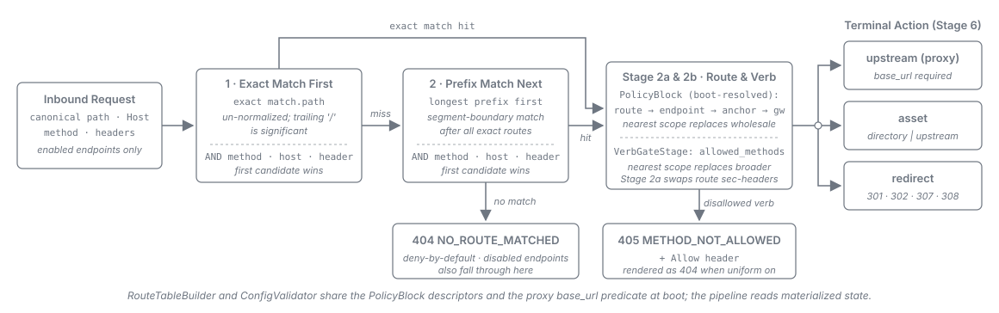
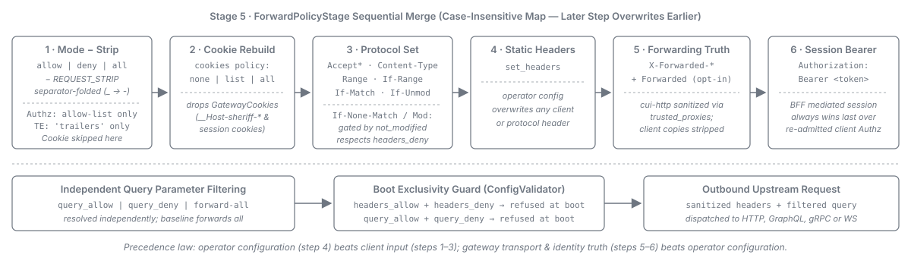
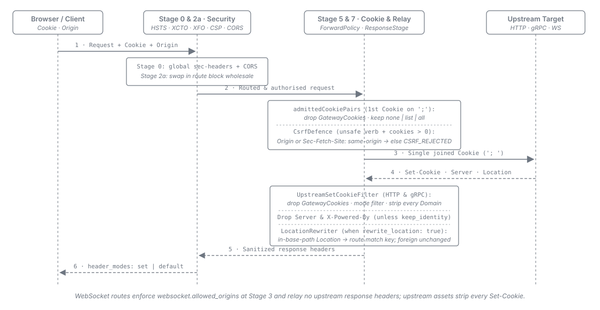

= Routing, Forwarding & Header Policies
:toc: left
:toclevels: 3
:toc-title: Table of Contents
:sectnums:
:source-highlighter: highlight.js

link:README.adoc[← Back to Architecture Index]

[[_routing_matching]]
== Routing / Matching

A static, immutable route table maps inbound requests to one route, and each route to one *terminal
action*: a proxied `upstream`, a served `asset` (see
link:terminal-actions-and-protocols.adoc#_asset_terminal_action[Asset Terminal Action]) or a
gateway-answered `redirect` (see
link:terminal-actions-and-protocols.adoc#_redirect_terminal_action[Redirect Terminal Action];
link:../adr/0014-asset-serving-terminal-action.adoc#_redirect_and_exact_routes[ADR-0014]).

Matchers are bounded and composable with AND semantics (exact path or path prefix, HTTP method,
host, header presence/value); routing carries no dynamic rule language. A route matches either one
exact address (`match.path`, compared un-normalized against the canonical path, so the trailing slash
is significant) or a path prefix on a segment boundary. The table is ordered *exact-first*: every
exact route precedes every prefix route, prefix routes longest first, and the first matching
candidate wins. A request matching no route is rejected with `404` (deny-by-default). See
link:../user/endpoint-routes.adoc#_route_ordering[Endpoint Routes -- Route ordering].

Only routes of *enabled* endpoints enter the table: an endpoint switched off by its resolved
`enabled` value (file literal or `${ENDPOINT_<ID>_ENABLED:-...}` placeholder,
link:../adr/0004-topology-indirection.adoc#_topology_override_placeholder[ADR-0004])
contributes nothing and its paths fall through to `404` (see
link:../configuration.adoc#_endpoint_identity[Configuration -- `endpoint`]). The endpoint `base_url`
alias is resolved only when the endpoint carries at least one proxy route.

Orthogonally, a coarse *positive verb allowlist* -- `allowed_methods`, declarable globally, per
anchor and per endpoint -- gates which HTTP methods an endpoint serves beyond the per-route
`match.methods` matcher. A routed request whose method is outside the matched route's effective set
is rejected `405` with an `Allow` header (rendered as the unrouted `404` without `Allow` while
`security_defaults.uniform_not_found` is on; see
link:../configuration.adoc#_allowed_methods[Configuration -- `allowed_methods`] and
link:observability-and-errors.adoc#_trust_boundary_rejections[Rejections before the trust boundary]).

Every policy block is resolved once at boot: the nearest declared scope of
`gateway -> anchor -> endpoint -> route` wins and replaces every broader declaration wholesale (see
link:../user/anchors.adoc#_policy_block_scopes[Where each policy block is declarable],
link:../user/anchors.adoc#_policy_block_resolution[Policy-block resolution],
link:../development/README.adoc#_adding_a_policy_block[Contributor Guide -- Adding a Policy Block],
and
link:../adr/0067-Every_policy_block_is_one_declaration_resolved_nearest_declared_scope_wins_with_whole-block_replacement.adoc[ADR-0067]).

[[_forward_policy]]
== Forward Policy (Filtering Inside an Authorised Route)

*Deny-by-default lives at the URL layer, not here.* By the time the forward policy runs, the request
is matched to a route and authorised for it (<<_routing_matching>>). The forward policy filters which
of the client's headers and query parameters survive the trip upstream -- never *whether* the client
reaches the backend
(link:../adr/0036-Forward_filtering_is_a_three-mode_policy_inside_an_authorised_route.adoc[ADR-0036]).
The browser `Cookie` is the one header the `forward` block does not decide; the route's `cookies`
policy does (<<_cookie_policy>>).

*Three modes per dimension.* Headers and query parameters resolve independently: *positive-list*
(`headers_allow` / `query_allow` declared), *negative-list* (`headers_deny` / `query_deny`) or
*forward-all* (neither). Declaring *both* lists for one dimension is *refused at boot*. The baseline --
no `forward` block -- is forward-all, so an ordinary backend behind an authorised route needs no
enumeration of `Accept`, `Content-Type` or `Range`.

*Three gateway-owned sets bound every mode*
(link:../adr/0037-The_gateway-owned_header_sets_are_enumerated_per_direction_and_bounded_by_knowledge.adoc[ADR-0037]):

* *The request-direction never-forward set* applies under *every* mode, tested on the
  *separator-folded* name (lower-cased, `_` mapped to `-`) to close the `-`/`_` equivalence class
  against CGI-folding backends (see link:../configuration.adoc#_never_forward_set[Configuration --
  Never-forward set] for the full request and response sets). `Authorization` is the single
  re-admittable member, honoured only where a route declares a *positive*-list naming it (and still
  overwritten by a mediated session bearer). `TE` crosses only when its value is exactly `trailers`
  (gRPC over HTTP/2, RFC 9110).

* *The gateway-understood protocol set* crosses *without* an operator entry: `Accept`,
  `Accept-Encoding`, `Accept-Language`, `Content-Type`, `Range`, and the preconditions `If-Range`,
  `If-Match` and `If-Unmodified-Since` (RFC 9110 §13) unconditionally, plus `If-None-Match` and
  `If-Modified-Since` gated on `GET`/`HEAD` by the route's
  link:../configuration.adoc#_upstream_defaults[`not_modified`] toggle (`If-None-Match` on write
  methods is a `412` precondition and crosses unconditionally). `User-Agent` is outside the set. An
  explicit `headers_deny` entry naming a member wins.

* *The regenerated forwarding headers* replace any client-supplied `Forwarded`, `X-Forwarded-*` or
  `X-Proxy*` chains. `cui-http`'s forwarding resolver normalizes client IP behind the
  `trusted_proxies` allowlist plus TCP-peer gate (and scheme/host/port/prefix only when
  `trust_scheme_host` opts in) and emits freshly regenerated `X-Forwarded-*` headers by default,
  with RFC 7239 `Forwarded` opt-in and additive
  (link:../adr/0003-forwarded-headers.adoc[ADR-0003],
  link:../configuration.adoc#_forwarded_headers[Configuration -- `forwarded`]).

*The merge order encodes a strict precedence rule.* Outbound headers are merged into a
*case-insensitively keyed* map (RFC 9110) in six steps: (1) mode copy minus never-forward strip, (2)
rebuilt `Cookie`, (3) gateway-understood protocol set, (4) static `set_headers`, (5) regenerated
forwarding headers, and (6) mediated session bearer. *Operator configuration beats client input*,
and *gateway-owned transport truth beats operator configuration*.

[[_cookie_policy]]
=== Cookie Policy: Request Rebuild, Response Predicate and Same-Origin Check

The browser `Cookie` and upstream `Set-Cookie` are governed per route by the `cookies` policy block
(link:../configuration.adoc#_cookies[Configuration -- `cookies`],
link:../adr/0037-The_gateway-owned_header_sets_are_enumerated_per_direction_and_bounded_by_knowledge.adoc[ADR-0037]).
Asset and redirect routes always resolve `allow: none`.

* *Gateway-owned cookies.* Every cookie under the reserved `+__Host-sheriff-+` prefix plus the
  configured `oidc.session.cookie_name` and its `-activity` sibling are owned by the gateway: boot
  validation refuses a `cookies.allow` list naming them, the request rebuild drops them before
  consulting the mode, and the response filter drops any upstream `Set-Cookie` naming them.

* *Request rebuild (stage 5).* Stage 5 reads the first inbound `Cookie` header value, splits it on
  `;`, drops gateway-owned crumbs, and rejoins pairs admitted by the route's mode (`none`, explicit
  list, or `all`) with `"; "` in inbound order into a single `Cookie` header across HTTP proxy, gRPC,
  and WebSocket upgrades.

* *Response predicate and identity headers (stage 7).* Across HTTP response headers, gRPC leading
  headers, and gRPC trailers, upstream `Set-Cookie` headers are filtered by the route's mode and
  have any `Domain` attribute stripped so cookies remain host-only. Upstream identity headers
  (`Server`, `X-Powered-By`) are stripped by default unless the route sets `keep_identity_headers:
  true` (link:../configuration.adoc#_keep_identity_headers[Configuration -- `keep_identity_headers`]).
  WebSocket upgrades relay no upstream response headers, and `source: upstream` assets strip every
  `Set-Cookie`.

[[_cookie_origin_check]]

* *Same-origin check on cookie-forwarding routes.* Every non-WebSocket route that forwards cookies
  and keeps `same_origin_check` on requires a matching `Origin` (or `Sec-Fetch-Site: same-origin`
  when `Origin` is absent) against the request's own origin plus `additional_origins` on unsafe
  methods whenever at least one cookie pair is forwarded. A mismatch raises `CSRF_REJECTED`
  (rendered as the unrouted `404` while `security_defaults.uniform_not_found` is on; when disabled,
  HTTP `403` or trailers-only `grpc-status: PERMISSION_DENIED` on `protocol: grpc` routes).
  Cookie-forwarding WebSocket routes require a non-empty `websocket.allowed_origins` instead.

[[_response_security_headers]]
== Response Security Headers and Location Rewrite

The gateway owns four response security headers -- `Strict-Transport-Security`,
`X-Content-Type-Options`, `X-Frame-Options` and `Content-Security-Policy` -- and applies them at two
fixed positions (link:../adr/0007-anchor-scoped-policy.adoc#_security_headers_after_route_selection[ADR-0007]):

* *Stage 0* seeds the *global* block and owns CORS (`Access-Control-Allow-*` headers and the `204`
  preflight short-circuit, which stays global because preflights are answered before route selection
  and authentication).

* *Stage 2a*, right after route selection, replaces the four headers wholesale with the selected
  route's resolved block (anchor block, else global), leaving CORS and other headers (`Allow`,
  `WWW-Authenticate`) untouched.

*Precedence against origin headers.* Each header resolves a mode from `header_modes`: `set` (default)
overwrites any upstream value, `default` applies only when the upstream response lacks that name.
Gateway-authored responses and WebSocket upgrades apply both maps.

*`Location` rewrite in the relay.* On a proxy route with `upstream.rewrite_location: true`, the HTTP
relay rewrites an upstream `Location` whose path-absolute value (or absolute URI matching the
route's upstream origin without user-info) matches the effective upstream base path (on a segment
boundary for prefix routes, or by exact path equality for exact routes) onto the route's match key
as a gateway-relative path with query and fragment preserved. Foreign origins, user-info URIs,
scheme-relative `//host`, relative references, paths outside the base path, and paths containing dot
segments or ambiguous separators (`\`, `%2f`, `%5c`) are relayed unchanged (see
link:../security-threat-model.adoc#gw-13[GW-13]). The gRPC relay never rewrites `Location`.
