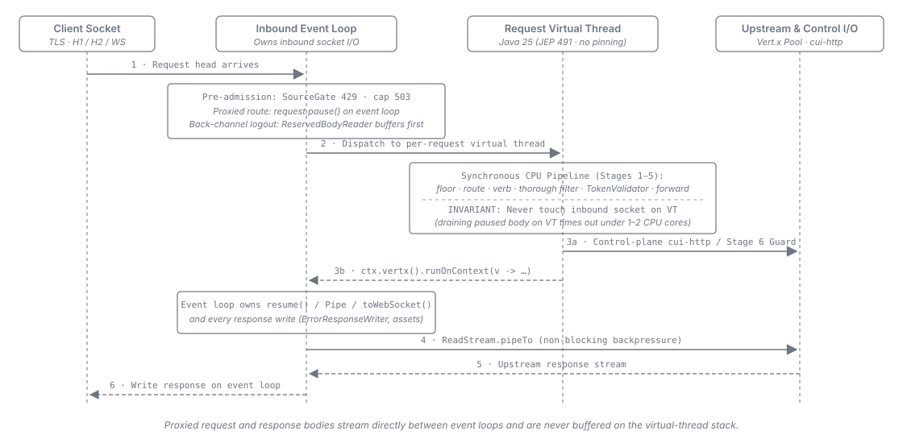
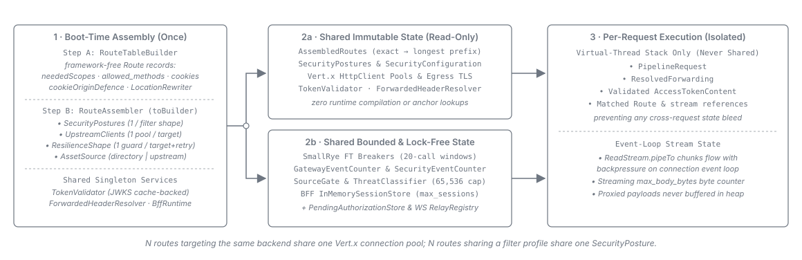

= Threading, Object Reuse & Dependencies
:toc: left
:toclevels: 3
:toc-title: Table of Contents
:sectnums:
:source-highlighter: highlight.js

link:README.adoc[← Back to Architecture Index]

[[_threading_model]]
== Threading Model

The gateway uses a virtual-thread-per-request model:

* *Virtual thread -- synchronous pipeline logic.* Inbound security validation, route selection,
  authentication, and forward-policy header/query resolution run inline on the request's virtual
  thread.

* *Event loop -- non-blocking socket I/O.* Data-plane downstream I/O uses the shared Vert.x client's
  event-loop streaming (link:../adr/0008-data-plane-transport.adoc[ADR-0008]), so the virtual thread
  coordinates the request without blocking on proxied body bytes. Control-plane calls (inside the
  token-sheriff libraries) use `cui-http` async `CompletableFuture` adapters or blocking JDK
  `HttpClient.send()` from a virtual thread.

* *Inbound-socket affinity.* The request's Vert.x event loop owns the inbound socket: response
  writes, stream `pause()` / `resume()`, WebSocket upgrades (`toWebSocket()`), and bounded
  gateway-consumed request-body reads (the back-channel logout receiver, capped by
  `reserved_body_max_bytes`) execute on that event loop, never inline on the virtual thread.

To benefit from JEP 491 (JDK 24+, removing carrier-thread pinning on `synchronized` blocks), API
Sheriff *compiles and runs on Java 25* (LTS) per
link:../adr/0001-java25-runtime-baseline.adoc[ADR-0001] (with Java 26 exercised in CI as a
forward-compatibility guard).

[[_performance_object_reuse]]
== Performance: Boot-Time Assembly and Object Reuse

Every expensive object is *assembled once at boot and shared immutably across all requests*;
request-time work allocates minimally and touches no shared mutable per-request state:

[cols="1,3", options="header"]
|===
| Object | Reuse rule

| Inbound security pipelines & `SecurityConfiguration`
| Immutable and thread-safe once built. Deduplicated per *distinct profile / `security_filter`
  shape* across all routes sharing that shape.

| Data-plane Vert.x `HttpClient` & resilience guards
| Deduplicated per *distinct upstream target* (scheme + host + port + forced HTTP/2 for gRPC) so
  routes to the same backend share one client and connection pool
  (link:../adr/0008-data-plane-transport.adoc[ADR-0008]). SmallRye Fault Tolerance guards are
  deduplicated per *resilience shape* (upstream target + retry setting). WebSocket routes use the
  edge-wide WebSocket client.

| `TokenValidator` & `ForwardedHeaderResolver`
| Single shared, thread-safe instances created at startup (`TokenValidator` cache-backed;
  `ForwardedHeaderResolver` immutable and transport-agnostic).

| Route table & assembled routes
| Built in two steps at startup: pre-boot route records resolve anchor policies, effective auth,
  `neededScopes`, `allowed_methods`, `security_filter`, `cookies`, forward sets, and
  `LocationRewriter` (link:../adr/0007-anchor-scoped-policy.adoc[ADR-0007]); boot assembly then
  attaches the deduplicated dispatch path, security posture, and asset source. Stage 2 walks the
  assembled route list in exact-first, longest-prefix-first order with zero runtime compilation or
  anchor lookups.

| Event counters
| Shared, lock-free (`GatewayEventCounter` and `cui-http` `SecurityEventCounter`).
|===

* *Per-request state (on the virtual-thread stack, never shared).* Pipeline request context,
  resolved forwarding headers, validated access-token claims, matched route reference, and stream
  handles. Streamed body chunks flow on the connection event loop with backpressure and are never
  buffered on the virtual-thread stack.

* *Bounded mutable shared state.* Confined to the upstream circuit breaker (per-resilience-shape
  rolling window), the lock-free event counters, the per-source detection/threat ledgers, and, when
  the BFF is active, the bounded session, pending-authorization, replay-protection, and WebSocket
  session-relay stores.

== Library Dependencies

Direct and transitive library dependencies are declared in `api-sheriff/pom.xml`, with versions
managed by `cui-java-bom` and `token-sheriff-bom` (`version.token-sheriff`) in the root `pom.xml`.
The single authoritative concern/library/artifact inventory lives in
link:../technical_aspects.adoc#_library_summary[Technical Aspects -- Library Summary].

[[_implementation_deviations]]
== Implementation Deviations

* *Parsed-only per-route `rate_limit` block.* The per-route `rate_limit` block is parsed and warned
  at boot (`WARN ApiSheriff-140`) but not enforced at runtime (see
  link:../configuration/security-and-edge-hardening.adoc#_rate_limit[Configuration --
  `rate_limit`] and
  link:../adr/0077-The_unenforced_rate_limit_key_is_kept_parsed_and_warned_at_boot.adoc[ADR-0077]).
