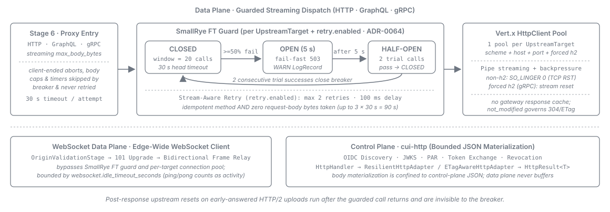
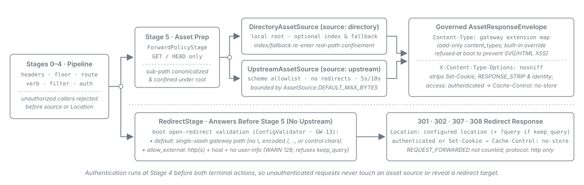
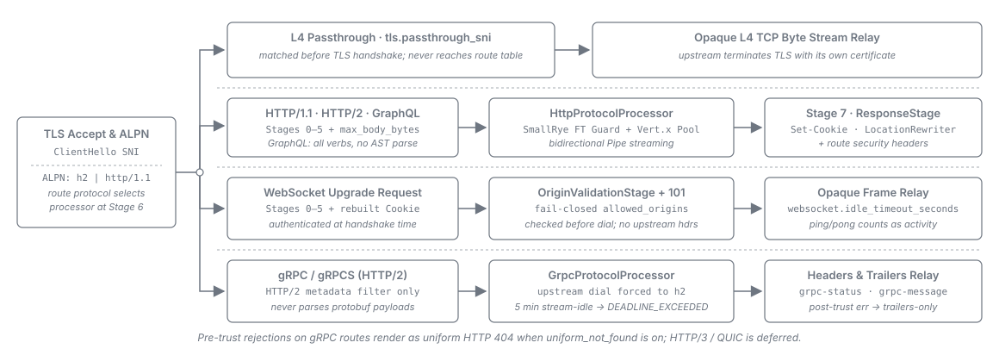

= Terminal Actions, Downstream Client & Protocols
:toc: left
:toclevels: 3
:toc-title: Table of Contents
:sectnums:
:source-highlighter: highlight.js

link:README.adoc[← Back to Architecture Index]

[[_downstream_client]]
== Downstream Client

The upstream client is split by plane (link:../adr/0008-data-plane-transport.adoc[ADR-0008]):

* *Data plane -- Vert.x `HttpClient`.* Proxied traffic for HTTP, GraphQL, and gRPC routes is
  dispatched on the Vert.x client that runs the edge: request and response bodies are piped as
  streams in both directions with backpressure, and the transport natively provides HTTP trailers
  (gRPC) and upstream HTTP/2. One shared client and connection pool is built once at boot per
  *distinct upstream target* (scheme + host + port + forced HTTP/2, with shared egress TLS trust
  options). Every client not forced to HTTP/2 closes its connections abortively (`SO_LINGER 0`), so
  an aborted or evicted connection ends in a TCP `RST` and holds no local port in `TIME_WAIT`. The
  forced-HTTP/2 (gRPC) client leaves its shared connection open and resets only the offending
  stream. WebSocket routes use the edge-wide WebSocket client without connection pooling.

* *Resilience -- SmallRye Fault Tolerance, programmatic.* Built at boot for HTTP, GraphQL, and gRPC
  routes: one programmatic guard per upstream target and retry setting, invoked around the dispatch
  call in the edge layer (no annotations or CDI interception on the hot path; WebSocket routes
  receive no resilience guard):
  ** *Stream-aware retry.* On a route with `retry.enabled`, the guard allows at most two retries
     (`maxRetries(2)`, 100 ms delay) and retries only for an idempotent method *while no attempt has
     consumed the one-shot request body*.
  ** *Fixed circuit breaker*
     (link:../adr/0064-The_upstream_guard_is_fixed_in_the_gateway_and_a_route_declares_no_circuit_breaker_settings.adoc[ADR-0064]):
     rolling window of 20 calls, opening at 50% failures for 5 s, closing after 2 successful trial
     calls. Only upstream failures count; client-ended dispatches (body-cap breaches, aborted
     bodies, framing mismatches, and 10 s / 25 s request-body timeouts) are neither retried nor
     counted as failures.
  ** *Attempt timeout.* Each attempt is bounded until its response head by a fixed 30 s timeout
     inside the retry loop (up to ~90 s across 3 attempts when `retry.enabled` is true; see
     link:runtime-and-dependencies.adoc#_implementation_deviations[Implementation Deviations] for
     parsed-only timeout/retry keys).

* *Control plane -- `cui-http`.* The gateway's bounded JSON calls (OIDC discovery, JWKS, PAR, token
  exchange, revocation inside the token-sheriff libraries) use `cui-http`'s `HttpHandler`,
  `ResilientHttpAdapter`, `ETagAwareHttpAdapter` and `HttpResult<T>`
  (link:../technical_aspects.adoc#_upstream_api_communication[Technical Aspects -- Upstream API
  Communication]).

* *No gateway response cache.* Response caching of proxied traffic is rejected by design to avoid
  cross-user cache leaks and body materialization
  (link:../adr/0006-body-streaming-vs-httpresult.adoc[ADR-0006]). Conditional requests pass through
  end-to-end, governed per route by `upstream_defaults.not_modified.enabled`: when enabled,
  `If-None-Match` and `If-Modified-Since` cross without an operator entry and upstream
  `304`/`ETag`/`Last-Modified` responses are relayed untouched; when disabled, `ETag` and
  `Last-Modified` are stripped from responses and `If-None-Match` / `If-Modified-Since` are withheld
  on `GET` and `HEAD`
  (link:../adr/0037-The_gateway-owned_header_sets_are_enumerated_per_direction_and_bounded_by_knowledge.adoc[ADR-0037]).

*Two planes, two body shapes* (link:../adr/0006-body-streaming-vs-httpresult.adoc[ADR-0006]).
`HttpResult<T>` body materialization is used on the control plane only. On the data plane the gateway
streams bodies with backpressure and enforces `security_filter.max_body_bytes` as a streaming byte
counter on inbound request bodies without buffering the payload (proxied responses are unbuffered;
asset responses have their own byte cap).

[[_asset_terminal_action]]
== Asset Terminal Action

Serving static content is the second terminal action a route can resolve to
(link:../adr/0014-asset-serving-terminal-action.adoc[ADR-0014]). An asset route runs the full fixed
pipeline through stage 5 and then serves the buffered, governed response from its boot-built *asset
source* (a local-directory reader or a secondary-origin fetcher).

* *Auth before source resolution.* Authentication runs before terminal dispatch, so an unauthorized
  request to an `access: authenticated` asset is rejected before the source is touched.

* *Shared response envelope.* Both sources serve `GET` and `HEAD` only (after canonicalizing and
  confining the sub-path under the configured root) through one gateway-owned envelope:
  `Content-Type` from the extension map, `X-Content-Type-Options: nosniff`, `Cache-Control:
  no-store` on authenticated routes, and stripping of any source `Set-Cookie`, hop-by-hop/framing
  headers, HTTP/2 pseudo-headers, and upstream identity headers (unless `keep_identity_headers:
  true`).

* *Add-only operator extension map.* `asset_defaults.content_types` maps unknown extensions
  (otherwise `application/octet-stream`), while refusing any entry that restates a built-in
  extension at boot so types such as `svg` cannot be remapped onto `text/html`.

* *Upstream and directory sources.* `source: upstream` resolves its target through the topology model
  with a scheme allowlist, `followRedirects(NEVER)`, a 5 s connect / 10 s read timeout, and a
  bounded response byte cap (link:../security-threat-model.adoc#gw-05[GW-05]). `source: directory`
  supports optional `index` and `fallback` files that re-enter the same path-confinement check.

[[_redirect_terminal_action]]
== Redirect Terminal Action

The third terminal action
(link:../adr/0014-asset-serving-terminal-action.adoc#_redirect_and_exact_routes[ADR-0014]) answers the
request at the gateway with the configured `redirect.status` (`3xx` from the schema's closed
redirect-status set; see link:../configuration.adoc#_redirect[Configuration -- `redirect`]) and a
`Location` header, never contacting an upstream.

A redirect route runs the pipeline through stage 4 (authentication) and is answered immediately
before stage 5 so unauthenticated callers under an authenticated anchor are rejected before the
target `Location` is disclosed. Effectively authenticated routes or responses carrying `Set-Cookie`
force `Cache-Control: no-store`.

The configured `location` is written verbatim (appending the raw query only when `keep_query: true`)
and validated against open-redirect vectors at boot (link:../security-threat-model.adoc#gw-13[GW-13]):
without `allow_external: true`, it must be a single-slash gateway path free of backslashes, encoded
slashes, dot-segments, whitespace and control characters; with `allow_external: true`, it may also be
an absolute `http`/`https` URI with a non-empty host and no user-info (`keep_query` is refused
alongside `allow_external`).

[[_protocol_support]]
== Protocol Support

The following protocols are supported (link:../features-analysis.adoc#_initial_scope[Feature Analysis
-- Initial Scope]; see link:../development/protocol-processors.adoc[Contributor Guide -- Protocol
Processors] for the SPI and dispatch seam); HTTP/3 / QUIC is deferred:

* *HTTP/1.1, HTTP/2.* Core request/response. HTTP/2 is negotiated via ALPN (`h2`) on terminated TLS.
* *WebSocket.* Proxied bidirectionally. The full inbound pipeline (security filter, auth, forward
  policy, rebuilt `Cookie`) runs on the HTTP upgrade request before `101 Switching Protocols`, and
  the client `Origin` is validated against `websocket.allowed_origins` (exact match, fail-closed,
  mandatory on authenticated and cookie-forwarding routes;
  link:../adr/0015-websocket-origin-failclosed-allowlist.adoc[ADR-0015]). After `101`, frames are
  relayed opaquely in both directions, bounded by `websocket.idle_timeout_seconds` (ping/pong counts
  as activity), with no upstream response headers relayed.

* *gRPC (incl. gRPCS).* Rides on HTTP/2 with the upstream dial *forced to `h2`*. Leading headers and
  response trailers (`grpc-status`, `grpc-message`) pass the response cookie/identity predicate
  (link:routing-and-forwarding.adoc#_cookie_policy[Cookie Policy]), and calls idle for 5 minutes
  after response headers end with `DEADLINE_EXCEEDED`
  (link:tls-and-inbound-security.adoc#_grpc_stream_idle_bound[gRPC stream-idle bound]). The security
  filter inspects HTTP metadata only, never protobuf payloads. Post-trust gateway rejections are
  emitted as *trailers-only* gRPC responses
  (link:observability-and-errors.adoc#_grpc_error_contract[gRPC Rejections]).

* *GraphQL.* Routed and forwarded as standard HTTP across all proxyable verbs, applying body-size
  caps and path/header checks without parsing GraphQL ASTs.

Connections whose SNI is listed in `tls.passthrough_sni` are relayed at L4 and never reach the route
table (link:tls-and-inbound-security.adoc#_tls_edge_accept_time_sni_split[TLS Edge]).
