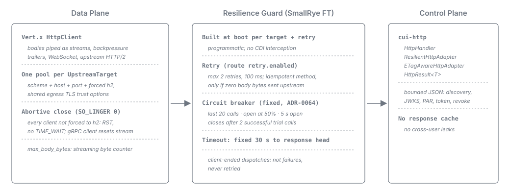
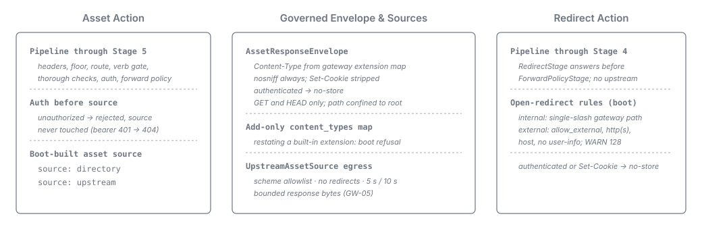
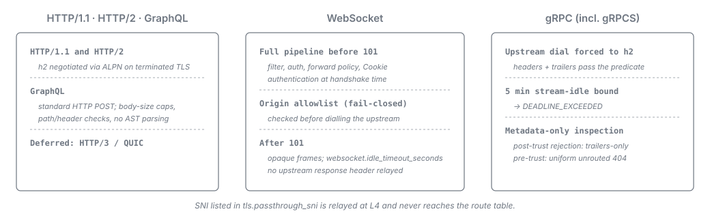

= Terminal Actions, Downstream Client & Protocols
:toc: left
:toclevels: 3
:toc-title: Table of Contents
:sectnums:
:source-highlighter: highlight.js

link:README.adoc[← Back to Architecture Index]

[[_downstream_client]]
== Downstream Client

The upstream client is split by plane (link:../adr/0008-data-plane-transport.adoc[ADR-0008]):

* *Data plane -- Vert.x `HttpClient`.* Proxied traffic for HTTP, GraphQL, and gRPC routes is
  dispatched on the Vert.x client that runs the edge: request and response bodies are piped as streams
  in both directions, and the transport natively provides HTTP trailers (gRPC) and upstream HTTP/2.
  One shared client and connection pool is built once at boot per *distinct upstream target*
  (`edge.assembly.UpstreamTarget`: scheme + host + port + forced HTTP/2, with shared egress TLS trust
  options). Every client not forced to HTTP/2 closes its connections abortively (`SO_LINGER 0`), so a
  connection closed after resetting an upstream request or evicting an idle connection ends in a TCP
  `RST` and holds no local port in `TIME_WAIT`. The forced-HTTP/2 (gRPC) client leaves its shared
  connection open and resets only the offending stream. WebSocket routes use the edge-wide WebSocket
  client and receive neither a per-target client nor connection pooling.

* *Resilience -- SmallRye Fault Tolerance, programmatic.* Built at boot for HTTP, GraphQL, and gRPC
  routes: one guard per upstream target and retry setting (`edge.assembly.ResilienceShape`), invoked
  around the dispatch call in the edge layer (no annotations or CDI interception on the hot path).
  WebSocket routes receive no resilience guard (no programmatic retries or circuit breakers). The
  pre-boot configuration model carries `retry.enabled`, `retry.max_attempts` and
  `retry.idempotent_only`; only `retry.enabled` acts, the other two stay bound and validated but unwired
  (link:../adr/0062-Platform_mechanisms_are_preferred_over_hand-rolled_equivalents_and_the_framework-agnostic_core_rule_is_retired.adoc#narrowed-pre-boot-rule[ADR-0062]).
+
Retry is *stream-aware*: on a route with `retry.enabled`, the guard allows at most two retries
  (`maxRetries(2)`, 100 ms delay) and retries an attempt only for an idempotent method *and only when
  zero request-body bytes have been sent upstream* (no replay buffer). The circuit breaker is fixed in
  the gateway
  (link:../adr/0064-The_upstream_guard_is_fixed_in_the_gateway_and_a_route_declares_no_circuit_breaker_settings.adoc[ADR-0064]):
  a rolling window of the last 20 calls, open at 50% failures, open for `BREAKER_RESET_SECONDS` = 5 s,
  closed after two successful trial calls, emitting WARN LogRecords on state transitions.
+
Only upstream failures count. Client-ended dispatches -- body-cap breaches, aborted inbound bodies
  (link:tls-and-inbound-security.adoc#_aborted_inbound_body[Aborted inbound body]), body bytes on a
  bodyless method or declared-length mismatches
  (link:tls-and-inbound-security.adoc#_dispatch_body_framing[Dispatch body framing]), 10 s
  request-body idle timeouts
  (link:tls-and-inbound-security.adoc#_request_body_idle_timeout[Request-body idle timeout]) and 25 s
  request-body deadlines
  (link:tls-and-inbound-security.adoc#_request_body_deadline[Request-body deadline]) -- are neither
  failures nor retried (SmallRye records skipped `GatewayException` outcomes as successes).
+
Each attempt of a guarded dispatch is bounded until its response head by the fixed 30 s timeout
  (`UpstreamGuards.UPSTREAM_TIMEOUT_SECONDS = 30`; `upstream.connect_timeout_ms` and
  `upstream.read_timeout_ms` are parsed into config records but not wired to the data-plane client).
  The timeout sits inside the retry, so on a route with `retry.enabled` an attempt that times out is
  retried when the retry predicate admits it, and such a dispatch can last three attempts, about 90 s.
  The edge's 60 s inbound idle timeout is longer than one attempt, so it can reap the connection first
  only across attempts; the dispatch then ends as a client-ended abort. Post-response upstream resets on early-answered uploads happen after the guarded
  call has returned and are invisible to the breaker
  (link:tls-and-inbound-security.adoc#_http2_post_response_reset[HTTP/2 post-response reset]).

* *Control plane -- `cui-http`.* The gateway's bounded JSON calls (OIDC discovery, JWKS, PAR, token
  exchange, revocation inside the token-sheriff libraries) use `HttpHandler`, `ResilientHttpAdapter`,
  `ETagAwareHttpAdapter` and `HttpResult<T>`.

* *No gateway response cache.* Response caching of proxied traffic is rejected by design to avoid
  cross-user cache leaks and body materialization
  (link:../adr/0006-body-streaming-vs-httpresult.adoc[ADR-0006]). Conditional requests pass through
  end-to-end, governed per route by `upstream_defaults.not_modified.enabled`: when enabled,
  `If-None-Match` and `If-Modified-Since` cross without an operator entry and upstream
  `304`/`ETag`/`Last-Modified` responses are relayed untouched; when disabled, the response half
  strips `ETag` and `Last-Modified` and `ForwardPolicyStage` withholds `If-None-Match` and
  `If-Modified-Since` on `GET` and `HEAD` under every forward mode (`If-Match`, `If-Unmodified-Since`
  and `If-Range`, plus `If-None-Match` on write methods, cross in either state; see
  link:../adr/0037-The_gateway-owned_header_sets_are_enumerated_per_direction_and_bounded_by_knowledge.adoc[ADR-0037]).

*Two planes, two body shapes* (link:../adr/0006-body-streaming-vs-httpresult.adoc[ADR-0006]).
`HttpResult<T>` body materialization is used on the control plane only. On the data plane the gateway
streams bodies with backpressure (`ReadStream.pipeTo`/`Pipe`) and enforces
`security_filter.max_body_bytes` as a streaming byte counter on inbound request bodies without
buffering the payload (proxied responses are unbuffered and not bounded by `max_body_bytes`; asset
responses are capped separately by `AssetSource.DEFAULT_MAX_BYTES`).

[[_asset_terminal_action]]
== Asset Terminal Action

Serving static content is the second terminal action a route can resolve to
(link:../adr/0014-asset-serving-terminal-action.adoc[ADR-0014]). An asset route runs the full fixed
pipeline through stage 5 -- stage-0 headers/CORS, stage-1 floor, route selection, stage-2a route
headers, verb gate, thorough checks, authentication and `ForwardPolicyStage` -- and then serves the
buffered, governed response from its boot-built *asset source* (a local-directory reader or a
secondary-origin fetcher). The third terminal action, the redirect
(<<_redirect_terminal_action>>), is shown beside it.

* *Auth before source resolution.* Authentication runs before terminal dispatch, so an unauthorized
  request to an `access: authenticated` asset is rejected before the source is touched (a bearer `401`
  is rendered as the unrouted `404` while `security_defaults.uniform_not_found` is on; see
  link:observability-and-errors.adoc#_trust_boundary_rejections[Rejections before the trust boundary]).

* *A shared, gateway-owned response envelope.* Both sources serve through `AssetResponseEnvelope`:
  `Content-Type` is set from the gateway's extension map, `X-Content-Type-Options: nosniff` is always
  added, any source `Set-Cookie` is stripped, `access: authenticated` forces `Cache-Control: no-store`,
  and `ConnectionHeaders.RESPONSE_STRIP` plus HTTP/2 pseudo-headers and `UpstreamIdentityHeaders`
  (unless `keep_identity_headers: true`) are stripped. Only `GET` and `HEAD` are served, and the
  request sub-path is canonicalized and confined under the configured root before reading.

* *Add-only operator extension map.* `asset_defaults.content_types` lets an operator map unknown
  extensions (otherwise served as `application/octet-stream`), but any entry restating a built-in
  extension is *refused at boot* so a built-in type such as `svg` cannot be remapped onto `text/html`
  as a stored-XSS vector. The map is resolved once at boot and passed into each asset source's
  constructor.

* *Shared egress for upstream assets.* A `source: upstream` asset resolves its target through the same
  topology model as proxy routes, using a dedicated `UpstreamAssetSource` client with a scheme
  allowlist, `followRedirects(NEVER)`, a 5 s connect / 10 s read timeout and a bounded response byte
  cap (GW-05; see
  link:../adr/0014-asset-serving-terminal-action.adoc#_shipped_surface_reconciliation[ADR-0014 --
  Shipped-surface reconciliation]).

* *Directory index and fallback.* A `source: directory` action may declare an `index` file and a
  `fallback` file (for extensionless unknown paths); both re-enter the same path-confinement and
  real-path-in-root walk as the original request.

[[_redirect_terminal_action]]
== Redirect Terminal Action

The third terminal action
(link:../adr/0014-asset-serving-terminal-action.adoc#_redirect_and_exact_routes[ADR-0014]) answers the
request at the gateway with the configured `redirect.status` (`3xx` from the schema's closed
redirect-status set; see link:../configuration.adoc#_redirect[Configuration -- `redirect`]) and a
`Location` header, never contacting an upstream.

A redirect route runs the pipeline through stage 4 (authentication) and is answered immediately by
`RedirectStage` before `ForwardPolicyStage` (`REQUEST_FORWARDED` is not counted). Running after
authentication ensures an unauthenticated caller under an authenticated anchor is rejected before the
target `Location` is disclosed. An effectively authenticated route, or any accumulated `Set-Cookie`,
forces `Cache-Control: no-store`; public cookie-less redirects stay cacheable.

`RedirectStage` writes the configured `location` verbatim (appending the raw query only when
`keep_query: true`). Open-redirect validation happens at boot in `ConfigValidator` (see
link:../security-threat-model.adoc#gw-13[GW-13]): without `allow_external: true`, `location` must be a
single-slash gateway path free of backslashes, encoded slashes, dot-segments, whitespace and control
characters; with `allow_external: true`, it may be an absolute `http`/`https` URI with a host and no
user-info (`WARN ApiSheriff-128` at boot), and `keep_query` is refused alongside `allow_external`.
Redirects are supported only on `protocol: http` routes without `asset` or `upstream` blocks.

[[_protocol_support]]
== Protocol Support

The following protocols are supported (link:../features-analysis.adoc#_initial_scope[Feature Analysis
-- Initial Scope]); HTTP/3 / QUIC is deferred:

* *HTTP/1.1, HTTP/2.* Core request/response. HTTP/2 is negotiated via ALPN (`h2`) on terminated TLS.

* *WebSocket.* Proxied bidirectionally. The full inbound pipeline (security filter, auth, forward
  policy, rebuilt `Cookie`) runs on the HTTP upgrade request before `101 Switching Protocols`,
  enforcing authentication at handshake time. The client `Origin` is validated against the route's
  link:../configuration.adoc#_allowed_origins[`allowed_origins`] allowlist (exact match, fail-closed)
  before dialling the upstream; bearer, session and cookie-forwarding WebSocket routes cannot boot
  without a non-empty allowlist
  (link:../adr/0015-websocket-origin-failclosed-allowlist.adoc[ADR-0015],
  link:routing-and-forwarding.adoc#_cookie_policy[Cookie Policy]). After `101`, frames are relayed
  opaquely in both directions, bounded by
  link:../configuration.adoc#_websocket[`websocket.idle_timeout_seconds`] (ping/pong counts as
  activity). No upstream response header is relayed on `101` or on a refused upgrade.

* *gRPC (incl. gRPCS).* Rides on HTTP/2 with the upstream dial *forced to `h2`*. Leading headers and
  response trailers (`grpc-status`, `grpc-message`) pass the response predicate of
  link:routing-and-forwarding.adoc#_cookie_policy[Cookie Policy]. Calls idle for 5 minutes after
  response headers are ended with `DEADLINE_EXCEEDED`
  (link:tls-and-inbound-security.adoc#_grpc_stream_idle_bound[gRPC stream-idle bound]). The security
  filter inspects HTTP metadata only, never protobuf payloads. Gateway rejections after the trust
  boundary are emitted as *trailers-only* gRPC responses
  (link:observability-and-errors.adoc#_grpc_error_contract[gRPC rejections]); pre-trust rejections
  render as the unrouted HTTP `404` while `security_defaults.uniform_not_found` is on
  (link:observability-and-errors.adoc#_trust_boundary_rejections[Rejections before the trust
  boundary]).

* *GraphQL.* Routed and forwarded as standard HTTP (supporting all proxyable methods including `GET`,
  `POST`, `PUT`, `DELETE` via `HttpProtocolProcessor`), applying body-size caps and path/header checks
  without parsing GraphQL ASTs.

Connections whose SNI is listed in `tls.passthrough_sni` are relayed at L4 and never reach the route
table (link:tls-and-inbound-security.adoc#_tls_edge_accept_time_sni_split[TLS Edge]).
