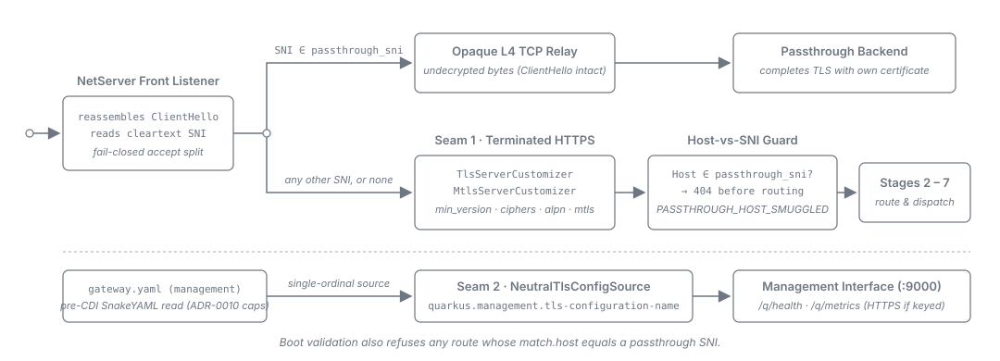
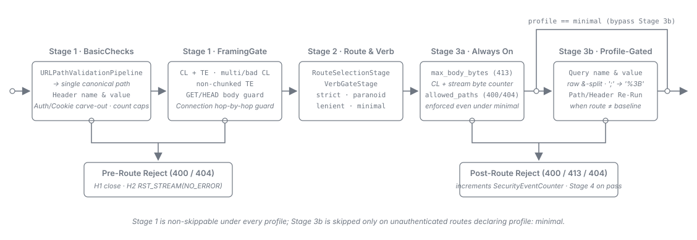
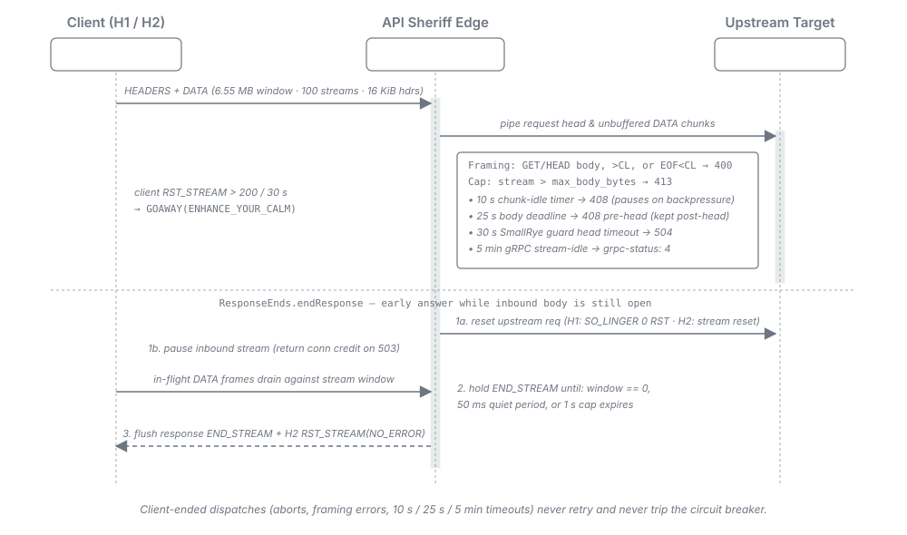
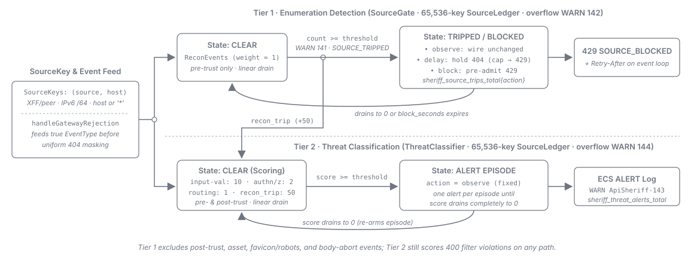

= TLS Edge & Inbound Security
:toc: left
:toclevels: 3
:toc-title: Table of Contents
:sectnums:
:source-highlighter: highlight.js

link:README.adoc[← Back to Architecture Index]

[[_tls_edge_accept_time_sni_split]]
== TLS Edge (Accept-Time SNI Split)

A Vert.x `NetServer` *front listener* owns the public TLS port. It reassembles the TLS ClientHello,
reads the cleartext Server Name Indication (RFC 6066) and splits each connection at accept time:

* *SNI listed in `tls.passthrough_sni`* -> an *opaque L4 TCP relay*. The intact byte stream
  (ClientHello included) reaches the topology-resolved backend, which presents *its own*
  certificate. The gateway never terminates and sees no L7 detail.

* *any other SNI, or none* -> an *internal handoff to the terminated L7 listener*, which completes
  the handshake with the gateway's certificate (`min_version`, `alpn`, `mtls`) and runs the full
  pipeline.

Two guards keep the split unambiguous: boot fails when a route's `match.host` equals a passthrough
SNI, and a runtime *Host-vs-SNI smuggle guard* answers a terminated request whose `Host` names a
passthrough SNI with `404` (`PASSTHROUGH_HOST_SMUGGLED`) *before route selection*. Selection is
*fail-closed* (link:../security-threat-model.adoc#gw-06[GW-06]): anything not positively matched as
passthrough is terminated, never relayed. Internals are in the
link:../development/tls-edge.adoc[developer TLS-edge topic].

[[_server_tls_policy_binding]]
== Server-TLS Policy Binding (Two Seams)

`gateway.yaml` is the single effective source of server-TLS *policy* across both listeners
(link:../adr/0025-The_whole_server-TLS_surface_is_neutral_in_gatewayyaml_and_bound_by_exactly_two_seams.adoc[ADR-0025]):

* *Terminated main HTTPS listener* -- bound at server startup via an options customizer that applies
  `tls.min_version`, `tls.cipher_suites`, `tls.alpn` and `tls.mtls`.

* *Management interface* -- bound before CDI startup via a single-ordinal configuration source that
  projects `management.tls.enabled: false` onto the management listener without exposing deployment
  ports or trust material.

See link:../development/tls-edge.adoc#_server_tls_policy_binding[Contributor Guide -- Server-TLS
Policy Binding] for the Quarkus hook mechanics and
link:../adr/0010-YAML_expansion_limits_enforced_in_a_compose-only_pre-pass_before_bind.adoc[ADR-0010]
for the pre-pass expansion limits.

[[_inbound_security_filter]]
== Inbound Security Filter

The inbound filter is the "basic HTTP security filtering -- not a WAF" layer, delivered by
`cui-http`'s security module (see link:../technical_aspects.adoc#_http_security_validation[Technical
Aspects -- HTTP Security Validation]). It runs synchronously on the request's virtual thread (< 1 ms
target, no I/O) and is split across route selection into a non-skippable pre-route floor and an
always-dispatched post-route stage whose validation half is profile-gated
(link:../development/README.adoc#_inbound_validation_where_the_code_lives_and_why[Contributor Guide
-- Inbound Validation]):

The parameter *count* cap stays in the floor although the values it bounds are validated
post-route: a collection limit is a DoS guard that does not depend on a per-route policy.

*Profiles.* The mode set is `strict` / `paranoid` / `lenient` / `minimal`, on the gateway-wide
`security_defaults` block and on any `security_filter` block. An omitted block or `profile` resolves
to `strict`, the fail-closed choice. `minimal` is refused at boot on any effectively-authenticated
or `type: bff` route and takes its retained limits (`max_body_bytes`) from the nearest non-`minimal`
profile in its fallback chain (`strict` when the whole chain is `minimal`; see
link:README.adoc#_component_model[Component Model] and
link:../adr/0024-Inbound_filter_modes_minimal_is_a_partial_disable_retaining_the_body_cap_and_path_allowlist_and_is_refused_on_authenticated_and_BFF_routes.adoc[ADR-0024]).

*The query is validated in the form it is forwarded in.* The post-route stage receives the query
pairs raw and still percent-encoded, split on `&` in wire order -- never grouped by name -- and
validates names and values with `cui-http`'s parameter pipelines (each decoding once). The forward
path appends the pairs in the same order, rewriting every raw `;` in a forwarded name or value as
`%3B` on every route so an upstream that splits on `;` cannot read a second parameter out of one
pair (CWE-235;
link:../adr/0047-The_security_filter_validates_the_raw_query_it_forwards.adoc#semicolon-exception[ADR-0047]).

Path allowlisting is enforced at the gateway from the route's `allowed_paths`. Which client headers
and query parameters reach the upstream is answered later by the route's `forward` block (see
link:routing-and-forwarding.adoc#_forward_policy[Forward Policy] and
link:../configuration/security-and-edge-hardening.adoc#_security_filtering[Configuration -- Security Filtering]).

=== Framing Gate

A stateless anti-request-smuggling *framing gate* runs once at stage 1, before route selection,
independent of the profile. It rejects five desync and framing vectors with `400` (see
link:../security-threat-model.adoc#gw-02[GW-02]):

. `Content-Length` + `Transfer-Encoding` coexistence;
. a `Content-Length` that is repeated, comma-listed, not strictly decimal ASCII digits (`1*DIGIT`),
  or overflows `long`;

. a `Transfer-Encoding` that is repeated or is not exactly `chunked`;
. a body on a bodyless method (`GET` or `HEAD`);

. a `Connection` header naming a framing or trust header.

On HTTP/1.x a framing rejection carries `Connection: close` and closes the connection once written,
discarding any pipelined request behind it. On HTTP/2 it ends the offending stream alone, resetting
an open request body with `NO_ERROR` once written (<<_http2_post_response_reset>>).

*One operator-relaxable leg.* The gateway-wide `security_defaults.allow_get_with_content_length_body`
(default `false`) relaxes only the declared-`Content-Length` check on `GET` (for upstreams such as
Elasticsearch `_search`,
link:../adr/0029-The_GET-with-body_opt-in_relaxes_only_the_Content-Length_leg_and_is_necessarily_gateway-wide.adoc[ADR-0029]);
every other leg stays unconditionally rejected.

[[_http2_post_response_reset]]
== HTTP/2 Post-Response Reset and Connection Window

*An HTTP/2 response answered while the request body is still open is ended once request data stops
arriving or a time cap passes, and its stream is then reset with `NO_ERROR`*
(link:../adr/0066-An_HTTP2_response_answered_while_its_request_body_is_open_is_ended_once_request_data_stops_arriving_or_a_time_cap_passes_and_its_stream_is_then_reset_with_NO_ERROR.adoc[ADR-0066]).
This single rule governs every response the edge ends -- relayed responses, pre-upgrade WebSocket
rejections, and every gateway-authored answer (problem documents, HTML error pages, portal, reserved
paths, assets, redirects, short-circuits, gRPC trailers-only statuses, and admission `503`s). Only a
completed WebSocket upgrade and L4 passthrough bypass it:

. *Stop the body at once.* Reset any in-flight upstream request and pause the inbound stream,
  returning no further flow-control window.

. *Wait until request data settles.* Hold `END_STREAM` until the stream or connection window is
  exhausted (or the stream ended), the window is quiet for 50 ms, or the 1 s cap elapses. The wait
  reduces, but does not remove, the transport's own resets: a DATA frame that still arrives after the
  stream was reset is answered with `RST_STREAM(STREAM_CLOSED)`, and Netty's encoder-side reset limit
  counts every reset the transport sends except `NO_ERROR` and `CANCEL` -- that `STREAM_CLOSED` reset,
  `REFUSED_STREAM` and the reset after a `431` included. While request data keeps arriving at least
  every 50 ms, only the 1 s cap ends the wait. The quiet period is an inference that the client has
  stopped sending, not a guarantee: a DATA frame delayed in transit for longer than 50 ms still
  arrives after the reset.

. *Emit end and `NO_ERROR` reset together.* Write `END_STREAM` followed immediately by `RST_STREAM
  (NO_ERROR)` (RFC 9113 §8.1) so other streams on the connection continue unaffected.

*Abortive upstream close on HTTP/1.1.* Resetting an HTTP/1.1 upstream request once body transfer has
begun closes that upstream connection with `SO_LINGER 0` (TCP `RST`), freeing the local ephemeral
port immediately instead of holding it in `TIME_WAIT` (if the reset fires before the first body chunk
is written, the clean connection returns to the pool; see
link:terminal-actions-and-protocols.adoc#_downstream_client[Downstream Client] and
link:../adr/0066-An_HTTP2_response_answered_while_its_request_body_is_open_is_ended_once_request_data_stops_arriving_or_a_time_cap_passes_and_its_stream_is_then_reset_with_NO_ERROR.adoc#abortive-upstream-close[ADR-0066]).

[[_http2_connection_window]]
[[_http2_connection_window_measurement]]
*Inbound HTTP/2 connection window.* An inbound request returns no flow-control window until its
dispatch obtains an upstream connection and subscribes to the body. The edge caps concurrent streams
per connection at 100 and sizes the connection window to `100 × 65,535` bytes (6,553,500 bytes), so
paused or queued streams cannot starve active uploads on the same connection (see
link:../adr/0060-Dispatch_sends_a_bodyless_method_no_body_and_frames_every_declared-length_body_by_exactly_that_length.adoc[ADR-0060]
for the benchmark comparison against a fixed 2 MiB window).

[[_http2_transport_bounds]]
*Per-connection HTTP/2 transport bounds* (link:../security-threat-model.adoc#gw-08[GW-08]):

* *Header block (`SETTINGS_MAX_HEADER_LIST_SIZE`).* Capped at 16 KiB across the whole decoded block
  (`CONTINUATION` frames included); exceeding it ends the connection with `GOAWAY`.

* *Rapid-Reset.* Pinned at 200 client-sent `RST_STREAM` frames per 30-second window (`GOAWAY
  ENHANCE_YOUR_CALM` on breach). Gateway-issued `NO_ERROR` resets do not count.

[[_http2_unread_upload_release]]
*Unread upload credit release.* An HTTP/2 upload refused `503` at admission returns its stream credit
to the connection window once ended (having never acquired an admission permit), and an admitted
upload reset by its client while awaiting a pooled upstream connection returns its stream credit and
releases its admission permit immediately
(link:../adr/0060-Dispatch_sends_a_bodyless_method_no_body_and_frames_every_declared-length_body_by_exactly_that_length.adoc#unread-upload-bodies[ADR-0060]).

== Request Body Framing and Timeouts

[[_dispatch_body_framing]]
*Dispatch body framing.* A `GET` or `HEAD` without a positive declared `Content-Length` is sent
upstream with no body; its first inbound body byte refuses the request with `400`
(`SECURITY_FILTER_VIOLATION`) before upstream response handover, or resets the HTTP/2 stream with
`CANCEL` (and closes HTTP/1.x) if it arrives after handover. Every other request declaring
`Content-Length` is framed by that exact byte count: a byte beyond it refuses the request (`400`
before handover, or stream reset after handover), and a body ending short of it resets the upstream
request (`INBOUND_BODY_ABORTED`). Requests without a declared length keep chunked/streamed framing.

[[_aborted_inbound_body]]
*Aborted inbound body.* When the inbound body stream fails after dispatch began (client disconnect
or broken chunk framing), the upstream request is reset and the gateway records
`INBOUND_BODY_ABORTED` (`400`, `INPUT_VALIDATION`). A body exceeding `max_body_bytes` remains
`CONTENT_TOO_LARGE` (`413`). A gRPC call whose client holds its request stream open without sending
its next complete request message within the message bound — before the first message or between any
two — is recorded as `INBOUND_BODY_ABORTED` too, with the disposition `client-idle`, but its client
receives `INVALID_ARGUMENT` in a trailers-only `200` (<<_grpc_message_bound>>). Every
`INBOUND_BODY_ABORTED` end is counted by its disposition (`body-stream-failed`, `client-left`,
`client-idle`) on `sheriff_inbound_body_aborts_total`, and `ApiSheriff-22` is latched per route and
disposition. Client-ended dispatches are never retried and are not counted as a failure by the
upstream circuit breaker.

[[_client_departure]]
*A client that leaves before it is answered.* A request stream reports a reset or a closed connection
only while its body is open. Once the body has ended, only the response learns that it can no longer
be answered; the edge reports that to the request body it armed (`DispatchStage.InboundBody`), and the
dispatch that is still waiting for its upstream answer releases the upstream request at once and ends
as `INBOUND_BODY_ABORTED` with the disposition `client-left`. The dispatch reads the departure from the
armed body it is handed, so it must be handed that body itself. That holds on a `protocol: grpc` route
too: the call's stream-idle bound observes the armed body's frames in place rather than wrapping it
(`ResponseStage.GrpcStreamIdleBound.watch`), so a gRPC client that resets its call after ending its
request stream, before the upstream answers, ends the call as its own departure instead of leaving it
to the guard's timeout as an upstream failure.

[[_request_body_idle_timeout]]
*Request-body idle timeout (10 s).* Once a proxied dispatch holds an upstream connection and is
reading the body, 10 s without a forwarded body byte resets the upstream request and answers `408`
(`REQUEST_BODY_TIMEOUT`;
link:../adr/0060-Dispatch_sends_a_bodyless_method_no_body_and_frames_every_declared-length_body_by_exactly_that_length.adoc#request-body-idle-timeout[ADR-0060]).
Waiting for a pooled upstream connection, upstream backpressure pauses, bodyless requests, and
`protocol: grpc` routes do not arm or advance this clock; a gRPC call's wait for each request message
has its own bound (<<_grpc_message_bound>>).

[[_request_body_deadline]]
*Request-body deadline (25 s).* A slow sender that drips chunks faster than every 10 s is bounded by
a fixed 25 s deadline from the start of the upstream attempt (including pool wait;
link:../adr/0060-Dispatch_sends_a_bodyless_method_no_body_and_frames_every_declared-length_body_by_exactly_that_length.adoc#request-body-deadline[ADR-0060]).
Expiry before the upstream response head answers `408` (`REQUEST_BODY_TIMEOUT`); expiry after the
response head preserves the upstream status and resets/closes the stream. A passed deadline stays in
force while upstream backpressure pauses the body: it ends the body as the request's when the pause
ends, whatever the pause's length. The deadline stops when the body ends before it, when another abort
claims the stream first, and when the attempt ends without handing its response back (its send failed, the
next attempt began, or the dispatch failed); a stopped deadline reports nothing. A body whose end reaches
the dispatch only after the deadline's instant does not stop it: that body is ended at the deadline all
the same. The instant is taken from the clock, not only from the deadline's timer, so a timer that fires
late does not let a late end pass as one in time. A `protocol: grpc` call is
bounded by a deadline of the same length too, but counted from the hand-over and only until its upstream
answers, and the end is rendered to its client as `DEADLINE_EXCEEDED` (<<_grpc_message_bound>>).

[[_grpc_message_bound]]
*gRPC message bound (10 s) and pre-response deadline (25 s, capped at 29 s).* A `protocol: grpc` call
ends as an upstream failure only when the upstream had everything the client was going to send, never
gave the client the time to send it, or stopped taking what the client sent: time the client holds its request open is the client's, time spent
reaching the upstream is the upstream's. The forced-HTTP/2 upstream request head is written only with
the first request body chunk, and an upstream cannot act on a request message it holds only part of,
so until the upstream answers the request side of a call is bounded twice
(link:../adr/0060-Dispatch_sends_a_bodyless_method_no_body_and_frames_every_declared-length_body_by_exactly_that_length.adoc#grpc-message-bound[ADR-0060]):

* *The message bound*, `GrpcDispatchStage.GRPC_MESSAGE_TIMEOUT_MILLIS` (10 s per message). The clock
  starts when the attempt hands its body to the upstream request and starts again after every complete
  message — the 5-byte length prefix and every payload byte it declares, read as the bytes cross and
  never buffered. The prefix and the payload may be split across any number of chunks, and a
  zero-length message completes at its prefix. A forwarded byte of an incomplete message does not stop it, and a pause while the
  upstream takes no data is not counted. When the next complete message does not arrive in time —
  the client sent nothing, only part of a message, or stopped between two messages without ending its
  request stream — the upstream request is reset and the call ends as the client's abort,
  `DispatchStage.RequestMessageTimeout` (`INBOUND_BODY_ABORTED`, disposition `client-idle`, rendered
  `INVALID_ARGUMENT`).
* *The pre-response deadline*, `GrpcDispatchStage.GRPC_PRE_RESPONSE_DEADLINE_MILLIS` (25 s, equal to
  the request-body deadline), counted like the message bound from the hand-over, so neither bound
  charges the wait for an upstream connection to the client. A client that keeps sending complete
  messages, each within the message bound, without ever ending its request stream is ended there: the
  upstream request is reset and the call ends as `DispatchStage.RequestBodyDeadlineExceeded`
  (`REQUEST_BODY_TIMEOUT`, `408`), rendered trailers-only as `DEADLINE_EXCEEDED` with
  `grpc-message: input-validation`. Only a sustained upstream stall makes the deadline the upstream's:
  one that passes while the upstream's backpressure has the request stream paused is the upstream's
  when, at the read that ends the pause, the pause has lasted without a break at least the upstream
  stall threshold (below).
* *The upstream stall threshold*, `GrpcDispatchStage.GRPC_UPSTREAM_STALL_MILLIS` (10 s, equal to the
  message bound). It is not a bound and ends nothing: it decides whose failure a passed pre-response
  deadline is. HTTP/2 flow control pauses a request stream whenever the client gets ahead of the
  upstream, for a few round-trips at a time while a healthy upstream keeps reading; only a pause lasting
  the threshold is the upstream's stall.

The two bounds stop when the upstream answers, when the request stream ends, on any abort and when the
attempt ends, so a bidirectional stream the upstream has answered is bounded by neither. Neither counts as a
failure for the circuit breaker when it ends a call its client held, and neither is retried. Both bounds and
the stall threshold are fixed. An HTTP dispatch arms neither bound;
it keeps the idle timeout and the whole-body deadline above. Because the 30 s guard timeout runs from
the start of the attempt and so counts the connection wait, the pre-response deadline is held to
`GrpcDispatchStage.GRPC_PRE_RESPONSE_CAP_MILLIS`, 29 s from the start of the attempt: a hand-over within
the first 4 s keeps the whole 25 s, a later one no later than 28 s has its deadline at the cap, so a
client still holding its stream open is always ended as the client's a second before the guard. The
deadline never leaves less than the fixed hand-over grace,
`GrpcDispatchStage.GRPC_HAND_OVER_GRACE_MILLIS` (1 s), after the hand-over: an attempt that obtains its
connection later than 28 s — less than the grace before the cap, or past it — is ended at once, its
request unsent and its body unread, as `DispatchStage.UpstreamConnectionTooLate`, an `UPSTREAM_TIMEOUT`
the breaker counts. The deadline ends only a request stream whose end has not reached the dispatch when
it passes — at its instant, read from the clock, so an end that arrives after it is too late even while
the deadline's timer has not run yet (<<_request_body_deadline>>). A client that had already ended its
stream at the hand-over is therefore ended by it only if the
gateway takes longer than the grace to deliver that end; if the upstream then does not answer the
complete request, the guard ends the call as `UPSTREAM_TIMEOUT`, which the circuit breaker counts. The
guard's timeout is therefore reached in three ways, all the upstream's: by an upstream holding a
complete, half-closed request it does not answer; by a wait for an upstream connection or HTTP/2 stream
slot that itself lasts the 30 s, before any body is handed over; and by an upstream that stops taking
data mid-request and takes no more within the 30 s. Each holds only while the client stays: a client
that leaves before the upstream answers ends the call at once, as its own departure
(<<_client_departure>>). While that backpressure pauses the request stream,
the message bound is not counted, and the pre-response deadline keeps counting but does not end the
call at once: a deadline that passes during the pause ends the call the moment the upstream takes data
again — no later than a deadline end during a read would. That read decides whose failure it is, by the
length the pause has reached. It takes the deadline's instant from the clock, not only from the
deadline's timer, so a timer that fires late leaves the decision with the read that ends the pause. A
pause of at least the 10 s stall threshold without a break is the
upstream's stall: the expiry resets the upstream request and fails the attempt with a
`DispatchStage.UpstreamStalledRequest`, a `TimeoutException` the breaker counts and the failure mapper
reports as `UPSTREAM_TIMEOUT`, rendered `DEADLINE_EXCEEDED` with `grpc-message: upstream`; a shorter pause leaves the
deadline the client's `REQUEST_BODY_TIMEOUT`. A deadline that passes while the request stream is being
read is the client's too, however long the upstream paused the stream before. A resume ends a pause, so
the stall is always one unbroken pause, never a sum of short ones. The threshold is what keeps the
breaker out of a client's reach: a client that sends faster than a healthy upstream reads, and never ends
its request stream, is paused by flow control for brief waits most of the time, so were any pause at the
deadline charged to the upstream, repeating such calls would open the route's breaker for every caller.
Only the attribution depends on the pause; when the call ends does not.

[[_grpc_stream_idle_bound]]
*gRPC stream-idle bound (5 min).* Because streaming RPCs legitimately pause between messages, a
`protocol: grpc` call arms no request-body idle timeout. Until its response headers arrive it is
bounded by the message bound and the pre-response deadline (<<_grpc_message_bound>>), and by the
upstream guard's fixed 30 s per-attempt timeout, which runs from the start of the attempt and bounds
an upstream that holds a complete, half-closed request, a connection or stream-slot wait that
lasts it, and an upstream that stops taking data mid-request and takes no more within it. From then on a 5-minute
bidirectional frame-idle timer (HTTP/2 `PING` excluded) bounds the call. Expiry resets the upstream request
and ends the client stream with trailers `grpc-status: 4` (`DEADLINE_EXCEEDED`) and `grpc-message:
stream-idle-timeout`
(link:../adr/0060-Dispatch_sends_a_bodyless_method_no_body_and_frames_every_declared-length_body_by_exactly_that_length.adoc#grpc-stream-idle-bound[ADR-0060]).

[[_request_body_bound_recording]]
*Recording of the request-body bounds.* `INFO` `ApiSheriff-23` records an idle timeout,
`ApiSheriff-24` a passed request-body deadline and `ApiSheriff-25` a call the gRPC stream-idle bound
ended. Each carries the route id and the fixed value only and is latched per route.
`sheriff_errors_total` counts both request-body bounds under `event="REQUEST_BODY_TIMEOUT"`; no error
counter counts a call the stream-idle bound ended. A gRPC message-bound end is recorded by
`ApiSheriff-22` under the disposition `client-idle`. That latch is keyed by route and disposition, so
the first end of each disposition on a route -- `client-idle`, `client-left`, `body-stream-failed` --
is its own `INFO`, and a repeat of the same disposition on the route is a `DEBUG` diagnostic.
`sheriff_inbound_body_aborts_total{route,disposition}` counts every `INBOUND_BODY_ABORTED` end by its
disposition, so an idle-client flood is countable apart from departures and failed body streams;
`sheriff_errors_total` still counts every such end, a message-bound end included, under its one
`event="INBOUND_BODY_ABORTED"` series. A gRPC pre-response deadline end the client
held is recorded like any passed request-body deadline: `ApiSheriff-24` and
`sheriff_errors_total{event="REQUEST_BODY_TIMEOUT"}`. One the upstream stalled for the threshold is
recorded as the upstream timeout it is, under `sheriff_errors_total{event="UPSTREAM_TIMEOUT"}`, never
as `ApiSheriff-24`
(link:../adr/0060-Dispatch_sends_a_bodyless_method_no_body_and_frames_every_declared-length_body_by_exactly_that_length.adoc#grpc-message-bound[ADR-0060]).

[[_per_source_detection]]
== Per-Source Detection (Enumeration Detection)

The gateway counts pre-trust reconnaissance rejections per source in a framework-free, per-instance
in-memory leaky-bucket substrate (thresholds apply per gateway instance and reset on restart) and
answers tripped sources according to `enumeration_detection`. The full substrate contract is in
link:../development/source-detection-substrate.adoc[Per-Source Detection Substrate -- Contract] and
the design decision in
link:../adr/0076-One_per-source_detection_substrate_counts_pre-trust_rejections_and_answers_a_tripped_source.adoc[ADR-0076].

* *Keying and bounds.* Requests are keyed by `(source, host)`: client IPv4, IPv6 `/64` prefix, or
  `unknown` (honouring `forwarded.trusted_proxies`), paired with a declared `match.host` or `*`. The
  ledger tracks at most 65,536 keys, draining linearly at `threshold / window` per second and
  transitioning `CLEAR -> TRIPPED` (and `-> BLOCKED` when `action` is `block`) at most once per
  `CLEAR` period.

* *Feed.* Pre-trust rejections in the closed recon set add weight `1` (tagged by their true
  `EventType`, even when rendered as the uniform `404`). Post-trust rejections, upstream/boot
  events, aborted/timed-out bodies, `PRE_TRUST_INTERNAL_FAILURE`, asset routes, and browser-ambient
  fetches (`/favicon.ico`, `/robots.txt`, touch icons) are excluded.

[cols="1,4", options="header"]
|===
| Action | Effect on the wire

| `observe` (default)
| Records `SOURCE_TRIPPED`, increments `sheriff_source_trips_total{action}`, and logs a warning;
  responses are unchanged. `observe` is the default so shared NAT or untrusted-proxy addresses are
  not blocked without operator opt-in.

| `delay`
| Holds recon rejections of a tripped source until at least `admission + delay_millis` (or the
  uniform-`404` floor, whichever is later) on the held-answer permit sub-budget. Served requests are
  never delayed; requests exceeding the source's sub-budget share are answered `429` with
  `Retry-After` before admission.

| `block`
| Blocks a tripped source for `block_seconds`, answering `429` (`SOURCE_BLOCKED`) with
  `Retry-After` and the `rate-limiting` problem document on the event loop before admission or route
  selection.
|===

See link:../configuration/security-and-edge-hardening.adoc#_enumeration_detection[Configuration -- `enumeration_detection`] and
link:../user/edge-security.adoc#_enumeration_detection_operator_note[Endpoint Routes].

[[_threat_classification]]
== Per-Source Threat Classification

A second `observe`-only ledger sits beside enumeration detection, scoring weighted rejections before
and after the trust boundary and raising one structured ECS ALERT per episode when a source crosses
the `threat_classification` threshold
(link:../development/source-detection-substrate.adoc#_second_consumer[Substrate -- Second Consumer],
link:../adr/0078-Per-source_threat_classification_raises_one_ECS_alert_per_episode_from_its_own_ledger.adoc[ADR-0078]):

[cols="2,1,3", options="header"]
|===
| Category / Signal | Default weight | Rationale

| `input-validation` | `10` | Malformed or injection-shaped requests are the clearest probe signal (scored even on static/asset paths; `REQUEST_BODY_TIMEOUT` and `INBOUND_BODY_ABORTED` are excluded with fixed weight `0` so network stalls alone cannot raise an ALERT).
| `routing` | `1` | Crawlers or stale links also draw unrouted answers (`PRE_TRUST_INTERNAL_FAILURE` is excluded with weight `0`).
| `authentication` / `authorization` | `2` | Expired tokens behind a shared address stay below the drain rate.
| `recon_trip` (`SOURCE_TRIPPED`) | `50` | Each enumeration-detection trip feeds into the threat score.
| `upstream`, `rate-limiting`, `configuration` | fixed `0` | Not caller behaviour or boot-only.
|===

Threat classification never alters responses on the wire. Each trip increments
`sheriff_threat_alerts_total` and logs one ECS-formatted ALERT document
(link:observability-and-errors.adoc#_threat_alert_document[The Threat ALERT Document]). See
link:../configuration/security-and-edge-hardening.adoc#_threat_classification[Configuration -- `threat_classification`] and
link:../user/edge-security.adoc#_threat_classification_operator_note[Endpoint Routes].
