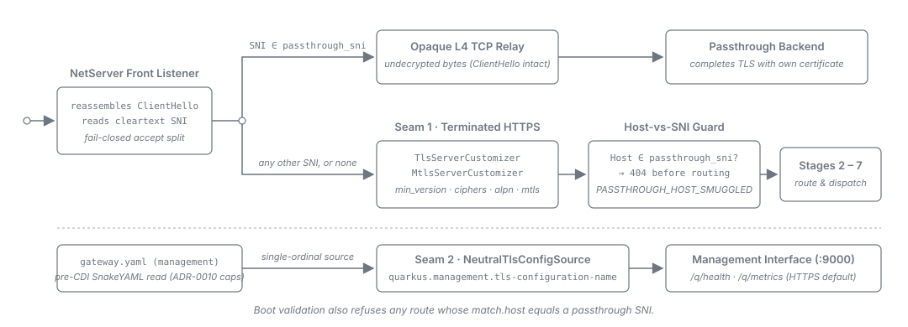
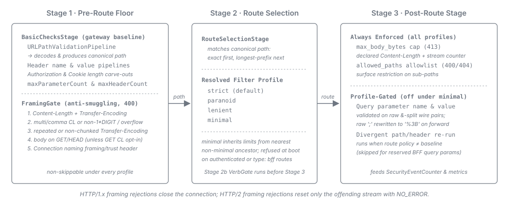
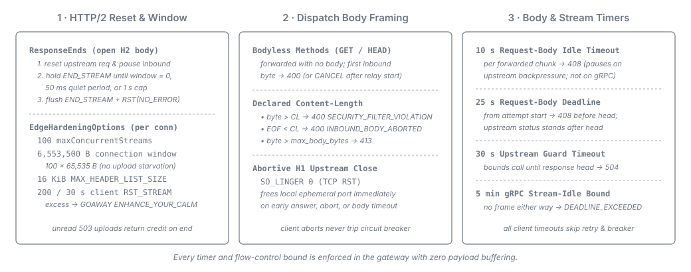
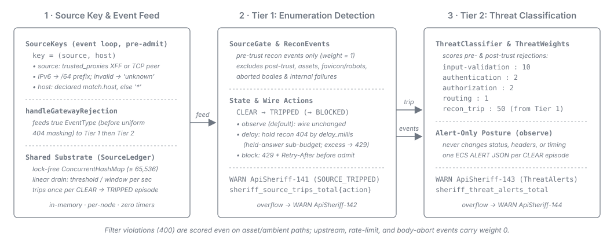

= TLS Edge & Inbound Security
:toc: left
:toclevels: 3
:toc-title: Table of Contents
:sectnums:
:source-highlighter: highlight.js

link:README.adoc[← Back to Architecture Index]

[[_tls_edge_accept_time_sni_split]]
== TLS Edge (Accept-Time SNI Split)

A Vert.x `NetServer` *front listener* owns the public TLS port. It reassembles the TLS ClientHello,
reads the cleartext Server Name Indication (RFC 6066) and splits each connection at accept time:

* *SNI listed in `tls.passthrough_sni`* -> an *opaque L4 TCP relay*. The intact byte stream
  (ClientHello included) reaches the topology-resolved backend, which presents *its own*
  certificate. The gateway never terminates and sees no L7 detail.

* *any other SNI, or none* -> an *internal handoff to the terminated L7 listener*, which completes
  the handshake with the gateway's certificate (`min_version`, `alpn`, `mtls`) and runs the full
  pipeline.

Two guards keep the split unambiguous: boot fails when a route's `match.host` equals a passthrough
SNI, and a runtime *Host-vs-SNI smuggle guard* answers a terminated request whose `Host` names a
passthrough SNI with `404` (`PASSTHROUGH_HOST_SMUGGLED`) *before route selection*. Selection is
*fail-closed* (GW-06): anything not positively matched as passthrough is terminated, never relayed.
Internals are in the link:../development/tls-edge.adoc[developer TLS-edge topic].

[[_server_tls_policy_binding]]
== Server-TLS Policy Binding (Two Seams)

`gateway.yaml` is the single effective source of server-TLS *policy*
(link:../adr/0025-The_whole_server-TLS_surface_is_neutral_in_gatewayyaml_and_bound_by_exactly_two_seams.adoc[ADR-0025]).
The two listeners share no seam, so two mechanisms bind it (see the lower half of the diagram above):

[cols="1,2,2", options="header"]
|===
| Listener | Seam | Why it is the only one available

| Terminated main HTTPS listener
| `TlsServerCustomizer`, an `HttpServerOptionsCustomizer` mapping `tls.min_version`,
  `tls.cipher_suites` and `tls.alpn` onto the protocol set, cipher allowlist and ALPN protocols.
  `MtlsServerCustomizer` is its sibling for `tls.mtls`.
| Quarkus runs customizer beans in `doServerStart` *after* `createSslOptions`, so the customizer is
  the last writer. `quarkus.tls.*` does not work here: that registry applies only when the
  certificate also comes from it, and this gateway supplies it through
  `quarkus.http.ssl.certificate.*`.

| Management interface
| `NeutralTlsConfigSource`, a SmallRye `ConfigSource` projecting `management.tls.enabled: false`
  onto `quarkus.management.tls-configuration-name`.
| `VertxHttpRecorder.initializeManagementInterface` never enumerates `HttpServerOptionsCustomizer`
  beans, so a config source is the seam *by elimination*.
|===

*The projecting source runs before CDI exists.* `NeutralTlsConfigSource` re-reads `gateway.yaml`
with SnakeYAML under the same expansion-bomb caps as the authoritative loader
(link:../adr/0010-YAML_expansion_limits_enforced_in_a_compose-only_pre-pass_before_bind.adoc[ADR-0010])
and parses only the `management` block:

* *The duplication is bounded and one-directional.* Parsing, schema validation and semantic
  validation still happen once in `ConfigLoader` and `ConfigValidator`; the early pass reads one
  block and emits at most one key.

* *A malformed or absent document degrades silently here.* The loader re-encounters the failure
  moments later and reports it as a located `ConfigError` that fails the boot.

* *An unexpected shape reads as "not explicitly disabled".* A non-map `management` block or a
  non-boolean `enabled` keeps TLS on, the fail-safe direction.

*The source is single-ordinal and projects policy keys only.* Its ordinal sits above the
environment-variable source's, so a deployment variable cannot silently override a policy named in
`gateway.yaml`. That is safe because the projected set contains no deployment-bound key: never a
port, never trust material, and never `quarkus.tls.key-store.*` (populating the default TLS registry
bucket would make the management interface inherit HTTPS through `registry.getDefault()`).

[[_inbound_security_filter]]
== Inbound Security Filter

The inbound filter is the "basic HTTP security filtering -- not a WAF" layer, delivered by
`cui-http`'s security module. It is synchronous CPU work (< 1 ms target, no I/O) on the request's
virtual thread, split across route selection into a non-skippable pre-route floor
(`BasicChecksStage`) and an always-dispatched post-route stage (`ThoroughChecksStage`) whose
validation half is profile-gated:

The parameter *count* cap stays in the floor although the values it bounds are validated
post-route: a collection limit is a DoS guard that does not depend on a per-route policy.

*Profiles.* The mode set is `strict` / `paranoid` / `lenient` / `minimal`, on the gateway-wide
`security_defaults` block and on any `security_filter` block. An omitted block or `profile` resolves
to `strict`, the fail-closed choice. The bundled JSON Schema enforces the value range; the
configuration validator enforces the posture rule, refusing an effective `minimal` on an
effectively-authenticated or `type: bff` route (see
link:README.adoc#_component_model[Component Model]). `minimal` contributes no limits of its own,
taking them from the nearest non-`minimal` profile in its fallback chain (`strict` when the whole
chain is `minimal`), which keeps its retained body cap concrete
(link:../adr/0024-Inbound_filter_modes_minimal_is_a_partial_disable_retaining_the_body_cap_and_path_allowlist_and_is_refused_on_authenticated_and_BFF_routes.adoc[ADR-0024]).

Wiring (see link:../technical_aspects.adoc[Technical Aspects] for the full API):

* `PipelineFactory.createCommonPipelines(config, counter)` yields the path, parameter-value,
  header-name and header-value pipelines; `ThoroughChecksStage` builds the parameter-name pipeline
  via `PipelineFactory.createParameterNamePipeline(routeConfig, eventCounter)`. Both stages build
  dedicated `PipelineFactory.createHeaderValuePipeline(...)` instances for `Authorization`
  (`security_defaults.max_authorization_header_value_length`) and for `Cookie` / `Set-Cookie` in
  cookie-mode BFF (`oidc.session.max_cookie_size + 512` overhead).

* `BasicChecksStage.enforceCollectionLimits` checks query-parameter pair count against
  `maxParameterCount()` and header value count against `maxHeaderCount()`, raising
  `PARAMETER_LIMIT_EXCEEDED` (`400`).

* A shared, immutable `SecurityConfiguration` supplies the limits from the resolved profile's preset
  (`SecurityProfile.STRICT`, `PARANOID` -- both refusing parameter-value line breaks -- or `LENIENT`),
  overlaid with explicit `security_filter` limit keys and
  `SecurityConfigurations.withDeclaredCharacterPolicy` (`security_defaults.allow_extended_ascii`).

* One `de.cuioss.http.security.monitoring.SecurityEventCounter` is passed into every pipeline,
  incrementing on each violation and feeding the gateway metrics.

*The query is validated in the form it is forwarded in.* The post-route stage receives the query
pairs raw and still percent-encoded, split on `&` in wire order -- never grouped by name -- and
validates names and values with `cui-http`'s parameter pipelines (each decoding once). The forward
path appends the pairs in the same order, with one exception: every raw `;` in a forwarded name or
value is rewritten as `%3B` on every route so an upstream that splits on `;` cannot read a second
parameter out of one pair (CWE-235). The rewrite is lossless at the decoded level
(link:../adr/0047-The_security_filter_validates_the_raw_query_it_forwards.adoc#semicolon-exception[ADR-0047]).

Path allowlisting is enforced at the gateway from the route's `allowed_paths`. Which client headers
and query parameters reach the upstream is answered later by the route's `forward` block (see
link:routing-and-forwarding.adoc#_forward_policy[Forward Policy]) and
link:../configuration.adoc#_security_filtering[Security Filtering].

=== Framing Gate

A stateless anti-request-smuggling *framing gate* (`FramingGate`) runs once at stage 1, before route
selection, independent of the profile. It rejects five desync and framing vectors with `400`:

. `Content-Length` + `Transfer-Encoding` coexistence;

. a `Content-Length` that is repeated or comma-listed, or a single value that is not strictly
  decimal ASCII digits (`1*DIGIT` -- rejecting empty, signed, whitespace-padded, hex or non-ASCII
  values) or overflows `long`;

. a `Transfer-Encoding` that is repeated or is not exactly `chunked`;
. a body on a bodyless method (`GET` or `HEAD`);

. a `Connection` header naming a framing or trust header (which would drop it hop-by-hop and reopen
  a desync).

The gate is not re-run after forwarding headers are regenerated: request headers are immutable, and
the outbound upstream map never carries the client's framing headers.

On HTTP/1.x a framing rejection carries `Connection: close` and closes the connection once written,
discarding any pipelined request behind it. On HTTP/2 it ends the offending stream alone, resetting
an open request body with `NO_ERROR` once written (<<_http2_post_response_reset>>), while other
streams continue. See link:../security-threat-model.adoc#gw-02[GW-02] for the enforcement table.

*One operator-relaxable leg.* The gateway-wide `security_defaults.allow_get_with_content_length_body`
(default `false`) relaxes only the declared-`Content-Length` check on `GET` (for upstreams such as
Elasticsearch `_search`,
link:../adr/0029-The_GET-with-body_opt-in_relaxes_only_the_Content-Length_leg_and_is_necessarily_gateway-wide.adoc[ADR-0029]).
A `GET` whose body is signalled without a declared `Content-Length`, any `Transfer-Encoding` on a
bodyless method, `HEAD` on every leg, and the CL+TE and `Connection`-header checks stay
unconditionally rejected. The knob is gateway-wide because the gate runs before route selection.

[[_http2_post_response_reset]]
== HTTP/2 Post-Response Reset and Connection Window

*An HTTP/2 response answered while the request body is still open is ended once request data stops
arriving or a time cap passes, and its stream is then reset with `NO_ERROR`.* This single rule in
`ResponseEnds.endResponse` governs every response the edge ends: a relayed response, pre-upgrade
WebSocket error and rejection answers, and every answer the gateway writes itself -- the problem
document, HTML error page, portal page, reserved-path answer, asset, redirect, short-circuit, gRPC
trailers-only status, relay-failure answer and the admission `503` (including a framing rejection
and a reserved-body `413`). Only a completed WebSocket upgrade (`toWebSocket()`) and the L4
passthrough relay bypass it. The `NO_ERROR` reset (RFC 9113 §8.1) tells the client to stop sending
while leaving the connection and its other streams intact. A stream whose body already ended is ended
normally. HTTP/1.x is unchanged -- a framing rejection or a reserved-body `413` retires the
connection instead.

The rule runs in three steps:

. *The body is stopped at once.* The upstream request still receiving the body is reset and the
  inbound stream is paused, returning no further flow-control window.

. *The end waits until request data stops arriving.* The `END_STREAM` frame is held until the
  stream's or connection's flow-control window is exhausted (or the stream ended), or the remaining
  window has not changed for 50 ms, or 1 s has passed, whichever comes first. Holding it prevents the
  client from sending its own reset or triggering `STREAM_CLOSED` resets on in-flight data frames,
  both of which count against the per-connection Rapid-Reset limit. The 50 ms and 1 s values are
  gateway constants.

. *The reset goes out right behind the end.* The end and the `NO_ERROR` reset are written together
  (or immediately after flow control flushes the final frame), so no window returned by another
  stream can let the client send on this stream in between.

*Abortive upstream close on HTTP/1.1.* HTTP/1.1 cannot cancel one message, so resetting an upstream
request closes that upstream connection. Every non-forced-HTTP/2 upstream client configures
`SO_LINGER 0`, turning that close into a TCP `RST` that frees the local ephemeral port immediately
instead of holding it in `TIME_WAIT` (see
link:terminal-actions-and-protocols.adoc#_downstream_client[Downstream Client]). It applies on all
four client-driven triggers: an early upstream answer, a client abort (<<_aborted_inbound_body>>),
and, once a body chunk was forwarded, the request-body idle timeout
(<<_request_body_idle_timeout>>) and deadline (<<_request_body_deadline>>). An early-answer reset
happens after the guarded dispatch call returned, so the circuit breaker never sees it, and any
resulting `StreamResetException` is dropped rather than logged at `ERROR`
(link:../adr/0066-An_HTTP2_response_answered_while_its_request_body_is_open_is_ended_once_request_data_stops_arriving_or_a_time_cap_passes_and_its_stream_is_then_reset_with_NO_ERROR.adoc#abortive-upstream-close[ADR-0066]).

[[_http2_connection_window]]
*The inbound HTTP/2 connection window has room for every stream the listener admits at once.* An
inbound request returns no flow-control window until its dispatch obtains an upstream connection and
subscribes to the body; until then (and permanently once step 1 pauses it), every byte stays charged
against the connection window. `EdgeHardeningOptions` caps concurrent streams per connection at 100
and sizes the connection window to `maxConcurrentStreams * initialStreamWindow` = 6,553,500 bytes
(100 × 65,535, capped at `Integer.MAX_VALUE`, never below one stream window). Paused or queued
streams therefore cannot starve active uploads on the same connection.

[[_http2_connection_window_measurement]]
*The derived window was measured against a fixed 2 MiB window, and stays derived.* In k6 HTTP/2
upload benchmarks against the native distroless stack (`upload-1MB` at 50 VUs, `upload-50MB` at
5 VUs), a fixed 2 MiB window (32 stream windows) reduced `upload-1MB` mean throughput by 12.2% and
`upload-50MB` by 31.1% (p95 latency 46.4% higher) while re-exposing starvation whenever more than 32
streams are paused; the derived window is retained (see
link:../adr/0060-Dispatch_sends_a_bodyless_method_no_body_and_frames_every_declared-length_body_by_exactly_that_length.adoc[ADR-0060]).

[[_http2_transport_bounds]]
*The inbound HTTP/2 header block and stream-reset rate are bounded on the transport, per
connection.* `EdgeHardeningOptions` sets two more bounds on every listener, as fixed constants no
configuration reaches:

* *Header block.* The listener announces a `SETTINGS_MAX_HEADER_LIST_SIZE` of at most 16 KiB, the
  HTTP/1.1 header-block bound: a higher or absent value is lowered to it, a lower one is kept. It
  covers the whole decoded block, `CONTINUATION` frames included, so a block grown past it over any
  number of frames ends the connection with a `GOAWAY` naming an error (`GatewayEdgeHttp2AbuseTest`
  drives blocks of 17 KiB, 32 KiB and an unended flood past 64 KiB).

* *Rapid-Reset.* The per-connection guard is pinned at 200 client-sent `RST_STREAM` frames per
  30-second window, the transport's default, set explicitly so a change of that default cannot move
  it, and never raised. A connection past it ends with `GOAWAY ENHANCE_YOUR_CALM`; every other
  connection is served on. Only client-sent resets count, so the gateway's own `NO_ERROR` resets
  (<<_http2_post_response_reset>>) never feed it.

A client's `HTTP2-Settings` header (the settings payload of a cleartext `h2c` upgrade) is withheld
from the upstream with `Upgrade` and `Connection` (see
link:../configuration.adoc#_never_forward_set[the request-direction never-forward set]). These
bounds belong to one connection and are deliberately not keyed by the per-source detection
substrate (<<_per_source_detection>>), whose key is a source address. The forced-h2 gRPC upstream
leg opens at most one upstream stream per admitted inbound request, so it inherits them
(link:../security-threat-model.adoc#gw-08[GW-08],
link:../adr/0076-One_per-source_detection_substrate_counts_pre-trust_rejections_and_answers_a_tripped_source.adoc#http2-on-the-transport[ADR-0076],
link:../adr/0066-An_HTTP2_response_answered_while_its_request_body_is_open_is_ended_once_request_data_stops_arriving_or_a_time_cap_passes_and_its_stream_is_then_reset_with_NO_ERROR.adoc[ADR-0066]).

[[_http2_unread_upload_release]]
*An HTTP/2 upload the gateway does not read returns its credit when its stream ends.* An upload
refused `503` by the admission cap is ended through the one end rule with a `NO_ERROR` reset (never
`REFUSED_STREAM`, because a `503` was already written), returning the stream's credit to the
connection so admitted uploads can complete. An upload reset by its client while waiting for a pooled
upstream connection likewise returns its credit and releases its admission permit immediately
(link:../adr/0060-Dispatch_sends_a_bodyless_method_no_body_and_frames_every_declared-length_body_by_exactly_that_length.adoc#unread-upload-bodies[ADR-0060],
link:../adr/0066-An_HTTP2_response_answered_while_its_request_body_is_open_is_ended_once_request_data_stops_arriving_or_a_time_cap_passes_and_its_stream_is_then_reset_with_NO_ERROR.adoc[ADR-0066]).

== Request Body Framing and Timeouts

[[_dispatch_body_framing]]
*A bodyless method carries no body upstream, and a declared length frames the forwarded body.* A
`GET` or `HEAD` without a positive declared `Content-Length` is sent upstream with no body on every
protocol; its first inbound body byte (such as HTTP/2 `DATA` frames without `content-length`)
refuses the request as `SECURITY_FILTER_VIOLATION` (`400` before relay, or a `CANCEL` stream reset
once the response was handed over for relay). Every other request declaring `Content-Length` is
forwarded framed by that exact byte count: a byte beyond it refuses the request as
`SECURITY_FILTER_VIOLATION`, and a body ending short of it resets the upstream request as
`INBOUND_BODY_ABORTED`. A request with no declared length keeps the transport's chunked/streamed
framing. Only proxy dispatch streams an inbound body; assets, redirects, the portal and reserved
paths forward none.

[[_aborted_inbound_body]]
*A request body that fails after dispatch is a client-caused termination.* When the inbound body
stream fails after dispatch began (client disconnect mid-upload or broken chunk framing), the
upstream request is reset (closing an HTTP/1.1 upstream connection abortively) and the gateway
reports `INBOUND_BODY_ABORTED` (`400`, `INPUT_VALIDATION`, `INFO` `ApiSheriff-22` latched per route,
counted in `sheriff_errors_total{event="INBOUND_BODY_ABORTED"}`). A body exceeding `max_body_bytes`
remains `CONTENT_TOO_LARGE` (`413`), and the gateway's own early-answer reset
(<<_http2_post_response_reset>>) is marked before ending the response so it is never recorded as
`INBOUND_BODY_ABORTED`.

Client-ended dispatches -- body over cap, body byte on a bodyless method, length mismatch, aborted
inbound body, request-body idle timeout (<<_request_body_idle_timeout>>), or request-body deadline
before the response head (<<_request_body_deadline>>) -- are not upstream failures: they are never
retried and do not trip the circuit breaker (SmallRye Fault Tolerance records skipped
`GatewayException` outcomes as successes in its rolling window).

[[_request_body_idle_timeout]]
*A request body that stops arriving ends its dispatch after 10 s, releasing its pooled upstream
connection.* Once a proxied dispatch holds an upstream connection and is reading the body, 10 s
without a forwarded body byte ends it as `REQUEST_BODY_TIMEOUT` (`408`, `INPUT_VALIDATION`, `INFO`
`ApiSheriff-23` latched per route, counted in `sheriff_errors_total{event="REQUEST_BODY_TIMEOUT"}`).
The clock starts when the body is handed to the upstream request and restarts on every forwarded
chunk. It does not count:

* waiting for a pooled upstream connection;
* backpressure pauses while the upstream is not taking data (restarting when the pipe resumes);
* bodyless requests or `protocol: grpc` routes (which never arm the clock);
* time after the upstream request send completed.

When it fires, the upstream request is reset. Because the request head is sent only with the first
body chunk, an HTTP/1.1 upstream connection returns to the pool if no chunk was sent and closes
abortively otherwise; an HTTP/2 upstream resets the stream only. The client receives `408` (with a
`NO_ERROR` stream reset on HTTP/2 or `Connection: close` on HTTP/1.x), and the circuit breaker and
retry gate skip it
(link:../adr/0060-Dispatch_sends_a_bodyless_method_no_body_and_frames_every_declared-length_body_by_exactly_that_length.adoc#request-body-idle-timeout[ADR-0060]).

[[_request_body_deadline]]
*A request body that has not ended 25 s after its upstream attempt started is ended there.* A slow
sender that drips chunks faster than every 10 s is bounded by a fixed 25 s deadline measured from the
start of the upstream attempt (below the upstream guard's 30 s head timeout). When it expires while
the body is still being read, the upstream request is reset and the body is refused as
`REQUEST_BODY_TIMEOUT` (`INFO` `ApiSheriff-24` latched per route, counted under
`event="REQUEST_BODY_TIMEOUT"`):

* *Before the response head:* answered `408` (`INPUT_VALIDATION`), skipped by the circuit breaker and
  retry gate, and ended via the one end rule (`NO_ERROR` reset on HTTP/2, `Connection: close` on
  HTTP/1.x).

* *After the response head:* the upstream status stands (ending with that status and no body rather
  than `502`, even if no upstream body byte was relayed yet), followed by a `NO_ERROR` stream reset on
  HTTP/2 or connection close on HTTP/1.x.

Waiting for a pooled upstream connection counts toward the 25 s; if the deadline has passed when the
body begins reading or a backpressure pause resumes, the body is ended immediately. Bodyless requests
and `protocol: grpc` routes never arm it
(link:../adr/0060-Dispatch_sends_a_bodyless_method_no_body_and_frames_every_declared-length_body_by_exactly_that_length.adoc#request-body-deadline[ADR-0060]).

[[_grpc_stream_idle_bound]]
*A gRPC call that carries no frame in either direction for five minutes is ended with
`DEADLINE_EXCEEDED`.* A `protocol: grpc` route arms neither the 10 s idle timeout nor the 25 s
deadline, because streaming RPCs legitimately pause between messages over a shared forced-HTTP/2
connection. Until the upstream response headers arrive, the upstream guard's 30 s timeout bounds the
call (`UPSTREAM_TIMEOUT`, mapped to `DEADLINE_EXCEEDED` per
link:observability-and-errors.adoc#_grpc_error_contract[gRPC rejections]). Afterwards a fixed
5-minute stream-idle timer takes over, restarted by every request frame read and every upstream frame
relayed (HTTP/2 `PING` frames do not count; `grpc-timeout` is not honoured). On expiry the upstream
request is reset and the client stream ends with trailers `grpc-status: 4` (`DEADLINE_EXCEEDED`) and
`grpc-message: stream-idle-timeout` (`INFO` `ApiSheriff-25` latched per route; no error counter
increment; see
link:../adr/0060-Dispatch_sends_a_bodyless_method_no_body_and_frames_every_declared-length_body_by_exactly_that_length.adoc#grpc-stream-idle-bound[ADR-0060]).

[[_per_source_detection]]
== Per-Source Detection (Enumeration Detection)

The gateway counts, per source, the rejections that reveal a scan, and answers a source that crossed
a threshold as the `enumeration_detection` block says. One framework-free substrate does the
counting: the package `de.cuioss.sheriff.gateway.detection`. Its written contract is
link:../development/source-detection-substrate.adoc[Per-Source Detection Substrate -- Contract], and
the decision with its rejected alternatives is
link:../adr/0076-One_per-source_detection_substrate_counts_pre-trust_rejections_and_answers_a_tripped_source.adoc[ADR-0076].

*Keying.* `SourceKeyResolver` keys a request by `(source, host)`. The source is the client address a
trusted forwarder reported -- read only for a peer `forwarded.trusted_proxies` trusts, through a
resolver configured exactly as the one the forward stage regenerates `X-Forwarded-For` from -- and
otherwise the TCP peer. An IPv6 source is reduced to its `/64` prefix; an absent or unparseable
address folds to the one source `unknown`. The host is kept only when it equals a `match.host` some
route declares; every other host folds to `*`, so a caller rotating `Host` cannot multiply its keys.

*The bucket and its states.* `SourceLedger` keeps one leaky bucket per key in a `ConcurrentHashMap`.
An admitted event adds its weight; the level drains linearly at `threshold / window` per second,
computed from a monotonic clock whenever the bucket is touched -- no timer, no thread. Every
read-modify-write of one key runs inside one `compute`, so a source trips exactly once per `CLEAR`
period: `CLEAR -> TRIPPED` when the level reaches the threshold, `TRIPPED -> BLOCKED` for
`block_seconds` under the `block` action, and back to `CLEAR` once the level drained to zero and no
block holds. A ledger tracks at most 65,536 keys. At the bound it sweeps drained, unblocked keys; if
the map is still full a new key stays untracked and the overflow is counted. A tripped or blocked
key is never evicted.

*Where the edge feeds it.* `ErrorResponseWriter.handleGatewayRejection` reports a rejection under its
true event and then hands it to `edge.admission.SourceGate`, the recon ledger's one producer.
`edge.error.ReconEvents` weighs the rejection `1` when its event is a member of the closed recon set
and the request has not passed the trust boundary
(link:observability-and-errors.adoc#_trust_boundary_rejections[Rejections before the trust
boundary]), and `0` otherwise. Never counted: an event after the trust boundary, an upstream or boot
event, a reserved-path event, a body that stopped arriving, an unexpected internal failure
(`PRE_TRUST_INTERNAL_FAILURE`, answered as the uniform `404` but not caller behaviour), and a static
resource -- a request on an asset route, or one of the closed set of browser-ambient fetches
(`/favicon.ico`, `/robots.txt`, `/apple-touch-icon.png`, `/apple-touch-icon-precomposed.png` and the
sized touch icons); a file extension alone does not exempt a path. The count follows the true event,
never the rendered status: a bearer `401` answered as the uniform `404` counts as `TOKEN_MISSING`.

*Where it answers.* `GatewayEdgeRoute.handle` calls `SourceGate.answersBlocked` on the event loop,
after the retired-connection check and before `EdgeAdmission.tryAdmit`. Just before, the source-key
stage `edge.admission.SourceKeys` resolves the key and stashes it on the `RoutingContext`;
`SourceGate` and the rejection feed read it there, also after the virtual-thread hop. What a trip
changes depends on the action:

[cols="1,4", options="header"]
|===
| Action | Effect on the wire

| `observe` (default)
| None. The trip is recorded below, and every answer stays what it was.

| `delay`
| A recon rejection of a tripped source is released no earlier than admission plus `delay_millis`,
  through `edge.end.ResponseDelay` on the held-answer sub-budget
  (link:README.adoc#_edge_package_structure[Edge Package Structure], the `admission` row). The
  uniform `404` floor still applies; the later release wins. An unexpected internal failure answered
  as the uniform `404` is not counted but is held exactly as a recon rejection of the same request
  would be, so the delay cannot tell it apart. Served requests are never delayed. While the source's
  share of the sub-budget is used up, its further requests are answered `429` before admission, with
  `Retry-After` the delay in whole seconds.

| `block`
| A tripped source is blocked for `block_seconds`. Each request from it is answered `429` with
  `Retry-After` (the whole seconds left, at least `1`) and the `rate-limiting` problem document,
  through the one end rule. It is answered before admission and route selection, so it takes no
  admission permit, starts no virtual thread, arms no timer and does not depend on the address.
  Counted as `SOURCE_BLOCKED` on `sheriff_errors_total`.
|===

*What a trip records.* Every trip, whatever the action, is counted as `SOURCE_TRIPPED` on the event
counter and on `sheriff_source_trips_total{action}`
(link:observability-and-errors.adoc#_metrics[Metrics and Health]), and logged as WARN
`ApiSheriff-141`, naming the canonical source and the folded host -- never the raw `Host`, the path or
a header. An untracked source is counted on `sheriff_source_untracked_total`; the first overflow of a
process is logged once as WARN `ApiSheriff-142`.

*Why the default is `observe`.* The gateway keys a source by address and cannot tell at boot whether
one address stands for one client or for every client behind a NAT or a load balancer that
`forwarded.trusted_proxies` does not name. A default `block` or `delay` would refuse or slow all of
them for the probing of one, so detection is on by default and enforcement is an operator opt-in. The
availability cost of a scan does not depend on this default: a held answer leaves the general
admission pool for its own sub-budget, so a scan draws on the pool trusted traffic is admitted from
only while a probe is processed and, for a probe refused the hold, until the floor's release time
(link:../adr/0076-One_per-source_detection_substrate_counts_pre-trust_rejections_and_answers_a_tripped_source.adoc#default-observe[ADR-0076]).

*Single node, in memory.* The buckets live in one process, are not shared between instances and do not
survive a restart. `enumeration_detection.enabled: false` builds no ledger and no gate. See
link:../configuration.adoc#_enumeration_detection[Configuration --
`enumeration_detection`] for every key and
link:../user/endpoint-routes.adoc#_enumeration_detection_operator_note[Endpoint Routes] for the
operator view.

[[_threat_classification]]
== Per-Source Threat Classification

A second per-source count sits beside the recon ledger: a weighted threat score. It counts the
rejections a source draws that carry a weight, before and after the trust boundary, and raises one
structured ALERT when a source's score crosses the `threat_classification` threshold. It is the second
consumer of the detection substrate
(link:../development/source-detection-substrate.adoc#_second_consumer[Substrate -- Second Consumer]);
the decision is
link:../adr/0078-Per-source_threat_classification_raises_one_ECS_alert_per_episode_from_its_own_ledger.adoc[ADR-0078].

*No effect on the wire.* The threat ledger's action is fixed to `observe`: a score, a trip and an
ALERT change no answer, status, header or timing. Holding or refusing a probing source stays the
business of `enumeration_detection`.

*The source key stage.* `edge.admission.SourceKeys` resolves the `(source, host)` key once per
request, on the event loop before admission, with the derivation under <<_per_source_detection>>. The
edge builds the stage whenever `enumeration_detection` or `threat_classification` is enabled, so each
consumer keys a request on the same source and neither depends on the other being switched on.

*The feed and its weights.* `ErrorResponseWriter.handleGatewayRejection` hands every rejection it
renders to the threat feed, after the recon feed and before the answer is written, under the true
event. `edge.admission.ThreatClassifier` admits it to its own `SourceLedger` with the weight
`edge.admission.ThreatWeights` gives the event's category:

[cols="2,1,3", options="header"]
|===
| Category | Default weight | Why

| `input-validation` | `10` | A malformed or injection-shaped request is the clearest probe signal.
| `routing` | `1` | A crawler or a stale link also draws unrouted answers.
| `authentication` | `2` | Expired tokens behind one shared address must stay below the drain rate.
| `authorization` | `2` | As for `authentication`.
| `upstream`, `rate-limiting`, `configuration` | fixed `0` | Not caller behaviour, never reaching the
  feed, or boot-only. No configuration key exists for them.
|===

A body that stopped arriving (`INBOUND_BODY_ABORTED`, `REQUEST_BODY_TIMEOUT`), an unexpected internal
failure (`PRE_TRUST_INTERNAL_FAILURE`, which `renderUnexpected` answers and does not feed), an event
without a category and a static resource carry no weight. The static-resource exclusion never covers a
filter verdict on caller-sent content: `SECURITY_FILTER_VIOLATION` and `PARAMETER_LIMIT_EXCEEDED` are
scored on an asset route or a browser-ambient path as on any other. A rejection weighed `0` is never
admitted. Three answered rejections never reach the feed, because they are answered without
`handleGatewayRejection`: the reserved-path rejections, the late refusal of a streaming body after
dispatch began (`TerminalDispatch.lateBodyRefusal`) and the `405` of a request method the gateway
cannot parse. The count follows the true event: a bearer `401` answered as the uniform `404` counts
under `authentication`.

*The two tiers.* The recon ledger's trip is an input to the score, not an ALERT: `SourceGate` hands
each recon trip to `ThreatClassifier.admitReconTrip`, which admits `weights.recon_trip` (default `50`)
under the tag `SOURCE_TRIPPED`. Only the threat ledger's own trip alerts. Its trip listener,
`edge.admission.ThreatAlerts`, logs WARN `ApiSheriff-143` with the ECS-shaped ALERT document
(link:observability-and-errors.adoc#_threat_alert_document[the threat ALERT document]) and counts
`sheriff_threat_alerts_total`. The substrate trips a source at most once per `CLEAR` period, so a
source raises one ALERT per episode, however long it keeps probing; the next needs its score to drain
to zero first. The recon record `ApiSheriff-141` and its meter are unchanged.

*Bounds.* The threat ledger tracks at most 65,536 sources, so ALERT volume is at most one per tracked
source per episode. A rejection it cannot score because the ledger is full is counted on
`sheriff_threat_untracked_total`; the first one per process is logged as WARN `ApiSheriff-144`.

*Single node, in memory.* The score lives in one process, as the recon ledger does. Correlating the
ALERTs of several instances is the job of the SIEM they are forwarded to.
`threat_classification.enabled: false` builds no classifier. See
link:../configuration.adoc#_threat_classification[Configuration -- `threat_classification`] for every
key and link:../user/endpoint-routes.adoc#_threat_classification_operator_note[Endpoint Routes] for
the operator view.
