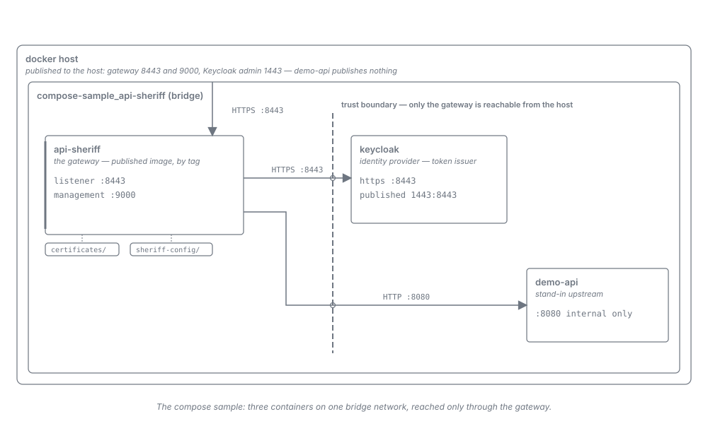

= Compose Sample -- Contributor Guide
:toc:
:toclevels: 3
:sectnums:

The `deployment` module owns one subtree, `compose-sample/`, holding a deployment-shaped Docker
Compose stack. This document covers why it exists as a separate stack, the decisions inside it that
look arbitrary until you know the constraint behind them, and the build mechanism that keeps it out
of the default lane. The link:../user/compose-sample.adoc[operator guide] covers running it.

== Topology

Three containers on one bridge network. `api-sheriff` is the only one an operator can reach for
traffic; `demo-api` publishes no host port at all, which is what makes "the gateway is the only way
in" a property of the stack rather than a claim in prose. Keycloak is published on the loopback
interface because the BFF sends the browser to its login page and a sample is worth inspecting; the
gateway reaches it container-internally regardless, for the token-key fetch and for the BFF back
channel.

One dial runs the other way: Keycloak calls the gateway. To verify the `private_key_jwt` assertion
the BFF authenticates with, it fetches the gateway's client JWKS at `/bff/jwks` over the internal
network -- `api-sheriff:8443` in the base sample, `tls-terminator:8443` in the plain-HTTP variant. The
topology diagram predates the BFF and does not draw that edge.

== Why this is not the integration-test stack

`integration-tests/docker-compose.yml` already brings up a gateway, an identity provider and a set
of upstreams. The sample deliberately does not reuse it, and equally deliberately does not trim it.

The integration stack exists to *exercise tests*. It carries toxiproxy for fault injection, a
TLS passthrough backend, an asset origin, a gRPC echo service and go-httpbin, plus six gateway
instances differing only by overlaid configuration. Every one of those exists to make an assertion
possible. None of them shows an operator how the gateway is deployed, and several would actively
mislead -- a reader who copies a fault-injection proxy into a production topology has been
misinformed by the documentation.

`demo-client` faced a related problem and solved it differently: it needs a *subset* of the
integration stack, so it uses explicit service selection against that same compose file rather than
declaring a second stack. That is the right call there, because the demo drives the same gateway
configuration the integration suite does. It is the wrong call here, because the sample's gateway
configuration is deliberately *different* -- a small, readable `gateway.yaml` with one public proxy
namespace and one server-session BFF, rather than the integration suite's much larger document. The
BFF is there because a session-protected route is deployment shape an operator needs to see; the
integration stack's further gateway instances and its per-suite realm clients and users are there
because tests need them, and stay out. A trimmed bring-up would have
forced the sample's configuration into a file whose job is to serve the tests, and the two would
have drifted.

The cost of a second stack is that the two files can diverge. That is accepted: they are answering
different questions, and the sample's value is precisely that it contains nothing you would have to
explain away.

== Runtime hardening and what it costs

All three services carry `security_opt: [no-new-privileges:true]`, `cap_drop: [ALL]` and
`read_only: true`, and none of them runs as root. The hardening is the substance of the sample --
that posture is what a production deployment should set, and setting it explicitly rather than
inheriting a default is the whole point.

`read_only: true` is the expensive one, and each service pays differently. These are the three
findings, each of which was a crash loop before it was a line of configuration:

`demo-api` (nginx):: Runs as `user: "101:101"` and writes to three paths. A tmpfs is created
root-owned and mode 755, so the unprivileged process cannot create `/var/cache/nginx/client_temp`
and nginx dies at startup with `mkdir() ... failed (13: Permission denied)`. Each tmpfs therefore
carries `uid=101,gid=101`. The service also sets `entrypoint: ["nginx", "-g", "daemon off;"]`,
bypassing `docker-entrypoint.sh` -- whose `10-listen-on-ipv6-only.sh` step rewrites
`/etc/nginx/conf.d/default.conf` in place and fails under a read-only root.

`keycloak`:: `start-dev` re-augments Quarkus on every boot and writes the rebuilt runner into
`/opt/keycloak/lib/quarkus`. Under `read_only: true` that write raises
`ReadOnlyFileSystemException` and the server never starts. The fix is a *named volume* at that path,
not a tmpfs: Docker seeds a named volume from the image's content at that path on first use, whereas
a tmpfs would mask the shipped libraries with an empty directory and break the augmentation a
different way. `/opt/keycloak/data` gets its own named volume for the realm import.

`api-sheriff`:: Needs only a tmpfs at `/tmp`. It declares no `user:` key because its image already
declares `USER nonroot` (uid 65532); restating the uid here would only risk drifting from it.

[[_the_certificate_permission_trap]]
=== The certificate permission trap

The certificate material is generated, never committed, and the generator writes the private key
world-readable. That is a deliberate inversion of the usual rule, and the reason is structural: the
two containers that mount the directory run as *different* non-root uids -- the gateway as 65532 and
Keycloak as 1000 -- while the files are owned by whichever host user ran the script. Neither uid can
be matched from the host without root, so mode 600 makes the key unreadable inside the container and
the gateway dies with `AccessDeniedException: /app/certificates/localhost.key`.

`integration-tests/src/main/docker/certificates/generate-certificates.sh` still chmods its key to
600, and that stack works -- but the mode there is nominal. Those certificates are *committed*, and
git records only the executable bit, so a fresh checkout materialises them world-readable anyway.
The sample commits no key material, so the mode it is created with is the mode the container
actually sees. Do not "restore" the 600 here by analogy with that script.

== The BFF: trust in both directions

The sample's BFF follows FAPI 2.0 rather than the simplest thing that works -- `private_key_jwt`
client authentication, pushed authorization requests, DPoP-bound tokens -- because the realm's
`sample-client` is what an operator copies, and a client that requires all three refuses a gateway
configuration that drops one instead of quietly downgrading it. That choice makes trust a two-way
problem, and each direction is wired explicitly.

*The gateway trusts Keycloak* through the `sample-idp` profile described under the probes below: the
token-key fetch names it as `jwks.tls_profile`, and the BFF back channel -- discovery, the pushed
authorization request, the code exchange, refresh and revocation -- names it as
`egress_tls.oidc_tls_profile`. Both dial `keycloak:8443`, so the certificate's SAN carries
`keycloak`.

*Keycloak trusts the gateway* because it has to call it: it verifies the client assertion against the
public key it fetches from the gateway's `/bff/jwks`. `KC_TRUSTSTORE_PATHS` anchors the generated
certificate for that fetch, with hostname verification left on, which is why the SAN also names the
two hosts Keycloak dials -- `api-sheriff` in the base sample and `tls-terminator` in the plain-HTTP
variant, where the gateway itself serves no TLS and the terminating hop answers instead.

*The JWKS URL differs per variant, and the realm file is shared.* The realm therefore names it as a
placeholder, `jwks.url: ${SAMPLE_GATEWAY_JWKS_URL}`, which Keycloak resolves from its environment at
import, and each compose file sets that variable to the address its own topology can reach. A literal
URL in the realm would be right for exactly one variant.

*The signing keys ride the existing `certificates/` mount.* `client-auth.pem` and `dpop.pem` are
generated by the same script as the TLS material, are git-ignored by the same rule, and reach the
gateway through the read-only mount it already has, named by `SHERIFF_CLIENT_AUTH_KEY_FILE` and
`SHERIFF_DPOP_KEY_FILE`. A second mount would have added a volume and a second permission story for no
gain in a sample. The cost is that Keycloak, which mounts the same directory for its certificate,
can read the keys too -- harmless here, because they are unregistered anywhere but the sample realm,
and recorded in the operator guide's list of sample-only values, where a real deployment is told to
mount its keys into the gateway only. The files are world-readable for the uid reason
<<_the_certificate_permission_trap>> gives.

== The BFF login check

`scripts/check-bff-login.sh` logs in through the BFF with `curl` and one cookie jar, following every
redirect itself, so a green run means a browser user can sign in and reach the upstream -- not that
the gateway reported `READY`, which layer 2 of the readiness gate already establishes. The script
header documents what each of its five steps proves; two decisions in it are worth recording here.

*The negative control comes first.* Step 1 sends an API request for `/app` with no session and
requires `401`. Without it, the final assertion -- `200` carrying the `demo-api` marker -- would pass
just as well against a route that demanded no session at all, because the public `/api` route serves
the same document. A matched control is what makes the positive assertion mean "the login worked"
rather than "the upstream answered".

*It derives every URL after the first.* The authorization URL, the login form's action and the
callback all come from a `Location` header or the page Keycloak served, so the script names neither a
variant nor an identity-provider host. The plain-HTTP variant, and any later variant that moves the
identity provider, reuse it unchanged, and `start-sample.sh` stays the one bring-up.

It verifies TLS against the generated certificate rather than passing `-k`, bounds every request
with `--max-time`, keeps the jar and the credentials in a private `mktemp -d` directory removed on
every exit, and on failure prints the step, the status and the response headers with cookie values
and URL queries removed -- never a token, a code or a password.

== Probes: three different answers to the same question

The stack contains three readiness-shaped mechanisms, and they are not interchangeable.

The gateway carries a `healthcheck:` key, and it is a deliberate *mirror* of the `HEALTHCHECK` baked
into `api-sheriff/src/main/docker/Dockerfile.native`, which remains the authority for both the
mechanism and the four cadence values. The image already carries that declaration, so the block in
this compose file is not what makes the container report health -- it is here so an operator reading
the sample sees the contract their own deployment inherits, and can copy it. Keep the two in step: a
Compose `healthcheck:` key *overrides* the image's declaration rather than merging with it, so a
drifted copy does not extend the real probe, it silently replaces it.

Its form is forced, and for a sharper reason than Keycloak's below. The distroless image ships
exactly one executable and no interpreter at all, so every probe form that needs one -- a shell
command, `curl`, `wget`, even Keycloak's `/dev/tcp` trick -- is unavailable by construction. That
leaves exactly one available form: the exec list naming that single executable,
`["CMD", "/app/application", "--health-probe"]`. The string form is not an alternative spelling of
it -- Docker rewrites a `test` string to `CMD-SHELL`, which resolves a `/bin/sh` this base does not
ship, so a string here would fail permanently.

What the probe measures is a bare TCP accept on the management port, answered by the application's
own `main` before Quarkus starts. It is therefore a *liveness* signal, which is why the host-side
gate below still asserts readiness on top of it.

Keycloak carries a TCP-accept probe, `bash -c 'echo -n > /dev/tcp/127.0.0.1/9000'`, and the form is
forced: the Keycloak image ships neither curl nor wget, so a probe naming either would fail
permanently and be indistinguishable from a service that never came up. `bash` is present, so
`/dev/tcp` is the available primitive. It is deliberately *accept-level only* -- it proves the
management listener is bound, not that the realm finished importing. It has one job, ordering the
gateway's start behind the identity provider's, and it does that job only roughly: the gateway can
still start while the realm imports, miss its first key-set fetch and sit out a retry backoff. That
residual is why layer 2 below polls instead of asking once.

`scripts/start-sample.sh` is the actual readiness gate, and it is bound by
link:../adr/0031-Host-side_readiness_gates_derive_the_probe_URL_from_the_resolved_Compose_model_and_assert_readiness.adoc[ADR-0031].
It gates in two layers, and they are not redundant -- each answers a question the other cannot.

*Layer 1 -- waiting.* `docker compose up -d --wait --wait-timeout 120` blocks until every service is
healthy, or running where it declares no health check: the gateway's baked probe, Keycloak's declared
one, and plain "running" for the demo upstream, which declares none. Unscoped is the correct meaning
here, because that is the right condition for each of this sample's three services. (The integration
stack scopes its own `--wait` to the gateway service names, because its model also carries backends
for which "healthy" would mean something else.)

*Layer 2 -- semantics.* A bounded readiness poll per derived target, addressed beneath that
target's derived management root path. Layer 1's signal is
a bare TCP accept -- it must be, because the management scheme is deployment-bound under
link:../adr/0025-The_whole_server-TLS_surface_is_neutral_in_gatewayyaml_and_bound_by_exactly_two_seams.adoc[ADR-0025] --
so it proves the interface is listening, not that the gateway reported `READY`. This assertion closes
exactly that gap. It is a *bounded wait* here rather than the integration stack's single shot, and
the difference is the stack, not the rule: readiness also waits for the issuer's JWKS key set, and
this sample orders its gateway only behind an accept-level Keycloak probe, so the first key-set fetch
can land during the realm import and be retried on the gateway's backoff (one second doubling, capped
at 30 s). ADR-0031 names exactly this case and prescribes this remedy. The budget, 90 one-second
attempts, outlasts that backoff's 61 s climb to the cap (1 + 2 + 4 + 8 + 16 + 30 s); a target still
not `UP` when it is spent is a real defect and fails the gate with the same diagnostics as layer 1.

The key set loading at all depends on trust, which the sample binds explicitly. Keycloak serves the
generated self-signed certificate, which no default trust store contains, so the issuer in
`gateway.yaml` names `jwks.tls_profile: sample-idp`, and `docker/certificates/sample-idp-trust.properties`
-- loaded through `QUARKUS_CONFIG_LOCATIONS`, the same mechanism the integration stack uses for its
`benchmark-idp` profile -- binds it to `sample-idp-truststore.p12`, which `generate-certificates.sh`
builds from that one certificate. Before that binding existed the fetch failed certificate validation
and readiness could never reach `UP`; no poll budget fixes that, which is why the two changes belong
together.

Layer 2 derives its whole probe target from `docker compose config --format json`:

* *which services to probe beneath a root path* -- those carrying the
  `de.cuioss.sheriff.management-scheme` label, *minus the identity provider*, which is waited on
  separately and unprefixed (see the carve-out below);
* *which scheme to speak* -- that label's value;
* *which root path the probe sits beneath* -- the sibling `de.cuioss.sheriff.management-root-path`
  label's value, *required* on a probe target and never defaulted: falling back to the shipped
  default would let a service that lost the label keep passing against a path its gateway may no
  longer serve, which is the exact drift the label exists to make impossible;
* *which host port to hit* -- the port published against the container-port selector 9000.

*The identity-provider carve-out is part of the rule, not an implementation detail.* Keycloak carries
*both* labels, but for label-set uniformity only: it serves `/health/ready` directly on its management
port under *no* prefix, so splicing its root-path label into a probe URL addresses a path it does not
serve. An implementation therefore splits the IdP row out of the derived set and keeps the unprefixed
literal for it. `integration-tests/scripts/start-integration-container.sh` does exactly that where it
partitions the discovered rows into `KEYCLOAK_TARGET` and `READINESS_TARGETS`, and the comment at that
split states the reason at the site; the integration-test runbook
(`.claude/skills/run-integration-tests/SKILL.md`) spells the same carve-out out for a human reader in
its probe list. This sample's own stack never reaches the case, because only its
gateway service carries the labels -- but the rule above is stated in its general form, so the
exclusion belongs in it rather than in the one script that happens to need it.

The only literals are the container-side management port and the endpoint names beneath the derived
root path, and both deliberately so. The port is a stable platform-level fact used as the *selector*
that picks the management binding out of a service's port list, not a per-deployment value; the
endpoint names (`/health`, `/health/ready`) are Quarkus' own fixed suffixes rather than
deployment-bound values. Renumbering the published port, moving the gateway's management context path
(link:../user/context-path.adoc[The Context Path]), or adding a second gateway instance therefore
needs no edit to the script.

ADR-0031's negative list is binding here, and each item is a real failure mode:

* *No restated host port, no restated scheme and no restated root path.* A list in the script
  mirroring the compose file becomes a defect the moment any of them changes.
* *No liveness probe standing in for readiness.* The liveness endpoint answers as soon as the process
  is up, which is strictly earlier than the point at which the gateway can serve a request. Gating on
  it would clear the wait before the stack is usable -- the exact race the gate exists to remove.
  Layer 1's baked container probe is liveness-shaped for the same structural reason, which is why
  layer 2 is not redundant with it. `curl -sf` is equally load-bearing in that assertion: without
  `-f`, curl exits 0 on the 503 the readiness endpoint returns while starting, so the gate would pass
  as soon as the port *accepted*.
* *Two bounds, each with a recorded origin.* The script owns `--wait-timeout 120`, roughly 13x
  headroom over the worst measured time-to-ready of 9.14s recorded in
  link:integration-test-topology.adoc[the integration-test topology document], and `READY_ATTEMPTS=90`
  for the readiness poll behind it, derived from the gateway's JWKS retry backoff as described under
  layer 2. Re-derive either before shrinking it -- a bound that is too small turns a slow machine into
  a spurious failure, which is worse than waiting.
* *An empty target set is a hard failure.* Discovering no labelled service exits non-zero rather
  than passing, because a gate that probes nothing and reports success is a vacuous green.

`-k` is applied only when the derived scheme is `https`, so a plain-HTTP management interface is
probed without it and no branch on the service name is needed.

== The opt-in build mechanism

`deployment/pom.xml` carries a `compose-sample` profile with five `exec-maven-plugin` executions, in
phase order:

. teardown at `pre-clean`, so a stack an aborted run left behind cannot fail the bring-up with a port
  conflict. It accepts no non-zero exit: "nothing running" already exits 0, so exit 1 can only be a
  teardown that genuinely failed;
. `generate-certificates.sh --if-missing` at `pre-integration-test`. The certificate material and
  signing keys are git-ignored, so a fresh checkout -- every CI runner -- has none, and the
  bring-up's preflight would refuse to start. `--if-missing` generates the whole set there and leaves
  an operator's complete set untouched, so a local run never rotates keys behind anyone's back. It
  needs only `keytool` (the build JDK) and `openssl`;
. `start-sample.sh`, also at `pre-integration-test` and declared *after* the generator, because Maven
  runs the executions of one phase in declaration order;
. `check-bff-login.sh` at `integration-test`, between bring-up and teardown, so the profile gates on
  a working login and not only on readiness;
. teardown again at `post-integration-test`.

A second profile, `compose-sample-image`, is activated by the property `compose-sample.image` alone.
It declares nothing but an `environmentVariables` entry, `API_SHERIFF_IMAGE=${compose-sample.image}`,
on an execution with the id `start-sample`, which Maven merges into the `compose-sample` profile's
execution of that id. That is how a build points the sample at another image without editing `.env`:
the exported variable wins over the file, and `start-sample.sh` preflights whichever image results.
Without `-Pcompose-sample` there is no bound execution to merge into, so the property on its own
starts nothing.

CI runs the profile. The `integration-tests` workflow appends
`verify -Pcompose-sample -pl deployment -Dcompose-sample.image=api-sheriff:distroless` to its Maven
lines, after the integration suite: by then the suite has torn its stack down, freeing the sample's
host ports (`8443`, `127.0.0.1:9000`, `127.0.0.1:1443`), and the native image the integration build
produced from the pull request's source is still in the daemon. So every pull request brings the
base sample up on the image it built and logs in through its BFF. The plain-HTTP variant is not
part of that run.

The skip is *two layers*, matching the convention `demo-client` establishes: the profile means a
default build has no executions to skip at all, and `skipComposeSample` -- defaulting to `true` at
module level and flipped to `false` inside the profile -- means an accidentally activated profile
still needs a deliberate override to start containers. A plain `verify` leaves the `deployment`
module at a few milliseconds and starts nothing.

Note that this profile needs no `<skipTests>false</skipTests>`, and that is not an oversight.
`demo-client`'s `e2e-demo` profile requires that flip because `frontend-maven-plugin`'s test
execution binds to a testing phase and therefore honours the inherited `skipTests`, which would
otherwise hollow the profile into a vacuous green. `exec-maven-plugin`'s `exec` goal honours only
its own `<skip>`, so the module-level `skipTests=true` that keeps inherited surefire off this
Java-free module cannot silently disable this gate.

Only the *success* path tears the stack down. Maven offers no always-runs hook, so a failing gate
leaves the containers up -- which is wanted, because they hold the logs explaining the failure being
diagnosed. The `pre-clean` teardown is the remedy, and it fires on any subsequent `clean` build.

== Standing constraints

* *The sample never builds an image.* It demonstrates deploying a released artifact, which is what
  an operator does. `start-sample.sh` preflights the reference and attempts exactly one pull; if
  that fails it exits non-zero naming both documented routes rather than falling through to
  `compose up` and surfacing the same failure later as a less legible error.
* *`deployment/compose-sample/` is self-contained.* Nothing in it reaches into `integration-tests/`
  or the `api-sheriff` module -- not even for shell helpers, which is why the compose-command
  resolution is repeated inline in each script rather than sourced from
  `integration-tests/scripts/lib-docker-compose.sh`. The directory is meant to be copied wholesale.
* *No comments in `sample-realm.json`.* JSON has no comment syntax, and Keycloak's
  `RealmRepresentation` rejects unrecognised fields outright -- a `_comment` key fails the import
  with `Unrecognized field`. Rationale belongs in this document and the operator guide; the only
  in-file markers are the `CHANGE-ME-BEFORE-PRODUCTION` values themselves, which are loud by
  construction and trip secret scanners on purpose.
* *Keycloak's own limits apply to the realm file, and it does not report them early.* A client
  `description` longer than 255 characters fails the realm import with `Value too long for column
  "DESCRIPTION"`; Keycloak restarts on it in a loop and the bring-up fails on its health. And a client's
  explicit `defaultClientScopes` list replaces the realm's defaults, so it must name Keycloak's
  `basic` scope, which carries the `sub` claim: a list naming a scope that does not exist is accepted
  silently, the tokens lack `sub`, and the gateway refuses every login at its callback. The login
  check catches both; nothing earlier does.
* *The gateway's `gateway.yaml` stays small.* It carries one BFF -- one session-protected namespace,
  one `oidc` block and the public page a signed-out browser lands on -- because that is deployment
  shape. Everything the integration suite needs and an operator does not -- passthrough SNI, mTLS,
  further gateway instances and per-test clients -- is *absent* rather than present-and-disabled. A
  disabled block still has to be read and understood.
