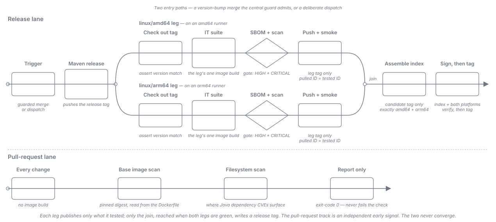

= Release Process
:toc:
:toclevels: 2
:sectnums:

How a release of API Sheriff is cut. A release has two entry points: merging a pull request that
changes the declared version in `.github/project.yml`, which *is* the publishing act once the
centrally-owned version-changed guard lets it through, and a deliberate `workflow_dispatch` from
`main`, which faces no central refusal and is the operator-gated fallback. This page states the
process and the rules that keep it safe.

== Cutting a release

The ordinary path is a single act -- merge the version declaration:

. *Declare the version.* Edit link:../../.github/project.yml[`.github/project.yml`], setting
  `current-version` to the version being released and `next-version` to the following development
  version. Open a pull request with that change.
. *Merge it.* Merging into `main` cuts the release. The Release workflow runs on the merged close,
  and the pinned cuioss-organization workflow's *version-changed guard* decides whether this merge
  is a release. It publishes when the declared version actually moved *and* no tag for that version
  exists yet, and refuses on either condition failing -- see <<guard-refusal-predicates>>.

*The merge is the publishing act, so review the pull request as one.* Approving a version bump is
approving a Maven Central publication, and a published coordinate can be superseded but never
withdrawn.

*`workflow_dispatch` is the fallback, and past one ref test it is unconditional.* The `release`
job's `if:` confines the dispatch path to `refs/heads/main`; a dispatch from any other ref is
skipped silently and publishes nothing, and a dispatch with `dry_run` set is refused on every ref
(<<dry-run>>). Dispatched from `main` without `dry_run`, Actions -> Release -> Run workflow
publishes whatever `.github/project.yml` declares there, including a re-declaration of a version
already published -- nothing central refuses it. Reach for it when the merge path did not
fire -- and when a merge cut no release, establish *which* of the guard's two conditions refused it
before dispatching: the `release / guard` job logs it as its `Release guard: SKIP` reason line
(<<guard-refusal-predicates>>). Only an unmoved version is a reason to dispatch, and only for a
version no tag names yet -- the guard checks the version first, so an `unchanged` line says nothing
about the tag. An already-existing tag means that version was already released, and dispatching
then republishes a published coordinate.

link:../../.github/workflows/release.yml[`.github/workflows/release.yml`] delegates to the
cuioss-organization reusable Maven release workflow, pinned to a specific commit SHA. Neither the
pin nor the `secrets:` block is part of the release decision -- they are build wiring.

== What a release contains

One release run produces one coherent set of artifacts, all carrying the same version:

* *Maven coordinates on Maven Central* -- `de.cuioss.sheriff.gateway:api-sheriff` and its reactor
  siblings, published by the reusable release workflow.
* *One image index on GHCR* -- `ghcr.io/cuioss/api-sheriff`, listing exactly two platform images,
  `linux/amd64` and `linux/arm64`, each built natively from the released source tree on a runner of
  its own architecture. Both release tags name the index.
* *Two SPDX SBOMs*, one per platform image, retained as artifacts of the release run.
* *Three Cosign signatures* -- over the index digest and over each of the two platform digests --
  stored in the registry next to the digests they sign.

That list is exhaustive. *No Helm chart is published*, and the Compose deployment sample is *not a
release artifact*: it lives in the repository at `deployment/compose-sample/` and is consumed from
the source tree rather than pulled from a registry. Both are named here so their absence from the
artifact list reads as a known boundary rather than an oversight.

Why the image is one index over two natively built platform images, and which CPU baseline each is
compiled for, is recorded in
link:../adr/0070-The_gateway_image_is_one_index_over_per-architecture_natively_built_and_tested_images.adoc[ADR-0070].

=== The image version is the Maven version

The image is a packaging of the same released source tree, not a separately versioned product, so
`ghcr.io/cuioss/api-sheriff:<version>` carries the Maven version verbatim. An operator who knows the
Maven version must be able to derive the image reference without consulting a mapping table, and a
divergence would make "which image contains fix X" unanswerable from the release notes alone.

This is a checked fact rather than a convention. Each of the two image legs checks out the release
tag the Maven release pushed, reads `current-version` from
link:../../.github/project.yml[`.github/project.yml`] with the same pinned action the release job
used, and asserts that the checked-out `project.version` equals it. A mismatch fails that leg, and
with it the release, before its image is built or pushed to GHCR. Both platform images therefore
carry the same version label, and the same revision label naming the release-tag commit.

[#release-not-atomic]
=== The release is NOT atomic

The image lane is three jobs. `publish-image` runs as two legs, one per platform, and declares
`needs: [release]`; `join` declares `needs: [release, publish-image]` and runs only when both legs
succeeded. So *the Maven Central publication has already happened* by the time any image step runs.
This is not an oversight and cannot be reordered away: the released version does not exist until the
release job has cut it, so nothing about the image can be validated beforehand.

The consequence is worth stating plainly rather than discovering during an incident. A failure
anywhere in the image lane leaves a *partial release*: the jars are on Maven Central and are
irrevocable, while GHCR holds less than a release. *What* it holds depends on where the failure
was, and the line between the cases is the join's last step, which writes the release tags:

* *A failed or cancelled leg* -- the integration-test suite, the SBOM step, the Trivy gate, the
  push, the plain-manifest check or the smoke test on either platform -- *leaves no release tag at
  all.* Only the join writes the release tags, and a leg that did not succeed leaves the join
  skipped. The legs run with `fail-fast`, so a red leg also cancels the other one. At most a
  leg-local `leg-<commit>-<arch>` tag is left behind, which no consumer is pointed at. There is no
  half release: no release tag ever names one platform while the other failed.
* *A failure in the join before it writes the release tags* -- an index assertion, a signature or
  its verification -- *also leaves no release tag.* The join pushes the index under the candidate tag
  `leg-<commit>-index` alone and proves, signs and verifies it there; the release tags are the last
  thing it writes. At most the `leg-<commit>-<arch>` tags and that candidate tag are left behind,
  which no consumer is pointed at.
* *A failure in the join's last two steps* -- promoting the verified index to its release tags, or
  reading them back -- is the only case that can leave a release tag behind. The promotion points the
  tags at the digest that was signed and verified, so a tag it did write names a signed index; re-run
  the join.

Everywhere this document or the workflow says a step runs "before anything is pushed", read it as
*before anything is pushed to GHCR*.

==== If the image lane fails after the Maven release

. *Do not re-trigger the whole workflow.* A second dispatch would attempt another Maven release of a
  version that is already published -- the dispatch path is unconditional and nothing central refuses
  it. The merge path is no remedy either, and *for two reasons rather than one*: re-merging the same
  version declaration moves nothing, so the guard's version condition refuses it; and an edit that
  makes the released version look like it moved again still publishes nothing, because the release
  job pushed that version's tag before this lane failed and tag-absence is the guard's second
  condition (<<guard-refusal-predicates>>). You are in the tag-exists case here by definition.
+
[WARNING]
====
Do not read that no-release as "the version didn't move" and reach for the dispatch on the strength
of it -- not even when the guard's reason line says `unchanged`, because the version is checked
before the tag and that line says nothing about the tag. The dispatch refuses nothing, so acting on that diagnosis republishes an
already-published coordinate -- the failure class this whole procedure exists to prevent.
====
. *Classify the failure first -- a re-run cannot pick up a fix.* *Re-run failed jobs* creates a new
  *attempt of the same run*: it reuses the original event context and the original workflow
  definition, and both image jobs check out the *release tag*, not `main`. A commit merged to `main`
  after the release run started is therefore invisible to it. "Fix it on `main`, then re-run" does
  not work here and must not be attempted.
+
--
Transient job or runtime failure::
A registry timeout, a runner flake, a Maven Central propagation race. Re-run from the Actions UI,
and re-run *only the image job that failed* -- never the `release` job. Each image job reads its
version from `.github/project.yml` at the triggering SHA and checks out the release tag, so a re-run
reproduces the same inputs without touching Maven Central.
+
* *A leg failed* (`Build, test and push the <platform> image`): re-run that leg. If `fail-fast`
  cancelled the other leg, re-run that one too -- the join needs both legs green, and it runs once
  they are. The re-run leg rebuilds and retests its image and hands the join its new digest.
* *Both legs are green and the join failed* (`Join the tested digests into the signed release
  index`): re-run the join alone. It reads the two digests the legs recorded in this run, so no image
  is rebuilt; it assembles the index from them again under the candidate tag, signs and verifies all three
  digests, and only then writes the release tags.

Anything carried in the tree or the workflow::
The source, the Dockerfile, the base-image pin, a `.trivyignore`, `release.yml` itself, the runner
label of a leg. A re-run reproduces the same inputs and so fails the same way, every time. Fix the
cause on `main` and *cut a new patch version*. Do not re-run.
--
. If the failure was the Trivy gate on an unfixable base-image CVE, see
  <<unfixable-base-image-cve>>. Note that both remedies there -- re-pinning the base and adding a
  `.trivyignore` -- are *tree* changes, so they fall under the second case above and need a new patch
  version rather than a re-run.
. If a version must be abandoned, *cut a patch version and publish relocation stubs* under the
  abandoned coordinates. Maven Central artifacts are never deleted, so a published coordinate can
  only be superseded, never withdrawn.

=== One build per architecture, and why the step order is inverted

link:../../integration-tests/pom.xml[`integration-tests/pom.xml`] binds
`docker compose build api-sheriff` to `pre-integration-test`, so the integration-test harness always
builds the image. Each leg of the publish lane is therefore ordered *test-which-builds, then
push-that-digest* rather than the more obvious build, test, push: the harness build is the one and
only image build in that leg, and the image it produced is the one that gets tagged, pushed, listed
in the index and signed.

The inversion exists so that "push exactly what was tested" holds *by construction*. Each leg has
only one build, so there is nothing that can drift between the artifact it tested and the one it
published.

*Two legs mean one build per architecture -- still never a second build of the same image.* GraalVM
native-image cannot cross-compile, and an emulated native build does not fit the time budget, so
the `linux/amd64` leg builds on an amd64 runner and the `linux/arm64` leg on an arm64 runner. The
harness pins no platform: the Compose build and every digest-pinned base image resolve to the
runner's own architecture, which is what lets the same step serve both legs unchanged. The join
builds nothing. It assembles the index inside the registry from exactly the two digests the legs
pushed, so every image a consumer can pull is an image some leg's integration-test suite ran
against.

[IMPORTANT]
====
Do not "correct" this back. Adding a second `docker build` to a leg, cross-building the other
architecture from one leg, replacing the leg push or the join with `docker buildx build --push`, or
adding a skip-guard to `integration-tests/pom.xml` so the harness stops building, reintroduces
exactly the drift the inversion removes -- and the drift is silent, because every build succeeds.
====

=== Scan and signature guarantees

* *Trivy gates the release at HIGH and CRITICAL, on each platform image.* The gate is the
  `Scan the tested image (gating, HIGH and CRITICAL)` step of
  link:../../.github/workflows/release.yml[`release.yml`], and it runs in both legs. A finding at
  either severity fails that leg, and the step runs before the leg's registry login, so nothing from
  that leg has been pushed to GHCR when it fires and no release tag is ever written (the Maven
  artifacts are already out -- see <<release-not-atomic>>). The threshold is deliberately stricter
  than a CRITICAL-only gate: API Sheriff is a security-focused gateway.
* *A Syft SBOM is produced in each leg for the same image* that leg's gate scanned, named
  `api-sheriff-<version>-<arch>-sbom.spdx.json`, and retained as an artifact of the release run.
* *Three digests are Cosign-signed keylessly*, under the workflow's GitHub OIDC identity, in the
  join's `Sign the release index and both platform digests (keyless)` step: the index digest the
  release tags name, and both platform digests, because a consumer can pull a platform digest
  directly and bypass the index. No key material and no new secret is involved, and the legs hold no
  signing permission at all. A tag is a mutable pointer, so signing one would sign nothing durable.
  The following `Verify all three signatures under the published identity` step then runs the
  operator verification command from link:../user/container-image.adoc[the container image guide]
  against each of the three digests and fails the release if any of them does not verify under the
  published identity. Only after that does `Promote the verified index to its final tags` write
  `<version>` and `sha-<commit>`, by the index digest, and `Assert every final tag names the signed
  index` reads both back.

The image scan is narrower than it looks. Each platform image is that architecture's variant of the
pinned distroless base plus one native executable and contains no jars, so each scan is in substance
a scan of that variant's OS packages -- and each SBOM, cataloguing that same image, carries exactly
the same scope. The two variants are separate package sets that can carry different CVEs, so a clean
scan of one says nothing about the other; that is why the gate runs in both legs and either one
blocks the release. Java dependency findings come from the pull-request supply-chain scan and from
the Sonar and Dependabot lanes, not from here.

[#unfixable-base-image-cve]
=== If the scan blocks on an unfixable base-image CVE

The gate runs with `ignore-unfixed: 'false'`, so it fails on HIGH and CRITICAL findings *including
those with no upstream fix available*. Combined with a digest-pinned base image, that means a
release can become blocked by a CVE in a layer this repository does not control and cannot patch --
in either architecture's variant of the base, since each leg scans its own.

That is the intended default -- an unfixable CVE in the shipped base is a fact an operator deserves
to know about, not something to route around silently. But it must have a sanctioned escape hatch,
or the first occurrence turns into an ad-hoc threshold relaxation under release pressure.

In order of preference:

. *Re-pin the base image* to a newer digest that carries the fix. This resolves the finding rather
  than hiding it, and is almost always available for a distroless base.
. *If, and only if, no fixed base exists*, add a `.trivyignore` at the repository root with one
  entry per CVE, each carrying a comment recording the CVE id, why it is not exploitable in this
  image, who accepted it and the date. Trivy picks the file up automatically. There is deliberately
  no `.trivyignore` in the tree today: an empty suppression file is an invitation to append to it
  without the accompanying justification.

Never relax `severity` or flip `exit-code` to `'0'` to get a release out. Those change the gate for
every future release; a `.trivyignore` entry is scoped to the specific finding and is visible in
review.

=== One-time action after the first release

A GHCR package created by a `GITHUB_TOKEN` push is *private by default*, and the in-workflow smoke
step pulls with the job's own credentials, so it cannot detect this. The release checklist therefore
carries one manual step:

. After the *first* release, open the organisation's package settings and set the `api-sheriff`
  package to *public*.

Until that is done every check stays green while `docker pull` fails for everyone outside the
organisation.

== Container image tags

Every release publishes exactly *two* release tags, and both name the same *image index* -- the one
the join assembled from the two tested platform digests. The join reads both tags back from the
registry and fails the release unless they resolve to one index digest that lists exactly
`linux/amd64` and `linux/arm64`, each pointing at its own leg's tested digest.

`ghcr.io/cuioss/api-sheriff:<version>`::
The human-facing release reference. `<version>` is the Maven version, verbatim.

`ghcr.io/cuioss/api-sheriff:sha-<commit>`::
*Provenance, not immutability.* `<commit>` is the *full 40-character SHA of the commit the release
tag points at* -- the `release:prepare` commit whose poms carry the released version -- and *not* the
`main` HEAD the release ran from. That is the commit whose source produced both platform images;
naming the triggering commit would point at a tree that never built them. The tag answers "which
source produced this?" unambiguously, but it remains an ordinary mutable registry tag and is not the
index digest -- which is exactly why Cosign signs digests rather than either tag.

*The `leg-<commit>-<arch>` and `leg-<commit>-index` tags are not release tags.* Each leg pushes its
platform image under `leg-<commit>-amd64` or `leg-<commit>-arm64` before the index exists, and the
join pushes the index under `leg-<commit>-index` until it has been signed and verified; none is a
release tag, and the join writes `<version>` and `sha-<commit>` only afterwards:
a release tag may only ever name the index over both platforms, so a leg that wrote one would
publish a single-platform release the moment it finished. The leg tags stay on the two platform
images after the release and accumulate, one pair per release; the candidate tag stays on the index.
They are harmless -- they name images
that are part of a signed release -- but no consumer is pointed at them, and the README's version
badge ignores them, together with the `sha-`, `sha256-` and `dryrun-` tags.

*Neither release tag is a deployment pin.* Only `ghcr.io/cuioss/api-sheriff@sha256:...` is
immutable, whether it names the index or one platform image; both tags above can be repointed at the
registry. Operator guidance for resolving, choosing between and deploying those digests is in
link:../user/container-image.adoc[the container image guide].

*No floating `:latest` tag is published at pre-1.0*, and that is a decision rather than an omission.
A floating tag invites an unpinned production pull whose contents change under the operator, which
is precisely the posture a security-focused gateway should not encourage. Operators pin by version,
or by digest for production.

link:../user/container-image.adoc[The container image guide] covers pulling, running and
cryptographically verifying the published image.

[#dry-run]
== Proving the image lane with a dry run

A dry run runs the whole image lane -- both legs with their full integration-test suites, the join,
the three signatures and their verification -- *without a release*, and then deletes everything it
pushed. It is how a change to the image lane, or a first run on a new runner, is proven before a
real release depends on it. A release cannot be rehearsed any other way: the release path publishes
to Maven Central first, irrevocably, so finding a broken leg there means a partial release.

=== Dispatching it

Dispatch the Release workflow with the `dry_run` input set, from the ref whose `release.yml` and
source tree should be proven -- usually the feature branch that changes the lane:

[source,bash]
----
gh workflow run Release --repo cuioss/API-Sheriff --ref <branch> -f dry_run=true
----

In the Actions UI this is Actions -> Release -> Run workflow, with the branch selected and *Dry run*
ticked. A dispatch runs the workflow definition of the ref it is dispatched from, which is what lets
a branch prove its own change to the lane before it is merged.

*A dry run may be dispatched from any ref; a release may not.* The release path is confined to
`refs/heads/main` because a release publishes what consumers pull by a release tag, under the one
signing identity operators verify against. A dry run publishes neither, and dispatching it already
requires write access to the repository, so allowing other refs widens nothing.

=== What it does

* *The `release` job is skipped, on every ref.* Its `if:` refuses a dry-run dispatch before the
  called workflow starts, so the central guard is never consulted and no Maven publication, SCM tag
  or GitHub release can result -- from `main` or from anywhere else.
* *Both legs build the dispatching commit*, labelled with the version `dryrun-<run_id>` and with that
  commit as its revision. There is no release tag to check out and no released version to claim, so
  the version-identity assertion is replaced by a check that the tested image carries the
  `dryrun-<run_id>` version label. That check runs after the integration-test suite, because it
  inspects the image the suite built; the rest runs as on a release: the integration-test suite, the
  SBOM, the Trivy gate, the push, the plain-manifest check and the smoke test by digest.
* *The join assembles the two-platform index and runs every index assertion*, then signs the index
  and both platform digests, verifies all three, and promotes the verified index to
  `dryrun-<run_id>-<attempt>-promoted`, so the promotion and its read-back run for real. The
  verification uses an identity derived from the dispatching ref -- the published identity with that
  ref, regex-escaped, in place of `refs/heads/main`. A dry run therefore produces signatures the
  published operator identity refuses.
* *A dry run dispatched from `main` does not sign.* A signature made from `refs/heads/main` would
  satisfy the published operator identity whatever the run was for, so on `main` the join skips the
  signing and its verification and says so in a notice. Dispatch the dry run from a branch to
  exercise them -- the branch runs the same steps under its own identity.

=== What it never does

* *It writes no `<version>`, no `sha-<commit>` and no `leg-<commit>-<arch>` tag.* Every tag it pushes
  names the run *and its attempt*: `dryrun-<run_id>-<attempt>-amd64`,
  `dryrun-<run_id>-<attempt>-arm64` or, on the index, `dryrun-<run_id>-<attempt>` and
  `dryrun-<run_id>-<attempt>-promoted`, where `<attempt>`
  is the workflow's run attempt -- `1`, and one more for each re-run. Each leg and the
  join assert this against the run's own id and attempt, anchored at both ends, before their first
  push. The version label stays `dryrun-<run_id>`: it names the run, not the attempt.
* *It never runs beside a release.* The image jobs accept a skipped `release` job only on a dry-run
  dispatch, so a release run cannot take the dry-run path and a dry run cannot reach the release
  path.
* *It publishes nothing to Maven Central.*

=== Cleanup

The `cleanup-dry-run` job runs at the end of every dry run, whatever the outcome of the image jobs
-- a dry run that failed half-way or was cancelled has still pushed images. It deletes exactly the
package versions this run created: the index, both platform images and the signature artifacts
Cosign stored for each of those three digests. It finds them by the digests the run recorded -- each
leg records its digest the moment it has pushed, the join records the index digest the moment the
index exists -- and never by sweeping a tag pattern, which could delete another dry run's versions
still in flight.

After deleting, it reads the package again and *fails, naming each one*, when anything it should
have removed is still there: a recorded digest the delete did not remove, or a version still
carrying one of this run's tags. Those are matched for *every* attempt of the run, from `1` to the
current attempt, as `dryrun-<run_id>-<attempt>` with at most one lowercase-alphanumeric suffix
(`-amd64`, `-arm64`, `-promoted`, or a leg added later). The match is anchored at both ends on this
run's id and the attempt, so it never reaches another run's or another attempt's tags, and it needs
no list of architectures to keep in step with the legs. The tag check only reports; it deletes
nothing.

*The tags are attempt-scoped so that a re-run cannot hide a version.* A leg pushes before it records
the digest, so a push followed by a failed record leaves a version only its tag still names. Were the
tag the same on every attempt, a *Re-run failed jobs* would push under it again, move it to the new
digest, and leave the earlier version untagged and unrecorded -- and the re-run's cleanup would go
green over it. Under attempt-scoped tags the earlier version keeps its own attempt's tag, and the
check names it.

*Re-run a dry run with "Re-run all jobs", or dispatch a new one -- not with "Re-run failed jobs".*
The cleanup of an attempt deletes every digest that attempt recorded, the green leg's included. A
*Re-run failed jobs* re-runs only the failed leg and the jobs that depend on it, so its join would
look for the green leg's digest, which the earlier attempt's cleanup has already deleted, and fail.

A green cleanup therefore means the dry run left no package version behind. A red one names what to
delete by hand in the package settings. A leftover `dryrun-<run_id>-<attempt>` tag is harmless to
consumers -- no one is pointed at it -- and the README's version badge ignores every `dryrun-` tag.

The SBOMs a dry run generates stay behind as artifacts of that workflow run, named for the
`dryrun-<run_id>` version; they are run artifacts, not package versions, and expire with the run.

== Trigger rules

Two rules govern how the release workflow may be triggered, and how a trigger may be changed. Both
are normative. The two subsections following the first rule are not further rules: they record the
empirical control run against that rule, and what that control does and does not establish.

[#guard-refusal-predicates]
=== The version-changed guard is the release decision

link:../../.github/workflows/release.yml[`.github/workflows/release.yml`] declares two triggers: a
`workflow_dispatch` carrying no branch filter, and a `pull_request` narrowed by `types: [closed]`,
`branches: [main]` and `paths: ['.github/project.yml']`. The `release` job's `if:` then narrows each
path once more -- the dispatch path to `refs/heads/main` and to a dispatch without `dry_run`, the
merge path to `merged == true` -- so a dispatch from a non-`main` ref, or any dry-run dispatch, is
skipped before anything is published. On the merge path the
question *"is this merge a release?"* is answered by the pinned cuioss-organization workflow's
*version-changed guard*.

*It refuses on either of two conditions, checked in this order:*

. The declared `current-version` did not move against the parent commit.
. A tag for the declared version already exists.

*The guard names the condition that refused.* It returns the refusal as its `reason` output, logs it
in the `release / guard` job as one of these two lines, and writes the same reason to that job's
summary:

* `Release guard: SKIP — release.current-version unchanged at <version>`
* `Release guard: SKIP — release.current-version changed to <version>, but a tag for <version> already exists`

What does not name the reason is the downstream rendering: an empty `released-version` and the
skipped jobs after the guard look identical for both conditions. Read the `release / guard` line,
never the skipped jobs, to learn which condition refused. Because the version is checked first, an
`unchanged` line says nothing about whether a tag for that version exists.

Both must be false for the merge to publish. The guard is named for the first condition because that
is what it was added for, but reading a no-release outcome as "the version didn't move" is a
one-predicate reading of a two-predicate guard -- and it is exactly the misreading that sends an
operator to the dispatch fallback after a partial release (see <<release-not-atomic>>), where no
central guard refuses at all.

*That guard is consumed, never re-implemented here.* A local copy of a security-relevant decision is
a second answer, and the local copy is the one that drifts out of sync. Do not add a caller-local
version comparison.

*What this section says about the guard holds for two pins, and must be re-checked when either
moves.* The `uses:` of `release.yml`'s `release` job (currently line 132) pins
`cuioss/cuioss-organization/.github/workflows/reusable-maven-release.yml@7115714` (v0.42.0), and
that workflow's `guard` job runs `cuioss/cuioss-organization/.github/actions/release-guard@ecd94a9`
(v0.42.0). The check order and the reason lines quoted above are those of that action's
`release-guard.py` at `ecd94a9`.

*The `paths:` filter is a prefilter, never the decision.* It matches *every* edit to
`.github/project.yml` -- `name`, `description`, `maven-build`, `sonar`, `pages`, `github-automation`,
and whatever key is added tomorrow -- so a merge arriving at the workflow proves nothing about the
version. Its only job is to keep unrelated merges from spending a runner. Reading it as the release
condition is precisely the 2026-07-12 defect: a trigger of exactly that shape fired on merged-ness
and published an unintended GA coordinate that had to be abandoned and relocation-stubbed.

`branches: [main]` filters on the pull request's *base*, so only a pull request merging into `main`
can reach the release job at all, and the job additionally refuses any close that was not a merge.
Both narrow *what may ask*, never *what is answered*.

The scope of all this is *release publication*. A merge to `main` is not otherwise inert:
link:../../.github/workflows/maven.yml[`maven.yml`] runs on `push: branches: [main]`, and its
snapshot deployment runs on that push (it is skipped on pull requests). So a merge can publish a
*snapshot* -- and, when the guard says the declared version moved, a release.

The decision is recorded in
link:../adr/0035-A_release_is_cut_by_a_guarded_version-bump_merge_or_a_deliberate_dispatch_and_the_version-changed_decision_is_centrally_owned.adoc[ADR-0035],
which supersedes ADR-0034.

[#guard-negative-control]
=== The observed refusal: a negative control over the guard

*This subsection was written before the merge it describes.* What follows is a prediction, not a
report. That ordering is what makes it falsifiable: an artifact written afterwards can only agree
with whatever happened, while this one can be shown wrong.

*The design.* A change to one non-`release:` key of
link:../../.github/project.yml[`.github/project.yml`] is merged. The `paths:` prefilter matches
*every* edit to that file, so the workflow fires; both `if:` operands are true on a merged pull
request, so the `release` job runs; and the version-changed guard executes inside it and refuses,
because the declared `current-version` did not move. Nothing in the `release:` block is touched --
not `current-version`, not `next-version`, not `create-github-release` -- and that is the whole
point of the control. The guard's two refusal predicates and its central ownership are described in
<<guard-refusal-predicates>> and decided by ADR-0035; they are consumed here, not restated.

*The run is identified by a rule, not by a value:* *the Release workflow run attached to this pull
request's merge commit*. No run id is committed here. An id would need a future edit to stay
correct, and a placeholder for one would be an untrue statement sitting in the tree.

*The predicted signature is a conjunction of four rows:*

. `release / guard` -- *success*
. `release.outputs.released-version` -- *empty*
. `release / release` -- *skipped*
. `Publish the tested image to GHCR` (`publish-image`) -- *skipped*

*Row 4 alone is insufficient.* That same rendering also occurs when the `release` job *fails*.
Without row 1 you cannot tell *refused by decision* from *died before deciding* -- and a crashed
guard, the more alarming of the two, wears exactly the same clothes.

*Two further rows are inert, and naming them is required.* `wait-for-maven-central` and
`propagate-to-consumers` are `if:`-gated on a non-empty `consumers` output, and
link:../../.github/project.yml[`.github/project.yml`] declares no `consumers` key at all. They skip
on every run of this workflow and so carry no information in either direction. Left unnamed, a
reader counts three skips and credits two of them.

*Cite the specific prefixed rows, never "the release job".* The run renders the called workflow's
inner jobs prefixed -- `release / guard`, `release / release`. There is no separate outer row to
cite.

*The absence evidence is end-state corroboration only.* No new tag, no Maven Central artifact, no
GHCR push. On its own it passes vacuously: it is equally true of every non-release merge in this
repository's history. It is retained because it corroborates the four rows, never because it
substitutes for them.

*Provenance of the discriminator.* link:../../.github/workflows/release.yml[`release.yml`] declares
`released-version` the run/skip discriminator for the downstream jobs, in the comment block and the
`if:` of its `publish-image` job: an empty value skips them. What an empty value proves is exactly that *no release was produced* -- not that
the declared version was unchanged. Emptiness is the union of both refusal predicates named in
<<guard-refusal-predicates>>, so it cannot discriminate a version that did not move from a tag that
already exists. Row 2 is therefore evidence drawn from the mechanism's declared contract rather
than an inference over its behaviour -- but read as the narrower claim it would be the very
one-predicate reading <<guard-refusal-predicates>> warns against.

*Escalation condition.* If the observed rendering does not match the predicted signature, that is a
finding about the guard, not a run id to file. It goes in-tree, in a follow-up PR, and the
artifact's claim is withdrawn until it does.

The observed run id and the rendered conclusions are posted as a comment on the merged pull request
-- public, permanent, and reachable from the merge commit -- not committed here.

[#guard-negative-control-limits]
=== What that control proves, and what it does not

*The four rows alone cannot tell which condition declined.* In control run `31256991225` both were
true: `current-version` was `0.1.1` at the merge and at its parent, and a tag `0.1.1` already
existed. The signature is the same for either refusal.

*The guard's reason line can, and it is the evidence.* The `release / guard` log of that run reads
`Release guard: SKIP — release.current-version unchanged at 0.1.1`. `decide` checks "unchanged"
before "already tagged", so a guard stuck on "changed" would have passed the first check and logged
the tag reason -- `release.current-version changed to 0.1.1, but a tag for 0.1.1 already exists` --
instead. On that line the control proves the guard *refused*, and refused on the version check.
The run executed the guard at the earlier action pin `b94a4a9`; `decide`'s check order and both
reason strings are unchanged at the current pin `ecd94a9`, and the diff between the two is
formatting only.

*The caveat, undiminished:* a guard permanently stuck on "unchanged" logs exactly the same line and
renders exactly the same four rows. Such a guard refuses this merge for entirely the wrong reason and
looks identical doing it. The control does *not* prove the guard *can proceed*, and it must never be
cited as though it did.

*Two things settle that, and both are cited rather than re-manufactured.* The 0.1.1 cut -- run
`31157727796` -- is the positive control: the guard did let a release through when the declared
version had genuinely moved, so a second deliberate release is not needed to re-establish it. And
the checkout of the pinned reusable workflow settles the *mechanism*, because the guard decides by
comparing the declared version against the parent commit and checking the tags. Its `guard` job
checks out with `fetch-depth: 0` and `fetch-tags: true` on every event except `workflow_dispatch`,
so the clone reaches that parent and carries the tags; the control run's guard log shows the
checkout running with both. When the parent commit is missing anyway, the guard cannot decide:
`release-guard.py` exits `1`, the `release / guard` job fails and the run goes red. That is a failed
run, not a refusal -- a refusal is a green `release / guard` with `proceed=false`. Citing one of the
two without the other lets the negative control imply more than it shows.

*The asymmetry is recorded, not erased.* The two stuck-guard failure modes are not equally bad:

* *Stuck on "unchanged" fails SAFE.* Releases are blocked -- visible, annoying, and recoverable
  through the `workflow_dispatch` path, which carries no version-changed guard at all.
* *Stuck on "changed" fails DANGEROUS.* It publishes irrevocably. A wrong GA coordinate cannot be
  withdrawn, only abandoned and relocation-stubbed, as the 2026-07-12 defect required.

The dangerous direction is therefore the one worth an empirical control, and the reason line is what
makes this control cover it: a guard stuck on "changed" would have logged the tag reason, not
`unchanged at 0.1.1`. It covers that direction deliberately, and first. *Anyone later tempted to "balance" the two directions
must not do so by weakening the negative control.* The remedy for an under-evidenced safe direction
is more evidence on that side, never less on this one.

=== A trigger removal merges on its own

For a `pull_request` event -- including `types: [closed]` -- GitHub evaluates the workflow
definition *from the base branch*, not from the pull request's head. A pull request that both
removes a trigger *and* edits the paths that trigger watches is therefore still evaluated against
the *old* workflow definition on `main` at merge time, and the very merge that deletes the trigger
fires it one last time.

The general rule this leaves behind: *a change that removes or weakens an event-driven workflow
trigger must merge on its own, before any change that would fire that trigger.* Verify the trigger
is gone from `main` before relying on it being gone.

== See also

* link:../../.github/workflows/release.yml[`.github/workflows/release.yml`] -- the release workflow
  and its two triggers.
* link:../../.github/project.yml[`.github/project.yml`] -- where the released version is declared.
* link:../user/container-image.adoc[Container Image] -- the operator layer for the published image.
* link:README.adoc[Contributor Guide] -- the index for this documentation layer.
