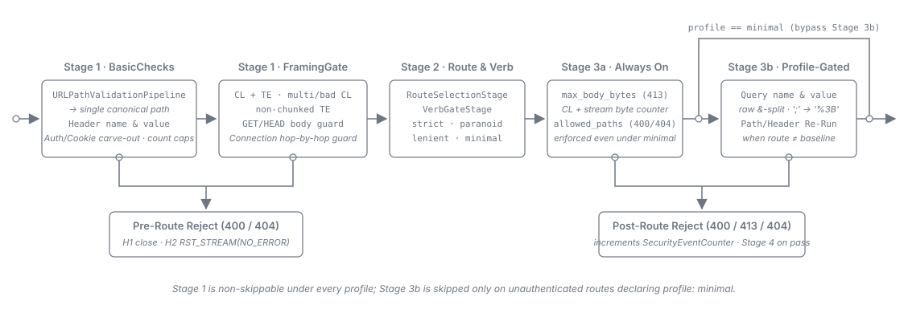
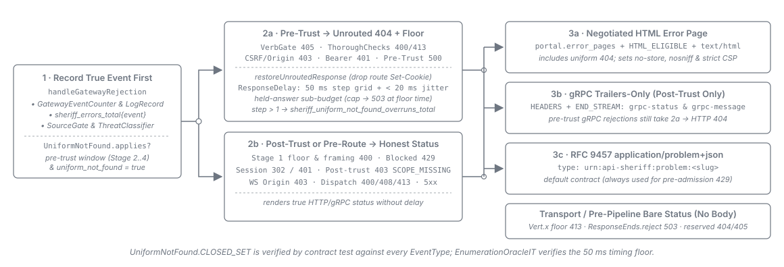
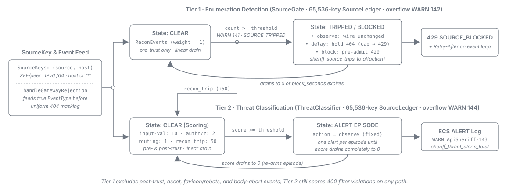

= API Sheriff -- Edge Security
:toc: left
:toclevels: 3
:toc-title: Table of Contents
:sectnums:
:source-highlighter: highlight.js

What the gateway does with a request at its edge, before any upstream sees it, and the knobs that
change that behaviour. The guide follows a request in:

. The *inbound filter* and the *framing gate* judge the request's form -- path, headers, query,
  body framing -- under the selected filter mode.
. A request a route refuses before authentication is answered as the *unrouted `404`*, so a
  scanner cannot tell which addresses are routes.
. Such refusals are counted *per source*, minus the exclusions in
  <<_enumeration_detection_operator_note,the counted-rejection table>>: a scanning source trips
  enumeration detection, and a separately weighted score raises a *threat ALERT*.
. Fixed *transport bounds* and two configurable *admission budgets* protect the listener itself.
. On the way out, an asset response carries a `Content-Type` the gateway decides, never the source.

The field-level contract for every key mentioned here lives in
link:../configuration/security-and-edge-hardening.adoc[Configuration -- Security and Edge
Hardening]; this guide is the operator's decision guide. Route authoring is covered in
link:endpoint-routes.adoc[Endpoint Route Configuration].

== Inbound Filter Modes (`security_defaults.profile`)

The `profile` knob selects the gateway's inbound-validation mode. It is declarable gateway-wide on
`security_defaults` and per anchor, endpoint or route on `security_filter`, where the nearest
declared `security_filter` block wins (see
link:anchors.adoc#_policy_block_resolution[Policy-block resolution]). The field-level contract lives
in
link:../configuration/security-and-edge-hardening.adoc#_security_defaults[Configuration Reference -- `security_defaults`].

=== The modes

[cols="1,2,3"]
|===
| Mode | Choose it when | What you get

| `strict`
| Default choice. Any route serving untrusted clients, and every authenticated or BFF surface.
| The tightest caps: 1 MiB body, 20 query parameters, 1024-character header values, parameter values
  and paths, and suspicious-pattern rejection on. The 1024-character figure is the *preset* cap;
  `Cookie` / `Set-Cookie` values are the one exception -- a cookie-mode BFF gateway validates them
  pre-route against a raised, gateway-wide cap derived from `oidc.session.max_cookie_size`. See
  link:../configuration/authentication-and-oidc.adoc#_oidc[Configuration Reference -- `oidc.session.max_cookie_size`].

| `paranoid`
| The surface really does reach a filesystem -- a document store, a static-asset origin, an
  export/download API -- and you want path- and parameter-name content rejected on top of the
  `strict` caps. *Do not reach for it as "strict, only more so" on an ordinary API*: it rejects a
  parameter literally named `file`, `path` or `url`, which is everyday REST vocabulary.
| Everything `strict` enforces, on identical caps, plus two block-lists: sensitive path segments
  (filesystem paths and configuration filenames, matched per `/`-delimited segment) and suspicious
  parameter names. Nothing is relaxed relative to `strict` -- this mode only adds.

| `lenient`
| A trusted internal caller legitimately needs headroom -- long tokens in headers, many query
  parameters, larger bodies -- and you have decided that traffic is trustworthy.
| Relaxed caps (10 MiB body, 8192-character header values, no suspicious-pattern rejection). Null
  bytes are *still* refused and path traversal is *still* blocked -- no mode permits either.

| `minimal`
| A specific route receives url-parameter values the validator rejects but your application requires
  -- a path-shaped callback target, an opaque token containing separators. Prefer it *per route*: a
  gateway-wide `security_defaults.profile: minimal` is accepted only while no authenticated or BFF
  route inherits it, because the boot validator refuses the mode on those routes.
| Everything `strict` enforces *except* two things: the url-parameter name/value validation and the
  per-route pipeline re-run. See "What `minimal` does not turn off" below -- it is a partial disable,
  not an off switch.
|===

=== `minimal` is a partial disable, not an off switch

Setting `profile: minimal` does *not* stop the gateway defending the route. It turns off exactly two
things -- the url-parameter name and value validation, and the per-route pipeline re-run -- and
nothing else. In particular, a `minimal` route **still**:

* enforces `max_body_bytes`, so an over-cap body is still rejected `413`;
* enforces `allowed_paths`, so a path outside the allowlist is still rejected `400`;
* runs the full pre-route floor, so an encoded path separator (`%2F`), an over-cap query-parameter
  count, and an oversized header value are all still rejected `400`;
* enforces authentication, the verb gate, CSRF, and the forward-policy allowlists.

An untrusted caller -- one that has not authenticated -- sees the two route-scoped rejections, the
body-cap `413` and the `allowed_paths` `400`, as the unrouted `404`, so it cannot tell that the route
exists; the true cause is counted in `sheriff_errors_total{event}` (see
<<_uniform_not_found_operator_note>>). The pre-route floor `400`s are the same for every address and
keep their status.

`minimal` is the *least* validation the gateway performs, not none of it. The closed list of what
`minimal` disables is in
link:../configuration/security-and-edge-hardening.adoc#_the_minimal_mode[Configuration Reference -- The `minimal` mode].

=== `minimal` is refused at boot on authenticated and BFF routes

The gateway *fails to start* if a route whose effective profile resolves to `minimal` is either

* effectively authenticated -- its resolved auth posture requires a bearer token or a session, or
* under a `type: bff` anchor.

This includes the indirect cases: a `minimal` declared on the route's endpoint or anchor, and a
gateway-wide `security_defaults.profile: minimal` that reaches such a route through the fallback, are
refused exactly as a per-route declaration would be. A route that adds its own
`auth.require: bearer` under an `access: public` anchor *is* authenticated in effect, so it is
refused even though its anchor still reads `public`.

The boot error names the route, which dimension refused it, and the remedy. Fix it by giving that
route an explicit `profile: strict` (or `lenient`), or by moving the `minimal` declaration to the
specific public route that needs it.

=== An unrecognized `profile` value is a hard boot failure

The mode set is exactly `strict`, `paranoid`, `lenient`, `minimal`. Any other value makes the gateway
*refuse to start*, with a value-range violation naming the offending site. There is no fallback and
no warning-and-continue.

The refusal applies at every site the key appears -- `security_defaults`, an anchor's
`security_filter`, an endpoint's `security_filter`, and a route's `security_filter`.
`auth.require: none` is a different key and is unrelated to this set.

=== An omitted `security_defaults` block means `strict`

A `gateway.yaml` that declares no `security_defaults` block -- or declares one without `profile` --
resolves to `strict`. `paranoid` is tighter still, but it rejects request *content* -- its
block-lists reject everyday REST vocabulary (see the mode table above) -- so it is never selected by
an omitted block. Select it with `security_defaults: { profile: paranoid }` where the surface
warrants it, and validate it against real traffic before it reaches production.

A route that needs more headroom than `strict` must say so. If a request is rejected `400` -- or `413` when it is the body cap -- check it against the `strict` caps in the
mode table above. A route-scoped rejection raised before the credential check is answered as the
unrouted `404` instead, to every client. That includes a client presenting a valid token, because
those checks run before the gateway looks at any credential. A body that overruns the cap while it
streams, and a filter refusal raised at dispatch, come after the credential check and keep their
honest codes. So a `404` from a route that exists can be the same cap: read
`sheriff_errors_total{event}` for the true cause (`SECURITY_FILTER_VIOLATION`, `PATH_NOT_ALLOWED`,
`CONTENT_TOO_LARGE`), as described in <<_uniform_not_found_operator_note>>. Two remedies, in order of
preference:

. *Raise only the cap you need*, on the specific route that needs it -- e.g.
  `security_filter: { max_body_bytes: 5242880 }`. This keeps the strict posture everywhere else.
. *Select the looser baseline explicitly* with `security_defaults: { profile: lenient }`. This is a
  gateway-wide loosening; prefer option 1 unless you genuinely want it everywhere.

Declaring the value you want -- rather than relying on the omitted-block default -- is the durable
choice either way.

== Admitting a Body on `GET` (`security_defaults.allow_get_with_content_length_body`)

Some upstream APIs genuinely take a request body on `GET` -- Elasticsearch's `_search` is the
common one. By default API Sheriff rejects that request `400` at the anti-smuggling framing gate,
because a body on an otherwise-bodyless method is a request-smuggling shape. This knob admits the
legitimate case without disabling the defence. Field-level contract:
link:../configuration/security-and-edge-hardening.adoc#_security_defaults[Configuration Reference -- `security_defaults`].

=== Symptom and fix

*Symptom:* a `GET` that carries a JSON body is rejected `400` with a framing violation, and the
upstream never sees it.

*Fix:* enable the opt-in gateway-wide:

[source,yaml]
----
security_defaults:
  profile: strict
  allow_get_with_content_length_body: true
----

The key is gateway-wide, not per-route, because the framing gate runs before route selection --
there is no route resolved yet to scope it to. Omit the key, or set it `false`, and a
`Content-Length`-framed `GET` body is rejected like every other smuggling shape.

*Decide it as a gateway-wide posture change, not an upstream-local one.* Since it cannot be scoped,
enabling it for the one upstream that needs a `GET` body also admits a `Content-Length`-framed `GET`
body on every other route -- your `require: bearer` routes and every route under a `type: bff`
anchor included. Content on `GET` has no defined semantics (RFC 9110 section 9.3.1), so the risk on
those routes is a cache that keys on the URL and ignores the body, or a component that authorizes on
the URL while the application reads the body. Leave the key `false` unless every route on the
gateway can tolerate a `GET` body.

=== What it does *not* turn off

Enabling it relaxes one rejection leg, and only for `GET`: the declared-`Content-Length` leg.
Everything else the framing gate enforces still applies. In particular, a `GET` is **still**
rejected `400` when it carries:

* a body with no declared `Content-Length` -- such a body is not `Content-Length`-framed, so it
  falls outside the single leg this key relaxes.
* `Transfer-Encoding` -- *unconditionally, and no configuration relaxes it.* Chunked framing on an
  otherwise-bodyless method is the exact shape the smuggling defences exist to constrain. This costs
  the use case nothing: an Elasticsearch client sends a `Content-Length`-framed body, never a chunked
  one, so the relaxation is drawn where the security value is rather than where the convenience is.
* both `Content-Length` and `Transfer-Encoding` -- the CL+TE desync primer, checked before this leg.
* more than one `Content-Length` header, or a comma-separated `Content-Length` value.
* a `Connection` header naming a framing or trust header (the hop-by-hop strip vector).

And `HEAD` is unaffected on every leg -- a body on `HEAD` stays rejected whatever this key says.

The key admits one specific, well-framed shape and nothing else.

== Admitting Non-ASCII Characters (`security_defaults.allow_extended_ascii`)

The `strict` profile -- the default -- accepts ASCII only: a header value such as
`X-Display-Name: José`, or a Latin-1 character in a path or query parameter, is rejected `400`.
This knob admits them without giving up the rest of the strict posture. Field-level contract:
link:../configuration/security-and-edge-hardening.adoc#_the_extended_ascii_override[Configuration Reference -- The extended-ASCII override].

=== Symptom and fix

*Symptom:* a request carrying a non-ASCII header value (a display name, a localized label) is
rejected `400` by the security filter, and the upstream never sees it.

*Fix:* enable the override gateway-wide, keeping the profile:

[source,yaml]
----
security_defaults:
  profile: strict
  allow_extended_ascii: true
----

Switching to `profile: lenient` would admit the same characters, but it also relaxes every other
validator and raises every limit -- prefer this key when non-ASCII input is the only reason.

Declaring `profile: lenient` on the one route that needs it does *not* work for header values: the
pre-route floor checks every header value against the gateway baseline before a route is selected,
which is also why this key is gateway-wide rather than per route. The opposite direction works:
`allow_extended_ascii: false` on a `lenient` gateway rejects non-ASCII input everywhere while
keeping the lenient limits.

Omit the key and the profile decides.

=== What it does *not* turn off

Header values may then carry any Unicode; paths and query-parameter values gain only the Latin-1
range (U+00A0-U+00FF), since URLs stay ASCII-plus-Latin-1 per RFC 3986. Whatever the key says, the
gateway still rejects:

* the C1 control characters U+0080-U+009F;
* non-ASCII in a header *name*, a cookie name or a cookie value;
* Unicode combining marks;
* CR, LF and the other control characters in headers and cookies (TAB stays legal in a header value).

*Decide it as a gateway-wide posture change.* It reaches every route, so first confirm your
upstreams, and anything that logs or re-emits header values, handle non-ASCII input safely.

[[_uniform_not_found_operator_note]]
== Why an existing route answers 404

A request to a route that exists can be answered `404`, exactly as an address without any route is
answered. That is deliberate: every rejection a route raises before authentication has completed --
before the trust boundary -- is answered as the unrouted `404` to every caller, one with a valid
credential included. Without this, an unauthenticated scanner would learn which addresses name routes
from the status it receives.

[cols="3,1,2", options="header"]
|===
| Rejection before the trust boundary | Honest status | `sheriff_errors_total{event}`

| Missing or invalid bearer token
| `401`
| `TOKEN_MISSING`, `TOKEN_INVALID`

| Method outside `allowed_methods`
| `405`
| `METHOD_NOT_ALLOWED`

| Path outside `allowed_paths`
| `400`
| `PATH_NOT_ALLOWED`

| Refusal of the route's `security_filter`
| `400`
| `SECURITY_FILTER_VIOLATION`

| Declared `Content-Length` over `max_body_bytes`
| `413`
| `CONTENT_TOO_LARGE`

| CSRF or same-origin refusal
| `403`
| `CSRF_REJECTED`

| Unexpected internal failure of the gateway while it handles the request
| `500`
| `PRE_TRUST_INTERNAL_FAILURE`
|===

The `404` is the same in every detail: status, body, `Content-Type`, response headers -- no
`WWW-Authenticate`, no `Allow` -- and the time it takes. A `protocol: grpc` route answers with the
HTTP `404` too, not with a gRPC status
(link:../adr/0073-Untrusted_callers_get_the_unrouted_404_for_every_rejection_raised_before_the_trust_boundary.adoc[ADR-0073]).

*How to tell the true cause apart.* The gateway reports the real reason even though the caller does
not see it:

* `sheriff_errors_total{event}` on the management port counts the true event from the table above,
  with the route id and the category, never `NO_ROUTE_MATCHED`. A rising `NO_ROUTE_MATCHED` count is
  a request for an address that has no route; any of the others is a request a route refused.
  `PRE_TRUST_INTERNAL_FAILURE` is the gateway failing on a request before authentication completed: it writes no WARN, because a
  caller who found an input that triggers it could otherwise fill the log, so its stack trace is
  logged at `DEBUG` only. A count that keeps rising is worth a `DEBUG` look at that route.
* The WARN and INFO lines the gateway logs for a rejection name the true event as well (see
  link:../LogMessages.adoc[Log Messages]).
* `sheriff_uniform_not_found_overruns_total` counts the `404` answers that took longer than the
  response floor to prepare and were therefore released one floor step later than an absent address
  is. It should stay at zero. A non-zero value means some path answered this way is slower than the
  floor on this deployment, so its `404` can be told from an absent address's by its timing; a
  steady rate is a reason to report it, together with the routes involved, so the floor can be
  re-measured.

*Who still gets the honest code.* The uniform `404` covers only what is raised before the trust
boundary. A client with a valid token keeps every answer raised after authentication: the
`403 insufficient_scope` of a token lacking a scope, the dispatch `408` and `413`, and upstream
`5xx`. A session route keeps its own answers too: a navigation without a session is redirected into
the login, and any other request receives `401` `application/problem+json`. Rejections raised before
authentication -- a wrong method, for example -- answer `404` to every caller, because the gateway
has not looked at a credential at that point. An authenticated client that receives an unexpected
`404` from a route it knows exists has therefore sent a request that route refuses; the metric above
names which refusal.

*Turning it off.* `security_defaults.uniform_not_found: false` in `gateway.yaml` restores the honest
`401`, `405`, `400`, `413` and `403` for every caller, and the gRPC trailers-only status on a gRPC
route. The default is `true`. See
link:../configuration/security-and-edge-hardening.adoc#_uniform_not_found[Configuration -- The uniform 404].

[[_enumeration_detection_operator_note]]
== Scanning sources and enumeration detection

The uniform `404` keeps a scanner from learning which addresses are routes. The gateway also notices
the scanner itself. It counts, per source, the rejections a request receives before authentication
completes -- an address without a route, a wrong method, a path or input the gateway refuses, a
declared body over the cap, a CSRF refusal, a missing or invalid token -- and a source whose count
reaches a threshold *trips*. All keys are in
link:../configuration/security-and-edge-hardening.adoc#_enumeration_detection[Configuration -- `enumeration_detection`].

*By default a trip changes nothing a client sees.* Detection runs on every gateway, also without an
`enumeration_detection` block, with the action `observe`: a trip is logged and counted, and every
answer stays exactly what it was. The gateway cannot tell whether one address is one client or every
client behind a NAT or a load balancer, so stopping or slowing a source is left for you to switch on.

*Reading a trip.*

* WARN `ApiSheriff-141` names the source, the host, the threshold, the window and the action. The
  source is an IPv4 address, an IPv6 `/64` prefix, or `unknown`; for a request through a trusted
  forwarder it is the client address the forwarder reported. The host is a host a route declares in
  `match.host`, or `*`. The line never carries the requested path or a header. A source trips once
  and is not reported again until it has stopped long enough for its count to drain.
* `sheriff_source_trips_total{action}` on the management port counts the trips.
* `sheriff_source_untracked_total` counts rejections from sources the gateway could not track because
  it already tracks the maximum of 65,536 sources; WARN `ApiSheriff-142` reports the first of them.
  A steady count there means more distinct sources are being rejected than the gateway tracks -- a
  scan spread over many addresses, or a deployment whose sources are not per client.
* `sheriff_errors_total{event}` keeps naming the true cause of every rejection the scanner received
  (see <<_uniform_not_found_operator_note>>).

*What a scanning source sees under each action.*

[cols="1,4", options="header"]
|===
| `action` | What the tripped source sees

| `observe` (default)
| The same answers as before the trip.

| `delay`
| Every rejection of the kind that is counted answers only `delay_millis` after the request arrived
  (default `2000`). Its served requests are not slowed. Scanning gets slower, and a scanner that keeps
  fewer answers waiting than its share allows is not told why.
  While as many of its answers wait as its share of the held-answer sub-budget allows, its further
  requests -- served ones included -- answer as under `block`, with `Retry-After` the seconds of
  `delay_millis`.

| `block`
| Every request answers `429` with `Retry-After`, the seconds left of the block, and the
  `rate-limiting` problem document, for `block_seconds` (default `60`). The answer is the same on every
  address, so it reveals no route. `sheriff_errors_total{event="SOURCE_BLOCKED"}` counts the blocked
  requests.
|===

*Before you switch to `block` or `delay`.* Make sure one source address is one client:

. If the gateway sits behind a load balancer or reverse proxy, list it in `forwarded.trusted_proxies`
  (see link:../configuration/routing-and-forwarding.adoc#_forwarded_headers[Configuration -- `forwarded`]).
  Otherwise every client arrives from the balancer's address, one scanning client trips that address,
  and `block` answers `429` to all of them.
. If many of your clients share an address -- a corporate NAT, a mobile carrier, a shared egress
  proxy -- they are one source whatever the gateway is told. Keep `observe`, or raise `threshold` well
  above what those clients cause together.
. Check the trips you already have: a WARN `ApiSheriff-141` naming the address of your balancer, or
  of a known partner, means that address is shared.

*Tuning and switching it off.* `threshold` and `window_seconds` set how many counted rejections a
source may cause before it trips: the count drains continuously, so a source stays below the line as
long as it causes fewer than `threshold` rejections per `window_seconds`. Raise `threshold` when
honest clients trip -- an application with many broken links, for example. `enabled: false` switches
detection off completely.

[cols="3,1", options="header"]
|===
| Rejection | Counted

| A rejection raised before authentication completes, an address without a route included -- except
  the cases below
| yes

| A missing `.css` or `.js` file outside an asset route
| yes

| Any request on an asset route
| no

| The fetches browsers make of every site: `/favicon.ico`, `/robots.txt`, the `/apple-touch-icon`
  images
| no

| Anything after the client has authenticated
| no

| A request the gateway itself failed on (`PRE_TRUST_INTERNAL_FAILURE`) -- an operator-side failure
  is not caller behaviour, so clients retrying through an outage are never tripped by it
| no
|===

The counts are kept per gateway instance and are cleared by a restart, so a source spreading its
requests over several instances is counted on each separately
(link:../adr/0076-One_per-source_detection_substrate_counts_pre-trust_rejections_and_answers_a_tripped_source.adoc[ADR-0076]).

[[_threat_classification_operator_note]]
== Threat classification: reading and forwarding the ALERT

Enumeration detection counts the probes of one kind. Threat classification adds them up: it keeps a
weighted score per source over the rejections the source receives that carry a weight, before and after
authentication, and raises one *ALERT* when the score reaches a threshold. All keys, and which
rejections carry no weight or never reach the score, are in
link:../configuration/security-and-edge-hardening.adoc#_threat_classification[Configuration -- `threat_classification`].

*An ALERT changes nothing a client sees.* Classification runs on every gateway, also without a
`threat_classification` block, and it only observes. No answer, status, header or timing changes
because of a score or an ALERT. To slow or stop a probing source, use the `delay` or `block` action of
<<_enumeration_detection_operator_note,enumeration detection>>.

*Reading an ALERT.*

* WARN `ApiSheriff-143` names the source and the host as `ApiSheriff-141` does, and ends with a JSON
  document after `ECS alert:`. The document names the score, the threshold and the window, and breaks
  the score down per rejection kind (`api_sheriff.threat.contributions`) and per category
  (`api_sheriff.threat.categories`), so you can see what the source did: mostly malformed input, or
  mostly wrong tokens. A `recon_trip` entry means enumeration detection tripped the same source. The
  document never carries the requested path, the raw `Host` or a header. Every field is listed in
  link:../architecture/observability-and-errors.adoc#_threat_alert_document[the threat ALERT
  document].
* A source raises one ALERT per episode, however long it keeps probing. It raises its next ALERT only
  after it has stopped long enough for its score to drain to zero.
* `sheriff_threat_alerts_total` on the management port counts the ALERTs.
* `sheriff_threat_untracked_total` counts rejections from sources the gateway could not score because
  it already tracks the maximum of 65,536 sources; WARN `ApiSheriff-144` reports the first of them.

*Forwarding it to a SIEM.* The document uses the field names of the Elastic Common Schema (ECS),
version `8.17.0`, so an ECS-aware pipeline can index it as it is: take the text after `ECS alert: `
as the event. `event.kind` is `alert` and `event.dataset` is `api_sheriff.threat`, which is enough to
route it. `source.ip` is present only for an IPv4 source; an IPv6 source appears as its `/64` prefix
in `source.address`. A pipeline that normalizes to OCSF finds the mapping in the same document
reference. The SIEM is also where the ALERTs of several gateway instances are correlated: each
instance scores only the requests it sees.

*Tuning.* `threshold` and `window_seconds` set how much weight a source may collect before it alerts:
the score drains continuously, so a source stays below the line as long as it collects less than
`threshold` per `window_seconds`. The weights say what one rejection of each kind is worth. Raise
`threshold`, or lower a weight, when honest clients alert; set a weight to `0` to stop scoring that
kind of rejection at all. `enabled: false` switches classification off completely.

*Known false positives.* The score is kept per source address, as for enumeration detection:

* Many clients behind one NAT, a mobile carrier or an untrusted load balancer share one score. Their
  honest mistakes add up. The low `authentication` and `routing` weights keep the expired tokens and
  stray links of such a population below the drain rate; list a load balancer in
  `forwarded.trusted_proxies` so that each client is keyed by its own address.
* A client stuck in a loop -- retrying a malformed request, or a request with an expired token --
  scores as a scanner does and alerts.

Neither case has a wire effect: an ALERT is a signal to look at, not a refusal
(link:../adr/0078-Per-source_threat_classification_raises_one_ECS_alert_per_episode_from_its_own_ledger.adoc[ADR-0078]).

[[_edge_hardening_defaults]]
== Edge hardening (transport) defaults

The public data-plane HTTP listener is bounded on two axes, and they are governed differently.

The *transport bounds* -- the framing limits, the HTTP/2 stream, header-list, reset and
connection-window bounds, the request-body idle timeout and deadline, the gRPC message bound and
stream-idle timeout,
the unrouted-`404` response floor and the drain window -- are fixed secure defaults and are not
operator-configurable. The header-block and request-line limits fail fast on abusive framing before
a request is admitted to the pipeline. This table is the documented contract for those constants.

The *admission budgets* -- how many requests, and how many WebSocket relays, may be in flight at
once -- are configurable through the optional
link:../configuration/security-and-edge-hardening.adoc#_edge_hardening[`edge_hardening`] block in
`gateway.yaml`. Their sizing depends on the deployment's traffic shape rather than on protocol
safety, which is why they are the two bounds the
operator owns. Omitting the block, or either key, resolves to the defaults in the table below, so a
deployment that never writes it keeps the behaviour shown here.

[cols="2,1,3"]
|===
| Bound | Default | Effect

| Maximum request header block
| 16 KiB
| An over-large header block is rejected by the Vert.x codec before the request reaches the pipeline.

| Maximum HTTP/1.x request-line length
| 8 KiB
| An over-long `METHOD SP request-target SP HTTP/x` line is rejected at the transport.

| Maximum chunked-transfer chunk size
| 16 KiB
| The largest body buffer the transport hands the pipeline. A larger wire chunk is not rejected: the
  decoder splits it into pieces of at most this size, and the whole chunked body stays bounded by the
  route's body cap.

| Reserved-path request body
| 16 KiB
| The cumulative body the edge buffers for a gateway-terminated reserved `POST` path -- in practice
  the back-channel logout receiver, which is reached before authentication and never meets a
  per-route body cap. A larger body is rejected `413`. Defined as the header-block bound rather than
  as a second constant.

| Idle-connection reap
| 60 s
| An idle connection is closed after this window, so a slow-loris / h2 abuse load cannot pin
  connection slots.

| HTTP/2 concurrent streams per connection
| 100
| The `SETTINGS_MAX_CONCURRENT_STREAMS` value every listener announces. A listener whose own setting
  is unbounded or larger is lowered to 100; a lower setting is kept. Not configurable.

| HTTP/2 connection window
| 6,553,500 bytes +
  (100 streams × 65,535-byte initial stream window)
| Each stream is bounded by its own window; the connection window is large enough that streams the
  gateway is not yet reading cannot hold back the ones it forwards. Derived from the 100-stream bound
  above times the initial stream window, capped at 2^31^-1 and never below one stream window. Not
  configurable.

| HTTP/2 header list per request
| 16 KiB
| The `SETTINGS_MAX_HEADER_LIST_SIZE` value every listener announces -- the HTTP/1.1 header-block
  bound. It covers the whole decoded header block, `CONTINUATION` frames included, so a header block
  grown past it over any number of frames ends the connection. A listener announcing more, or no
  limit, is lowered to it; a lower setting is kept. Not configurable.

| HTTP/2 stream resets per connection
| 200 per 30 s
| The Rapid-Reset guard: a connection whose client sends more `RST_STREAM` frames than this inside one
  window is ended with `GOAWAY ENHANCE_YOUR_CALM`, and every other connection is served on. Pinned at
  the transport's own default and never raised. Only resets the client sends count, never the
  gateway's own. Not configurable. See
  link:../architecture/tls-and-inbound-security.adoc#_http2_transport_bounds[Architecture -- HTTP/2 transport bounds].

| Request-body idle timeout
| 10 s
| A proxied request whose body makes no progress for this long while the gateway reads it is
  answered `408` and stops holding its upstream connection. On an HTTP/1.1 upstream that connection
  is reused only when no body chunk had been forwarded; otherwise it is closed and the next request
  opens a new one. Not applied to bodyless requests or
  `protocol: grpc` routes; not configurable. Shorter than the upstream guard's 30 s timeout, which
  bounds each upstream attempt until the upstream's response head. See
  link:../architecture/tls-and-inbound-security.adoc#_request_body_idle_timeout[Architecture -- request-body idle timeout].

| Request-body deadline
| 25 s +
  (from the start of the upstream attempt)
| A proxied request whose body has not ended this long after its upstream attempt started is ended,
  however steadily the body arrives: answered `408` when the upstream has not answered yet, and
  otherwise its relayed response is ended -- on HTTP/2 the stream is then reset, on HTTP/1.x the
  connection is closed. The time spent waiting for a pooled upstream connection counts towards the
  25 s: a request that obtains its connection only after the deadline is answered `408` as soon as its
  body is read. The deadline does not reset an upstream that is not taking data, but a body that
  upstream reads again after the deadline is ended then. Not applied to bodyless requests. On a
  `protocol: grpc` route it applies only until the upstream answers: a call whose request stream is
  still open then is ended with `grpc-status: 4` (`DEADLINE_EXCEEDED`) and
  `grpc-message: input-validation`. Not configurable. See
  link:../architecture/tls-and-inbound-security.adoc#_request_body_deadline[Architecture -- request-body deadline].

| gRPC message bound
| 10 s +
  (per complete request message)
| Until the upstream answers, each request message of a `protocol: grpc` call -- its length prefix and
  every payload byte it declares -- must arrive within this long of the attempt's start or of the
  message before it, until the client ends its request stream; part of a message does not count. A
  call that sends nothing, only part of a message, or stops between two messages is ended with
  `grpc-status: 3` (`INVALID_ARGUMENT`) as the client's abort, which the upstream's circuit breaker does
  not count as a failure. Not configurable. See
  link:../architecture/tls-and-inbound-security.adoc#_grpc_message_bound[Architecture -- gRPC message bound and pre-response deadline].

| gRPC stream-idle timeout
| 5 min
| A `protocol: grpc` call whose upstream has sent its response headers and that then carries no frame
  in either direction for this long is ended with `grpc-status: 4` (`DEADLINE_EXCEEDED`) and
  `grpc-message: stream-idle-timeout`. A frame in either direction keeps the call open; HTTP/2 `PING`
  frames do not count, and the call's `grpc-timeout` is not honoured. Before the response headers the
  gRPC message bound and the request-body deadline bound the call instead, and the upstream guard's
  30 s timeout an upstream that holds the complete, half-closed request. Not configurable. See
  link:../architecture/tls-and-inbound-security.adoc#_grpc_stream_idle_bound[Architecture -- gRPC stream-idle bound].

| Unrouted-`404` response floor
| 50 ms + a random jitter below 20 ms +
  (from admission)
| While `security_defaults.uniform_not_found` is on, every answer rendered as the unrouted `404` is
  written no earlier than this after the request was admitted, so the answer time does not tell an
  existing route from an absent one (<<_uniform_not_found_operator_note>>). A Vert.x timer holds the
  answer; no thread waits. While it waits, the answer holds a permit of the held-answer sub-budget,
  a quarter of the effective `admission_cap`, instead of its general admission permit; when that
  sub-budget is full the answer is a `503`, written no earlier than the floor's release time. An answer released after the first floor step is
  counted on `sheriff_uniform_not_found_overruns_total`. Not configurable.

| Admission cap (in-flight requests) +
  [`edge_hardening.admission_cap`]
| 2048
| Requests beyond the cap are rejected `503` *before* a virtual thread is dispatched, so a flood
  cannot spawn unbounded virtual threads. Operator-configurable; minimum 1.

| WebSocket relay cap (established relays) +
  [`edge_hardening.websocket_relay_cap`]
| 512 +
  (a quarter of the effective `admission_cap`)
| A sub-budget acquired *in addition to* the general admission permit, never instead of it. An
  established relay holds both permits for the connection's whole lifetime rather than for one
  round-trip, so without this second bound a modest number of long-lived relays would consume the
  general pool and starve ordinary HTTP traffic. An upgrade beyond the cap is refused `503` and
  releases the general permit on the way out. Operator-configurable; minimum 1, and must not exceed
  `admission_cap`. Omitting it takes a quarter of the *effective* `admission_cap` rather than a fixed
  `512`, so the three-quarters-for-HTTP reservation holds at every admission cap.

| Graceful-drain timeout
| 25 s
| The bounded wait for in-flight requests to complete on `SIGTERM`; kept below the Quarkus default
  shutdown timeout so the drain completes within the shutdown window rather than being cut short.
|===

== Asset Content Types (`asset_defaults.content_types`)

The gateway -- never the backing directory or upstream -- decides the `Content-Type` of every asset
it serves, from its own built-in extension map. An extension the map does not carry is served as
`application/octet-stream`, which browsers download instead of rendering. `asset_defaults` is how
you teach the gateway that extension. Field-level contract:
link:../configuration/routing-and-forwarding.adoc#_asset_defaults[Configuration Reference -- `asset_defaults`].

=== Symptom and fix

*Symptom:* a file served through a `type: asset` anchor downloads instead of rendering, and the
response carries `Content-Type: application/octet-stream`.

*Fix:* declare its extension, gateway-wide:

[source,yaml]
----
asset_defaults:
  content_types:
    webmanifest: application/manifest+json
    avif: image/avif
----

Keys are the lowercase extension without the dot. An omitted block is the same as an empty one: the
built-in map governs alone.

=== The block is add-only -- and a built-in extension is refused at boot

You can *teach* the gateway an extension it does not know. You cannot *change* one it does. The 21
built-in extensions -- `html`, `htm`, `css`, `js`, `mjs`, `json`, `map`, `xml`, `txt`, `svg`, `png`,
`jpg`, `jpeg`, `gif`, `webp`, `ico`, `woff`, `woff2`, `ttf`, `pdf`, `wasm` -- always win, and an
entry naming any of them makes the gateway *refuse to start*, with the error naming the offending
extension.

The refusal is a security bound. An override could remap `svg` away from `image/svg+xml`, or point a
built-in extension at `text/html`, and turn a file served from a directory mount or a secondary
origin into a script-executing document on the *gateway's own origin* -- a stored-XSS lever. The
gateway refuses at boot rather than ignoring the entry at request time, so a mapping that would not
take effect never looks like a working one in the descriptor.

To serve a file under a different type, serve it under an extension the gateway does not map, or
correct the file's extension to match its actual type.
