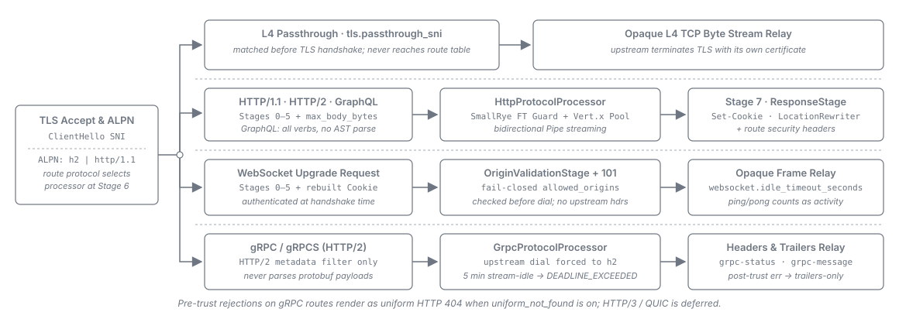

= Protocol Routes -- WebSocket and gRPC
:toc: left
:toclevels: 3
:toc-title: Table of Contents
:sectnums:
:source-highlighter: highlight.js

A task-oriented guide for operators configuring `protocol: websocket` and `protocol: grpc`
routes in `endpoints/*.yaml`. It shows *how* to author these routes and tune their per-route knobs;
the authoritative field reference is the
link:../configuration.adoc[Configuration Reference], and the design rationale lives in the
link:../architecture/README.adoc[Architecture] document and the
link:../adr/0015-websocket-origin-failclosed-allowlist.adoc[ADR-0015] /
link:../adr/0016-grpc-trailers-only-rejection-mapping.adoc[ADR-0016] decision records. This
guide never restates that rationale -- it points to it.

Every route declares the protocol it serves via the `protocol` key -- `http` (the default),
`graphql`, `grpc`, or `websocket`. The value selects handshake and streaming behaviour only; the
security filter, authentication, and forward policy apply uniformly across protocols. See
link:../configuration/routing-and-forwarding.adoc#_protocols[Configuration -- Protocols] for the key itself and
link:../architecture/terminal-actions-and-protocols.adoc#_protocol_support[Architecture -- Protocol Support] for what each
protocol does and does not inspect.

*A route that declares no `forward` block forwards every client header and query parameter the
gateway-owned never-forward set does not withhold* -- so a protocol route needs no enumeration of
its own mechanics to work, and the routes shown below deliberately declare none. Neither of the
example routes on this page is thereby unguarded: the hop-by-hop, framing and provenance names of
the link:../configuration/routing-and-forwarding.adoc#_never_forward_set[never-forward set] are withheld under every mode.
The re-admittable members are an inbound `Authorization` and the provenance and URL-override class
(`X-Forwarded-Server`, `X-Original-URL` and the rest), each re-admitted only where a route declares a
`headers_allow` naming it; the routes below declare no list at all, so all of them are withheld here. The
browser `Cookie` is decided by the route's link:../configuration/routing-and-forwarding.adoc#_cookies[`cookies`] block,
not by `forward`; the routes below declare none, so they resolve `allow: none` and forward no
cookie (see <<_cookies_on_protocol_routes>>).
Declare a `forward` block only to *narrow* that. One protocol-specific caution: a gRPC route that *does*
declare `headers_allow` must list `te`, because a positive-list never copies a name it does not
name and gRPC over HTTP/2 requires `TE: trailers`. See
link:../architecture/routing-and-forwarding.adoc#_forward_policy[Architecture -- Forward Policy].

How each protocol is handled, from the TLS accept to the upstream:

== Configuring a WebSocket route

A `protocol: websocket` route proxies an HTTP upgrade handshake, then relays frames opaquely in
both directions between the client and the upstream. Author it in an `endpoints/*.yaml` file:

[source,yaml]
----
- id: live-updates
  protocol: websocket
  match: { path_prefix: /api/stream, host: api.example.com }
  auth: { require: bearer }
  websocket:                       # both WebSocket keys live inside this block
    allowed_origins:
      - https://app.example.com
    idle_timeout_seconds: 300
  upstream: { path: /stream }
----

=== Setting `allowed_origins` (cross-site WebSocket hijacking guard)

On a WebSocket route whose *effective* auth is `require: bearer` or `require: session`,
`websocket.allowed_origins` is a
*mandatory, non-empty* list of the browser origins permitted to open a socket. It is declared inside
the route's `websocket` block; written as a route-level sibling of `websocket` it fails the boot as
an unknown key. The gateway
checks the upgrade request's `Origin` header against this list *before dialling the upstream*; a
foreign or absent `Origin` is rejected `403` and the upstream is never contacted.

Author each permitted origin *in full* -- `scheme://host[:port]`:

* The *host* is matched case-insensitively; the *scheme and port* are matched exactly.
* There are *no wildcards*, no suffix forms, and no regular expressions.
* An *absent or empty* `allowed_origins` on a bearer or session WebSocket route *fails the boot*
  (deny-by-default), naming the route. A session route does not inherit
  `oidc.session.csrf.trusted_origins`: list the origins here as well.
* A `require: none` WebSocket route may omit the list; its upgrade is then not origin-checked. A
  list it does declare is enforced.
* A `websocket` block on a non-WebSocket route is a boot-time configuration error.

For the full field contract see
link:../configuration/routing-and-forwarding.adoc#_allowed_origins[Configuration -- `allowed_origins`].

[[_invalid_upgrade_requests]]
=== Requests that are no valid WebSocket upgrade

A WebSocket route serves WebSocket opening handshakes only. Right after the `Origin` check, the
gateway checks that the request is a valid upgrade, and refuses one that is not *before any upstream
contact* -- it takes no relay budget and the upstream is never dialled:

[cols="2,1,2", options="header"]
|===
| Request | Status | Headers on the answer

| Any method other than `GET` that the route's `allowed_methods` admits -- by default every
  standard method (a method it does not admit is refused before this check, as on every route)
| `405`
| `Allow: GET`

| Not HTTP/1.1 -- an HTTP/2 request, for example -- or missing the `Connection: Upgrade` /
  `Upgrade: websocket` pair (a plain `GET`). `Upgrade` must be a token of the *first* `Connection`
  header line, and `websocket` the whole value of an `Upgrade` line rather than one entry of a list
  such as `chat, websocket`
| `426`
| On HTTP/1.x `Upgrade: websocket` and `Connection: Upgrade`; on HTTP/2 none, as HTTP/2 forbids both

| A `Sec-WebSocket-Version` other than `13`
| `426`
| `Sec-WebSocket-Version: 13`, plus the HTTP/1.x pair above

| `Sec-WebSocket-Version` or `Sec-WebSocket-Key` sent on more than one header line (RFC 6455
  §11.3.1, §11.3.5)
| `400`
| --

| No `Sec-WebSocket-Version`, or a missing or malformed `Sec-WebSocket-Key` -- the key must be padded
  base64 (RFC 4648 §4) of a 16-byte nonce: exactly 24 characters, the last two `==`
| `400`
| --

| A declared `Content-Length` above 8192 bytes -- reachable only on a gateway that admits a `GET`
  body through `security_defaults.allow_get_with_content_length_body`; without that opt-in the
  gateway's framing check refuses a `GET` declaring a body before route selection, so this check never
  sees one
| `413`
| `Connection: close` -- the gateway closes the connection after the answer, since the body is never
  read

| A request URI that cannot be parsed as a URI -- reached on a route with
  `security_filter.profile: minimal`; under every other profile the route's query-parameter check
  refuses such a URI before this one
| `400`
| --
|===

Each refusal has no body; like every response on the route, it carries the route's
`security_headers` and any `Set-Cookie` line the session handling wrote for the request, such as a
refreshed session cookie. The rules are checked in a fixed order -- the method,
the HTTP version, the upgrade headers, repeated handshake fields, the WebSocket version, the key, the
declared body length, the request URI -- and the first one broken decides the answer. The last two,
and the exact form the upgrade headers must take, mirror what the gateway's HTTP stack
(vertx-core 4.5.34) would itself refuse in a handshake, so a request the gateway lets through is not
refused by the stack after the upstream was dialled. A
WebSocket can only be opened over HTTP/1.1, so a client that negotiated HTTP/2 with the gateway has to
offer HTTP/1.1 for its WebSocket connections.

*A declared body above 8192 bytes closes the connection, whichever check refuses.* The gateway never
reads the body of a refused handshake. A request that declares more than 8192 bytes and breaks an
earlier rule -- answered `405`, `426` or `400` -- keeps that status, and on HTTP/1.x the gateway closes
the connection after the answer exactly as it does after the `413`: the answer carries
`Connection: close`, a `426` `Connection: Upgrade, close`. On HTTP/2 only that request's stream is
ended; the connection stays open.

*A failed client upgrade is answered `502`.* The gateway dials the upstream before it upgrades the
client connection. If the upstream accepts the upgrade and the client upgrade then fails, the gateway
closes the upstream connection and answers the client `502`. Where the HTTP stack has already refused
the client's handshake itself -- with `400`, `405`, `413` or `426` on HTTP/1.1 -- that answer stands
instead; each of those is a refusal the gateway's own check above answers first, so it is not expected
for a request that check let through.

=== Tuning `websocket.idle_timeout_seconds`

The `websocket` block's second key tunes an *established* relay. `idle_timeout_seconds` bounds how long a relay may sit with *no frame in either direction*
before the gateway closes it (WebSocket close code `1001`, "Going Away"). When omitted it
defaults to `300` seconds; when declared it must be a *positive integer* and is valid *only* on a
`protocol: websocket` route.

Raise it for long-lived push channels that legitimately idle between messages; lower it to
reclaim connection slots more aggressively. For the full field contract see
link:../configuration/routing-and-forwarding.adoc#_websocket[Configuration -- `websocket`].

=== Sizing the WebSocket relay budget

An established relay is not like a proxied request. A request holds one *admission permit* for a
single round-trip and returns it in milliseconds; a relay holds its permit for as long as the
connection lives — minutes, or the whole day for a push channel. Long-lived relays therefore
accumulate against the same pool that ordinary HTTP traffic draws from, and enough of them will
starve it: the gateway starts refusing `503` while doing very little work.

`edge_hardening.websocket_relay_cap` bounds them separately. It is a *sub-budget acquired in
addition to* the general permit, never instead of it — a relay takes one permit from each pool — so
capping it leaves the remaining `admission_cap` headroom available to HTTP no matter how many
sockets are open. An upgrade beyond the cap is refused `503` at the handshake, before the upstream is
dialled; the general permit is released on the way out, so a refusal costs nothing.

[source,yaml]
----
# gateway.yaml -- global; the pools are process-wide, so there is no per-route form
edge_hardening:
  admission_cap: 2048          # default; all in-flight requests, relays included
  websocket_relay_cap: 512     # default; established relays only
----

Size `websocket_relay_cap` to the *peak concurrent relays* the deployment expects, plus headroom for
reconnect storms — after an upstream restart or a network blip, clients reconnect together, and the
old sockets may not have been reaped yet, so the momentary peak runs well above steady state. Then
check the remainder: `admission_cap - websocket_relay_cap` is the request concurrency guaranteed to
survive a fully saturated relay pool, and it is what HTTP traffic actually gets in the worst case.
The defaults reserve three quarters of the pool for HTTP on that reasoning.

Two boot-time rules bound the pair: each cap must be at least `1`, and `websocket_relay_cap` must not
exceed `admission_cap` — a larger sub-budget could never bind, so it is refused rather than silently
ignored. Both keys are optional. An omitted `admission_cap` is `2048`; an omitted
`websocket_relay_cap` is a *quarter of the effective* `admission_cap` (never below `1`), which is the
`512` shown above at the default pool size. Lowering `admission_cap` on its own therefore lowers the
relay budget with it — the three-quarters-for-HTTP reservation is preserved instead of being turned
into a boot-time rejection.

== Configuring a gRPC route

A `protocol: grpc` route proxies gRPC calls -- each an HTTP/2 `POST` to a service/method path.
The gateway forces the *upstream* connection to HTTP/2 (gRPC requires HTTP/2 end-to-end), streams
the request and response bodies as opaque length-prefixed frames (it never inspects the protobuf
payload), and relays the upstream response *trailers* (`grpc-status`, `grpc-message`) back to the
client -- except for a call it ends itself because it went quiet (see
<<_what_bounds_a_long_lived_call>>). The leading headers and the trailers pass the same response
filter as an HTTP response, so an upstream `Set-Cookie` in either reaches the client only as the
route's `cookies` policy admits it (see <<_cookies_on_protocol_routes>>). Author it in an
`endpoints/*.yaml` file:

[source,yaml]
----
endpoint:
  id: orders
  base_url: ORDERS_GRPC            # topology alias -> orders-svc:50051
  routes:
    - id: orders-grpc
      protocol: grpc
      match: { path_prefix: /orders.OrderService }
      auth: { require: bearer }
      upstream: { path: /orders.OrderService }
----

*Route on the bare service path.* A gRPC method path is service-rooted --
`/{package}.{Service}/{Method}`. Match the route on the bare `/{package}.{Service}` prefix and set
an *identical* `upstream.path`. The gateway builds the upstream path as
`alias base path + upstream.path + remainder-after-prefix` (see
link:../configuration/routing-and-forwarding.adoc#_upstream[Configuration -- `upstream`]), so point the endpoint's
`base_url` at a topology alias carrying the gRPC service's `host:port` and *no base path* -- for
example `ORDERS_GRPC=http://orders-svc:50051`. With an empty alias base path, the identity of the
route prefix and `upstream.path` makes the full method path reach the upstream *unchanged*, and a
stock gRPC client dials the real service path with no gateway-specific rewriting. An alias that did
carry a base path would be prepended to the service path, which no gRPC server answers. The gateway
holds a forced-h2 client for that target distinct from any HTTP/1.1 route to the same `host:port`.

A gRPC route carries no extra per-route fields beyond the standard `match`, `auth`, and
`upstream` keys -- the forced-HTTP/2 upstream dial and the trailer relay are automatic. A gRPC client
follows no HTTP redirect, so a `redirect` terminal action and `upstream.rewrite_location: true` are
both refused at boot on a `protocol: grpc` route (`rewrite_location` likewise on
`protocol: websocket`). Two gRPC
routes that share the same service path must be *statically disjoint* (by host, method, or a header
matcher -- see link:endpoint-routes.adoc#_route_ordering[Endpoint Routes -- route ordering]); a
public route and a bearer route on the *same* service path are not disjoint, so give each its own
service path.

[[_what_bounds_a_long_lived_call]]
=== What bounds a long-lived call

A gRPC call is not held to the request-body idle timeout of an HTTP route. Until the upstream
answers, the time a client holds its request stream open is the client's, and two fixed bounds end
it as the client's own abort, which the upstream's circuit breaker does not count as a failure:

* *One complete request message every 10 s.* Each request message must arrive whole -- its 5-byte
  length prefix and every payload byte the prefix declares -- within 10 s of the moment the gateway
  hands the call to the upstream or of the message before it, until the client ends its request
  stream. Part of a message does not count. A call that sends nothing, only part of a message, or
  stops between two messages without ending its stream is ended with `grpc-status: 3`
  (`INVALID_ARGUMENT`; `INBOUND_BODY_ABORTED`).
* *The request stream ended within 25 s.* A call whose request stream is still open 25 s after the
  gateway handed it to the upstream -- however steadily it sends -- is ended with `grpc-status: 4`
  (`DEADLINE_EXCEEDED`) and `grpc-message: input-validation` (`REQUEST_BODY_TIMEOUT`). A
  client-streaming call that the upstream answers only after the client ends its stream must therefore
  end its stream within 25 s. Waiting for the upstream connection does not count against the client,
  but the deadline never passes later than 29 s after the gateway started the attempt, a second before
  the upstream guard's timeout, so behind a slow connection the client has less than 25 s. The
  deadline is the client's only when the client was holding its stream open when it passed (see below).

Both bounds stop as soon as the upstream sends its response headers. The upstream guard's 30 s
timeout runs from the start of the attempt and ends a call whose upstream holds the complete,
half-closed request and does not answer, a call whose wait for an upstream connection or HTTP/2
stream slot itself lasts the 30 s, and a call whose upstream stops taking data mid-request and takes
no more within the 30 s; each ends with `DEADLINE_EXCEEDED` and `grpc-message: upstream`, and the
breaker counts it. So does a call whose upstream connection took longer than 28 s: the
deadline always leaves the client at least one second after the gateway hands the call over, so a call
that would get less than that before the 29 s cap is ended without being sent, before the guard would
end it the same way. While an upstream is not taking data, the 10 s message bound does not run and the
25 s deadline does not end the call at once. Who was holding the request stream when the deadline
passed decides whose failure the call is: a deadline that passed while the upstream was not taking data
ends the call the moment the upstream takes data again, as the upstream's `UPSTREAM_TIMEOUT` --
`DEADLINE_EXCEEDED` with `grpc-message: upstream`, counted by the breaker -- however slowly the client
sent before; a deadline that passes while the gateway is reading the stream is the client's
`REQUEST_BODY_TIMEOUT`, however long the upstream paused it earlier. Because of the one-second grace, a
client that had already ended its request stream is not ended by the
deadline unless the gateway takes longer than that second to pass its end on. After the response
headers, a client-streaming or bidirectional call may pause between its messages: the call stays
open while a frame travels in either direction, and a call that carries no frame for five minutes is ended with `grpc-status: 4`
(`DEADLINE_EXCEEDED`) and `grpc-message: stream-idle-timeout` in place of the upstream's trailers.
HTTP/2 `PING` frames do not count, and the call's `grpc-timeout` is not honoured. A service whose
calls stay silent for longer than five minutes has to send messages to keep them open; every bound
is fixed and has no configuration key. See
link:edge-security.adoc#_edge_hardening_defaults[Edge Security -- edge hardening defaults],
link:../architecture/tls-and-inbound-security.adoc#_grpc_message_bound[Architecture -- gRPC message bound and pre-response deadline] and
link:../architecture/tls-and-inbound-security.adoc#_grpc_stream_idle_bound[Architecture -- gRPC stream-idle bound].

=== gRPC rejections are trailers-only

Because a gRPC client cannot consume an `application/problem+json` body, a *gateway-generated*
rejection on a `protocol: grpc` route is emitted as a *trailers-only* gRPC response -- an HTTP
`200` whose `content-type` is `application/grpc` and whose `grpc-status` (and `grpc-message`)
name the failure, with no message body. The gateway maps the same rejection it would render as an
HTTP status on an HTTP route onto the canonical gRPC status; for example, a call whose validated
token lacks a scope the route needs is rejected `PERMISSION_DENIED` (7). Operators do not configure
this mapping -- it is fixed. The full mapping table is in
link:../architecture/observability-and-errors.adoc#_grpc_error_contract[Architecture -- gRPC rejections (trailers-only)].

*The exception: rejections before the trust boundary.* On the shipped default, a rejection raised
before the caller is authenticated -- a missing or invalid token, a wrong method, a refused path or
filter check, an oversized declared body, a same-origin refusal -- is answered to that caller as the
unrouted HTTP `404`, never trailers-only. A trailers-only status would itself tell an unauthenticated
caller that the address is a gRPC route. A gRPC client therefore sees such a call fail with the
transport error its runtime derives from an HTTP `404` -- `UNIMPLEMENTED` (12) in the common
runtimes -- rather than `UNAUTHENTICATED` (16). The true cause is counted in
`sheriff_errors_total{event}` (see
link:edge-security.adoc#_uniform_not_found_operator_note[Edge Security -- Why an existing route
answers 404]). Setting `security_defaults.uniform_not_found: false` restores the trailers-only answer
for these rejections, `UNAUTHENTICATED` (16) for a call without a token included.

[[_cookies_on_protocol_routes]]
== Cookies on WebSocket and gRPC routes

A protocol route takes a `cookies` block like any other route; the full contract is the
link:../configuration/routing-and-forwarding.adoc#_cookies[`cookies` reference]. Two things differ per protocol.

*A WebSocket route.* The upgrade request carries the rebuilt `Cookie` header: the gateway's own
cookies are dropped and the remaining pairs are filtered by the route's policy, exactly as on an
HTTP route. A route whose effective block forwards any cookie must declare a non-empty
`websocket.allowed_origins` -- on a `require: none` route too, which could otherwise boot with the
list empty -- and the boot is refused otherwise. That allowlist, not the per-route same-origin check,
is what gates a cookie-forwarding upgrade: it is stricter, because an absent `Origin` is always
refused. `same_origin_check` and `additional_origins` therefore do not act on a WebSocket route.
The gateway relays no upstream header on the `101` answer and none on a refused upgrade, so no
upstream `Set-Cookie` reaches the client on this path.

[source,yaml]
----
- id: live-updates
  protocol: websocket
  match: { path_prefix: /app/stream }
  auth: { require: none }
  cookies: { allow: [SESSIONID] }    # forwards a cookie, so allowed_origins is mandatory
  websocket:
    allowed_origins: [https://app.example.com]
  upstream: { path: /stream }
----

*A gRPC route.* The call carries the rebuilt `Cookie` header, and the upstream's leading headers
and trailers pass the shared response filter, which relays a `Set-Cookie` only as the policy admits
it and with its `Domain` attribute removed. A gRPC route whose block forwards a cookie carries the
same-origin check, and the check applies only to an unsafe call -- every gRPC call is a `POST` --
that carries at least one cookie the route would forward. A non-browser gRPC client that sends no
cookie therefore needs no `Origin` and passes unchecked; a cross-site browser call carrying a
forwarded cookie is refused before authentication, so it is answered with the uniform HTTP `404`, and
with a trailers-only `PERMISSION_DENIED` when `security_defaults.uniform_not_found` is `false`.

== See also

* link:../configuration.adoc[Configuration Reference] -- the authoritative `gateway.yaml` key reference.
* link:../architecture/terminal-actions-and-protocols.adoc#_protocol_support[Architecture -- Protocol Support] -- what each protocol inspects.
* link:../architecture/observability-and-errors.adoc#_grpc_error_contract[Architecture -- gRPC rejections] -- the trailers-only status mapping.
* link:../adr/0015-websocket-origin-failclosed-allowlist.adoc[ADR-0015] -- WebSocket Origin fail-closed allowlist.
* link:../adr/0016-grpc-trailers-only-rejection-mapping.adoc[ADR-0016] -- gRPC trailers-only rejection mapping.
