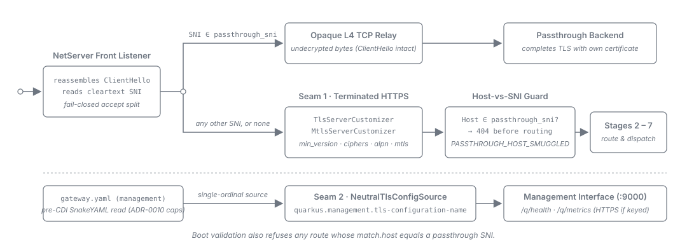

= API Sheriff -- TLS Edge: Policy, Passthrough SNI, mTLS and the Management Interface
:toc: left
:toclevels: 3
:toc-title: Table of Contents
:sectnums:
:source-highlighter: highlight.js

How to configure and operate the TLS edge: the *TLS policy keys* (protocol floor, cipher allowlist,
ALPN), *SNI passthrough*, *mTLS*, *egress TLS* (every TLS connection the gateway dials) and the
*management interface*. The field contract lives in
link:../configuration/tls-and-egress.adoc[Configuration Reference -- TLS and Egress]; the design
rationale in the link:../development/tls-edge.adoc[developer TLS-edge topic]. To start from a
deployment goal instead of a key, see link:tls-scenarios.adoc[TLS Scenarios].

One rule governs the whole page
(link:../adr/0025-The_whole_server-TLS_surface_is_neutral_in_gatewayyaml_and_bound_by_exactly_two_seams.adoc[ADR-0025]):
*`gateway.yaml` names TLS policy; the deployment supplies ports and material.* Which side a given knob
falls on is listed in link:environment-variable-overrides.adoc[Environment-variable overrides].

The top two tracks are the public port: passthrough hostnames leave at L4, everything else is
terminated and runs the full L7 pipeline. The bottom track is the management interface, whose TLS
posture `gateway.yaml` sets before the runtime starts.

== TLS policy on the terminated listener

Three optional keys govern how the gateway terminates TLS. Omitting a key leaves the runtime's own
default in place. What each value means and which values are accepted is in
link:../configuration/tls-and-egress.adoc#_tls[the `tls` reference].

[source,yaml]
----
tls:
  min_version: "1.3"               # "1.2" or "1.3"
  cipher_suites:                   # OPTIONAL allowlist; omit to keep the runtime's selection
    - TLS_AES_256_GCM_SHA384
    - TLS_AES_128_GCM_SHA256
  alpn: [h2, http/1.1]             # h2 | http/1.1 | http/1.0
----

Operating rules:

* *`min_version` is a floor, not a pin.* `"1.2"` enables TLSv1.2 *and* TLSv1.3.
* *Prefer no cipher allowlist.* The runtime's selection tracks deprecations for you; a list you
  write is frozen until you edit it. A list that leaves an enabled protocol with nothing to
  negotiate -- a TLS 1.2-only list under a `"1.2"` floor strands TLSv1.3 -- or names an unsupported
  suite fails the boot, naming the stranded protocol or the suite.
* *The keys govern the terminated listener only.* A passthrough connection is never terminated by
  the gateway, so the backend's TLS policy is the effective one end to end. Set a floor for a
  passthrough hostname on its backend.
* *A declared key wins.* It is applied after the runtime builds its listener options. A key you omit
  leaves the runtime's resolution in force, which a deployment variable such as
  `QUARKUS_HTTP_SSL_PROTOCOLS` can still reach. Declare the key here rather than setting both. Where
  every former `quarkus.tls.*` key went is in
  link:../configuration/tls-and-egress.adoc#_server_tls_key_verdicts[Server-TLS key verdicts].

[[_tls_and_http2_fingerprints]]
=== TLS and HTTP/2 fingerprints

A client that records the gateway's TLS handshake (a JA3S / JA4S-style fingerprint) or the `SETTINGS`
frame of an HTTP/2 connection can recognise the software stack without reading a response header.
Both come from the runtime -- the JDK TLS stack and Netty -- not from API Sheriff, and no gateway
setting disguises them. The policy keys above change *what* is negotiated, not the shape of the
handshake, and removing the `Server` header (see
link:endpoint-routes.adoc#_keep_identity_headers[`keep_identity_headers`]) does not hide it.

Where the fingerprint matters, put a CDN or load balancer that terminates TLS and HTTP/2 itself in
front of the gateway: clients then fingerprint that component.

== Serving plain HTTP

Plain HTTP is declared, never inferred. Set `QUARKUS_HTTP_INSECURE_REQUESTS=enabled` and the
terminated listener serves cleartext -- the supported deployment behind a TLS-terminating ingress.
Expose that port only behind such a boundary.

The boot decides the listener's posture from what you declared:

[cols="2,2,1", options="header"]
|===
| Declared | Behaviour | Log ID

| Server key material, no opt-in
| Starts on HTTPS.
| --

| No server key material, no opt-in
| Refuses to start, naming both ways out: declare a certificate, or set the opt-in. It never falls
  back to cleartext -- a missing certificate cannot be told apart from a certificate that failed to
  mount.
| --

| `QUARKUS_HTTP_TLS_CONFIGURATION_NAME` names a bucket with no key material, no opt-in
| Refuses to start, naming the bucket (usually a typo).
| --

| The opt-in plus declared server key material
| Refuses to start: one listener cannot both serve cleartext and terminate TLS.
| --

| The opt-in plus `tls.mtls.enabled`
| Refuses to start -- <<_interactions_with_the_rest_of_the_edge,verdict 1 below>>.
| --

| The opt-in plus a non-empty `tls.passthrough_sni`
| Refuses to start -- <<_interactions_with_the_rest_of_the_edge,verdict 2 below>>.
| --

| The opt-in alone (an empty bucket selection included)
| Starts on plain HTTP and reports it once.
| `WARN ApiSheriff-121`
|===

"Server key material" is any of: a key-bearing `QUARKUS_HTTP_TLS_CONFIGURATION_NAME` bucket, a
default `quarkus.tls.key-store.*` bucket, `QUARKUS_HTTP_SSL_CERTIFICATE_FILES` (with `..._KEY_FILES`),
`QUARKUS_HTTP_SSL_CERTIFICATE_KEY_STORE_FILE`, or `QUARKUS_HTTP_SSL_CERTIFICATE_CREDENTIALS_PROVIDER`.
A keystore-based deployment carries no `..._FILES` key at all and is valid.

Every refusal names the offending key and both ways out: remove the contradicting declaration, or
remove the opt-in and declare a certificate. `ApiSheriff-121` reports the key material that actually
*reached* the listener, whatever route supplied it, so it is the authoritative record wherever a
declaration and the resolved listener disagree. Why the check runs before the listener is built is in
link:../configuration/tls-and-egress.adoc#_server_tls_key_verdicts[Server-TLS key verdicts].

[[_interactions_with_the_rest_of_the_edge]]
=== What this mode does to the rest of the edge

Four parts of the gateway behave differently when the terminated listener serves cleartext.

*1. Inbound mTLS (`tls.mtls`) -- refused at boot.* A gateway that terminates no TLS takes part in no
handshake, so it could verify no client certificate. Put client-certificate verification on the
terminating hop, which holds the handshake.

*2. SNI passthrough (`tls.passthrough_sni`) -- refused at boot.* Passthrough gives the public TLS port
to the accept-time front listener, which a plain-HTTP application port contradicts. Passthrough and a
TLS-terminating hop are two answers to the same question; pick one.

*3. `forwarded.trusted_proxies` -- required, not optional.* The gateway's TCP peer is now the
terminating hop, so this list decides every client-address question. With no `forwarded` block or an
empty list, the gateway trusts no peer, ignores every inbound `X-Forwarded-For`, and -- because it
regenerates the forwarding headers rather than passing them on, and never synthesises one from the
TCP peer -- sends the upstream *no* `X-Forwarded-For` at all. An upstream that rate-limits,
allow-lists or audits by IP then sees only the gateway's address, and every client looks alike to it.
Set the list to the hop's *exact* address -- a `/32` for IPv4, a `/128` for IPv6. Never a bridge range or any range that contains
clients: a client inside the trusted set has its own `X-Forwarded-For` believed, which is the spoof
the list exists to stop.

*4. The BFF `Secure` / `+__Host-+` cookies -- unconditional.* Every cookie the BFF emits -- the
server-mode and cookie-mode session cookies, the login-time binding cookie
`+__Host-sheriff-binding+`, and the logout state and clearing cookies -- carries `Secure`, `HttpOnly`
and `SameSite=Lax`, whatever the listener serves. A browser reaching the gateway over `http://` on a
non-loopback origin drops all of them, so *the BFF cannot work on a plain-HTTP port a browser reaches
directly*. It works only behind a hop the browser reaches over HTTPS. There is no setting that relaxes
the attributes.

Loopback is the one exception, and it is not a deployment option: browsers treat `http://localhost`,
`http://127.0.0.1` and `http://[::1]` as secure contexts and accept these cookies there, so a BFF flow
against a plain-HTTP gateway on your own machine works. No deployment is reached on loopback, so do
not read a working developer setup as evidence that the port may be exposed.

The browser-side half is stated from the cookie rules, not from a test in this repository: the
integration lane drives a Java HTTP client that accepts what a browser would refuse (see
link:../development/cookie-deliverability-blindness.adoc[Cookie-deliverability blindness]).

== Passthrough SNI

A passthrough entry maps an *SNI hostname* to a *topology alias*. Every connection whose TLS
ClientHello carries that SNI is relayed undecrypted to the alias's `host:port`, and the backend
presents its own certificate. The field contract is in
link:../configuration/tls-and-egress.adoc#_tls[the `tls` reference].

[source,yaml]
----
tls:
  passthrough_sni:
    backend.example.com: PASSTHROUGH_BACKEND   # SNI -> topology alias
----

The alias resolves through `topology.properties` / `TOPOLOGY_PASSTHROUGH_BACKEND`, exactly like a
route's `base_url`, so a passthrough target moves per environment by changing only the topology.

Operating rules:

* *Exact match, case-insensitive, no wildcards.* List every hostname literally; `*.example.com` is not
  supported. The SNI is lower-cased and one trailing FQDN dot is removed before matching.
* *The alias URL carries no base path.* An L4 relay has no notion of a path; a base-path alias fails
  the boot.
* *Passthrough is declared here, never on a route*, and terminated and passthrough hostnames share
  the public port. Any SNI you do not list is terminated.
* *A terminated request whose `Host` names a passthrough SNI is rejected `404`* before routing. The
  guard is automatic; it normalises the `Host` the same way and also strips one `:port` suffix, so
  `backend.example.com:8443` cannot slip past it.

[[_front_listener_bounds]]
=== How long the front listener holds a connection

With passthrough configured, an accept-time front listener owns the public TLS port and reads the SNI
out of each connection's ClientHello before it relays the connection -- to the passthrough backend or
to the terminated listener. Five bounds keep a connection it has not routed yet, a backend that does
not answer, or a relay nobody uses, from holding a connection indefinitely, or one client or one
passthrough backend from holding the others off:

[cols="1,1,3", options="header"]
|===
| Bound | Value | What it does

| ClientHello deadline
| 10 s
| A connection that has not sent its complete ClientHello 10 s after it was accepted is closed,
  without an answer. A client sends its ClientHello in its first flight, so only a silent, stalled or
  dripping connection reaches the deadline.

| Undecided connections
| 1024
| At most 1024 accepted connections may be waiting for their ClientHello, or for the front to finish
  connecting them to their backend (see _The backend dial_ below), at the same time. A connection
  accepted beyond that is closed at once, without being read. A connection holds its slot for at most
  one 10 s deadline window while it waits for its ClientHello, and for at most one dial window while its
  backend is dialed, so a full bound delays new handshakes by at most that long. No single client or
  backend can take the whole bound: the two rows below hold each to a share of it.

| Undecided connections per source
| 256
| At most 256 of those 1024 may come from one source at the same time. A source is the TCP peer
  address for IPv4, and the /64 prefix of the address for IPv6, so one host cannot multiply its share
  by spreading connections over the addresses of its own /64; an IPv4 address reaching the gateway as
  an IPv4-mapped IPv6 address is the same source as over IPv4. A further connection from a source that
  holds its 256 is closed at once, without being read, while every other source still finds three
  quarters of the bound free.

| Dial budget per passthrough backend
| 128
| At most 128 of those 1024 may be connecting to one passthrough backend at the same time. A
  connection whose SNI matches a backend that already has 128 connections in progress is closed at the
  route decision, without the backend being dialed, and its slots of the 1024 and of its source's 256
  come back at once. A passthrough backend that does not answer therefore holds at most 128 slots and
  leaves seven eighths of the bound to terminated handshakes and to every other backend. Connections
  to the terminated listener are not budgeted: that dial goes to the gateway's own loopback port and
  completes at once.

| Relay idle timeout
| derived
| Both legs of a relayed connection -- passthrough and terminated alike -- are closed when no byte
  crosses them in either direction for this long. The value is the longest of the terminated
  listener's HTTP idle timeout (`quarkus.http.idle-timeout`, thirty minutes by default), the gRPC
  stream-idle bound (five minutes) and the longest `websocket.idle_timeout_seconds` of any route (300 s
  for a WebSocket route that declares none), plus 60 s. It is never below any of them, so the relay
  never cuts off a connection the gateway behind it still allows to be idle.
|===

None of the five is configurable. The relay idle timeout moves only with the values it is derived
from: a route that declares a long WebSocket idle timeout, or a longer `quarkus.http.idle-timeout`,
keeps idle relayed connections open longer. The front never logs a connection's bytes; a connection
the deadline closes is recorded at `DEBUG` only.

[[_front_listener_backend_dial]]
*The backend dial.* Once the front has routed a connection, it connects to the backend -- the
passthrough backend or the terminated listener. A backend that has not accepted the TCP connect within
a fixed 10 s is given up on, and the client's connection is closed without an answer. A backend named
by host name is looked up first, and the 10 s do not cover that lookup: with the resolver settings the
gateway ships (5 s per DNS query, at most 4 queries per name, the search list of the container's
`/etc/resolv.conf`) one lookup takes at most 20 s per name tried, and the name is tried at most once
as given and once per search domain. The whole dial window is therefore at most 30 s with no search domain, and
20 s longer for each search domain -- in a Kubernetes pod, with its three cluster search domains, at
least 90 s. The terminated listener's `localhost` is answered from the hosts file and adds nothing.
Until the backend has accepted or been given up on, the connection still counts against the 1024, its
source's 256 and, for a passthrough backend, that backend's 128 -- also when the client disconnects in
the meantime. The derivation is in
link:../development/tls-edge.adoc#relay-dial-name-lookup[the developer TLS-edge topic].

*`quarkus.http.idle-timeout=0` with passthrough active.* A zero HTTP idle timeout switches the
terminated listener's own idle close off; it does not switch the relay's off. Zero contributes no
bound to the derivation, so the relay idle timeout becomes the longer of the gRPC stream-idle bound and
the longest WebSocket idle timeout, plus 60 s -- six minutes unless a WebSocket route declares more than
five. The relay is then the idle bound of every terminated connection: an idle connection behind the
front is closed after that time, even though the HTTP idle timeout is off. There is no key to raise it;
to keep idle terminated connections open longer, set `quarkus.http.idle-timeout` to the duration you
want instead of zero.

*An unreachable passthrough backend.* When a passthrough backend is down or filtered, clients for its
hostname see their connection closed once the 10 s connect timeout has passed -- after the backend's
host-name lookup, when the topology names it by host name -- during the TLS handshake and without a
TLS alert -- the gateway never terminates a passthrough connection, so it has no certificate to answer
with. When the backend actively refuses the connection, the client's connection is closed as soon as
the refusal arrives. While the backend is unreachable, each waiting connection holds one of the 1024
slots for the lookup plus up to those 10 s -- whether or not its client is still connected, so a
client that gives up and reconnects does not free its earlier slot. The backend's dial budget stops
there: once 128 connections for that hostname are waiting, every further one is closed at once and
shows up as a `dial_budget` refusal (see <<_front_listener_refusals>>), and the rest of the bound stays
free for every other hostname. Several unreachable passthrough backends add up, 128 slots each: two
hold at most a quarter of the bound, eight could hold all of it, each slot for at most one dial window.

[[_front_listener_refusals]]
==== Reading the front's refusals

A connection the front closes at once -- at accept because the 1024 bound or its source's 256 is
full, or at its route decision because its passthrough backend's 128 are in use -- is visible in two
places:

[cols="1,3", options="header"]
|===
| Where | What you see

| `sheriff_front_connections_refused_total{reason}`
| Every refusal, on the management port's metrics. `reason` is `cap` (the 1024 bound was full),
  `source_share` (one source already held its 256) or `dial_budget` (one passthrough backend already
  had 128 connections in progress).

| `WARN ApiSheriff-146`
| The first refusal of each reason in a 60 s window, naming the reason (`cap` / `source_share` /
  `dial_budget`), the bound and the window. Further refusals of that reason inside the window are
  logged at `DEBUG`, so a flood leaves one line per minute and reason, not one per connection.
|===

Neither names the client's address or anything it sent. Read the counter for the rate and the log
line as the sign that the front is saturated at all:

* *A sustained `cap` rate* has one of two causes. Either many connections are holding their
  ClientHello back -- a slow or silent handshake flood -- or several passthrough backends do not answer
  the dial, and each connection for their hostnames holds a slot for the backend's host-name lookup
  plus up to the 10 s connect timeout (see _An unreachable passthrough backend_ above). Either way,
  legitimate clients then wait up to one such window -- the 10 s ClientHello deadline, or the dial
  window (see _The backend dial_ above) -- before they are admitted. Check whether the refusals
  coincide with passthrough backends being down before treating them as a flood.
* *A `dial_budget` rate* means 128 connections to one passthrough backend were in progress at once,
  usually because that backend does not answer the dial. Its hostname is held to those 128, and
  clients of every other hostname are unaffected. Check that backend first.
* *A `source_share` rate from one client* is that client being held to its share; the others are
  unaffected.

*Behind an L4 load balancer.* The source is the TCP peer address of the connection the gateway
accepts (for IPv6, its /64 prefix). A layer-4 load balancer or NAT in front of the gateway that does
not keep the client's source address on the connection makes every client the same source, so the
share becomes a gateway-wide limit of 256 connections waiting for their ClientHello or for their
backend dial to settle. That still admits tens of thousands of handshakes per second, but every
client is refused together once it is reached, and `source_share`
refusals then appear for everyone. The front reads no PROXY protocol header -- it expects the
ClientHello as the connection's first bytes -- so keep the share per client by having the load
balancer preserve the client's source address (transparent or client-IP-preserving mode).

== mTLS (client-certificate verification)

Enabling `mtls` makes the *terminated* listener require and verify a client certificate against one
CA trust anchor. Passthrough connections are unaffected -- the gateway never takes part in that
handshake.

[source,yaml]
----
tls:
  mtls:
    enabled: true
    client_ca: /etc/sheriff/client-ca.pem   # the trust anchor client certs must chain to
----

A connection presenting no certificate, or one that does not chain to `client_ca`, fails the *TLS
handshake* before any HTTP is exchanged. There is no optional or "want" mode.

`client_ca` is a path *reference*, not material: keep it a fixed mount point that is the same in
every environment, so `gateway.yaml` stays environment-neutral. See
link:../configuration/tls-and-egress.adoc#_client_ca_carve_out[the `client_ca` carve-out].

== Operator Consideration: Emergency Trust-Root Replacement

`client_ca` is a *single global trust anchor* for the terminated listener, so replacing it has a
global blast radius:

* *Swapping `client_ca` rejects every certificate under the old root at once.* There is no gradual
  cutover and no per-client exemption.
* *There is no per-certificate revocation.* Neither CRL nor OCSP is checked, so the only revocation
  lever is replacing the trust root.

Stage the new client certificates to every client *before* switching `client_ca`. To cut off a single
compromised client without rotating the fleet, drop it at the network perimeter.

[[_egress_tls]]
== Egress TLS (`egress_tls`)

The global `egress_tls` block governs the TLS connections the gateway *dials*. Every key is optional
and an omitted `*_verify_hostname` key is `true`:

[source,yaml]
----
egress_tls:
  upstream_verify_hostname: true      # proxy, gRPC and WebSocket upstreams
  upstream_tls_profile: corporate-up  # logical name only; the deployment binds the anchors
  jwks_verify_hostname: true          # the JWKS fetch of every http issuer
  oidc_verify_hostname: true          # the BFF back channel to the identity provider
  oidc_tls_profile: corporate-idp     # logical name only; the deployment binds the anchors
----

Field semantics are in link:../configuration/tls-and-egress.adoc#_egress_tls[the `egress_tls`
reference]; the design in
link:../adr/0040-Upstream_hostname_verification_is_a_global_egress-TLS_knob_bound_at_client_construction.adoc[ADR-0040],
link:../adr/0041-The_JWKS_hostname-verification_knob_is_the_librarys_own_passthrough_and_its_sslContext_collision_is_refused_at_boot.adoc[ADR-0041]
and
link:../adr/0045-The_BFF_OIDC_back-channel_posture_is_pinned_through_the_librarys_own_passthrough_under_peer_egress-TLS_keys.adoc[ADR-0045].
To start from a goal -- a corporate CA, a private-CA identity provider, a name the certificate does
not carry -- see link:tls-scenarios.adoc[TLS Scenarios].

=== Which key reaches which leg

[cols="1,2", options="header"]
|===
| Leg | Keys that reach it

| Proxied HTTP, gRPC and WebSocket upstreams
| `upstream_verify_hostname`, `upstream_tls_profile`

| JWKS fetch
| `jwks_verify_hostname`; trust through the per-issuer `jwks.tls_profile`

| Asset-origin fetch
| None -- see below

| BFF back channel (discovery, pushed authorization request, code exchange, refresh, refresh-token
  revocation)
| `oidc_verify_hostname`, `oidc_tls_profile`
|===

The keys act only on a TLS dial: an `http`/`ws` or h2c upstream, a file-sourced JWKS, a BFF back
channel under `oidc.back_channel_allow_insecure_http`, the L4 passthrough relay and the loopback
health probe negotiate no TLS. The per-client breakdown is in
link:../configuration/tls-and-egress.adoc#_egress_tls_legs[The six TLS legs].

*Every key is gateway-wide.* There is no per-route, per-endpoint or per-issuer override, so a gateway
with one name-mismatched upstream relaxes hostname verification for every proxied upstream or for
none. `jwks.tls_profile` is per issuer, but it is not part of this block.

*The asset-origin fetch reads no key of this block.* It always verifies hostnames (unless the JDK
switch in <<_jdk_hostname_verification_switch>> is set), and `upstream_tls_profile` does not reach it,
so an asset origin behind a private CA fails closed with a `502`. Put that anchor into the JVM default
trust store instead (see <<_operator_consideration_outbound_trust_material_replaces_the_platform_bundle>>).

=== What a relaxation does and does not do

A `*_verify_hostname: false` stops the dialled-name check on that leg only. The certificate chain is
still verified: a self-signed or untrusted peer is still refused. If the real problem is a private CA,
use the leg's trust key, not the relaxation (see
link:../configuration/tls-and-egress.adoc#_egress_tls_hostname_scope[What disabling hostname
verification does and does not do]).

*A named trust profile replaces the leg's anchors* rather than adding to them: a profile holding only a
private CA stops that leg trusting public authorities. A profile that is not bound, carries no
anchors, or sets `trust-all` fails the boot; there is no fallback to default trust (see
link:../configuration/tls-and-egress.adoc#_upstream_trust_profile_replaces[A named profile replaces
the client's anchors]).

*Two combinations fail the boot:*

* `jwks_verify_hostname: false` while any `http` issuer names `jwks.tls_profile` -- every such issuer,
  not only the one you meant to relax (see
  link:../configuration/tls-and-egress.adoc#_jwks_verify_hostname_profile_collision[the JWKS
  collision]).
* `oidc_verify_hostname: false` together with a named `oidc_tls_profile` (see
  link:../configuration/tls-and-egress.adoc#_oidc_profile_collision[the OIDC collision]).

A peer that needs both a private CA and a relaxed name check on one of those legs has no supported
combination: fix the certificate's names, or put the CA into the JVM default trust store and name no
profile on that leg.

=== What you see at boot

Each relaxed or re-anchored posture is reported once, as a `WARN`, and the gateway still starts:

[cols="1,3", options="header"]
|===
| Log ID | Reported when

| `ApiSheriff-118`
| `upstream_verify_hostname` is `false`. States the scope: proxy, gRPC and WebSocket clients, chain trust
  untouched, asset-origin fetch not governed.

| `ApiSheriff-119`
| `upstream_tls_profile` is named. States that its anchors replace the default trust store on those
  three clients, not on the asset-origin fetch.

| `ApiSheriff-120`
| `jwks_verify_hostname` is `false`. Logged once, not per issuer -- and also on a boot the JWKS
  collision then refuses.

| `ApiSheriff-125`
| `oidc_verify_hostname` is `false`, on an active BFF only.

| `ApiSheriff-126`
| `oidc_tls_profile` is named, on an active BFF only. Carries the logical name, never a path, password or
  anchor.
|===

The full wording is in link:../LogMessages.adoc[Log messages].

[[_jdk_hostname_verification_switch]]
*One switch sits below every key.* The JDK system property
`jdk.internal.httpclient.disableHostnameVerification` turns off hostname verification on every JDK-client
leg -- the JWKS fetch, the BFF back channel and the asset-origin fetch -- whatever `egress_tls` says. No
gateway key and no build check can see it. Do not set it.

[[_operator_consideration_outbound_trust_material_replaces_the_platform_bundle]]
== Operator Consideration: Outbound trust material replaces the platform bundle

The outbound mirror of the trust-root hazard above: *a default trust store you supply replaces the
platform trust bundle rather than adding to it.* A store holding only your private CA removes every
public root, and the loss surfaces later as a handshake failure against something that used to work.

Follow the full route in
link:../configuration/tls-and-egress.adoc#_default_trust_store_replaces[Supplying a default trust store
REPLACES the platform bundle]: why the distroless image has no `update-ca-trust`, why the JDK triple
must arrive as command-line `-D` arguments (a native executable ignores `JAVA_TOOL_OPTIONS`), and how
to build a store that keeps the public roots and adds your CA. After any trust change, read
`ApiSheriff-17` and `ApiSheriff-122` in the boot log.

For the identity provider you may not need a default store at all. The BFF back channel -- discovery,
the pushed authorization request, the code exchange, refresh and refresh-token revocation -- has its
own key, `egress_tls.oidc_tls_profile`, which a per-issuer `jwks.tls_profile` does not cover. Naming it
keeps the private CA off every other leg. Both routes *replace* anchors. See
link:../configuration/tls-and-egress.adoc#_oidc_back_channel_posture[The BFF OIDC back-channel] for the
key and link:bff-oidc-common.adoc#_private_ca_self_signed_idp[Private-CA / self-signed IdP] for the steps.

RP-initiated logout is not on that list: the gateway only redirects the browser to the provider's
`end_session_endpoint` and opens no connection, so the browser's trust applies. Refresh-token
revocation *is* on it: when a refresh fails after the provider redeemed the grant, the gateway revokes
the still-live refresh token with an RFC 7009 request over the back channel (see
link:../adr/0046-Refresh_failures_are_disposed_by_the_engines_failure_kind_and_refresh-token_reuse_detection_is_the_identity_providers_job.adoc[ADR-0046]).

== The management interface (health and metrics)

Health and metrics are served on a separate port -- `9000` by default -- so operations endpoints are
not exposed on the public listener. That port serves HTTPS by default. The field contract is in
link:../configuration/tls-and-egress.adoc#_management[the `management` reference].

=== The single-port constraint

The management interface has exactly *one* port: no management SSL port and no "insecure requests"
mode. Turning TLS off takes health *and* metrics to plain HTTP together, and every consumer probing
over HTTPS -- readiness gates, scrapers, load-balancer checks -- breaks at the same moment. There is no
partial posture and no gradual cutover; switch every consumer at once.

The image's baked container `HEALTHCHECK` is the only consumer unaffected: it is a bare TCP accept,
so it reports the same under either posture -- and for the same reason it observes neither the scheme
nor readiness.

=== Turning it off, when you must

Plain-HTTP management behind a trusted network boundary is a legitimate deployment, so the downgrade
is possible but never silent: the boot logs `WARN ApiSheriff-115`, naming the port. The record
reports the listener's resolved state, so it fires whichever door you used. The gateway still starts.

There are *two doors onto one lever*. Use exactly one:

[cols="1,2,2", options="header"]
|===
| Door | How | Use it when

| Policy (`gateway.yaml`)
| `management: { tls: { enabled: false } }`
| The posture is a property of this gateway's role and belongs in the document you ship.

| Deployment (environment)
| `QUARKUS_MANAGEMENT_TLS_CONFIGURATION_NAME=plain-management`
| The posture differs per environment.
|===

`plain-management` is a named TLS bucket with no key material, shipped in the configuration.
Selecting it *is* the disable, at runtime, with no rebuild; a bucket name that does not resolve fails
the boot. `management.tls.enabled: true`, or omitting the block, projects nothing, which is what keeps
the environment door working. When both doors are set, the `gateway.yaml` value wins. To restore
HTTPS, undo the door you opened.

[WARNING]
====
*`quarkus.management.enabled=false` is NOT the way to get a plain probe endpoint.*

* It is *build-time fixed* in the native image, so you cannot change it on a built artifact.
* It does not remove TLS -- it *moves* health and metrics onto the main, TLS-terminated router,
  behind the public listener's policy and mTLS posture.

Use the `plain-management` bucket, through either door above.
====

=== The port is not in gateway.yaml

The management port is deployment-bound: `quarkus.management.port` (default `9000`), overridden with
`QUARKUS_MANAGEMENT_PORT`. Writing `management.port` in `gateway.yaml` fails the boot with
`ApiSheriff-200` at `/management/port`, naming `QUARKUS_MANAGEMENT_PORT`, then `ApiSheriff-201`.

The baked `HEALTHCHECK` probes `9000` as a compiled-in constant and does not follow
`QUARKUS_MANAGEMENT_PORT`. Moving the port makes the container never report healthy. Overriding the
`HEALTHCHECK` with the image's own `--health-probe` does not help, because that binary probes the
constant it was built with. Rebuild the image against the new port, or override the health check
with an exec-form command that runs a probe you mount yourself against the new port. See
link:compose-sample.adoc#_reading_the_container_health_signal[Reading the container health signal].
