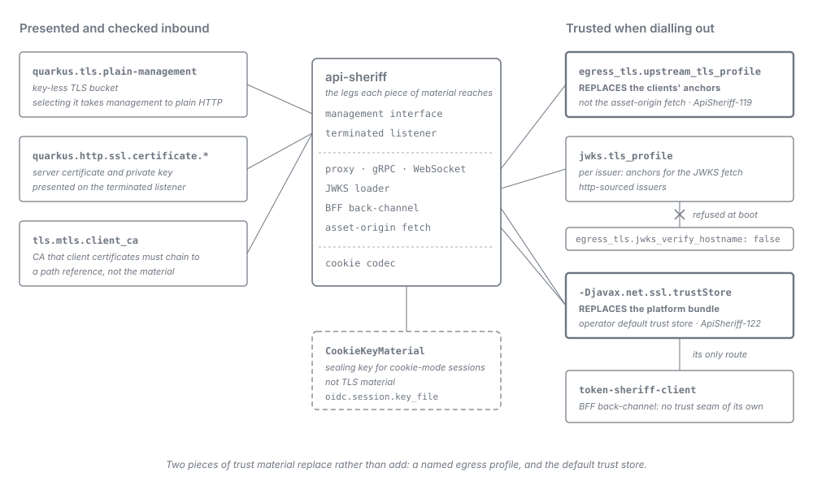

= API Sheriff -- TLS Scenarios: Choosing and Configuring a TLS Posture
:toc: left
:toclevels: 3
:toc-title: Table of Contents
:sectnums:
:source-highlighter: highlight.js

An operator guide organised by *what you are trying to achieve*. Each scenario states its goal, what
must exist before you start, the configuration that achieves it, and what you see when it goes wrong.

This page composes and links. What a key means lives in
link:../configuration/tls-and-egress.adoc[Configuration Reference -- TLS and Egress], how its
environment spelling is derived in link:environment-variable-overrides.adoc[Environment-variable
overrides], and how the mechanism behaves in link:tls-edge.adoc[TLS Edge]. Where this page and one of
those disagree, that page is right.

Every configuration block below is copied from a file this repository ships, named in the block's
title. A scenario with no shipped instance copies from the reference section named in its title.

== Choosing a scenario

[cols="3,1", options="header"]
|===
| Goal | Scenario

| Serve HTTPS from the gateway itself
| <<_scenario_terminate_at_gateway>>

| Accept only clients holding a certificate from your CA
| <<_scenario_mtls>>

| Relay selected hostnames to a backend that keeps its own certificate
| <<_scenario_passthrough>>

| Keep health and metrics on HTTPS
| <<_scenario_management_https>>

| Serve health and metrics as plain HTTP behind a trusted boundary
| <<_scenario_management_plain>>

| Validate tokens from an identity provider behind a private CA
| <<_scenario_private_ca_idp>>

| Run the gateway behind an ingress or load balancer that already terminated TLS
| <<_scenario_terminated_upstream>>

| Dial upstreams that present certificates from a corporate CA
| <<_scenario_corporate_ca_upstreams>>

| Dial an upstream or an IdP whose certificate does not name the address you dial
| <<_scenario_relax_hostname_verification>>

| Reach the BFF's identity provider (discovery, pushed authorization request, code exchange, refresh,
  revocation) through a private CA or a name its certificate does not carry
| <<_scenario_bff_oidc_back_channel>>
|===

The scenarios compose: a typical production gateway is <<_scenario_terminate_at_gateway>> plus
<<_scenario_management_https>>, with <<_scenario_private_ca_idp>> or
<<_scenario_corporate_ca_upstreams>> added when a private CA is involved. Three combinations fail the
boot instead, all with <<_scenario_terminated_upstream>>: it cannot be combined with
<<_scenario_mtls>>, with <<_scenario_passthrough>>, or with declared server key material.

== The material each scenario touches

The left column is inbound: the certificate the gateway presents, the key-less management bucket, and
the CA it checks client certificates against. The right column is outbound, and two of its entries
*replace* the anchors they govern rather than adding to them. `jwks.tls_profile` and
`egress_tls.jwks_verify_hostname: false` cannot be combined. The cookie sealing key protects
cookie-mode sessions and is not TLS material; it appears so it is not mistaken for one.

== Reading a failure mode

Three kinds of signal appear in the *Failure mode* tables below:

* *A configuration-document refusal.* `ERROR ApiSheriff-200` once per violation (file, JSON pointer,
  detail), then `ERROR ApiSheriff-201`, and the process exits non-zero. Schema violations and
  cross-field rules surface this way. See link:../LogMessages.adoc[Log messages].
* *A TLS boot refusal.* Startup aborts with an error that names the offending key and the way out.
  It carries no `ApiSheriff` identifier.
* *A boot `WARN` reporting a deliberate posture.* The gateway starts and says, once, what it is
  doing. `ApiSheriff-115` (management) and `ApiSheriff-121` (main listener) report the state the
  listener actually resolved, not a declared key.

[[_scenario_terminate_at_gateway]]
== Terminate TLS at the gateway

=== Goal

The gateway presents its own server certificate and runs the full L7 pipeline on every connection.
This is the default topology: one terminated listener, no front listener. Pick it whenever clients
reach the gateway directly. If something in front of the gateway already terminates TLS, use
<<_scenario_terminated_upstream>>.

=== Preconditions

* A server certificate and its private key, in PEM form, naming every hostname clients use.
* Both files mounted read-only into the container at a stable path.
* No `tls` key is required: every key you omit leaves the runtime's own protocol and cipher selection
  in force.

=== Configuration

*Policy* -- optional. Declare a protocol floor, a cipher allowlist or ALPN only when you mean to own
them; see link:tls-edge.adoc#_tls_policy_on_the_terminated_listener[TLS policy on the terminated
listener].

[source,yaml]
.deployment/compose-sample/docker/sheriff-config/gateway.yaml
----
tls:
  min_version: "1.2"
  cipher_suites:
    - TLS_AES_256_GCM_SHA384
    - TLS_AES_128_GCM_SHA256
    - TLS_ECDHE_RSA_WITH_AES_256_GCM_SHA384
    - TLS_ECDHE_RSA_WITH_AES_128_GCM_SHA256
  alpn: ["h2", "http/1.1"]
----

*Deployment* -- the certificate, the key and the public port. Leave `QUARKUS_HTTP_SSL_PORT` unset:
the terminated listener keeps its shipped `8443`.

[source,yaml]
.deployment/compose-sample/docker-compose.yml (api-sheriff service)
----
ports:
  - "8443:8443"
environment:
  - QUARKUS_HTTP_SSL_CERTIFICATE_FILES=/app/certificates/localhost.crt
  - QUARKUS_HTTP_SSL_CERTIFICATE_KEY_FILES=/app/certificates/localhost.key
volumes:
  - ./docker/certificates:/app/certificates:ro
----

=== Failure mode

[cols="2,2,2", options="header"]
|===
| Misconfiguration | Symptom | Fix

| No key material and no plain-HTTP opt-in
| TLS boot refusal naming both ways out. Never falls back to cleartext.
| Declare a certificate, or set `QUARKUS_HTTP_INSECURE_REQUESTS=enabled` (<<_scenario_terminated_upstream>>).

| `QUARKUS_HTTP_TLS_CONFIGURATION_NAME` selects a bucket with no key material
| TLS boot refusal naming the bucket.
| Correct the bucket name, or populate the bucket.

| A declared certificate or key file that is not mounted
| Startup aborts while the runtime reads the file (a classpath resource of that name would be read
  instead). The listener never falls back to plain HTTP for it.
| Fix the path or the mount.

| Unsupported `min_version`, unknown cipher suite, or an allowlist that strands an enabled protocol
| TLS boot refusal naming the value or the stranded protocol.
| Correct the value; keep the allowlist consistent with `min_version`.
|===

[[_scenario_mtls]]
== Terminate and require client certificates

=== Goal

Every terminated connection must present a client certificate that chains to one CA you name, or the
handshake fails before any HTTP is exchanged. Pick it for machine-to-machine clients you issue
certificates to. Do not pick it for browsers you do not provision, for passthrough hostnames (the
gateway never takes part in that handshake), or behind a hop that terminates TLS for the gateway.
Revocation is a trust-root rotation with a global blast radius -- read
link:tls-edge.adoc#_operator_consideration_emergency_trust_root_replacement[Emergency trust-root
replacement] before relying on it.

=== Preconditions

* Everything <<_scenario_terminate_at_gateway>> needs: the listener still presents a server
  certificate.
* The CA bundle as a PEM file, mounted read-only at a path that is the same in every environment
  -- `client_ca` is a path reference, not the material (see
  link:../configuration/tls-and-egress.adoc#_client_ca_carve_out[the `client_ca` carve-out]).
* Client certificates issued under that CA and staged to every client *before* you switch the
  requirement on.
* `QUARKUS_HTTP_INSECURE_REQUESTS` is not `enabled`.

=== Configuration

*Policy* -- the requirement and the anchor's mount path.

[source,yaml]
.integration-tests/src/main/docker/sheriff-config-mtls/gateway.yaml
----
tls:
  alpn: ["h2", "http/1.1"]
  mtls:
    enabled: true
    client_ca: /app/certificates/mtls-client-ca.crt
----

*Deployment* -- the server certificate and the mount that carries both it and the CA bundle.

[source,yaml]
.integration-tests/docker-compose.yml (api-sheriff-mtls service)
----
environment:
  - QUARKUS_HTTP_SSL_CERTIFICATE_FILES=/app/certificates/localhost.crt
  - QUARKUS_HTTP_SSL_CERTIFICATE_KEY_FILES=/app/certificates/localhost.key
volumes:
  - ./src/main/docker/certificates:/app/certificates:ro
----

That service also sets `QUARKUS_HTTP_SSL_PROTOCOLS=TLSv1.2` as a test pin, so the integration client
observes the rejection at the handshake. It is not part of the posture; leave it out.

=== Failure mode

[cols="2,2,2", options="header"]
|===
| Misconfiguration | Symptom | Fix

| A client presents no certificate, or one from another CA
| The TLS handshake fails. No HTTP status and no catalogued log record.
| Issue the client a certificate under `client_ca`.

| `enabled: true` without `client_ca`
| TLS boot refusal: `Refusing to start — tls.mtls.enabled requires a client_ca trust anchor`.
| Add `client_ca`.

| An `mtls` block without `enabled`
| `ApiSheriff-200` at the block's pointer, then `ApiSheriff-201`.
| Add `enabled`.

| Combined with `QUARKUS_HTTP_INSECURE_REQUESTS=enabled`
| TLS boot refusal: a listener that terminates no TLS could verify no client certificate.
| Remove the opt-in, or move client-certificate verification to the terminating hop.
|===

[[_scenario_passthrough]]
== Pass selected hostnames through untouched

=== Goal

Connections whose TLS ClientHello names a listed hostname are relayed undecrypted, at L4, to a
backend that completes the handshake with its own certificate. Every other hostname is terminated on
the same public port. Pick it when a backend must keep end-to-end TLS with the client. Do not pick it
when you need any L7 feature on that hostname -- filtering, authentication, forwarding headers, mTLS
-- because none of them applies to a connection the gateway never decrypts.

=== Preconditions

* Everything <<_scenario_terminate_at_gateway>> needs, for the hostnames that are *not* passed
  through.
* The backend serves TLS itself, with a certificate naming the passthrough hostname.
* A topology alias for each backend, whose URL carries no base path.
* Clients send SNI, and the passthrough hostname resolves to the gateway.
* The terminated listener moves off the public port: set `QUARKUS_HTTP_SSL_PORT` to the internal
  port the front listener hands unmatched connections to, `SHERIFF_TLS_INTERNAL_HTTPS_PORT` (default
  `8444`).

=== Configuration

*Policy* -- which hostnames pass through, each mapped to a topology alias.

[source,yaml]
.integration-tests/src/main/docker/sheriff-config/gateway.yaml
----
tls:
  passthrough_sni:
    passthrough.test.example: PASSTHROUGH_BACKEND
    fault.test.example: PASSTHROUGH_FAULT
----

[source,properties]
.integration-tests/src/main/docker/sheriff-config/topology.properties
----
PASSTHROUGH_BACKEND=https://passthrough-backend:8443
PASSTHROUGH_FAULT=https://toxiproxy:8666
----

*Deployment* -- the moved terminated listener, alongside the server certificate.

[source,yaml]
.integration-tests/docker-compose.yml (api-sheriff service)
----
environment:
  - QUARKUS_HTTP_SSL_PORT=8444
  - QUARKUS_HTTP_SSL_CERTIFICATE_FILES=/app/certificates/localhost.crt
  - QUARKUS_HTTP_SSL_CERTIFICATE_KEY_FILES=/app/certificates/localhost.key
----

*What the environment can supply here.* An in-file `${VAR}` placeholder is retyped to the type the
schema declares at that position, and a map cannot be built from a string:

* *The whole map cannot come from one variable.* `passthrough_sni: "${VAR}"` is refused --
  `ApiSheriff-200` at `/tls/passthrough_sni`, then `ApiSheriff-201`.
* *Each alias value can.* `backend.example.com: ${VAR}` is a valid placeholder. The hostname keys
  cannot be placeholders; substitution applies to values only.
* *Each backend's location can move without touching `gateway.yaml`.* Write an in-file placeholder
  into `topology.properties`, as described in
  link:environment-variable-overrides.adoc#_topology_and_endpoint_enablement[Topology and endpoint
  enablement]. The shipped `PASSTHROUGH_BACKEND` above is a literal, so no
  `TOPOLOGY_PASSTHROUGH_BACKEND` variable reaches it.

=== Failure mode

A healthy boot logs `INFO ApiSheriff-7` with the public port and the number of mappings. Its absence
means the front listener never started.

[cols="2,2,2", options="header"]
|===
| Misconfiguration | Symptom | Fix

| `QUARKUS_HTTP_SSL_PORT` left at `8443`
| The front listener and the terminated listener both claim the public port; the boot fails with
  `Port 8443 seems to be in use by another process`. The gateway never serves on a half-open edge.
| Set `QUARKUS_HTTP_SSL_PORT` to `SHERIFF_TLS_INTERNAL_HTTPS_PORT` (`8444`).

| A ClientHello with no usable SNI, a malformed one, or one beyond the reassembly bound
| The connection is terminated instead of relayed; `WARN ApiSheriff-107` records the disposition only.
| Make the client send SNI for the passthrough hostname.

| A terminated request whose `Host` names a passthrough hostname
| `404` before route selection; `WARN ApiSheriff-108` records the disposition only.
| Expected: this is the Host-smuggle guard. Reach the hostname with matching SNI.

| An alias that does not resolve, or resolves to a URL with a base path
| `ApiSheriff-200`, then `ApiSheriff-201`.
| Bind the alias in `topology.properties` to a bare `scheme://host:port`.

| Combined with `QUARKUS_HTTP_INSECURE_REQUESTS=enabled`
| TLS boot refusal.
| Pick passthrough or a TLS-terminating hop, not both.
|===

[[_scenario_management_https]]
== Management interface over HTTPS

=== Goal

Health and metrics are served on their own port, `9000` by default, over HTTPS. The port serves HTTPS
only when the deployment supplies key material for it; without key material it serves plain HTTP and
the gateway logs `WARN ApiSheriff-115` at startup (<<_scenario_management_plain>>). Supplying the
material is the recommended posture; pick it unless you have a specific reason for plain HTTP. The
management interface has exactly one port, so every consumer -- readiness gates, scrapers,
load-balancer checks -- must speak TLS (see
link:tls-edge.adoc#_the_single_port_constraint[The single-port constraint]).

=== Preconditions

* A certificate and key for the management interface, mounted read-only. It may be the pair the
  terminated listener uses.
* Consumers of the management port that speak TLS, and trust that certificate or skip verification
  deliberately.
* The port stays out of `gateway.yaml`; move it with `QUARKUS_MANAGEMENT_PORT`.

=== Configuration

*Policy* -- none. Omitting the `management` block, or writing `management.tls.enabled: true`, changes
nothing.

*Deployment* -- the management certificate, and a publication that does not expose the
unauthenticated endpoints on every interface.

[source,yaml]
.deployment/compose-sample/docker-compose.yml (api-sheriff service)
----
labels:
  de.cuioss.sheriff.management-scheme: "https"
  de.cuioss.sheriff.management-root-path: "/q"
ports:
  - "127.0.0.1:9000:9000"
environment:
  - QUARKUS_MANAGEMENT_SSL_CERTIFICATE_FILES=/app/certificates/localhost.crt
  - QUARKUS_MANAGEMENT_SSL_CERTIFICATE_KEY_FILES=/app/certificates/localhost.key
----

The two labels are what the sample's readiness gate reads its scheme and root path from; carry them
only if your own tooling reads them.

=== Failure mode

The management listener takes its key material from the first of these that applies:

. A selected named bucket (`quarkus.management.tls-configuration-name`) decides alone: a key-bearing
  bucket serves HTTPS, a key-less one serves plain HTTP even with the certificate pair above set.
. With no bucket selected, a default `+quarkus.tls.key-store.*+` bucket that carries key material
  serves HTTPS.
. Otherwise the `+quarkus.management.ssl.certificate.*+` keys decide, in any spelling -- `files`,
  `key-files`, `key-store-file` or `credentials-provider`.

[cols="2,2,2", options="header"]
|===
| Misconfiguration | Symptom | Fix

| None of the three supplies key material
| The listener starts plain, `WARN ApiSheriff-115` names the port, and HTTPS probes fail.
| Mount the certificate pair and check its variables.

| `management.port` written in `gateway.yaml`
| `ApiSheriff-200` at `/management/port`, naming `QUARKUS_MANAGEMENT_PORT`, then `ApiSheriff-201`.
| Remove the key; set `QUARKUS_MANAGEMENT_PORT`.

| `QUARKUS_MANAGEMENT_PORT` moved away from `9000`
| The baked `HEALTHCHECK` probes `9000`, so the container never reports healthy (see
  link:compose-sample.adoc#_reading_the_container_health_signal[Reading the container health signal]).
| Keep `9000`, rebuild the image against the new port, or override the health check with a probe you
  mount yourself (link:tls-edge.adoc#_the_port_is_not_in_gateway_yaml[TLS Edge -- The port is not in `gateway.yaml`]).

| A key-bearing default `+quarkus.tls.key-store.*+` bucket declared anywhere, with no named
  management bucket selected
| The management interface switches to HTTPS through a path no management setting mentions.
  `ApiSheriff-115` stays truthful, but your management settings no longer describe the posture.
| Avoid a default key-store bucket when the management posture must follow the management settings.
|===

[[_scenario_management_plain]]
== Management interface over plain HTTP

=== Goal

Health and metrics are served in cleartext, on the same single port. Pick it only when that port is
reachable exclusively inside a trusted network boundary. The downgrade takes health *and* metrics at
once and breaks every consumer still probing over HTTPS. There are two doors onto one lever; use
exactly one (see link:tls-edge.adoc#_turning_it_off_when_you_must[Turning it off, when you must]).

=== Preconditions

* A network boundary you trust in front of the management port.
* Every consumer of the port switched to `http://` at the same moment.
* Nothing to mount: the shipped `application.properties` already declares the key-less
  `plain-management` bucket (`quarkus.tls.plain-management.reload-period=24H`).

=== Configuration

*Policy door* -- when the posture belongs to the document you ship.

[source,yaml]
.doc/user/tls-edge.adoc (Turning it off, when you must)
----
management: { tls: { enabled: false } }
----

*Deployment door* -- when the posture differs per environment.

[source,yaml]
.integration-tests/docker-compose.yml (api-sheriff-plain-mgmt service)
----
labels:
  de.cuioss.sheriff.management-scheme: "http"
  de.cuioss.sheriff.management-root-path: "/q"
environment:
  - QUARKUS_MANAGEMENT_TLS_CONFIGURATION_NAME=plain-management
----

Both doors land on `quarkus.management.tls-configuration-name`. The policy door is projected at
ordinal `350`, above the environment's, so when both are set the `gateway.yaml` value wins.

=== Failure mode

Every boot in this posture logs `WARN ApiSheriff-115`, naming the port. That is the expected record,
not a fault; the gateway never refuses to start over it.

[cols="2,2,2", options="header"]
|===
| Misconfiguration | Symptom | Fix

| A bucket name that does not resolve
| The boot fails naming the `quarkus.tls.<name>` property. No fallback.
| Use `plain-management`, or declare the bucket you named.

| `QUARKUS_MANAGEMENT_ENABLED=false` used instead
| No effect at runtime: it is build-time fixed, and it would move health and metrics onto the main,
  TLS-terminated router anyway.
| Use one of the two doors above.

| The management certificate pair left set
| Nothing changes -- the selected key-less bucket is what disables TLS -- but it misleads the next
  reader.
| Remove the pair.
|===

[[_scenario_private_ca_idp]]
== Validate tokens against an identity provider behind a private CA

=== Goal

The gateway fetches the identity provider's signing keys (JWKS) over a TLS connection it verifies
against *your* CA, and, when the BFF is enabled, reaches the same provider for discovery, the pushed
authorization request, the code exchange, refresh and refresh-token revocation. Those are two
independent legs with two different trust levers, and a private-CA provider needs both. Do not pick
the JWKS lever when you also need `egress_tls.jwks_verify_hostname: false` -- the two are mutually
exclusive
(link:../adr/0041-The_JWKS_hostname-verification_knob_is_the_librarys_own_passthrough_and_its_sslContext_collision_is_refused_at_boot.adoc[ADR-0041]);
see <<_scenario_relax_hostname_verification>>.

=== Preconditions

* A PKCS12 trust store holding the provider's CA, mounted read-only.
* A logical profile name for it, used in `gateway.yaml` and bound by the deployment. How the name maps
  to an environment spelling is in
  link:environment-variable-overrides.adoc#_env_encoding_rule[Deriving the variable name].
* Nothing extra when the provider sits on a private address: with `allowed_egress_hosts` omitted, the
  host of `jwks.url` is the derived egress allowance. Declare the list only to pin that allowance --
  a declared list is authoritative and never merged with the `jwks.url` host (see
  link:../configuration/authentication-and-oidc.adoc#_token_validation[`allowed_egress_hosts`]). The
  shipped block below declares it, as the explicit form.
* For the BFF back-channel, either a trust profile of its own -- `egress_tls.oidc_tls_profile`, see
  <<_scenario_bff_oidc_back_channel>> -- or a store the JVM default trust manager can use. The default
  store *replaces* the platform bundle, so build it to keep the public roots you still need -- see
  link:../configuration/tls-and-egress.adoc#_default_trust_store_replaces[Supplying a default trust
  store REPLACES the platform bundle].

=== Configuration

*Policy* -- the JWKS leg names a trust profile, never material.

[source,yaml]
.integration-tests/src/main/docker/sheriff-config/gateway.yaml
----
token_validation:
  issuers:
    - name: benchmark-keycloak
      issuer: https://localhost:1443/realms/benchmark   # identity: Keycloak's published KC_HOSTNAME
      jwks:
        source: http
        url: https://keycloak:8443/realms/benchmark/protocol/openid-connect/certs   # transport: the internal host
        allowed_egress_hosts: ["keycloak"]
        tls_profile: benchmark-idp
----

The issuer is Keycloak's browser-facing identity; `keycloak:8443` is only the address the gateway
dials for the key set, on the internal network. The trust profile verifies the host actually dialled.

*Deployment, JWKS leg* -- bind the profile name to the store. The integration stack loads the binding
from a mounted properties file.

[source,properties]
.integration-tests/src/main/docker/certificates/benchmark-idp-trust.properties
----
quarkus.tls.benchmark-idp.trust-store.p12.path=/app/certificates/localhost-truststore.p12
quarkus.tls.benchmark-idp.trust-store.p12.password=localhost-trust
----

[source,yaml]
.integration-tests/docker-compose.yml (api-sheriff service)
----
environment:
  - QUARKUS_CONFIG_LOCATIONS=/app/certificates/benchmark-idp-trust.properties
----

*Policy, BFF back-channel leg* -- the integration stack names the same profile, so the one binding
above serves both legs and the provider's CA stays off every other leg. The key is described in
<<_scenario_bff_oidc_back_channel>>.

[source,yaml]
.integration-tests/src/main/docker/sheriff-config/gateway.yaml
----
egress_tls:
  oidc_tls_profile: benchmark-idp
----

The alternative is the JVM default trust store, which reaches every leg that names no profile of its
own; on the native image it must arrive as command-line `-D` arguments. No shipped descriptor supplies
one. The key set, and the recipe for a store that keeps the public roots, are in
link:../configuration/tls-and-egress.adoc#_default_trust_store_replaces[Supplying a default trust
store REPLACES the platform bundle].

=== Failure mode

`INFO ApiSheriff-17` names on every boot which trust store is in force on each tier;
`WARN ApiSheriff-122` appears whenever an operator-supplied store replaces the platform bundle.

[cols="2,2,2", options="header"]
|===
| Misconfiguration | Symptom | Fix

| The profile is named but not bound
| TLS boot refusal naming the issuer, the profile and the `+quarkus.tls.<name>.trust-store.*+` key to
  set. No fallback to default trust.
| Bind the profile.

| The bound profile carries no anchors, or sets `trust-all`
| The same refusal (see
  link:../configuration/authentication-and-oidc.adoc#_jwks_trust_profiles[Trust profiles]).
| Bind a store holding the CA.

| `tls_profile` on an `http` issuer while `egress_tls.jwks_verify_hostname` is `false`
| TLS boot refusal naming both keys and the issuer.
| Drop one of the two; see <<_scenario_relax_hostname_verification>>.

| A declared `allowed_egress_hosts` that does not name the `jwks.url` host of a private-address
  provider
| Readiness stays `DOWN`, `WARN ApiSheriff-129` reports each retry, and every bearer request is
  rejected as `TOKEN_INVALID` -- the unrouted `404` on the shipped default, `401` with
  `security_defaults.uniform_not_found: false`.
| Name the host in the list, or omit the list.

| No profile, and a JVM default trust store without the provider's CA
| The JWKS fetch fails PKIX path building, the key set never loads, and every bearer request is
  rejected as `TOKEN_INVALID` -- a trust problem that looks like a token problem. Read the true event
  in `sheriff_errors_total{event}` (see
  link:edge-security.adoc#_uniform_not_found_operator_note[Why an existing route answers 404]).
| Name a profile, or add the CA to the default store.

| The BFF back-channel store missing, or supplied through `JAVA_TOOL_OPTIONS`
| A native executable ignores that variable. Discovery, the first call of a login, fails PKIX and the
  login answers `500`.
| Name `oidc_tls_profile`, or pass the store as command-line `-D` arguments.
|===

[[_scenario_terminated_upstream]]
== TLS terminated in front of the gateway

=== Goal

An ingress controller, a service-mesh sidecar or a load balancer terminates TLS, and the gateway
serves plain HTTP on its internal port behind it. Pick it when TLS termination already lives in that
hop. Do not pick it when browsers could reach the plain port directly: the BFF's `Secure` and
`+__Host-+` cookies only work behind a hop the browser reaches over HTTPS (see
link:tls-edge.adoc#_interactions_with_the_rest_of_the_edge[What this mode does to the rest of the
edge]).

=== Preconditions

* A terminating hop at a stable, exact address, so the gateway can trust it as a `/32`.
* No declared server key material on the gateway, no `tls.mtls`, and no non-empty
  `tls.passthrough_sni`.
* The terminating hop carries the TLS posture: the `tls` policy keys govern only an HTTPS listener,
  so they no longer act. The compose sample mirrors the gateway's floor in the hop's configuration.
* For the compose sample's override file, Docker Compose `2.24.4` or newer.

=== Configuration

*Policy* -- whose forwarding headers the gateway believes, supplied whole from one variable.

[source,yaml]
.deployment/compose-sample/docker/sheriff-config/gateway.yaml
----
forwarded:
  trusted_proxies: "${SHERIFF_TRUSTED_PROXIES}"
----

*Deployment* -- the opt-in, the certificate variables cleared rather than omitted, and the hop's exact
address.

[source,yaml]
.deployment/compose-sample/docker-compose.plain-http.yml (api-sheriff service)
----
ports: !override
  - "127.0.0.1:9000:9000"
environment:
  - QUARKUS_HTTP_INSECURE_REQUESTS=enabled
  - QUARKUS_HTTP_SSL_CERTIFICATE_FILES=
  - QUARKUS_HTTP_SSL_CERTIFICATE_KEY_FILES=
  - SHERIFF_TRUSTED_PROXIES=10.89.0.10/32
----

The certificate variables are cleared because Compose merges an override into the base file, so
omitting them would inherit the base file's paths. A blank value counts as absent.

[source,nginx]
.deployment/compose-sample/docker/nginx/tls-terminator.conf
----
server {
    listen 8443 ssl;
    ssl_protocols TLSv1.2 TLSv1.3;

    location / {
        proxy_pass http://api-sheriff:8080;
        proxy_set_header Host              $http_host;
        proxy_set_header X-Forwarded-For   $proxy_add_x_forwarded_for;
        proxy_set_header X-Forwarded-Proto https;
    }
}
----

The excerpt omits the certificate directives and the cipher list; the file carries both.

=== Failure mode

Every boot in this posture logs `WARN ApiSheriff-121`, naming the plain port and the live edge
topology. That is the expected record, not a fault.

[cols="2,2,2", options="header"]
|===
| Misconfiguration | Symptom | Fix

| The opt-in combined with declared server key material, `tls.mtls.enabled`, or a non-empty
  `tls.passthrough_sni`
| TLS boot refusal naming the contradicting key and both ways out.
| Remove the contradicting declaration.

| No certificate and no opt-in
| TLS boot refusal. Plain HTTP is never inferred from a missing certificate.
| Set `QUARKUS_HTTP_INSECURE_REQUESTS=enabled`.

| `SHERIFF_TRUSTED_PROXIES` unset or empty
| The placeholder has no default and a list field refuses an empty resolution: `ApiSheriff-200`,
  then `ApiSheriff-201`.
| Set the variable to the hop's `/32`.

| `trusted_proxies` naming something other than the hop
| The hop is not trusted, its `X-Forwarded-For` is ignored, and the upstream receives no client
  address -- verdict 3 in
  link:tls-edge.adoc#_interactions_with_the_rest_of_the_edge[What this mode does to the rest of the
  edge].
| Set the list to the hop's exact address.
|===

[[_scenario_corporate_ca_upstreams]]
== Dial upstreams through a corporate CA

=== Goal

The gateway verifies terminated upstreams against anchors you choose instead of the platform bundle.
Two levers exist, and both *replace* the anchors they govern rather than adding to them:

* `egress_tls.upstream_tls_profile` governs the proxy, gRPC and WebSocket egress clients
  (link:../adr/0040-Upstream_hostname_verification_is_a_global_egress-TLS_knob_bound_at_client_construction.adoc[ADR-0040]).
* An operator-supplied default trust store governs every leg that uses the JVM default trust manager
  -- including the asset-origin fetch, which the profile does not reach.

Pick the profile when only proxied upstreams use the corporate CA. Pick the default trust store when an
asset origin does too. The BFF back-channel to the identity provider has a profile key of its own
(<<_scenario_bff_oidc_back_channel>>); the default store reaches it only when that key is omitted. Do
not name a profile holding only the corporate CA while a proxied upstream still needs a public CA (see
link:../configuration/tls-and-egress.adoc#_upstream_trust_profile_replaces[A named profile replaces the
client's anchors]).

=== Preconditions

* A PKCS12 trust store holding the corporate CA -- plus every public root the same leg still needs,
  because the store is used instead of the platform bundle, never alongside it.
* For the default trust store on the native, distroless image: the store built on a host JDK, then
  mounted, because the image carries no `update-ca-trust`.

=== Configuration

*Policy* -- the egress profile name.

[source,yaml]
.integration-tests/src/main/docker/sheriff-config-egress-verify-on/gateway.yaml
----
egress_tls:
  upstream_tls_profile: it-upstream
----

*Deployment, profile* -- bind the name, loaded next to any other bindings the gateway needs.

[source,properties]
.integration-tests/src/main/docker/certificates/it-upstream-trust.properties
----
quarkus.tls.it-upstream.trust-store.p12.path=/app/certificates/upstream-truststore.p12
quarkus.tls.it-upstream.trust-store.p12.password=upstream-trust
----

[source,yaml]
.integration-tests/docker-compose.yml (api-sheriff-egress-verify-on service)
----
environment:
  - QUARKUS_CONFIG_LOCATIONS=/app/certificates/benchmark-idp-trust.properties,/app/certificates/it-upstream-trust.properties
----

*Deployment, default trust store* -- no shipped descriptor supplies a store for this purpose. The
minimal key set below is copied from the reference section that also has the recipe for a store that
keeps the public roots. The Quarkus TLS registry's `<default>` bucket is a second, independent lever,
`QUARKUS_TLS_TRUST_STORE_P12_PATH`; that section explains when you need it.

[source,yaml]
.doc/configuration/tls-and-egress.adoc (Supplying a default trust store REPLACES the platform bundle)
----
command:
  - -Djavax.net.ssl.trustStore=/app/certificates/gateway-truststore.p12
  - -Djavax.net.ssl.trustStorePassword=<password>
  - -Djavax.net.ssl.trustStoreType=PKCS12
----

See link:../configuration/tls-and-egress.adoc#_default_trust_store_replaces[Supplying a default trust
store REPLACES the platform bundle].

=== Failure mode

Every boot with a named profile logs `WARN ApiSheriff-119` with the logical profile name, restating
that its anchors replace the default trust store on the three upstream clients and not on the
asset-origin fetch. `INFO ApiSheriff-17` and `WARN ApiSheriff-122` report which default store is in
force, naming the tier left behind when the two disagree.

[cols="2,2,2", options="header"]
|===
| Misconfiguration | Symptom | Fix

| The profile is not bound, carries no anchors, or sets `trust-all`
| TLS boot refusal naming the `+quarkus.tls.<name>.trust-store.*+` key to set.
| Bind a store holding the CA.

| A proxied upstream with a public certificate after you name a profile
| The handshake fails and the request is answered `502`: the profile replaced the public roots.
| Add the public roots to the profile's store, or omit the profile.

| An asset origin behind the corporate CA
| The asset fetch fails closed with a `502`; the profile does not reach it.
| Put the anchor into the default trust store.
|===

[[_scenario_relax_hostname_verification]]
== Relax outbound hostname verification

=== Goal

The gateway stops comparing the dialled name against the names in the peer's certificate, while still
requiring the chain to be trusted. Pick it for an upstream or an identity provider reached through a
cluster-internal service name, a container alias or a load-balancer address its certificate does not
name. Never pick it to reach a self-signed or private-CA peer -- the chain is still verified, so that
is <<_scenario_corporate_ca_upstreams>> or <<_scenario_private_ca_idp>>. Fixing the certificate's
names is always the better answer. Both keys are gateway-wide, with no per-route or per-issuer
override (see link:../configuration/tls-and-egress.adoc#_egress_tls_hostname_scope[What disabling
hostname verification does and does not do]). Which key reaches which egress leg is tabled in
link:tls-edge.adoc#_egress_tls[TLS Edge -- Egress TLS].

The two keys below cover proxied upstreams and the JWKS fetch. The BFF's own back-channel to the
identity provider is a separate leg with a separate key, `egress_tls.oidc_verify_hostname`, which
relaxing the JWKS leg does not reach -- see <<_scenario_bff_oidc_back_channel>>.

=== Preconditions

* A peer whose certificate chains to an anchor the gateway already trusts on that leg.
* For the JWKS key: no `http`-sourced issuer names `jwks.tls_profile`. An issuer that needs both a
  private CA and the relaxation has no supported combination on the JWKS leg. Fix the certificate's
  names, or put the CA into the JVM default trust store and name no profile on that issuer (see
  link:../configuration/tls-and-egress.adoc#_default_trust_store_replaces[Supplying a default trust
  store REPLACES the platform bundle]). The flag is global, so every other `http` issuer must then
  name no profile either.

=== Configuration

*Policy* -- the upstream leg. The shipped instance keeps its trust profile alongside, which is what
makes the relaxation hostname-only.

[source,yaml]
.integration-tests/src/main/docker/sheriff-config-egress-verify-off/gateway.yaml
----
egress_tls:
  upstream_verify_hostname: false
  upstream_tls_profile: it-upstream
----

*Policy* -- the JWKS leg. No shipped descriptor sets this key; it is copied from the
link:../configuration/tls-and-egress.adoc#_egress_tls[`egress_tls`] field table.

[source,yaml]
.doc/configuration/tls-and-egress.adoc (egress_tls)
----
egress_tls:
  jwks_verify_hostname: false
----

*Deployment* -- none. Both keys are policy and live in `gateway.yaml` alone.

=== Failure mode

Expected records: `WARN ApiSheriff-118` on every boot with `upstream_verify_hostname: false`, stating
the scope (proxy, gRPC and WebSocket clients, chain trust untouched, asset-origin fetch not governed);
`WARN ApiSheriff-120` once -- not per issuer -- on every boot with `jwks_verify_hostname: false`.

[cols="2,2,2", options="header"]
|===
| Misconfiguration | Symptom | Fix

| `jwks_verify_hostname: false` and an `http` issuer naming `jwks.tls_profile`
| TLS boot refusal naming both keys and the issuer. The flag is global, so every such issuer is
  refused, not only the one you meant to relax.
| Remove the profile from every `http` issuer, or keep hostname verification on.

| An upstream whose chain is not trusted
| The handshake is still refused; the request is answered `502`.
| Fix trust (<<_scenario_corporate_ca_upstreams>>), not the hostname check.
|===

[[_scenario_bff_oidc_back_channel]]
== Reach the BFF identity provider: relax its hostname check or name its trust

=== Goal

A gateway running a BFF variant dials its identity provider for discovery, the pushed authorization
request, the authorization-code exchange, refresh and refresh-token revocation. That leg carries the
client credential -- the signed client assertion by default, the client secret when one is configured
-- and the authorization codes, and it has two keys of its own in `egress_tls`
(link:../adr/0045-The_BFF_OIDC_back-channel_posture_is_pinned_through_the_librarys_own_passthrough_under_peer_egress-TLS_keys.adoc[ADR-0045]),
each answering a different problem:

* `egress_tls.oidc_verify_hostname: false` -- the provider is reached through a name its certificate
  does not carry. It turns off hostname matching on this leg only; the chain is still verified, so it
  does not admit a self-signed or untrusted provider. The default is `true`.
* `egress_tls.oidc_tls_profile` -- the provider presents a certificate from a private CA. The named
  profile *replaces* the JVM default trust store on this leg: public certificate authorities stop
  being trusted for the provider unless the profile carries them too.

Pick exactly one. The pair is refused at boot. A provider that needs both a private CA and a relaxed
name check has no supported combination: fix the certificate's names, or put the CA into the JVM
default trust store and omit the profile (see
link:../configuration/tls-and-egress.adoc#_oidc_profile_collision[The relaxation and a profile are
refused together]).

Neither key reaches the JWKS fetch. The same provider's signing keys keep their own per-issuer
`jwks.tls_profile` (<<_scenario_private_ca_idp>>) and `jwks_verify_hostname`
(<<_scenario_relax_hostname_verification>>), so a deployment that relaxes or re-anchors both legs sets
both. A bearer-only gateway builds no identity-provider client, and on it both keys are inert.

=== Preconditions

* An active BFF: an `oidc` block and at least one `require: session` route.
* For the hostname relaxation: a provider whose certificate chains to an anchor the gateway already
  trusts on this leg, and no `oidc_tls_profile` named.
* For the trust profile: a PKCS12 trust store holding the provider's CA -- plus any public root the leg
  still needs -- a logical profile name for it, and `oidc_verify_hostname` left at its default.

=== Configuration

Use one of the two blocks below, not both. No shipped descriptor sets `oidc_verify_hostname`, so the
relaxation is copied from
link:../configuration/tls-and-egress.adoc#_oidc_back_channel_posture[The BFF OIDC back-channel]; the
trust-profile block and its binding are copied from the integration descriptors.

*Policy* -- the hostname relaxation.

[source,yaml]
.doc/configuration/tls-and-egress.adoc (The BFF OIDC back-channel)
----
egress_tls:
  oidc_verify_hostname: false
----

*Policy* -- the trust profile, by logical name only.

[source,yaml]
.integration-tests/src/main/docker/sheriff-config/gateway.yaml
----
egress_tls:
  oidc_tls_profile: benchmark-idp
----

*Deployment* -- the relaxation needs none. The profile is bound like every other trust profile,
through `+quarkus.tls.<name>.trust-store.*+`. The integration stack binds `benchmark-idp` once, in a
mounted properties file, and that one binding serves this leg and the JWKS fetch
(<<_scenario_private_ca_idp>>).

[source,properties]
.integration-tests/src/main/docker/certificates/benchmark-idp-trust.properties
----
quarkus.tls.benchmark-idp.trust-store.p12.path=/app/certificates/localhost-truststore.p12
quarkus.tls.benchmark-idp.trust-store.p12.password=localhost-trust
----

[source,yaml]
.integration-tests/docker-compose.yml (api-sheriff service)
----
environment:
  - QUARKUS_CONFIG_LOCATIONS=/app/certificates/benchmark-idp-trust.properties
----

=== Failure mode

Expected records: `WARN ApiSheriff-125` once on every boot with `oidc_verify_hostname: false`, stating
the scope (this leg only, chain trust untouched); `WARN ApiSheriff-126` once on every boot with a named
`oidc_tls_profile`, with the logical profile name, restating that its anchors replace the JVM default
trust store on this leg.

[cols="2,2,2", options="header"]
|===
| Misconfiguration | Symptom | Fix

| Both keys set
| The boot fails with a configuration error naming `egress_tls.oidc_verify_hostname` and
  `egress_tls.oidc_tls_profile`.
| Keep one.

| The profile is not bound, carries no anchors, sets `trust-all`, or its material cannot be loaded
| The boot fails naming `egress_tls.oidc_tls_profile`. No fallback to default trust.
| Bind a loadable store holding the CA.

| Login stops working against a publicly trusted provider after you name a profile
| Discovery fails PKIX and the login answers `500`, before the pushed authorization request or the
  code exchange: the profile replaced the public roots.
| Add the roots to the profile's store, or omit the profile.

| Tokens validate but login fails
| The JWKS leg works; this leg does not. `jwks.tls_profile` and `jwks_verify_hostname` do not reach
  discovery, the pushed authorization request, the code exchange, refresh or revocation.
| Configure this leg's own key.
|===
