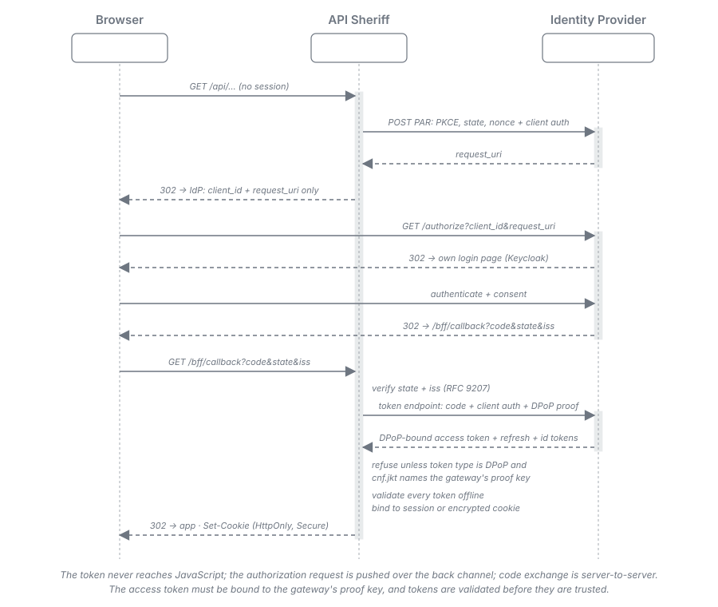
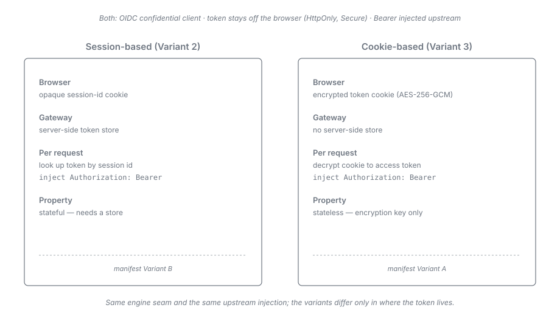

= Variant 2 -- BFF, Session-based
:toc: left
:toclevels: 3
:toc-title: Table of Contents
:sectnums:
:source-highlighter: highlight.js

== Summary

API Sheriff acts as an *OIDC confidential client* for a browser SPA. It runs the login, holds the
tokens in a *server-side store*, and gives the browser only an opaque *session cookie*. On each API
call it resolves the cookie to the stored session and injects the access token upstream as
`Authorization: Bearer`.

The variant is *stateful* -- it needs a session store -- and gives the strongest token isolation: the
token never leaves the server, not even encrypted. Select it with `oidc.session.mode: server`; the
key has no default. The link:03-bff-cookie.adoc[cookie-based variant] is the stateless alternative.

NOTE: This is the *stateful BFF* shape of `CLIENT-19`. The authoritative specification and the
`token-sheriff-client` engine seam are stated in
link:../architecture/authentication-and-bff.adoc#_authentication_layer[Architecture -- Authentication Layer].

*Operator guides.* Setting this variant up step by step is in
link:../user/bff-session.adoc[BFF -- session mode]. What both BFF modes share -- the login handshake,
pushed authorization requests, DPoP binding, client authentication and key material -- is in
link:../user/bff-oidc-common.adoc[BFF -- OIDC client common to both modes]. This page is the
posture datasheet.

== Login Flow

The login is shared with the cookie-based variant up to the final binding step. The gateway pushes
the authorization request to the identity provider (PAR), sends the browser there with `client_id`
and `request_uri` only, exchanges the code server-to-server with its client credential and a DPoP
proof, validates the tokens offline and -- in this variant -- *stores them server-side* and sets the
opaque session cookie. A login in a browser that still presents a session ends that session first.
An identity provider without a pushed-authorization-request endpoint cannot serve this variant: the
login is refused with `502`, and there is no front-channel fallback.

== Client Authentication, Pushed Requests and Token Binding

Fixed by
link:../adr/0058-The_BFF_pushes_every_authorization_request_and_binds_its_tokens_with_DPoP_and_authenticates_with_private_key_jwt_unless_a_client_secret_is_configured.adoc[ADR-0058]
and identical in both BFF variants:

* every authorization request is pushed;
* every access token is bound to the gateway's DPoP key (`cnf.jkt`), and an unbound token response is
  refused;
* the gateway authenticates with `private_key_jwt` unless `oidc.client_secret` is configured.

The binding ends at the gateway: the token injected upstream travels as `Authorization: Bearer`
without a proof, so an upstream must not check `cnf`.

[WARNING]
====
Client-secret authentication is not FAPI 2.0 conformant and may weaken security. The gateway logs
`WARN` `ApiSheriff-133` at every boot while it is configured.
====

Key files, generated keys and client registration are in
link:../user/bff-oidc-common.adoc[the common BFF guide]; the requirement-by-requirement position is in
link:../fapi_status.adoc[FAPI 2.0 Status].

== Steady-State API Call

An API call carries only the session cookie. The gateway:

. resolves the cookie's opaque handle to the stored session -- a session past its absolute lifetime
  or idle timeout resolves to nothing (see <<_session_lifetime>>);
. refreshes the access token when it is near expiry (see <<_transparent_token_refresh>>);
. compares the session's scopes with the route's `needed` set and obtains what is missing or refuses
  (see <<_scope_enforcement>>);
. injects `Authorization: Bearer <token>` last, so it wins over any inbound `Authorization`, and
  forwards under the same link:01-base-gateway.adoc[base-gateway] filtering and per-route
  link:../configuration/routing-and-forwarding.adoc#_forward[forward policy].

The session cookie is a gateway-owned cookie and reaches no upstream under any policy. The
browser's other cookies cross only as the route's
link:../configuration/routing-and-forwarding.adoc#_cookies[`cookies`] block admits them -- under the
default `allow: none` not at all. A route resolving `auth.token_relay: false` still requires the
session and its scopes but sends no `Authorization` upstream.

The left-hand column is this variant: the cookie carries a handle the store resolves.

== Token Storage

[cols="1,3"]
|===
| Aspect | Posture

| Store
| Server-side, keyed by an internal session identity; holds the access, refresh and ID tokens and
  their metadata, indexed by `sid`/`sub` so a back-channel logout finds its session without a scan.
  `oidc.session.store: memory` is the only option: one node, or replicas behind sticky sessions
  (link:../user/bff-session.adoc#multi-replica[Running more than one replica]). A shared store is
  deliberately unsupported -- it would add the external dependency the
  link:../features-analysis.adoc#_features_to_avoid[feature analysis] rules out.

| Bounds
| `oidc.session.max_sessions` bounds the store; `oidc.session.max_sessions_per_subject` bounds one
  subject, ending its oldest session first. See
  link:../configuration/authentication-and-oidc.adoc#_oidc[the configuration reference].

| Session cookie
| `HttpOnly`, `Secure`, `SameSite=Lax`, `__Host-` prefix; carries only an opaque handle, never token
  material. A scope widening replaces the handle while the session stays the same
  (link:../adr/0018-BFF_session_mode_is_one_SessionBinding_seam_behind_a_fixed_reserved-path_and_CSRF_model.adoc#cookie-reissue[ADR-0018]).
|===

[[_session_lifetime]]
== Session Lifetime

A session ends at the earlier of two deadlines:

* *Absolute* -- `oidc.session.ttl_seconds` from the login; nothing extends it.
* *Idle* -- `oidc.session.idle_timeout_seconds` without a request the gateway let through on a
  session route.

An expired session is removed when its cookie is next presented, or by a once-a-minute sweep. A
WebSocket relayed on a session route is closed whenever its session ends -- expiry, logout,
replacement by a new login, the per-subject bound, the sweep. Streamed HTTP and gRPC responses are
not ended. See link:../user/bff-session.adoc#session-lifetime[How long a session lives].

[[_csrf_defence]]
== CSRF Defence

Per `CLIENT-19`, backend-API CSRF is the BFF's concern (the callback itself is protected by the
session-bound `state`, `CLIENT-5`). Every `auth.require: session` route verifies the origin of unsafe
methods (everything except GET/HEAD/OPTIONS):

* The `Origin` header must be in `oidc.session.csrf.trusted_origins` -- the origins the application
  is served from, defaulting to the origin of `oidc.redirect_uri`. `Origin` names the *calling
  page*, so an SPA on `https://app.example.com` calling a gateway on `https://gw.example.com` needs
  `https://app.example.com` listed (see
  link:../configuration/authentication-and-oidc.adoc#_oidc[`session.csrf.trusted_origins`]). The
  comparison is exact: scheme, host and port.
* Without `Origin`, `Sec-Fetch-Site: same-origin` is accepted. Anything else -- an untrusted
  `Origin`, `Sec-Fetch-Site: cross-site`, or neither header -- is rejected with a `CSRF_REJECTED`
  event. The check runs before the session is resolved, so the caller gets the unrouted `404`
  (link:../adr/0073-Untrusted_callers_get_the_unrouted_404_for_every_rejection_raised_before_the_trust_boundary.adoc[ADR-0073]);
  with `security_defaults.uniform_not_found: false` it gets `403`.
* The session cookie's `SameSite=Lax` is defence in depth; origin verification is the enforced
  check.

This is fixed behaviour with no switch to disable it.

A route that forwards the browser's own application cookies through a `cookies` block adds a
per-route same-origin check, trusting the receiving origin plus the block's `additional_origins`
(see link:../configuration/routing-and-forwarding.adoc#_cookies_same_origin_check[The same-origin check]).

NOTE: `trusted_origins` governs what the gateway accepts. An SPA on a different origin also needs
`security_headers.cors` enabled with `allow_credentials: true`, and works only from a *same-site*
origin (same registrable domain): the cookie is `SameSite=Lax`, so a cross-site SPA never gets it
attached. Same-origin deployments need neither.

[[_logout]]
== Logout

* *RP-initiated* (`oidc.logout.path`, `CLIENT-13`). The gateway destroys the stored session and
  expires the cookie *first*, then redirects to the IdP's end-session endpoint with `id_token_hint`
  and a session-bound `state` verified on the return leg. The local logout does not depend on the
  IdP: without a usable end-session endpoint the browser lands on `oidc.logout.final_redirect`
  (`ApiSheriff-135`).
* *What RP-initiated logout revokes.* After destroying the session and before building the
  redirect, the gateway revokes the session's refresh token at the IdP (RFC 7009) -- the one the
  store held when the session was destroyed, so a refresh that rotated it just before is covered; a
  failure never stops the logout, and the first one per runtime is reported as `ApiSheriff-146`. The
  access token is not revoked and
  stays valid at a resource server until it expires. A session without a refresh token, an IdP
  without a `revocation_endpoint`, or a session something else ended just before the logout destroyed
  it gets no revocation request
  (link:../adr/0080-RP-initiated_logout_revokes_the_sessions_refresh_token_at_the_identity_provider_before_the_end-session_redirect.adoc[ADR-0080]).
* *Back-channel* (`oidc.logout.backchannel_path`). A signed logout token from the IdP destroys the
  matching session; a token acts once. Because the session is held server-side, the termination is
  *immediately effective* -- an advantage over the link:03-bff-cookie.adoc[cookie-based variant].
  This path revokes no token: the IdP initiated the logout and has already ended its own session.
  What the IdP must send is in link:../user/bff-session.adoc#backchannel-logout[the operator guide].
* *Logout wins over in-flight work.* A refresh or scope widening running when the session is
  destroyed does not write it back: the refresh is answered as session-ended and revokes the refresh
  token it just obtained (`ApiSheriff-111`, `session-terminated`); the widening callback answers
  `403` (`ApiSheriff-131`)
  (link:../adr/0018-BFF_session_mode_is_one_SessionBinding_seam_behind_a_fixed_reserved-path_and_CSRF_model.adoc#updating-write[ADR-0018]).

[[_transparent_token_refresh]]
== Transparent Token Refresh

Near expiry, the gateway refreshes the access token with rotation during a normal request, asking
for the session's active scope set. A refused refresh keeps the session when the IdP never processed
the grant, and ends it when the IdP rejected the refresh token or the gateway refused the response.
How a request left without a token is answered is set by `oidc.session.refresh.on_failure` (see
link:../configuration/authentication-and-oidc.adoc#_refresh_failure_dispositions[the per-kind table]).

*Refresh-token reuse detection is the IdP's job.* The gateway keeps no token family; in this variant
the refresh token never leaves the store. A token stolen elsewhere is caught only by *strict rotation
at the IdP*, and only once it is reused (ADR-0046).

[[_scope_enforcement]]
== Scope Enforcement

On every request a session route compares the session's active scopes with the route's `needed`
set, whatever `auth.token_relay` says
(link:../adr/0057-Session_routes_obtain_their_declared_scopes_by_refreshing_inside_the_grant_and_widening_the_live_session_outside_it.adoc[ADR-0057]).
A missing scope the IdP already granted is requested by a refresh. One outside the grant, or one the
refresh did not obtain, *widens* the live session: a navigation is redirected to the IdP and the grant is merged into the same session;
any other request is refused `403` naming the `missing_scopes`. An IdP refusal on the callback ends
in a terminal `403` with the session unchanged and still usable where it suffices. Behaviour, problem body and the `oidc.step_up.path` contract are in
link:../user/bff-session.adoc#scope-enforcement[the operator guide].

CAUTION: Enforcement closes the under-check, not the over-reach. A widening adds scopes to a live
session, and every scope a session holds is relayed to every session-route upstream that receives a
token. An API client cannot recover from the `403` by retrying: widening needs a browser navigation.

== Step-Up Authentication (RFC 9470)

Handling an upstream `401` carrying `insufficient_user_authentication` -- a silent refresh first,
otherwise a login re-driven with the required `acr_values` / `max_age` / `scope`, then a replay of the
request -- is assembled but *not wired*: no request path calls it, so the gateway relays that `401` to
the client like any other upstream response and starts no elevated login (see
link:../fapi_status.adoc[FAPI 2.0 status]). It would answer a demand for stronger *authentication*;
scope enforcement above obtains *scopes* the route declares.

== User-Info Endpoint

`oidc.user_info.path` serves the browser a curated identity view assembled from the session -- never
the raw claims, never token material. `oidc.user_info.allowed_claims` is the disclosure ceiling and
is empty by default, so nothing is disclosed until the operator lists claims;
`oidc.user_info.default_view` must lie within it or the boot fails.

== Configuration

[source,yaml]
----
# gateway.yaml
oidc:
  issuer: https://idp.example.com/realms/main
  client_id: api-sheriff
  client_authentication:         # private_key_jwt, the default; no client_secret is declared
    key_file: /etc/sheriff/keys/client-auth.pem   # optional: omit to generate a key on startup
  sender_constraint:             # DPoP proof key; every access token is bound to it
    key_file: /etc/sheriff/keys/dpop.pem          # optional: omit to generate a key on startup
  redirect_uri: https://gw.example.com/bff/callback
  scopes: [openid, profile]      # requested on every login; endpoints add their own (additive)
  login:
    path: /bff/login             # gateway-owned login-initiation entry point (reserved path)
  user_info:
    path: /bff/session           # curated identity view (reserved path)
    allowed_claims: [sub, name, email]   # disclosure ceiling; empty (default) discloses nothing
    default_view: [sub, name]    # returned when no explicit claims requested; subset of allowed_claims
  session:
    mode: server                 # server-side token store (this variant)
    store: memory                # the only initial option (single-node / sticky sessions)
    max_sessions: 10000          # DoS guard: upper bound on concurrently stored sessions
    cookie_name: __Host-sheriff
    ttl_seconds: 3600            # absolute lifetime from login
    idle_timeout_seconds: 1800   # ends a session nobody uses (the default)
    refresh: { enabled: true, leeway_seconds: 30, on_failure: reauthenticate }
----

[source,yaml]
----
# endpoints/app1.yaml           (base_url APP1 lives in topology.properties)
endpoint:
  id: app1
  base_url: APP1
  auth: { require: session }     # default for all routes here; add token_relay: false to
                                 #   require the login without relaying the token upstream
  scopes: [orders.read]          # a login for these routes requests oidc.scopes ∪ [orders.read];
                                 #   a live session is compared against that set on every
                                 #   request, then refreshed within its granted set, widened,
                                 #   or refused 403
  routes:
    - id: orders-api
      match: { path_prefix: /api/orders }
      # No forward block: every client header and query parameter crosses, bounded by the
      # gateway-owned never-forward set. No cookies block either: allow: none, so no browser
      # cookie reaches the backend -- and the session cookie never does, under any cookies
      # block. The mediated "Authorization: Bearer" is injected automatically on session
      # routes, last, so it wins. Declare headers_deny / query_deny (or a positive-list) only
      # to narrow this.
      upstream: { path: /orders }
----

== Security Posture

[cols="1,3"]
|===
| Property | Variant 2

| State | Stateful -- a server-side token store (`memory`; one node or sticky sessions).
| Token custody | The token never leaves the server in any form; the browser holds an opaque handle.
| Revocation | Immediate: logout and back-channel logout destroy the stored session; RP-initiated logout also revokes the session's refresh token at the IdP, never the access token.
| OIDC client | Confidential client: pushed requests, DPoP-bound tokens, key-based client authentication unless a client secret is configured.
| CSRF | Fixed origin verification on unsafe methods (<<_csrf_defence>>).
|===

== Performance baseline

The shared measurement contract, the load parameters and the regression thresholds are stated once
in link:README.adoc#benchmark-baselines[Deployment Variants -- Benchmark baselines]. This section
records only what is specific to Variant 2.

*Read this variant as a delta from link:01-base-gateway.adoc#_performance_baseline[Variant 1], not
in isolation.* The filter, routing, forward and observability stages are shared and unchanged; what
this variant adds on the steady-state path is a *session-store lookup* in place of the client's own
bearer token.

The two costs to keep separate:

[cols="1,3", options="header"]
|===
| Path | What dominates

| *Login handshake* | The OIDC authorization-code exchange -- network round trips to the identity provider. It happens *once per session*, so amortising it into a per-request figure misrepresents both numbers. Measure and report it separately.
| *Steady-state API call* | The session cookie read and validated, then the store lookup its handle keys, then the mediated `Authorization: Bearer` injection, then the shared forward path. This is the figure that belongs next to Variant 1's `bearer` aspect.
|===

What to watch on this variant specifically:

* *The store lookup is the variant's dominant overhead* on the steady-state path, but not the only
  one: the cookie read and resolution in front of it are paid on every request too. With
  `session.store: memory` the lookup is in-process, so the delta from Variant 1 should be small.
* *`max_sessions` is a DoS guard, and it interacts with load testing.* A benchmark that starts
  refusing sessions is measuring the guard, not the gateway. Expired sessions leave the store within
  a minute, but a ceiling full of *live* sessions refuses fail-closed, and virtual users that share
  one subject meet `max_sessions_per_subject` first. Restart the gateway between runs to start from
  an empty store.
* *Refresh is a background cost.* With `refresh.enabled: true`, a long run crosses token expiry and
  pays a refresh round trip mid-measurement. On a 60s load phase against a typical token lifetime
  this does not trigger -- but it is the first thing to suspect in a longer run that shows an
  unexplained latency tail.
