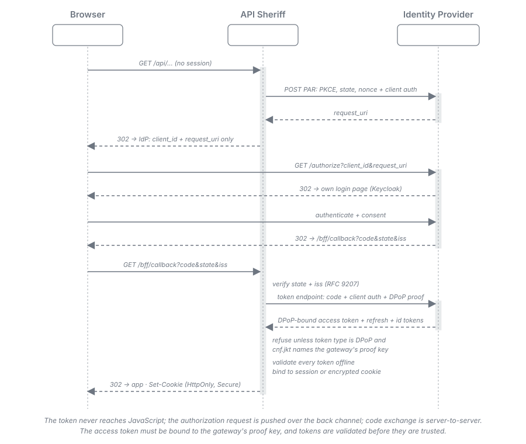
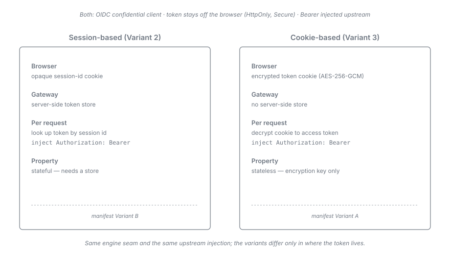

= Variant 3 -- BFF, Cookie-based (non-session)
:toc: left
:toclevels: 3
:toc-title: Table of Contents
:sectnums:
:source-highlighter: highlight.js

== Summary

The cookie-based Backend-For-Frontend variant is the *stateless* counterpart of the
link:02-bff-session.adoc[session-based variant]. API Sheriff is the same OIDC confidential client,
but instead of a server-side store it *seals the tokens (AES-256-GCM) into an `HttpOnly` cookie* and
unseals them per request. All gateway instances share only key material: the sealing-key file and
the two signing-key files (see <<client-controls,the client controls below>>).

Cookie mode is implemented. Select it with `oidc.session.mode: cookie`; the key has no default, so a
deployment declares `cookie` or `server`. This is the *token-mediating backend* shape, chosen where
the gateway's stateless, self-contained posture matters more than immediate revocation.

NOTE: This is the *stateless BFF* shape of `CLIENT-19` (tokens returned to the browser only inside
an `HttpOnly` cookie encrypted with a server-side key). The authoritative specification and the
`token-sheriff-client` engine seam are stated in
link:../architecture/authentication-and-bff.adoc#_authentication_layer[Architecture -- Authentication Layer].

*Operator guides.* Setting this variant up step by step is in
link:../user/bff-cookie.adoc[BFF -- cookie mode]. What both BFF modes share -- the login handshake,
pushed authorization requests, DPoP binding, client authentication and key material -- is in
link:../user/bff-oidc-common.adoc[BFF -- OIDC client common to both modes]. This page is the
posture datasheet.

== Login Flow

The login is identical to the link:02-bff-session.adoc[session-based variant] up to the final
binding step: pushed authorization request, code exchange with the client credential and a DPoP
proof, offline token validation -- then, in this variant, the tokens are *sealed into the session
cookie* instead of stored.

[[client-controls]]
== Client Authentication, Pushed Requests and Token Binding

Identical to the session-based variant and fixed by
link:../adr/0058-The_BFF_pushes_every_authorization_request_and_binds_its_tokens_with_DPoP_and_authenticates_with_private_key_jwt_unless_a_client_secret_is_configured.adoc[ADR-0058]:
every authorization request is pushed, every access token is bound to the gateway's DPoP key, and
the gateway authenticates with `private_key_jwt` unless `oidc.client_secret` is configured. The
token injected upstream travels as `Authorization: Bearer` without a proof.

*Every replica needs the same key files.* This variant exists to run several replicas without a
shared store, so the two signing keys join the sealing key as shared material. A generated key lives
in one process and fits a single replica only: with per-replica client-authentication keys the IdP
fails authentication on all but one replica, and with per-replica proof keys a refresh on another
replica presents a proof the tokens are not bound to. The two signing keys must be two different
files; one key for both purposes is refused at boot. With `oidc.client_secret` there is no
client-authentication key: replicas share the secret, the sealing key and the proof key, and a
`client_authentication.key_file` declared beside the secret is refused at boot.

[WARNING]
====
Client-secret authentication is not FAPI 2.0 conformant and may weaken security. The gateway logs
`WARN` `ApiSheriff-133` at every boot while it is configured.
====

Key files, generated keys and client registration are in
link:../user/bff-oidc-common.adoc[the common BFF guide] and
link:../user/bff-cookie.adoc#_key_material[the cookie-mode guide]; the requirement-by-requirement
position is in link:../fapi_status.adoc[FAPI 2.0 Status].

== Steady-State API Call

An API call carries the sealed token cookie. The gateway:

. unseals the cookie to recover the tokens -- no store lookup; a session past its absolute lifetime
  or idle timeout is no session (see <<_session_lifetime>>);
. refreshes a near-expiry token and re-seals the cookie;
. injects `Authorization: Bearer <token>` last, so it wins over any inbound `Authorization`, and
  forwards under the same link:01-base-gateway.adoc[base-gateway] filtering and per-route
  link:../configuration/routing-and-forwarding.adoc#_forward[forward policy].

The sealed cookie and the activity cookie are gateway-owned and reach no upstream under any policy.
The browser's other cookies cross only as the route's
link:../configuration/routing-and-forwarding.adoc#_cookies[`cookies`] block admits them -- under the
default `allow: none` not at all.

The right-hand column is this variant: the token lives only inside the sealed cookie, and the
gateway holds no per-user state.

== Cookie Design

[cols="1,3"]
|===
| Aspect | Posture

| Encryption
| AES-256-GCM over the packed, deflated token set (access, refresh and ID token plus minimal
  metadata, including the session's active and granted scope sets). A tampered cookie fails
  authentication and is rejected. Compress-then-encrypt is safe in this construction for reasons
  that do not generalise
  (link:../adr/0043-Compress-then-encrypt_in_the_sealed_session_cookie_and_the_CRIME_BREACH_discriminator.adoc[ADR-0043]).

| Cookie attributes
| `HttpOnly`, `Secure`, `SameSite=Lax`, `__Host-` prefix. Script cannot *read* the token, but an XSS
  payload on the page can still *issue* authenticated requests, and a stolen cookie can be replayed
  until it expires.

| Sealing key
| One symmetric key from the optional `session.key_file`
  (link:../adr/0072-The_cookie_sealing_key_is_read_from_a_base64_key_file_the_gateway_configuration_names_by_path.adoc[ADR-0072]).
  Declared, the same file on every instance lets sessions survive restarts and move between
  replicas; omitted, a key is minted at boot and sessions end at every restart. There is no
  rotation window: replacing the key ends every session sealed under the old one. See
  link:../user/bff-cookie.adoc#_key_material[the operator guide].

| Size
| A seal-time budget, 4019 bytes by default: an over-budget seal *fails* rather than being
  truncated. Splitting the token set across cookies is a deliberate non-goal. See
  link:../user/bff-cookie.adoc#_cookie_size_budget[Cookie size budget].

| Format version
| Bound into the cookie's authenticated data; a cookie of any other version is refused as no
  session. A version change forces one re-login per user at deploy, with no backward-compatible
  reader
  (link:../user/bff-cookie.adoc#_upgrading_forced_re_login_on_a_format_change[the operator guide]).

| Activity cookie
| `<session cookie name>-activity`, with the same attributes: the time of the last request,
  authenticated under its own key and bound to its session, no token. The idle timeout rests on it.
|===

[[_session_lifetime]]
== Session Lifetime

A session ends at the earlier of two deadlines, as in the
link:02-bff-session.adoc#_session_lifetime[session-based variant]:

* *Absolute* -- `oidc.session.ttl_seconds` from the login instant sealed into the cookie; every
  re-seal carries the same deadline.
* *Idle* -- `oidc.session.idle_timeout_seconds` without a request the gateway let through on a
  session route, measured from the activity cookie. The cookie is rewritten once the recorded access
  is 60 seconds old (or half the idle timeout, if shorter), so the deadline is exact to within that
  interval.

The activity cookie can only shorten a session: one that is missing, unreadable or bound to another
session is ignored, and the idle timeout is measured from the login
(link:../adr/0018-BFF_session_mode_is_one_SessionBinding_seam_behind_a_fixed_reserved-path_and_CSRF_model.adoc#idle-deadline[ADR-0018]).

A WebSocket relayed on a session route is closed at the session's absolute expiry only; a logout or
the idle timeout closes no open WebSocket in this variant.

== Statelessness

* No session store, no Redis, no database.
* Any instance with the same sealing-key file and the same two signing-key files serves any request
  *of an established session* -- no sticky sessions, no coordination. The login leg is the exception
  (see <<_stateless_after_login_not_during_it,Stateless after login, not during it>>).
* A node can be added or removed with no session migration.

[[_transparent_refresh_and_step_up]]
== Transparent Refresh and Step-Up

Refresh, refresh-failure dispositions and RFC 9470 step-up work as in the
link:02-bff-session.adoc#_transparent_token_refresh[session-based variant], except that the
refreshed tokens are re-sealed into a *new cookie* (`Set-Cookie`) rather than written to a store.
Scope enforcement works as there too
(link:02-bff-session.adoc#_scope_enforcement[Scope Enforcement]), with two differences that follow
from the session being the cookie:

* *A pre-widening cookie stays usable.* A widening re-seals a new cookie, but the cookie sealed
  before it still unseals at its earlier scope level until the absolute lifetime -- nothing the
  gateway holds could withdraw it.
* A request whose near-expiry refresh just re-sealed the session is widened or refused rather than
  refreshed again; the next request, carrying the new cookie, refreshes normally.

*Concurrent refresh is an accepted trade-off.* Two parallel requests with the same cookie can
present the same refresh token. Under strict rotation (enabled in the shipped realms) the IdP reads
the second as reuse and refuses it -- Keycloak also revokes the successor -- so the session ends
(`ApiSheriff-111`, `credential-rejected`). Each instance single-flights refreshes per session; across
instances the race cannot be prevented without shared state. IdP-side reuse tolerance avoids the
forced re-login but blunts rotation's theft-detection signal (RFC 9700 §4.14). The gateway detects
no reuse itself (ADR-0046).

*A retained ended cookie is refused locally.* When a refresh ends a cookie-mode session, the
gateway marks the presented refresh token (a salted digest, never the token) until the session's
absolute lifetime, so a client replaying the cookie gets the session-ended answer with no IdP call
and no further link:../LogMessages.adoc#apisheriff-111[`ApiSheriff-111`] record. The marker store is
per instance, in memory and bounded: when it is full of unexpired markers a token is not recorded,
and its replays cost one IdP call each, as without the guard. RP-initiated logout does not set it.

The refresh token's share of the cookie budget is measured: the three-token session seals to at most
2580 of 4019 bytes in the integration suite (see
link:../user/bff-cookie.adoc#_cookie_size_budget[the cookie-BFF operator guide]).

== Logout

* *RP-initiated* (`oidc.logout.path`). Works as in the
  link:02-bff-session.adoc[session-based variant]: the session cookie and the activity cookie are
  expired first, then the browser is redirected to the IdP's end-session endpoint with a
  session-bound `state` (carried in the short-lived logout cookie, see
  link:../configuration/authentication-and-oidc.adoc#_oidc[`logout.path`]). Before that redirect the
  gateway revokes at the IdP (RFC 7009) the refresh token sealed in the cookie the logout request
  presents; a failure never stops the logout, and the first one per runtime is reported as
  `ApiSheriff-147`. The access token is not revoked and stays valid at a resource server until it
  expires; a session without a refresh token, or an IdP without a `revocation_endpoint`, gets no
  revocation request
  (link:../adr/0080-RP-initiated_logout_revokes_the_sessions_refresh_token_at_the_identity_provider_before_the_end-session_redirect.adoc[ADR-0080]).
  Once the revocation succeeded, a copy of the logged-out cookie stops working at its next
  transparent refresh, which the revoked refresh token fails; until then it still carries a usable
  access token.
* *Back-channel is disabled.* With no server-side session there is nothing a logout token could
  destroy, so in `mode: cookie` `backchannel_path` answers `404`. An IdP-side session termination
  takes effect at the next transparent refresh, when the revoked refresh token fails. Until then,
  issued cookies stay valid -- immediate termination cannot be guaranteed.
* *A logout cannot stop a response already in flight.* A refresh or widening callback running when
  the browser logs out still answers with a re-sealed cookie; if it arrives after the logout
  response, the browser again holds a valid session, until `ttl_seconds` at the latest
  (link:../adr/0018-BFF_session_mode_is_one_SessionBinding_seam_behind_a_fixed_reserved-path_and_CSRF_model.adoc#updating-write[ADR-0018]).
  The revocation of the presented refresh token shrinks that window but does not close it: a cookie
  re-sealed with the revoked token ends at its next transparent refresh, but a refresh whose
  rotation already ran, or a widening, seals a refresh token the logout never saw.

Mitigate with a short `ttl_seconds` and short access-token lifetimes; where a logout has to be final
at once, choose the link:02-bff-session.adoc[session-based variant].

== CSRF Defence

Identical to the link:02-bff-session.adoc#_csrf_defence[session-based variant]: `Origin`
verification against `session.csrf.trusted_origins` on unsafe methods plus a `SameSite=Lax`
cookie, fixed behaviour on every `auth.require: session` route. A route that forwards the browser's
own application cookies carries the separate per-route same-origin check of the `cookies` block as
well (see link:../configuration/routing-and-forwarding.adoc#_cookies_same_origin_check[The same-origin check]).

== Configuration

[source,yaml]
----
# gateway.yaml
oidc:
  issuer: https://idp.example.com/realms/main
  client_id: api-sheriff
  client_authentication:         # private_key_jwt, the default; no client_secret is declared
    key_file: /etc/sheriff/keys/client-auth.pem   # the same file on every replica
  sender_constraint:             # DPoP proof key; every access token is bound to it
    key_file: /etc/sheriff/keys/dpop.pem          # the same file on every replica
  redirect_uri: https://gw.example.com/bff/callback
  scopes: [openid, profile]      # requested on every login; endpoints add their own (additive)
  session:
    mode: cookie                # encrypted cookie, no store (this variant)
    cookie_name: __Host-sheriff
    key_file: /run/secrets/session.key   # sealing-key file; optional -- omit to generate on startup
    ttl_seconds: 3600            # absolute lifetime from login
    idle_timeout_seconds: 1800   # ends a session nobody uses (the default)
    refresh: { enabled: true, leeway_seconds: 30, on_failure: reauthenticate }
----

[source,yaml]
----
# endpoints/app1.yaml           (base_url APP1 lives in topology.properties)
endpoint:
  id: app1
  base_url: APP1
  auth: { require: session }     # default for all routes here; add token_relay: false to
                                 #   require the login without relaying the token upstream
  scopes: [orders.read]          # a login for these routes requests oidc.scopes ∪ [orders.read];
                                 #   a live session is compared against that set on every
                                 #   request, then refreshed within its granted set, widened,
                                 #   or refused 403
  routes:
    - id: orders-api
      match: { path_prefix: /api/orders }
      # No forward block: every client header and query parameter crosses, bounded by the
      # gateway-owned never-forward set. No cookies block either: allow: none, so no browser
      # cookie reaches the backend -- and the sealed token cookie never does, under any
      # cookies block. The mediated "Authorization: Bearer" is injected automatically on
      # session routes, last, so it wins. Declare headers_deny / query_deny (or a
      # positive-list) only to narrow this.
      upstream: { path: /orders }
----

The only material difference from the link:02-bff-session.adoc[session-based] configuration is
`session.mode: cookie` and its sealing-key file. The two signing-key `key_file` entries are optional
in both variants; they are written out here because a deployment with more than one replica must
provide them, and they name two different files. `openssl rand -base64 32 > session.key` creates a
sealing-key file; the file is read at startup only, so a replaced key takes effect per replica on
restart. Validation rules are in
link:../configuration/authentication-and-oidc.adoc#_oidc[the configuration reference].

== Security Posture

[cols="1,3"]
|===
| Property | Variant 3

| State | Stateless after login -- the sealed cookie carries the session; the login and widening legs need affinity.
| Token custody | Tokens leave the server only sealed in an `HttpOnly` cookie; script cannot read them, but XSS on the page can still drive requests -- hence the fixed CSRF defence and short token lifetimes.
| Shared material | The sealing-key file and the two signing-key files (with a client secret: the secret and the proof-key file).
| Revocation | Not immediate: no back-channel logout; an ended IdP session takes effect at the next refresh. RP-initiated logout revokes the presented refresh token at the IdP, never the access token, so a retained cookie ends at its next refresh.
| OIDC client | Confidential client: pushed requests, DPoP-bound tokens, key-based client authentication unless a client secret is configured.
|===

[#_stateless_after_login_not_during_it]
=== Stateless after login, not during it

The pending authorization -- the state held between the login redirect and the callback -- lives in
memory on one instance and is never shared. A login *begun* on one instance must *complete* there; a
callback landing on another replica finds no pending authorization and the login fails. A session
*widening* keeps its pending authorization the same way, so its redirect and callback -- an
interactive retry included -- must stay on one replica too.

An *established* session is portable: any replica with the same key material unseals the cookie.
The cookie-statelessness integration test logs in against the first instance only, then drives the
second instance with the resulting cookie.

*Deployment consequence*: session affinity is required for the *login leg* and for each
*widening*, from the redirect to the callback. Every other request may be balanced freely.

== Performance baseline

The shared measurement contract, the load parameters and the regression thresholds are stated once
in link:README.adoc#benchmark-baselines[Deployment Variants -- Benchmark baselines]. This section
records only what is specific to Variant 3.

*Read this variant as a delta from link:01-base-gateway.adoc#_performance_baseline[Variant 1], and
against link:02-bff-session.adoc#_performance_baseline[Variant 2].* The three-way comparison is the
point: Variant 2 and Variant 3 run the *same login handshake* and differ only in where the token
lives, so their steady-state delta isolates *store lookup versus cookie unseal* and nothing else.

The defining cost of this variant:

* *Per-request AES-256-GCM decryption.* Variant 2 pays a store lookup once per request; Variant 3
  pays a cookie *unseal* once per request. That is the trade the variant exists to make -- CPU in
  place of state -- and the steady-state delta between the two variants is exactly its price.
* *The cost scales with cookie size, not with session count.* Variant 2's lookup cost is a function
  of how many sessions exist; Variant 3's unseal cost is a function of how large the sealed payload
  is. A benchmark that grows the session population stresses Variant 2 and leaves Variant 3 flat.
* *Login is not portable; steady state is.* Only the login and widening legs need session affinity. Because a
  benchmark's virtual users typically log in against one instance and then drive requests, a
  multi-replica run that balances the *login* leg will produce failures that look like performance
  faults and are actually affinity faults.

[NOTE]
====
*Do not read a cookie-format version change as a regression.* Changing the sealed-cookie format
invalidates existing sessions, so the first run after such a deploy re-executes the login handshake
for every user. That is a one-off re-authentication cost, not a change in steady-state throughput.
====
